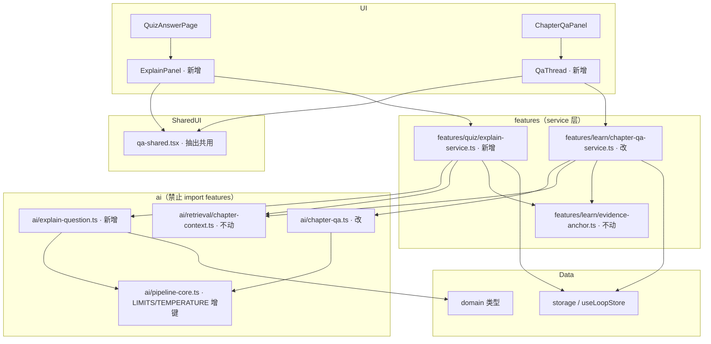
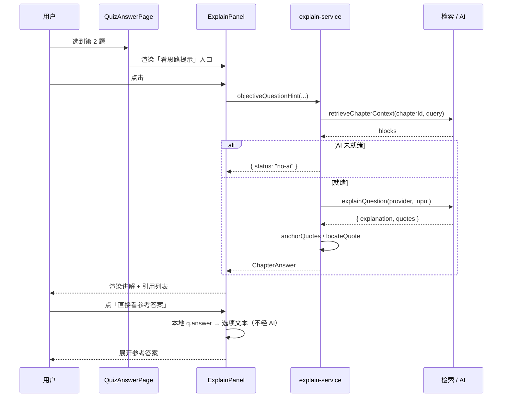

# AI 即时反馈层（答题即时解释 · 章内追问线程）技术方案

| 字段 | 内容 |
|------|------|
| 作者 | Agent |
| 日期 | 2026-10-21 |
| 状态 | **已实施**（D1–D8 全部取推荐档，2026-10-21 用户确认「按推荐档实施」） |
| 关联需求 | `docs/ai-native-learning-benchmark-2026-10.md` §6 的 P0-A / P0-B（该处两条定义已按本方案 §1.2 修订） |
| 实施记录 | `docs/ai-immediate-explain-runbook-2026-10.md`（T0–T12 全部 done） |

---

## 1. 背景

### 1.1 触发原因

`docs/ai-native-learning-benchmark-2026-10.md` 对 10 个 AI native 学习产品做了横评，提炼出最可移植的一条范式：

> **P4「出错 / 卡住的瞬间」是唯一高价值的 AI 触发点。**
> Duolingo Max 的 Explain My Answer、Khanmigo 的练习内 hint，都长在做题流里而非独立聊天页。

据此落到 PLOS 的优先级列出两条 P0：

- **P0-A**：把 AI 解释带进作答流
- **P0-B**：`chapter-qa` 从「你说我答」变成「先诊断再讲解」

本方案负责把这两条展开为可实施的工程方案。

### 1.2 ⚠️ 对调研稿两处定义的技术修正（务必先读）

调研阶段是基于公开资料的行为推断；本次读源码后，**这两条定义都不能原样实施**，必须修正。**修正不是推翻结论，而是把落点改到能落地的位置。**

#### 修正一：P0-A 不是「把已有批语前移」，而是「分层新建 + 复用」

调研稿原文写的是「把已有批语前移到作答流（复用既有数据，不新增写方）」。读源码后这条不成立，三条证据：

| # | 事实 | 出处（实测） |
|---|---|---|
| 1 | **主观题 AI 批语只能在判卷时产生**：`gradeSubjectiveWithAi` 的调用点是判卷页 `run()`，输入是「整份已作答的主观题」。用户在答第 1 题时，系统还没拿到后面任何一题的作答，**不可能预生成批语** | `src/features/quiz/QuizGradingPage.tsx:136-157`（`subjectiveQs.filter(...)` → `gradeSubjectiveWithAi`） |
| 2 | **客观题根本没有解释数据**：`PaperQuestion` 只有 `answer`（正确项索引）用于比对，`wrongQuestions` 只带 `yourAnswer`。全仓 search `feedback` 的 AI 产出仅有 `SubjectiveGradeFeed.feedback` 一条路径 | `src/domain/quiz.ts:27-43`、`src/engine/quiz-engine.ts:704-712` |
| 3 | 反过来看，真正被浪费的是另一件事：**客观题的对错，本地就能算**——`gradePaper` 是纯函数（`paper`+`answers` → `questions[].correct`），作答页**零 AI、零成本**即可知道这题对没对。这说明缺的不是搬运，而是「解释」本身 | `src/engine/quiz-engine.ts:565-633` |

所以「把批语前移」这条路走不通：主观批语此刻还不存在，而客观题缺的从来不是批语，是**解释**。正确形态是按数据源分层的三层解释——见 §4.1。

#### 修正二：P0-B 不是「默认先抛诊断句」，而是「掌握度驱动的自适应档位 + 追问线程」

调研稿写的是「`chapter-qa` 默认先抛一句诊断问题再作答」。两个问题：

1. **与既有功能重叠**：右栏第 5 区「讲给我听」（费曼式复述，`checkRestatement`）已经是「用户先输出 → AI 对照原文给差距」的苏格拉底式实现。再给 `chapter-qa` 加一层「用户先说」，是同一个模式做两遍。
2. **读源码后发现的真实缺口不是「没有诊断句」，而是「没有上下文」**：`askChapter` 是**严格单轮**——每次调用只用 `input.question` 组 messages，AI 既看不到上一轮自己说了什么，也不知道用户是不是没听懂。用户第二次提问只能重述整个问题，AI 也无法追问一层。

所以 P0-B 改为：**由章掌握度（数据已知）驱动 AI 的讲解档位，并把单轮升级成有限深度的追问线程**。这样既不重复建设 restatement，又补上了真实的上下文缺口。

### 1.3 不做的代价

- 用户答错后，最近一次能看到「为什么」的时机是**交卷后的报告页**，此时已离开错题语境，学习价值衰减最大；
- 「问这一章」只能一问一答，无法「没听懂，再说一次」，用户会用脚投票退回自己翻原文。

---

## 2. 方案目标

| 类型 | 描述 |
|------|------|
| **主要目标** | ① **Feature A**：客观题（`choice` / `judge`）在**作答流内**（未交卷）可就地获取「有原文依据的 AI 思路提示」，参考答案由本地兜底给出；② **Feature B**：`chapter-qa` 升级为「掌握度驱动的自适应讲解 + 最多 3 轮追问线程」，AI 首答之前先看这张章的掌握度决定给多深 |
| **非目标** | ❌ 不改动任何 `PaperResult` / `Chapter` / `Paper` 的持久化结构与 SQLite 表（**`src-tauri/**` 与 `src/storage/tauri.ts` 零改动**）；❌ 不为解释 / 线程新增任何落库（会话级内存，沿用既有决策 D2）；❌ 不在作答中显示「你答对了 / 答错了」（保双测评独立性，见 D1）；❌ 不动 `mastery` 的单一写方（`applyPaperResult` 仍是唯一）；❌ 不做 UI 设计系统整改（`ui-design-system-remediation-design-2026-10.md` 的 T1–T12），但**严格遵守其 token 约束**；❌ 不引入任何新第三方依赖；❌ 本轮不做主观题（qa / application）的即时解释（见 D4） |
| **成功标准** | ① 客观题作答页出现提示入口，点击后 ≤1 次模型调用产出「≤4 句讲解 + ≥1 条可点回原文的引用」；② 引用可跳 `/learn/chapter/:chapterId?at=<绝对偏移>` 并高亮命中；③ 关闭 AI 或未配置模型时，入口不消失但点击给出诚实提示，**不伪造任何讲解 / 引用**；④ `chapter-qa` 在 `tier` / `history` 缺省时输出与改动前**逐字节相同**；⑤ 新增 / 修改的文件中不出现新的跨层依赖（`layer:check` 绿）；⑥ 不新增一处新的硬编码调色板 class（`ui-consistency-scan` palette 计数不涨） |

---

## 3. 项目现状

### 3.1 相关代码与模块

| 模块 | 路径 | 现状 | 与本方案关系 |
|---|---|---|---|
| 作答页 | `src/features/quiz/QuizAnswerPage.tsx` | 逐题作答 + 草稿自动暂存 + 交卷；`QuestionCard` 按题型渲染；sticky 底栏带 `key={index}`（WKWebView 残影护栏） | **Feature A 落点**（在 `QuestionCard` 下方插入解释区） |
| 判卷流 | `src/features/quiz/QuizGradingPage.tsx` | `gradeAndApply` + 主观题 AI 批改 + 5s 撤销窗口 + 幂等守卫 | 不动（主观批语路径保持不变） |
| 报告页 | `src/features/quiz/QuizReportPage.tsx` | 错题回顾已渲染 `w.aiFeedback` / `w.point`，并有 `aiPendingHint` 兜底（`:641-659`） | 不动；本方案结束不影响其任何分支 |
| 判卷引擎 | `src/engine/quiz-engine.ts` | `gradePaper`（纯函数，本地判客观）`/ gradeAndApply` / `mergeSubjectiveGrades` | **复用 `gradePaper` 的判分规则**，但不调用它（见 §4.2 说明） |
| 章内提问 AI | `src/ai/chapter-qa.ts` | `buildChapterQaMessages` + `parseChapterQaAnswer` + `answerChapterQuestion`；system prompt 强制「只依据片段、严禁外部知识」 | **Feature B 改造点**（增 tier / history 注入）；同时是 Feature A 新管线的**范式模板** |
| 提问编排 | `src/features/learn/chapter-qa-service.ts` | 检索 → 调用 → `anchorQuotes`（`locateQuote`）→ 组装 `ChapterAnswer`；零写入、零伪造引用 | **Feature A 的 service 模板**；`anchorQuotes` 将被两处共用 |
| 阅读右栏 Q&A | `src/features/learn/reader/ChapterQaPanel.tsx` | 六态状态机，`CitationList` / `renderWithCitations` / `jumpTo` 在其内部 | **Feature B 改造点**；`CitationList` / `renderWithCitations` 将被抽出共用于 Feature A |
| 引用锚定 | `src/features/learn/evidence-anchor.ts` | `locateQuote`（档 1 精确 / 档 2 折叠空白），定位唯一真源 | 复用，**不自造第二套匹配** |
| 任务注册表 | `src/stores/useAiTaskStore.ts` | `useAiTask(id)`：running / status / phase / message / `skipIfFinished` / run / clear；id 联合类型在 `ai-task-types.ts` | Feature A 的解释任务登记 `explain:{paperId}:{qid}` |
| 管线共享件 | `src/ai/pipeline-core.ts` | `PIPELINE_LIMITS` / `TEMPERATURE` / `chatJson` / `isRecord` / `str` | 新增两个 LIMITS 键与一个温度档 |

### 3.2 相关文档与约定

| 文档 / 规则 | 约束摘录（对本方案生效） |
|---|---|
| `docs/ai-native-learning-benchmark-2026-10.md` | 范式 P1 有源 Grounded / P3 不给答案 / P4 错误瞬间才是入口 / P5 时机 > 检索 |
| `docs/learn-chapter-qa-design-2026-09.md` | 「不信 AI 的偏移量」（`quotes` → `locateQuote` 反查）；六态状态机；决策 D2 会话级内存不落库 |
| `docs/ui-design-system-remediation-design-2026-10.md` | 新 UI 一律走语义 token；`EmptyState` / `ErrorState` 原语（T4 才建立）——见 D8 依赖处理 |
| `rules/layer-import-boundaries.mdc` | `features → engine/ai/storage/stores`；`engine` / `ai` **不 import** `features`；UI 不经 Store 直接碰 IO 需走 storage 适配层 |
| `rules/react.mdc` | sticky 容器禁 `backdrop-filter`；sticky 换内容需 `key` 重挂载（已有 `key={index}` 护栏，不得删） |
| `rules/no-headless-browser-validation.mdc` | **禁止起浏览器验证**；验收走单测 + 手工约定 |
| `rules/playwright-test-ids.mdc` | 新增交互点要有 `data-testid`（写 id 但不启跑） |
| `docs/copy-optimization-design-2026-10.md` | 文案层红线：判据 6 类（A 实现层 / B 里程碑 / C 外部参数 / D 用户决策 / E 格式名 / F 核心卖点），**E/F 不可进黑名单**；新 i18n 键必须 **zh/en 同批** |

### 3.3 约束与依赖

- **零新增依赖**：只用仓库既有 @base-ui 组合 + zustand + react-router。
- **零 Tauri 改动**：本方案不引入任何 `invoke`，不涉及 Keychain / 本地模型命令；纯浏览器预览下行为一致。
- **不得起浏览器**：`rules/no-headless-browser-validation.mdc` 明确禁止用无头浏览器取证，故验收靠纯逻辑单测 + 用户手工走查。
- **时延预算**：本地小模型（qwen3.5:4b）单次 chat 约 3–8s；作答页一次解释必须 ≤1 次调用，且随时可重试（无阻塞遮罩）。
- **上限唯一**：`PIPELINE_LIMITS` / `TEMPERATURE` 的新增键值必须是唯一事实源，feature 层禁止再写第二份数字。

### 3.4 决策点（D1–D8）

> ✅ **已全部取推荐档**（2026-10-21 用户确认「按推荐档实施」）。改档需全量回扫正文与任务表。

| ID | 决策点 | 选项 | 推荐 | 理由 |
|----|--------|------|------|------|
| **D1** | 作答页是否即时显示对错？ | A 完全不显示（保留"已答 N/M"）/ B 答后立即 ✓/✗ / C 仅答错时提示 | **A** | 此刻答卷仍是 `mastery` 回写的生效证据（是你发给 Mu... 的证据），练习化会削弱测评效度；且选项可反复修改，即时对错会诱导试错。对答错后的解释需求，由 D2 的分层承担 |
| **D2** | AI 提示揭示到什么程度？ | A 分层：默认「思路提示」（不揭示答案），用户主动点才展开本地参考答案 / B 一次性给全 | **A** | 对齐范式 P3（OpenAI / Anthropic / Khan 三家独立收敛到苏格拉底）；且东西都是本地已有的，成本为零 |
| **D3** | 是否把正确答案告诉 AI？ | **A 不给**：AI 只解释「原文怎么说的」；参考答案由本地 `q.answer` 单独渲染 / B 给 | **A（强烈）** | 一旦给答案，小模型会**顺着答案倒编理由**（hallucination justification），恰恰破坏 P1 有源。附带好处是：讲解只依赖原文，与用户选了什么无关——改答案后无需重算（见 §4.4） |
| **D4** | 主观题是否纳入即时解释？ | A 本轮不做 / B 一并支持 | **A** | 主观题作答时间长（≈3 min/题），"卡住"的形态是「不知道怎么组织语言」而不是「不知道答案」；且它的 AI 批语路径已在判卷完善。避免范围蔓延 |
| **D5** | Feature B 的形态 | A 掌握度驱动的自适应档位 + 追问线程 / B 无条件每次先抛诊断句 / C 只加线程不加档位 | **A** | 见 §1.2 修正二：B 与已有 restatement 重叠，且无条件追问会变成摩擦力；C 少了 AI native 最有份量的那部分（由数据决定 AI 行为） |
| **D6** | 线程持久化 | A 会话级内存（切章 / 切页即弃）/ B 落库 | **A** | 沿用既有决策 D2（`docs/learn-chapter-qa-design`），零 schema 迁移、零搬运脏数据风险 |
| **D7** | 涉及文件的硬编码色处理 | A 只 token 化本方案触及的行，新增行一律语义 token / B 顺势把整个 `QuizAnswerPage` 收口 / C 完全沿用现有写法 | **A** | B 越界到整改方案 T5–T9，与进行中的批次会撞车；C 会让整改基线（实测 436 处）反向上升，等于一边还债一边欠债。A 保证基线**不涨** |
| **D8** | 与 UI 整改方案的先后依赖 | A 本方案在整改 T4（EmptyState/ErrorState 原语）之后开 / B 本方案 T0 先行实现最小版，整改 T4 复用同一份 | **B** | 整改 T1–T4 尚未开工，本方案不该被卡住；同一份实现若有两个入口就违反「原语唯一实现」的要求。T0 完工即成为整改 T4 的交付内容 |

---

## 4. 技术架构

### 4.1 总体架构

**Feature A：三层解释模型**（对应 §1.2 修正一）

```
┌───────────────────────────────────────────────────────────────┐
│ L0 本地判定事实（零 AI）                                        │
│    gradePaper 同源规则 → 但这层在作答页【不向用户显示】（D1）   │
├───────────────────────────────────────────────────────────────┤
│ L1 AI 思路提示（本方案新建，有源 Grounded）                     │
│    输入：题面 + 选项（不带正确标记）+ 本章检索片段              │
│    输出：≤4 句讲解 + verbatim quotes（不给 AI 答案，D3）        │
├───────────────────────────────────────────────────────────────┤
│ L2 参考答案（本地）                                             │
│    q.answer → 选项内容 / 对错符号；用户主动点开才显示（D2）     │
├───────────────────────────────────────────────────────────────┤
│ L3 主观题 AI 批语（既有，不动）                                 │
│    gradeSubjectiveWithAi → PaperResult.aiFeedback / point      │
└───────────────────────────────────────────────────────────────┘
```

**Feature B：掌握度驱动的讲解档位**

```
  learnerState.byUnit[chapterId].mastery
        │  tutorTierOf()（纯函数，可单测）
        ├─ < 0.4  → scaffold  先给指向性提示，问用户要不要更完整的讲解
        ├─ < 0.75 → standard  短答 + 一句追问（现有行为）
        └─ ≥ 0.75 → direct    直接给完整回答（不必再引导）
```

**分层依赖图**



### 4.2 模块职责

| 模块 / 层级 | 职责 | 技术选型 |
|---|---|---|
| `QuizAnswerPage` | 逐题作答；持有 `explanations: Record<questionId, ExplainState>`（**按题存储，随 `q.id` 索引，不随 `index` 走**） | React 19 + 既有 Tailwind token |
| `ExplainPanel`（新增） | 「看思路提示」入口 → loading / ok / no-ai / no-source / not-found / unanchored / error 六态渲染 + 参考答案折叠区 | 复用 `Card` / `Button` / `Spinner`；`data-testid` 前缀 `quiz-explain-` |
| `features/quiz/explain-service.ts`（新增） | 取章 / 检索 / 调模型 / 锚定 → 返回 `ChapterAnswer`；零写入 | 复用 `retrieveChapterContext` + `anchorQuotes` |
| `ai/explain-question.ts`（新增） | prompt 组装 + 解析 + 执行；只产出 `quotes: string[]` | `chatJson` + `TEMPERATURE.explain` |
| `ChapterQaPanel`（改） | 追加追问线程 UI + 档位标签 | 既有组件内改造 |
| `features/learn/chapter-qa-service.ts`（改） | 接 `history` / `tier`；新增 `tutorTierOf` / `trimThread` 纯函数 | 纯函数导出便于单测 |
| `features/learn/reader/qa-shared.tsx`（新增） | 从 `ChapterQaPanel` 抽出 `QaNotice` / `CitationList` / `renderWithCitations` / `jumpTo` | 供 Feature A、B 共用，**不得写第二份** |
| `ai/pipeline-core.ts`（改） | 增 `explainQuoteMaxChars` / `explainMaxQuotes` / `qaThreadMaxTurns` / `qaThreadMaxChars`；温度档 `explain` | 单一事实源 |

### 4.3 数据模型与 API

**复用既有类型，不新增持久化实体。**

```ts
// features/quiz/explain-service.ts —— 返回既有 domain 类型，零新实体
import type { ChapterAnswer } from "../../domain";

export interface ExplainQuestionRequest {
  /** 整份试卷由 service 自行解析所属资料（调用方不必重复「遍历找资料」）。 */
  paper: Paper;
  /** 目标题 id；service 侧按此题取出题面 / 选项 / 归属章。 */
  questionId: string;
  /** 依赖注入（单测传 mock）。 */
  storage?: StorageAdapter;
  provider?: AIProvider;
  embedder?: Embedder;
}

// 返回 ChapterAnswer（status: answered | unanchored | not-found | empty | no-ai | error）
export async function objectiveQuestionHint(req: ExplainQuestionRequest): Promise<ChapterAnswer>;
```

**为什么返回 `ChapterAnswer` 而不是新类型**：它与 Q&A 的形态完全同构（正文 + 可锚定引用 + 六态），可以共用同一套渲染件。新增一套平行状态机 = 同一份分支在两处维护，将来改一处漏一处。

**新纯函数（Feature B）**

```ts
export type TutorTier = "scaffold" | "standard" | "direct";
/** 掌握度 → 档位；undefined 视为 0（未测评过的章按最弱处理）。 */
export function tutorTierOf(mastery: number | undefined): TutorTier;
export interface ChapterQaTurn { role: "user" | "tutor"; text: string }
/** 保留最近 N 轮并按字符预算截断（纯函数，返回新数组，不改实参）。 */
export function trimThread(history: readonly ChapterQaTurn[]): ChapterQaTurn[];
```

**数据读写路径**（`rules/layer-import-boundaries.mdc`）

- **读**：`QuizAnswerPage` → `explain-service` → `storage.getDocument` / `listChapters` / `getLearnerState`；检索走 `retrieveChapterContext({ storage, embedder, chapterId, documentId, query })`。
- **写**：**无**。本方案零写入（对齐 `chapter-qa` 的「零写入承诺」），不落解释、不落线程、不写掌握度、不改证据流。
- **桌面能力**：不涉及 `vault_*` / `llm_*`；无需 `isTauri` 守卫。
- **缓存 / 幂等**：解释结果存在组件 state，按 `questionId` 为键；**改答案不清缓存**（因为 AI 没吃用户作答，讲解与作答无关——这是 D3 的意外红利，省一次调用）。

### 4.4 状态与副作用

| 状态 | 归属 | 说明 |
|---|---|---|
| `explanations: Record<qid, { askCount; answer?: ChapterAnswer }>` | `QuizAnswerPage` 局部 state | **不进全局 store**：解释是答题会话内的临时物，与 paper 无关（卸载即弃） |
| `revealed: Record<qid, boolean>` | 局部 state | 参考答案是否展开（D2 分层） |
| AI 任务进度 | `useAiTask(\`explain:${paperId}:${qid}\`)` | 全局不持久化注册表；切页重挂可恢复 loading；`skipIfFinished` 防重跑 |
| 章节掌握度 | 每次展开解释异步读一次 `getLearnerState`（Feature A 不需要；Feature B 在 `ChapterQaPanel` mount 时读一次） | 不在轮询，避免多余 IO |
| 线程 | `ChapterQaPanel` 局部 state（`turns: ChapterQaTurn[]`） | D6 会话级；切章由父组件 key 变化自然重置 |

**副作用时机**

- 解释仅在用户点击时触发，**不做自动预取**（本地小模型 + 移动电能神关心的项目；且自动预取会显得像偷看数据）。
- `ChapterQaPanel` 的 `useEffect` 取掌握度：依赖 `[chapter.id]`，`useAliveRef` 防迟到 setState。

---

## 5. 交互流程

### 5.1 主流程 · Feature A（客观题要点提示）

1. 用户在 `/quiz/:paperId` 作答，选到第 2 题（`choice` 或 `judge`）。
2. 题目卡下方出现一行常驻入口：「💡 没思路？看思路提示」。
3. 用户点击 → `data-testid="quiz-explain-open"`：
   - 立即走 `useAiTask` 进入 loading（短语「正在从你的原文里找依据…」）。
4. service 侧依次：读资料与章 → `retrieveChapterContext`（本题 prompt + 选项作为 query）→ AI 未配置则早退 `no-ai` → 调一次模型 → `anchorQuotes` 锚定。
5. 返回后在下方展开提示卡：**讲解正文（≤4 句）+ 可点回原文的引用列表**。
6. 用户若仍不确定 → 点「还是拿不准？直接看参考答案」→ 本地用 `q.answer` 渲染参考答案（不经过 AI）。
7. 用户继续作答 →「下一题」。切题后解释区收起；再回来（上一题）时**已取过的讲解仍展开**（缓存命中，不再调用）。

### 5.2 分支与异常流程

| ID | 场景 | 触发条件 | 系统行为 | UI 反馈 |
|---|---|---|---|---|
| EX-A01 | 主观题传入守卫 | `q.type` 为 `qa` / `application` | service 直接返回 `status:"error"`（不检索、不调用） | 入口不渲染（UI 侧同样按题型判断，双保险） |
| EX-A02 | AI 未配置 | `provider.isConfigured() === false` | 早退 `no-ai`，**不检索不伪造** | 「AI 未就绪，先去配置模型」+ 去配置链接 |
| EX-A03 | 无正文快照 / 无 chunk | `doc.textPreview` 空或 `candidates === 0` | 返回 `empty` | 「这章还没进搜索范围，暂时给不出有原文依据的提示」 |
| EX-A04 | 原文不足以解释 | 检索有结果但 `found=false` | 返回 `not-found` | 「你的原文里没有足够依据解释这道题」 |
| EX-A05 | 引用锚不上 | `found=true` 但 `citations.length === 0` | 返回 `unanchored` | 展示讲解 + 显式警示条（与既有 `ChapterQaPanel` 的 `unanchored` 同款措辞） |
| EX-A06 | 调用 / 解析失败 | `AiProviderError` / JSON 抢救失败 | `aiFailureKindOf(err)` → `error` + 重试按钮 | 「AI 暂不可用，请重试」 |
| EX-A07 | 重复点击 | 已 running | `skipIfFinished` / `runningRef` 拦截 | 按钮 disabled |
| EX-B01 | 追问超深 | 线程已达 3 轮 | `trimThread` 裁掉最早的轮次 | 输入框仍可用，但不提示限制（默认自然滚动） |
| EX-B02 | 掌握度未测评 | `mastery === undefined` | `tutorTierOf(undefined)` → `scaffold` | 标签显示「引导式」 |

### 5.3 时序图



---

## 6. 用户用例（User Cases）

### UC-01：客观题卡住，就地要点提示（有 AI，检索命中）

| 项 | 内容 |
|----|------|
| 角色 | 学习者 |
| 前置条件 | 已配置 AI；当前章已切分并建索引；正在作答一份含客观题的试卷 |
| 主流程 | 1. 打开 `/quiz/:paperId` 2. 停在某道 choice 题 3. 点「看思路提示」 4. 等待 ≤1 次调用 5. 读到讲解并点引用查看原文片段 |
| 期望结果 | 展示 2–4 句讲解 + ≥1 条引用；引用可跳 `/learn/chapter/:chapterId?at=<abs>` 并高亮；**不显示本题对错，不显示正确答案** |
| 异常 / 边界 | 见 EX-A02…EX-A07 |

### UC-02：仍拿不准，解锁参考答案（本地）

| 项 | 内容 |
|----|------|
| 前置条件 | UC-01 已完成（或用户直接点，不要求先取解释） |
| 主流程 | 1. 点「还是拿不准？直接看参考答案」 2. 本地渲染 `q.answer` 对应内容 |
| 期望结果 | choice → 显示「参考答案：B · <选项文本>」；judge → 「参考答案：对 ✓」。零 AI 调用 |
| 异常 / 边界 | 已有讲过的同题再取一次不重复调用（缓存命中） |

### UC-03：AI 未配置时不误导

| 项 | 内容 |
|----|------|
| 前置条件 | 未配置任何 Provider |
| 主流程 | 1. 进入作答页 2. 入口可见且可点（不隐藏事实） 3. 点击 |
| 期望结果 | 「AI 未就绪——配置后可在答题时就地查看要点提示」+ 「去配置 AI →」；**不生成任何讲解、不显示任何引用** |
| 异常 / 边界 | 配置后立即生效，无需刷新页（读取实时 `buildActiveProvider()`） |

### UC-04：弱章提问先给脚手架（Feature B · scaffold）

| 项 | 内容 |
|----|------|
| 前置条件 | 目标章 `mastery ≈ 0.2`；AI 已配置 |
| 主流程 | 1. 打开该章阅读页 2. 在「问这一章」输入问题并提问 |
| 期望结果 | 面板顶部显示「引导式 · 本章掌握度 20%」；AI 首答给**指向性提示**（指向相关要点 / 让你先注意什么），并以一个追问收尾，而不是直接给完整结论 |
| 异常 / 边界 | 用户可点「直接给我答案」→ 以 `direct` 档重问一次（同一问题的第二次调用） |

### UC-05：追问线程（Feature B · 线程）

| 项 | 内容 |
|----|------|
| 前置条件 | UC-04 已有首答 |
| 主流程 | 1. 在答案下方的追问框输入「还是不懂，能不能再说一遍」 2. 发送 |
| 期望结果 | AI 知道上一轮自己说了什么，给出换角度的讲解；历史按最近 3 轮注入；线程在问答面板内可回看 |
| 异常 / 边界 | 切章 / 切页后线程清空（D6，会话级）；不落库、不进证据流 |

---

## 7. 线框 UI（Wireframe）

### 7.1 Feature A · 作答页题目卡 + 提示区（默认态）

```
┌─ mx-auto max-w-3xl px-8 py-8 ──────────────────────────────────┐
│  ← 试卷中心                            2 / 10 已答   [交卷]     │
│  单元测 · 《RAG 指南》 · 第 1–3 章                              │
│  ▓▓▓▓▓▓░░░░░░░░░░░░░░░░  第 2 / 10 题                          │
│                                                                │
│  ┌ Card ───────────────────────────────────────────────┐       │
│  │ ②  [选择] 难度 3                                     │       │
│  │ Reranking 在检索链路里的作用是？                     │       │
│  │                                                     │       │
│  │  Ⓐ 减少候选文档数量        Ⓑ 对初排结果重排序       │       │
│  │  Ⓒ 生成向量索引            Ⓓ 压缩正文长度           │       │
│  │                                                     │       │
│  │  ┌ border-t border-line pt-3 ───────────────────┐   │       │
│  │  │ 💡 没思路？            [ 看思路提示 ]         │   │       │
│  │  └──────────────────────────────────────────────┘   │       │
│  └─────────────────────────────────────────────────────┘       │
│                                                                │
│  （点击后）                                                     │
│  ┌ ExplainPanel ──────────────────────────────────────┐        │
│  │ 思路提示                        AI 依据你的原文      │        │
│  │                                                     │        │
│  │ 原文把 rerank 放在初排之后：先用低成本方式召回候选， │        │
│  │ 再用更贵的模型给候选重排 [1]。所以它不是为了压缩或   │        │
│  │ 加速召回，而是提高最终返回的顺序质量。               │        │
│  │                                                     │        │
│  │ 依据（点一行到原文核对）                             │        │
│  │  [1] 第 3 章 · Reranking 与混合检索                  │        │
│  │      「初排给出候选集合，rerank 负责最终顺序…」      │        │
│  │                                                     │        │
│  │ ─────────────────────────────────────────────       │        │
│  │ 还是拿不准？[ 直接看参考答案 ]                       │        │
│  │ ─────────────────────────────────────────────       │        │
│  │ 答案只依据你导入的原文；AI 不知道参考答案，          │        │
│  │ 所以它不会顺着答案编理由。                           │        │
│  └─────────────────────────────────────────────────────┘        │
│                                                                │
│  ┌ sticky bottom-4 z-10（key={index} · 禁 backdrop）───┐        │
│  │ ← 上一题        按 1–4 快速选择        下一题 →     │        │
│  └─────────────────────────────────────────────────────┘        │
└────────────────────────────────────────────────────────────────┘
```

- **布局**：解释区作为 `QuestionCard` 的最后一个子区块，宽度跟随题目卡；引用行沿用 `ChapterQaPanel` 的列表样式（`hover:bg-subtle`）。
- **组件映射**：`Card`（题目） / `Button size="sm" variant="outline"`（入口与参考答案二次确认） / `Spinner`（loading） / `QaNotice`（共用，抽出） / `CitationList`（共用，抽出）。
- **token**：全部走语义 token —— `border-line` / `bg-surface` / `bg-subtle` / `text-ink-1` / `text-ink-2` / `text-ink-3` / `text-primary` / `border-primary/20` / `bg-primary/5`（与报告页现有 AI 批语块完全一致）。**不出现任何 `slate-*` / `indigo-*` 新类**（D7）。
- **`data-testid`**：`quiz-explain-open` / `quiz-explain-panel` / `quiz-explain-body` / `quiz-explain-citation-<n>` / `quiz-explain-reveal` / `quiz-explain-answer` / `quiz-explain-loading`。

### 7.2 Feature A · 其他状态

```
【loading】                      【no-ai】                    【empty / not-found】
┌──────────────────────────┐   ┌────────────────────────┐   ┌────────────────────────┐
│ ⟳ 正在从你的原文里找依据…│   │ AI 未就绪——配置后可在   │   │ 这章还没进搜索范围，    │
└──────────────────────────┘   │ 答题时就地查看要点提示。│   │ 暂时给不出有原文依据    │
                               │ [ 去配置 AI → ]        │   │ 的提示。                │
                               └────────────────────────┘   └────────────────────────┘

【unanchored】                  【error】
┌──────────────────────────┐   ┌────────────────────────┐
│ ⚠ 未能把这条讲解定位回你  │   │ AI 暂不可用，请重试。  │
│   的原文，请谨慎参考。    │   │            [ 重试 ]    │
│ <讲解正文照常显示>        │   └────────────────────────┘
└──────────────────────────┘
```

### 7.3 Feature B · 阅读右栏第 4 区（追问线程）

```
问这一章
┌────────────────────────────────────────────┐
│ 引导式 · 本章掌握度 20%          [换档位]   │  ← 档位标签（tier 可手动切）
│                                            │
│ […… 提问框 ……]                 [提问]      │
│                                            │
│ 「BM25 和向量检索差别在哪？」               │
│ ─────────────────────────────────────────  │
│ 引导式回答（来自 AI）                       │
│ 先看原文里「稀疏」和「稠密」这两个词出现的  │
│ 上下文 [1]，想想它们各自依赖什么信号？      │
│ 要不要我直接讲结论？                        │
│                                            │
│ 依据（点一行回到原文）                      │
│  [1] 第 2 章 · BM25 与稀疏检索              │
│      「……」                                │
│                                            │
│ ─────────────────────────────────────────  │
│ [ 继续追问……                        ] [发送]│
│ [ 还是不懂，换成别的说法讲 ] [ 直接给答案 ] │
└────────────────────────────────────────────┘
答案只依据你导入的原文生成；每条引用都可点回原文核对。
```

- **档位标签**：只有在 `tier !== standard` 或用户手动过档时才显示「改回推荐档」入口，避免常态噪音。
- **追问框**：Enter 发送（Shift+Enter 换行），与首轮输入同一套 `Textarea`；disabled 条件沿用 `canAsk`。
- **键盘可达性**：所有按钮是原生 `button`，禁用态 `opacity-50` 且真正 `disabled`；引用列表项是 `button`，有 hover 与 focus 环（沿用 `ChapterQaPanel` 既有写法，不另起一套）。

### 7.4 ⚠️ 交互说明（护栏继承）

- 解释区在 `Card` 内部，**不是 sticky 容器**，因此不受 WKWebView 残影护栏约束；但**不得删掉**底部 sticky 栏的 `key={index}`（`QuizAnswerPage.tsx:204-206` 注释记录了两起实测残影）。
- 解释的 loading / 结果切换会改变 `Card` 高度 → 页面自然回流，**不使用** `transform` / `backdrop-filter`。

---

## 8. 涉及文件及改动伪代码

> 共 **13 个文件**（新增 4、修改 9）。下面逐个给出签名与核心逻辑（非最终提交代码，但体现边界处理与分支）。

### 8.1 `src/ai/pipeline-core.ts`（修改）

**改动说明**：集中增加解释管线的尺寸上限与温度档。**唯一事实源**，feature 层不得再写第二份数字。

```ts
export const PIPELINE_LIMITS = {
  // … 既有键保持不动 …
  /** 客观题解释：单条引文字符上限。 */
  explainQuoteMaxChars: 200,
  /** 客观题解释：引文条数上限。 */
  explainMaxQuotes: 3,
  /** 章内追问线程：注入的最近轮数上限。 */
  qaThreadMaxTurns: 3,
  /** 章内追问线程：单条往返文本字符上限。 */
  qaThreadTurnChars: 400,
} as const;

/** 温度档：解释属事实讲解，与 grade（0.1）同档。 */
export const TEMPERATURE = { refine: 0.2, quiz: 0.3, grade: 0.1, concept: 0.2, keyPoint: 0.2, explain: 0.1 };
```

> ⚠️ `PIPELINE_LIMITS` 是 `as const` ⇒ 默认参数被推断成字面量类型。凡以 LIMITS 值为默认参数的函数，**参数必须显式标 `: number`**，否则调用方传变量会 TS2345。

### 8.2 `src/ai/explain-question.ts`（新增）

**改动说明**：解释管线的 prompt + 解析 + 执行。**范式照抄 `chapter-qa.ts`**：只产出 `quotes`，不给偏移；严判 `found`。

```ts
/**
 * 客观题即时解释的 AI 管线。
 *
 * ⚠️ 设计红线（D3）：**绝不要把正确答案/正确项索引送进 prompt**。
 * 一旦模型知道答案，小模型会顺着答案倒编理由（把自己没依据的推理写得像原文支持），
 * 直接破坏「有源 Grounded」。本管线只回答「原文里是怎么讲的这件事」，
 * 正确答案由 UI 侧用本地数据单独渲染（UC-02）。
 *
 * 依赖方向：只 import ./pipeline-core 与 ./types；不 import features/**。
 */
import type { AIProvider, ChatMessage } from "./types";
import { chatJson, isRecord, PIPELINE_LIMITS, str, TEMPERATURE } from "./pipeline-core";
import type { ContextBlock } from "./retrieval/chapter-context";

export const EXPLAIN_SYSTEM = [
  "你是用户学习资料的讲解助手。你唯一的依据是下面给出的【原文片段】。",
  "",
  "硬性规则：",
  "1. 严禁使用片段之外的任何知识、常识、经验或推测。",
  "2. 你不知道这道题的正确答案，也不需要给出「选哪个」——你的任务是讲清原文怎么说。",
  "3. explanation 控制在 2–4 句，讲清楚「相关概念在原文中的关系」，不要复述题目。",
  "4. quotes 必须是【原文片段】中**逐字复制**的原文，不得改写、不得拼接不相邻的句。",
  "5. 片段不足以讲清 → 返回 found=false，reason 说明「资料中未讲述这一点」。",
  "",
  '只输出 JSON：{"found":true,"explanation":"…","quotes":["…"]}',
  '或 {"found":false,"reason":"…"}。不要输出任何其他文字。',
].join("\n");

export interface ExplainQuestionInput {
  question: string;
  /** choice 的选项原文（**按原序传入，不含正确项标记**）。 */
  options?: readonly string[];
  chapterTitle: string;
  documentTitle: string;
  blocks: readonly ContextBlock[];
  /** 讲解深度（D2）：hint = 只给思路不给结论；answer = 允许给出结论句。 */
  depth: "hint" | "answer";
}

export interface ExplainQuestionDraft {
  found: boolean;
  explanation: string;
  quotes: string[];
  reason?: string;
}

export function buildExplainMessages(input: ExplainQuestionInput): ChatMessage[] {
  const ctx = input.blocks
    .map((b) => `【片段 ${b.index}】来源：「${b.chapterTitle}」\n${b.text}`)
    .join("\n\n");
  // options 必须**原序、无标记**：任何 "正确答案：B" 之类的字样都是安全事故。
  const optionsBlock =
    input.options && input.options.length > 0
      ? `\n【本题选项】（仅作语境参考，**不含正确项信息**）\n${input.options
          .map((o, i) => `${String.fromCharCode(65 + i)}. ${o}`)
          .join("\n")}`
      : "";
  const depthLine =
    input.depth === "hint"
      ? "本次请给「思路」：指出该看原文里的什么、概念之间是什么关系，**不要**直接给出结论句。"
      : "本次可以给出明确的结论句，但仍必须有原文依据。";

  return [
    { role: "system", content: EXPLAIN_SYSTEM },
    {
      role: "user",
      content: [
        `资料：《${input.documentTitle}》 · 当前章：《${input.chapterTitle}》`,
        "",
        "【原文片段】",
        ctx,
        optionsBlock,
        "",
        `【用户正在作答的题目】${input.question}`,
        depthLine,
      ]
        .filter((s) => s !== undefined)
        .join("\n"),
    },
  ];
}

/** 解析：宽容取值 + 严判 found（与 parseChapterQaAnswer 同策略）。 */
export function parseExplainAnswer(raw: unknown): ExplainQuestionDraft {
  if (!isRecord(raw)) return { found: false, explanation: "", quotes: [] };
  const explanation = (str(raw.explanation) ?? "").trim();
  const seen = new Set<string>();
  const quotes: string[] = [];
  for (const item of Array.isArray(raw.quotes) ? raw.quotes : []) {
    const q = (str(item) ?? "").trim();
    if (!q || seen.has(q)) continue;
    seen.add(q);
    quotes.push(q.slice(0, PIPELINE_LIMITS.explainQuoteMaxChars));
    if (quotes.length >= PIPELINE_LIMITS.explainMaxQuotes) break;
  }
  const reason = (str(raw.reason) ?? "").trim() || undefined;
  const found = raw.found === true && explanation.length > 0 && quotes.length > 0;
  if (!found) return { found: false, explanation: "", quotes: [], ...(reason ? { reason } : {}) };
  return { found: true, explanation, quotes, ...(reason ? { reason } : {}) };
}

export async function explainQuestion(
  provider: AIProvider,
  input: ExplainQuestionInput,
): Promise<ExplainQuestionDraft> {
  const raw = await chatJson(provider, buildExplainMessages(input), TEMPERATURE.explain);
  return parseExplainAnswer(raw);
}
```

### 8.3 `src/domain/qa.ts`（修改 · 类型增补）

**改动说明**：复用既有 `ChapterAnswer`，仅新增两个纯数据类型（不进任何持久化实体）。

```ts
/** 讲解档位：由章掌握度决定 AI 的讲解深浅（D5）。 */
export type TutorTier = "scaffold" | "standard" | "direct";

/** 追问线程中的一轮。**仅存在于会话内存**，不落库（决策 D6）。 */
export interface ChapterQaTurn {
  role: "user" | "tutor";
  text: string;
}
```

### 8.4 `src/features/learn/chapter-qa-service.ts`（修改 · 新增纯函数）

**改动说明**：导出两个可单测纯函数 + `AskChapterInput` 增两个可选字段（缺省 = 行为逐字节不变）。

```ts
/**
 * 掌握度 → 讲解档位（纯函数，UI 与 AI 共同依赖）。
 *
 * 口径：undefined（从未测评）按最弱处理 —— 没证据 = 不了解，不该给直给型回答。
 * 阈值借用既有精熟度口径的两端：0.4 之下 learning、0.75 接近 ready
 * （与 progress-analytics 的 band 划分同源，不在本文件再写第三套）。
 */
export function tutorTierOf(mastery: number | undefined): TutorTier {
  const m = mastery ?? 0;
  if (m < 0.4) return "scaffold";
  if (m < 0.75) return "standard";
  return "direct";
}

/**
 * 线程裁剪（纯函数）：保留最近 N 轮并对单条文本封顶。
 *
 * 为什么要封顶：本地 4B 模型上下文有限，且线程越旧越失焦。
 * 保留 **成对** 的 user/tutor：孤立的 tutor 轮次会让模型以为自己在自言自语。
 */
export function trimThread(history: readonly ChapterQaTurn[]): ChapterQaTurn[] {
  const capped = history.map((t) => ({
    role: t.role,
    text: t.text.slice(0, PIPELINE_LIMITS.qaThreadTurnChars),
  }));
  const max = PIPELINE_LIMITS.qaThreadMaxTurns * 2;
  const tail = capped.slice(-max);
  // 去掉开头的孤立 tutor 轮（首个必须是 user）
  while (tail.length > 0 && tail[0].role !== "user") tail.shift();
  return tail;
}

export interface AskChapterInput {
  // … 既有字段不动 …
  /** 追问上下文（会话级，UI 累积；缺省 = 单轮，与改动前一致）。 */
  history?: readonly ChapterQaTurn[];
  /** 讲解档位（缺省 = "standard"，与改动前一致）。 */
  tier?: TutorTier;
}
```

### 8.5 `src/ai/chapter-qa.ts`（修改）

**改动说明**：`history` / `tier` 注入。**缺省必须逐字节不变**（单测锁）。

```ts
export function buildChapterQaMessages(input: ChapterQaInput): ChatMessage[] {
  const ctx = /* 既有：片段拼接，不动 */;
  const learnerBlock = buildLearnerContextBlock(input.learner);
  const memoryBlock = buildMemoryContextBlock(input.memory);

  // 新增：追问线程与档位（两者均为可选；不传则整段不出现）
  const threadBlock = !input.history || input.history.length === 0
    ? undefined
    : [
        "【前面的对话】（仅用于理解上下文，**不得**推翻上面的「只依据片段」规则）",
        ...input.history.map((t) => `${t.role === "user" ? "用户" : "你"}：${t.text}`),
      ].join("\n");

  const TIER_LINE: Record<TutorTier, string> = {
    scaffold: "讲解策略：用户对该章掌握较弱。**先给一个指向性的提示**（让他去看原文里的哪个信号 / 哪两个概念的关系），然后问他要不要听更完整的讲解；**不要**直接给完整结论。",
    standard: "讲解策略：先用 2–3 句作答，末尾用一个追问确认他是否真的理解了。",
    direct: "讲解策略：用户掌握较好，直接给出完整、准确的回答，不必铺垫。",
  };
  const tierLine = input.tier ? TIER_LINE[input.tier] : undefined;

  return [
    { role: "system", content: CHAPTER_QA_SYSTEM },
    {
      role: "user",
      content: [
        `资料：《${input.documentTitle}》 · 当前章：《${input.chapterTitle}》`,
        "",
        "【原文片段】",
        ctx,
        "",
        `【用户问题】${input.question}`,
        ...(tierLine ? ["", tierLine] : []),
        ...(threadBlock ? ["", threadBlock] : []),
        ...(learnerBlock ? ["", learnerBlock] : []),
        ...(memoryBlock ? ["", memoryBlock] : []),
      ].join("\n"),
    },
  ];
}
```

> **顺序约束**：`tierLine` 必须排在「用户问题」**之后**、线程**之前** —— 策略指令紧贴当前问题，避免被长线程稀释。这一点写进单测断言。

### 8.6 `src/features/learn/reader/qa-shared.tsx`（新增 · 从 `ChapterQaPanel` 抽出）

**改动说明**：把 `ChapterQaPanel` 内已验证的 `QaNotice` / `renderWithCitations` / `CitationList` / `jumpTo` / `previewOf` **原样搬过来**（不重写），供解释面板与 Q&A 面板共用。`ChapterQaPanel` 改为从此处 import。

```tsx
// ⚠️ 这是「搬家」不是「重写」：JSX 与 className 逐字保留，只改 import 路径。
export function QaNotice({ kind, text, testId, action }: { … }): JSX.Element { … }
export function renderWithCitations(text, citations, onHighlight, onJumpChapter): ReactNode { … }
export function CitationList({ citations, chapterOrdinal, onJumpChapter }: { … }): JSX.Element { … }
/** 答题页场景专用：只有跨页跳转（无页内高亮），把 jumpTo 的两种路径合成一种。 */
export function citationAbsOffset(c: QaCitation): number { return c.start; }
```

> **注意**：若 UI 整改方案 T4 已完成，`QaNotice` 应与 `EmptyState` / `ErrorState` 对齐；未完成则按 D8 由本方案 T0 一并建立，**绝不允许出现两份 `QaNotice`**。

### 8.7 `src/features/quiz/explain-service.ts`（新增）

**改动说明**：编排层。零写入承诺与 `chapter-qa-service` 完全一致。

```ts
/**
 * 客观题即时提示（Feature A 的 service 层）。
 *
 * 承诺：
 *  - **零写入**：不落解释、不改 paper / result / learner / evidence；
 *  - **零伪造**：锚不上的 quote 一律丢弃；AI 未就绪不检索、不生成任何文本；
 *  - **不让 AI 知道答案**：见 ai/explain-question.ts 的文件头注释（D3）。
 *
 * 为什么返回既有 ChapterAnswer：它与 Q&A 同构（正文 + 可锚定引用 + 六态），
 * 可共用渲染件；另起一套状态机等于同时维护两个真相。
 */
export async function objectiveQuestionHint(req: ExplainQuestionRequest): Promise<ChapterAnswer> {
  const store = req.storage ?? storage;
  const q = req.paper.questions.find((x) => x.id === req.questionId);

  // ⓪ 题不存在 / 主观题 → 早退（不检索、不调用、不伪造；UI 侧另有题型判断，双保险）
  if (!q || isSubjectiveType(q.type)) {
    return { question: "", at: Date.now(), citations: [], scopeUsed: "chapter", status: "error" };
  }
  const base = {
    question: q.prompt,
    at: Date.now(),
    citations: [] as QaCitation[],
    scopeUsed: "chapter" as const,
  };

  // ① AI 未就绪 → 早退（不检索、不调用、不伪造）
  const provider = req.provider ?? buildActiveProvider();
  if (!provider.isConfigured()) return { ...base, status: "no-ai" };

  try {
    // ② 定位本题所属资料与章（EX-A05：资料被删则为 undefined，不可显示裸 id）
    const located = await locatePaperSource(store, req.paper, q.chapterId);
    if (!located) return { ...base, status: "empty" };

    // ③ 检索：本章命中不足会自动扩展到同资料其他章（既有决策 D1 行为）
    const embedder = req.embedder ?? createEmbedder(activeEmbeddingModel());
    const ctx = await retrieveChapterContext({
      storage: store,
      embedder,
      chapterId: q.chapterId,
      documentId: located.doc.id,
      query: `${q.prompt} ${(q.options ?? []).join(" ")}`.trim(),
    });
    if (ctx.candidates === 0) return { ...base, status: "empty" };
    if (ctx.blocks.length === 0) return { ...base, status: "not-found", scopeUsed: ctx.scopeUsed };

    // ④ 调模型（只拿 quotes，偏移本地反查）
    const draft = await explainQuestion(provider, {
      question: q.prompt,
      options: q.options,          // ⚠️ 原序、无正确项标记（D3）
      chapterTitle: located.chapter?.title ?? "",
      documentTitle: located.doc.title,
      blocks: ctx.blocks,
      depth: "hint",
    });
    if (!draft.found) return { ...base, status: "not-found", scopeUsed: ctx.scopeUsed };

    // ⑤ 锚定：复用既有 locateQuote 封装，不自造匹配算法
    const chapters = await store.listChapters(located.doc.id);
    const citations = anchorQuotes(
      draft.quotes, located.doc.textPreview ?? "", chapters, q.chapterId,
    );

    return {
      ...base,
      scopeUsed: ctx.scopeUsed,
      answer: draft.explanation,
      citations,
      status: citations.length > 0 ? "answered" : "unanchored",
    };
  } catch (err) {
    return { ...base, status: "error", errorKind: aiFailureKindOf(err) };
  }
}

/**
 * 试卷 → 所属资料 + 目标章（内部函数，随本文件落地，不新建文件）。
 *
 * 为什么不复用 `QuizAnswerPage` 里的 `contextLabel()`：那里返回的是**展示文案**
 * （「《RAG 指南》· 第 1–3 章」），拿不到 doc.id / textPreview，且它已稳定，
 * 不该为了本需求改动。
 */
async function locatePaperSource(
  store: StorageAdapter,
  paper: Paper,
  chapterId: string,
): Promise<{ doc: SourceDocument; chapter: Chapter | undefined } | undefined> {
  for (const doc of await store.listDocuments()) {
    const chapters = await store.listChapters(doc.id);
    const chapter = chapters.find((c) => c.id === chapterId);
    if (chapter) return { doc, chapter };
  }
  return undefined; // 资料已删 / 已无此章 → 调用方渲染「无依据」态
}
```

### 8.8 `src/features/quiz/ExplainPanel.tsx`（新增）

**改动说明**：六态渲染 + 参考答案折叠。`QuestionCard` 的 props 增 `explain`（受控），面板自身不含任何取数逻辑。

```tsx
export interface ExplainPanelProps {
  q: PaperQuestion;
  /** 页级缓存：一次取得，切题不丢。 */
  state: { answer?: ChapterAnswer; loading: boolean } | undefined;
  onAsk: () => void;
  onRetry: () => void;
}

export function ExplainPanel({ q, state, onAsk, onRetry }: ExplainPanelProps) {
  const { m } = useI18n();
  const t = m.quiz.explain;
  const [revealed, setRevealed] = useState(false); // 参考答案展开（D2）

  // 主观题不提供入口（双保险：service 侧也守卫）
  if (isSubjectiveType(q.type)) return null;
  if (!state?.answer && !state?.loading) {
    return <button data-testid="quiz-explain-open" onClick={onAsk}>{t.openEntry}</button>;
  }
  if (state.loading) return <p data-testid="quiz-explain-loading"><Spinner /> {t.loading}</p>;

  const ans = state.answer;
  /* answered → QaNotice(muted) + 正文 + CitationList + 参考答案折叠
     unanchored → QaNotice(warn) + 正文
     not-found / empty / no-ai / error → 对应提示 + 重试按钮 */
  return (
    <div data-testid="quiz-explain-panel" className="mt-3 border-t border-line pt-3">…</div>
  );
}
```

### 8.9 `src/features/quiz/QuizAnswerPage.tsx`（修改）

**改动说明**：最小侵入。新增两块 state、一个 handler、在 `QuestionCard` 内插入一个子节点。

```tsx
/** 解释缓存：按 questionId（**不是 index**）存 —— 换题/回来都不会串位置。 */
const [explanations, setExplanations] = useState<Record<string, ChapterAnswer>>({});
const [pending, setPending] = useState<string | undefined>();
const explainTask = useAiTask(`explain:${paperId}:${q?.id ?? ""}`);

const askExplain = useCallback(async () => {
  if (!paper || !q) return;
  setPending(q.id);
  try {
    await explainTask.run(async () => {
      // paper 整份传下去：所属资料 / 章由 service 解析，UI 不做第二次遍历
      const res = await objectiveQuestionHint({ paper, questionId: q.id });
      setExplanations((prev) => ({ ...prev, [q.id]: res }));
    });
  } catch {
    /* 任务终态已在 store；UI 由 explainTask.status==="error" 渲染 */
  } finally {
    setPending(undefined);
  }
}, [paper, q, explainTask]);

// QuestionCard 增加受控 props（不改动既有 Tab油和 WKWebView 护栏）
<QuestionCard
  q={q} index={index} value={answers[q.id] ?? ""}
  onChange={(v) => void answer(q.id, v)}
  explain={{
    answer: explanations[q.id],
    loading: pending === q.id || explainTask.running,
  }}
  onAsk={() => void askExplain()}
  onRetry={() => void askExplain()}
/>
```

> ⚠️ `locatePaperSource` 是 `explain-service.ts` 的**内部函数**，不新建文件、不动 `paper-flow.ts`（那是「出卷」的唯一入口，语义不合）、也不改既有的 `contextLabel()`（它已稳定且只回展示文案）。

**同批改动 · `src/features/quiz/meta.ts`（修改）** —— 新增一个本地纯函数，供 UC-02 渲染参考答案（零 AI 调用）：

```ts
/**
 * 本地参考答案文本（D3：这条路完全不经过 AI）。
 *
 * choice → 「B · <选项原文>」；judge → 「对 ✓」/「错 ✗」。
 * 放在 `features/quiz/meta.ts`（既有的 /quiz 展示辅助，且它已经 import 了
 * 需要的 domain 类型与 i18n）—— 不在 `explain-service.ts` 里再写一份。
 */
export function referenceOptionText(
  q: PaperQuestion,
  m: Messages,
): string | undefined {
  if (q.type === "judge") return q.answer === "true" ? m.quiz.report.trueLabel : m.quiz.report.falseLabel;
  if (q.type === "choice" && q.answer !== undefined && q.options) {
    const i = Number(q.answer);
    const opt = q.options[i];
    if (opt === undefined) return undefined;
    return `${String.fromCharCode(65 + i)} · ${opt}`;
  }
  return undefined; // 主观题无「标准选项」可言
}
```

### 8.10 `src/features/learn/reader/ChapterQaPanel.tsx`（修改）

**改动说明**：六态状态机保持不变，只追加「线程 + 档位」。

```tsx
const [turns, setTurns] = useState<ChapterQaTurn[]>([]);
const [tierOverride, setTierOverride] = useState<TutorTier | undefined>();
/** 本章掌握度（mount 时读一次；不轮询）。 */
const [mastery, setMastery] = useState<number | undefined>();
useEffect(() => {
  void (async () => {
    const learner = await storage.getLearnerState();
    if (aliveRef.current) setMastery(learner.byUnit[chapter.id]?.mastery);
  })();
}, [chapter.id]);

const tier = tierOverride ?? tutorTierOf(mastery);

const ask = async (text: string) => {
  const res = await askChapter({
    documentId: doc.id, chapterId: chapter.id, question: text,
    history: trimThread(turns),
    tier,
  });
  if (aliveRef.current) {
    setAnswer(res);
    // 只有真的拿到了回复才追加进线程（no-ai / error 不污染上下文）
    if (res.status === "answered" || res.status === "unanchored") {
      setTurns((prev) => [...prev, { role: "user", text }, { role: "tutor", text: res.answer ?? "" }]);
    }
  }
};
```

### 8.11 `src/i18n/messages/zh.ts` + `en.ts`（修改 · 同批）

```ts
// zh —— quiz.explain 新增命名空间
explain: {
  openEntry: "💡 没思路？看思路提示",
  loading: "正在从你的原文里找依据…",
  hintTitle: "思路提示",
  aiBadge: "AI 依据你的原文生成",
  citationsTitle: "依据（点一行到原文核对）",
  revealCta: "还是拿不准？",
  revealAnswer: "直接看参考答案",
  answerTitle: "参考答案",
  noAiTitle: "AI 未就绪——配置后可在答题时就地查看要点提示。",
  goConfigure: "去配置 AI →",
  emptyIndex: "这章的内容还没进入搜索范围，暂时给不出有原文依据的提示。",
  notFound: "你的原文里没有足够依据讲清这道题。",
  unanchored: "未能把这条讲解定位回你的原文，请谨慎参考。",
  retry: "重试",
  errGeneric: "AI 暂不可用，请稍后重试。",
  footnote: "提示只依据你导入的原文生成；AI 不知道参考答案，所以不会顺着答案编理由。",
},

// zh —— learn.reader.qa 追加
tierLabel: (mastery: number) => `本章掌握度 ${mastery}%`,
tierScaffold: "引导式",
tierStandard: "标准",
tierDirect: "直达",
tierReset: "改回推荐档",
followUpPlaceholder: "换个说法再问一次…",
followUpSend: "发送",
rephrase: "还是不懂，换成别的说法讲",
directAnswer: "直接给答案",
```

```ts
// en（同批，成对维护；test:i18n 锁键同构）
explain: {
  openEntry: "💡 Stuck? Get a hint",
  loading: "Looking for evidence in your material…",
  hintTitle: "Hint",
  aiBadge: "Generated from your own material",
  citationsTitle: "Sources (tap a row to check in the original)",
  revealCta: "Still unsure?",
  revealAnswer: "Show the reference answer",
  answerTitle: "Reference answer",
  noAiTitle: "AI isn't set up — configure a model to see hints while answering.",
  goConfigure: "Set up AI →",
  emptyIndex: "This chapter isn't searchable yet, so a sourced hint isn't available.",
  notFound: "Your material doesn't provide enough evidence to explain this question.",
  unanchored: "This explanation couldn't be traced back to your text — treat it with caution.",
  retry: "Retry",
  errGeneric: "AI is unavailable right now. Please try again later.",
  footnote: "Hints come only from your imported text; the AI never sees the answer key, so it can't rationalize toward it.",
},
```

> **文案合规自检**（`docs/copy-optimization-design-2026-10.md` 六类判据）：以上均为用户可理解的行为描述，不含实现层词（A）、里程碑号（B）、外部参数名（C）、格式名（E）、且不以技术卖点自居（F）。`footnote` 里提到「AI 不知道参考答案」属 **D 类用户决策说明**，允许保留。

---

## 9. 任务清单（Tasks）

| ID | 任务 | 依赖 | 预估复杂度 |
|----|------|------|------------|
| **T0** | 建立共用渲染件 `features/learn/reader/qa-shared.tsx`（搬家 `QaNotice` / `CitationList` / `renderWithCitations` / `jumpTo`），`ChapterQaPanel` 改为引用（D8） | — | S |
| **T1** | i18n：新增 `quiz.explain` 命名空间 + `learn.reader.qa` 追加 8 键，**zh/en 同批**；`test:i18n` 绿 | — | S |
| **T2** | `ai/pipeline-core.ts` 增 LIMITS 与温度档（含 `as const` 字面量类型陷阱防护） | — | S |
| **T3** | `domain/qa.ts` 增 `TutorTier` / `ChapterQaTurn` 纯类型 | — | S |
| **T4** | 新增 `ai/explain-question.ts`（prompt / parse / run） | T2 | M |
| **T5** | 纯函数 `tutorTierOf` / `trimThread` 落到 `chapter-qa-service.ts`（导出便于单测） | T2 T3 | S |
| **T6** | `ai/chapter-qa.ts` 注入 tier / history（缺省逐字节不变） | T3 | M |
| **T7** | 新增 `features/quiz/explain-service.ts`（编排 + `anchorQuotes` 复用 + 内部 `locatePaperSource`）+ `features/quiz/meta.ts` 增 `referenceOptionText` | T4 | M |
| **T8** | 新增 `ExplainPanel.tsx` + 接进 `QuizAnswerPage`（缓存按 `q.id`、任务 id `explain:{paperId}:{qid}`） | T0 T1 T7 | M |
| **T9** | `ChapterQaPanel` 追问线程 UI + 档位标签 + 手动切档 | T5 T6 | M |
| **T10** | 单测 `tests/quiz-explain.test.ts`（新）+ `tests/chapter-qa.test.ts` 扩展；`package.json` 加 `test:explain` 并入 `test:library` | T4 T5 T6 T7 | M |
| **T11** | 门禁全跑：`typecheck` / `layer:check` / `ui:check` / `copy:check` / `test:i18n` / `test:explain` / `test:qa`；记录 palette 计数**未上涨** | 全部 | S |
| **T12** | 文档回扫：更新本方案「状态」、在调研稿 §6 标注 P0-A/P0-B 定义修订（`ai-native-learning-benchmark-2026-10.md`） | T11 | S |

---

## 10. 实施步骤

按推荐顺序，每步独立可编译、可单独回滚。

1. **步骤 1（T2 + T3）** —— 先把 LIMITS / 温度档 / 纯类型落地。这两个是无行为改动的"数据层"，先做不影响任何现有路径。
   - 验证：`npm run typecheck` 绿；`git diff --cached --name-only` 只有 2 个文件。
2. **步骤 2（T1）** —— i18n 成对落地。
   - 验证：`npm run test:i18n` 绿；`npm run copy:check` 无新增违规（注意不要扫到键名）。
   - ⚠️ **先 i18n 后 UI** 是本项目既定顺序，不得颠倒。
3. **步骤 3（T4 + T5）** —— AI 管线与纯函数，**此时仍无 UI 依赖**，可独立单测。
   - 验证：既有 `npm run test:qa` 仍绿（证明缺省行为未变，这是最关键的回归信号）。
4. **步骤 4（T6）** —— 注入 tier / history。
   - 验证：同步骤 3；追加「缺省逐字节不变」断言。
5. **步骤 5（T7）** —— service 编排层。
   - 验证：`node --experimental-strip-types --no-warnings --import ./tests/register-loader.mjs tests/quiz-explain.test.ts`（此时只跑纯逻辑部分）。
6. **步骤 6（T0 + T8）** —— Feature A 的 UI。
   - 验证：`typecheck` + `ui:check`；人工约定走查 EX-A02/A03（**不起浏览器**）。
7. **步骤 7（T9）** —— Feature B 的 UI。
   - 验证：`typecheck` + `ui:check`（sticky / 原生控件两类）。
8. **步骤 8（T10 + T11）** —— 测试与门禁。
   - 验证：`ui-consistency-scan` 的 palette 计数与步骤 1 之前实测值一致（**不得上涨**）。
9. **步骤 9（T12）** —— 文档回扫与本方案状态更新。

**回滚策略**

- 每个 Feature 的入口都可由单一 revert commit 摘掉：`T8` 摘 Feature A（剩一个无引用的 service 与管线，可随后清理）；`T9` 摘 Feature B。
- 无 feature flag：**生产代码路径只在用户点击后才触发**，不点击即零行为变更，这是本方案最低风险的保证。
- 无数据迁移 → 回滚不需要任何数据修复。

---

## 11. 测试方案

### 11.1 测试范围与策略

| 层级 | 工具 / 方式 | 覆盖重点 | 不负责 |
|------|-------------|----------|--------|
| **单元** | `node --experimental-strip-types --no-warnings --import ./tests/register-loader.mjs tests/quiz-explain.test.ts`（`npm run test:explain`） | `parseExplainAnswer` 严判；`buildExplainMessages` **不含正确项标记**（安全回归）；`tutorTierOf` 阈值边界；`trimThread` 轮数与字符上限；`objectiveQuestionHint` 用 mock provider + mock storage 打穿六态 | JSX 渲染（禁止 import `.tsx`） |
| **单元（既有扩展）** | `tests/chapter-qa.test.ts` + `npm run test:qa` | tier / history 缺省时 `buildChapterQaMessages` 输出与基线一致；注入后 tierLine 位于 question 之后、线程之前 | — |
| **集成** | 不引入新框架；以 mock storage + mock provider 组合跑到 `ChapterAnswer` 成型 | 检索 → 调用 → 锚定整链路的六态分支 | 真实模型调用 |
| **E2E** | 无（仓库未启用 Playwright） | — | 全部 E2E |
| **手工** | 用户实跑（`rules/no-headless-browser-validation.mdc`） | EX-A02（未配置 AI）、EX-A03（未建索引）、EX-A05（引用缺失）、UC-04/UC-05 的线程手感与档次切换是否合心意 | 单测覆盖不到的真实模型观感 |

### 11.2 测试环境与数据

- Mock：`tests/fake-local-storage.ts`（既有）+ 内联 `AIProvider` stub（`questions.json` 风格固定返回）。
- Fixture：一份正文含「BM25 / 稀疏检索」与「rerank / 重排」关键词的短资料 + 3 章 + 已 chunk（复用 `tests/chapter-qa.test.ts` 既有 fixture 风格）。
- **不接真实模型**、不起 dev server、不起浏览器。

### 11.3 通过标准

- `typecheck` / `layer:check` / `ui:check` / `copy:check` / `test:i18n` / `test:explain` / `test:qa` / `test:quiz` 全绿；
- `ui:check` 的 palette 硬编码计数与实施前实测值相比**持平或不增**；
- `tests/` 下 54 个 `*.test.ts`（实测）中，与 Q&A、quiz 相关的全部保持绿（无行为回归）。

---

## 12. 测试用例

### 12.1 Feature A

| ID | 关联 UC | 步骤 | 输入 / 操作 | 期望结果 | 类型 |
|----|---------|------|-------------|----------|------|
| TC-UC01-01 | UC-01 | 1 | `provider` 就绪、检索返回 2 个 block、模型返回 `{found:true, explanation:"E", quotes:["原文句"]}`；`docText` 含该原句且落在章 `contentRef` 内 | `status==="answered"`；`answer==="E"`；`citations.length===1` | 单元 |
| TC-UC01-02 | UC-01 | 1 | 同上，但 `docText` 中**没有**该原句 | `status==="unanchored"`；`citations.length===0`；`answer` 仍保留 | 单元 |
| TC-UC01-03 | UC-01 | 1 | `ctx.candidates===0` | `status==="empty"`，无 provider 调用记录 | 单元 |
| TC-UC01-04 | UC-01 | 1 | `ctx.blocks.length===0` 且 `candidates>0` | `status==="not-found"` | 单元 |
| TC-UC01-05 | UC-01 | 1 | 模型返回 `found:false` | `status==="not-found"`，`answer` 为 undefined | 单元 |
| TC-UC01-06 | UC-01 | 1 | 构造一次，断言 `buildExplainMessages` 产出的 content **不含**「正确答案」「正确项」「answer key」等字样，且 options 段不含任何 `*`/`✓` 标记 | 断言通过（D3 安全回归锁） | 单元 |
| TC-UC01-07 | UC-01 | 1 | `raw` 为 `{found:"true"（字符串）, explanation:"E", quotes:["q"]}` | `found===false`（严判，与 `parseChapterQaAnswer` 同策略） | 单元 |
| TC-UC01-08 | UC-01 | 1 | `quotes` 给 5 条 | `quotes.length===3`（`explainMaxQuotes`） | 单元 |
| TC-UC01-09 | UC-01 | 1 | `req.questionId` 指向一道 `qa` 题（service 侧仍被调用） | `status==="error"`；provider 未被调用 | 单元 |
| TC-UC02-01 | UC-02 | 1 | `q.type==="choice"`，`q.answer==="1"`（选项索引），`options` 四项 | UI 渲染「B · <options[1]>」；**不触发任何 AI 调用** | 单元（渲染逻辑由调用的纯函数 `referenceOptionText` 兜底） |
| TC-UC02-02 | UC-02 | 1 | `q.type==="judge"`，`q.answer==="false"` | 渲染「错 ✗」 | 单元 |
| TC-UC03-01 | UC-03 | 1 | `provider.isConfigured()===false` | `status==="no-ai"`；`retrieveChapterContext` 与 `chatJson` 均**未被调用**（早退顺序） | 单元 |

### 12.2 Feature B

| ID | 关联 UC | 步骤 | 输入 / 操作 | 期望结果 | 类型 |
|----|---------|------|-------------|----------|------|
| TC-UC04-01 | UC-04 | 1 | `mastery=0.2` | `tutorTierOf(0.2)==="scaffold"` | 单元 |
| TC-UC04-02 | UC-04 | 1 | `mastery=undefined` | `tutorTierOf(undefined)==="scaffold"`（未测评按最弱） | 单元 |
| TC-UC04-03 | UC-04 | 1 | `mastery=0.39` / `0.4` / `0.749` / `0.75` | 依次 `scaffold` / `standard` / `standard` / `direct` | 单元 |
| TC-UC04-04 | UC-04 | 1 | `tier="scaffold"` 构造 messages | content 含 scaffold 策略行；且该行紧随「【用户问题】」之后 | 单元 |
| TC-UC05-01 | UC-05 | 1 | `history` = 6 轮（12 条） | `trimThread` 返回最近 6 条，且首条 `role==="user"` | 单元 |
| TC-UC05-02 | UC-05 | 1 | `history` = user 单条孤立 | 返回该 1 条（不成对也允许，只是不能被裁成以 tutor 开头） | 单元 |
| TC-UC05-03 | UC-05 | 1 | 单条文本 1000 字 | 截断到 `qaThreadTurnChars`（400） | 单元 |
| TC-UC05-04 | UC-05 | 1 | `history` 与 `tier` 均不传，构造 messages | 输出与既有基线**完全一致**（不含 tier 行 / 线程块） | 单元（回归锁） |

### 12.3 边界与回归

| ID | 场景 | 期望 |
|----|------|------|
| TC-EDGE-01 | 一次解释 running 期间重复点击入口 | 第二次调用抛 `task-already-running` 并被 catch，**不产生第二次模型调用** |
| TC-EDGE-02 | 取到解释后用户改了选项 | 解释仍展示原内容（它不依赖作答），**不重新调用**；参考答案区不受影响 |
| TC-EDGE-03 | 切到下一题再切回 | 缓存命中直接展开，不再进 loading |
| TC-EDGE-04 | 解释区展开导致题目卡变高 | 底部 sticky 栏仍可见；`key={index}` 护栏未被删除（源码 diff 断言） |
| TC-EDGE-05 | `locatePaperSource` 找不到任何包含该章的资料（资料已删） | 返回 `empty` 态；**不抛错、不显示裸 id** |
| TC-EDGE-06 | 引用跨章（`inThisChapter===false`） | 点击跳 `/learn/chapter/:chapterId?at=<abs>`（目标章而非当前章，直接用 `c.chapterId`） |
| TC-EDGE-07 | `ui:check` palette 计数 | 与本方案开工前实测值相比不上涨 |
| TC-EDGE-08 | `layer:check` | `ai/**` 未 import `features/**`；`explain-service` 仅依赖 service / ai / storage |
| TC-EDGE-09 | 对应 EX-B01：线程已满 3 轮再追问 | `trimThread` 裁掉最早一轮；最终注入仍为最近 3 轮 6 条（由 TC-UC05-01 覆盖同一逻辑） |
| TC-EDGE-10 | 对应 EX-B02：章从未测评 | `tutorTierOf(undefined)` → `scaffold`，UI 显示「引导式」（由 TC-UC04-02 覆盖同一逻辑） |

---

## 变更记录

| 日期 | 变更 | 作者 |
|------|------|------|
| 2026-10-21 | 初稿。含对调研稿 P0-A / P0-B 定义的两处技术修正（§1.2），D1–D8 待拍板 | Agent |
| 2026-10-21 | D1–D8 全部取推荐档，实施完成（runbook T0–T12 全 done）。新增 §13 实现偏差表 | Agent |

---

## 13. 实现偏差表（实施后追加）

> 方案正文写于实施前，以下几处与最终代码不一致。**以本表为准**（`docs-task-runbook`
> 要求：偏差必须记录，否则「代码与方案一致」这句话会悄悄失效）。

| # | 位置 | 设计原文 | 实现 | 理由 |
|---|------|----------|------|------|
| 1 | §8.7 `locatePaperSource` | 签名为 `(store, paper, chapterId)` | `(store, chapterId)` —— 去掉 `paper` | 函数体只用 `chapterId`（`Chapter.id` 全局唯一即可定位）。多带一个用不到的参数会让人误以为「范围来自试卷」 |
| 2 | §8.2 选项块免责声明 | 「【本题选项】（仅作语境参考，**不含正确项信息**）」 | 「【本题选项】（仅作语境参考）」 | 原措辞**本身含「正确项」三字**，会命中自己的泄露扫描（TC-EX-A01）；且提了等于提醒模型「存在一个答案」 |
| 3 | §8.9 `useAiTask` 路径 | 未标注 | 位于 `src/stores/useAiTaskStore.ts`（**非** `src/hooks/`）；`AiTaskId` 需增 ``explain:${string}`` | 仓库实际结构 |
| 4 | §8.10 `referenceOptionText` | 签名 `(q, m)` | `(q, m = zh)`，且 `meta.ts` 的 i18n 导入改为直连 `i18n/messages/zh` | 走 `i18n` 索引会连带 `I18nProvider.tsx`，node 单测不支持 JSX ⇒ 本文件无法被单测引用 |
| 5 | §7.1 引用跳转 | `/learn/chapter/:chapterId?at=<abs>` | 沿用该写法（与既有 `ChapterQaPanel` 一致） | ✅ **「阅读页不消费 `?at=`」经核实为误判，已撤回**：`ChapterReaderPage.tsx:81–82` 读参、`:212–213` 换算为章内相对偏移后走 `highlightSourceRange`（`learn-chapter-qa` T7 落地、`learn-highlight-note` T12 修正偏移口径）。点引用落在精确位置 |

**待办（本轮不做的已知缺口）**

- ~~`ChapterReaderPage` 未消费 `?at=` ⇒ 从答题页点引用只跳到章首~~ —— **2026-10-21
  核实为误判，撤回**：该参数在 `ChapterReaderPage.tsx:81–82` 读取、`:212–213` 换算后
  走既有高亮通道，接线记录见 `docs/learn-chapter-qa-task-runbook-2026-09.md` §T7。
  **本项无遗留待办**（教训：登记"既有缺口"前须先 Grep 消费方实测，勿凭局部印象下判）。
