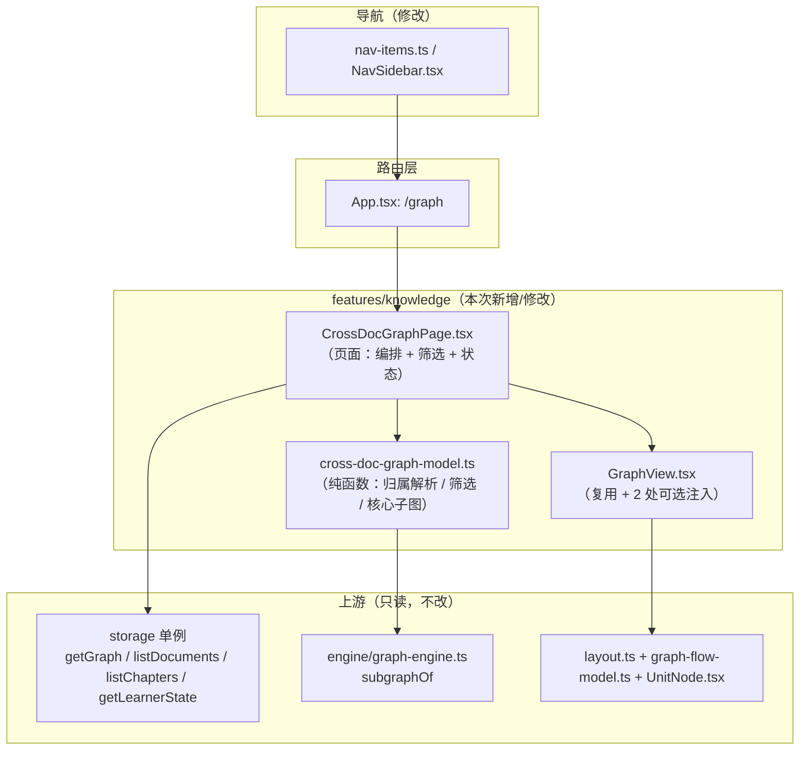
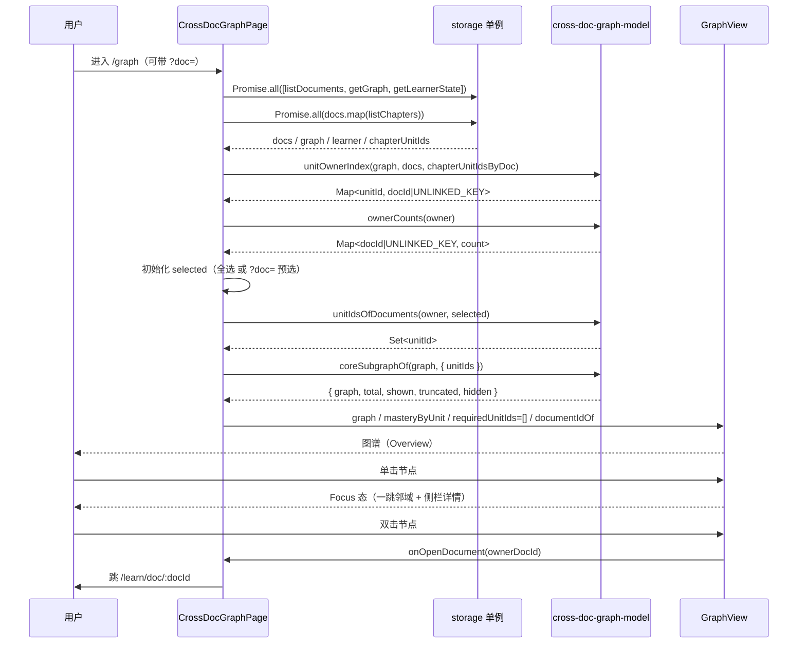

# 跨文档概念图谱视图页 技术方案

| 字段 | 内容 |
|------|------|
| 作者 | Agent / 许一 |
| 日期 | 2026-10-13 |
| 状态 | **已实施（2026-10-14）** —— D6 采纳推荐档 A；偏差见「实施偏差记录」节 |
| 关联需求 | README 双语待办 `[ ] Cross-document concept graph` @P2 · `docs/roadmap-next-features-plan-2026-09.md` §五「仍未做」末项（**无 Feature 编号**） · `docs/nav-sidebar-redesign-design-2026-09.md` §D3「N5 上线时再补」 · `docs/code-gap-review-2026-09.md` §六 缺口中 README `[ ]` 的镜像登记 |

---

## 1. 背景

### 1.1 用户痛点

概念（`KnowledgeUnit`）由 AI 逐章从正文提炼，落库进**一份全局图谱**。但用户至今**只能在「章」或「资料」的笼子里看它**：

- 章概念图谱页 `features/knowledge/ChapterGraphPage.tsx:82` —— `subgraphOf(graph, chapter.unitIds)`，单章
- 资料详情页「概念」Tab `features/learn/detail/KnowledgeTab.tsx:87-90` —— `subgraphOf(graph, allUnitIds)`，单份资料

后果：两份 RAG 资料各自提炼出「检索」「重排序」两个概念，它们**在图里是两个孤立节点**。用户无法回答「我这一整套资料里，哪些概念是核心枢纽」「同一个前置关系跨了几份资料」——而这恰恰是「知识图谱」这个说法本该给出的价值。

### 1.2 触发原因

`README` 双语产品清单里这条 `[ ]` 长期挂着，且**描述已在 2026-10-09 被实测改写过**：

> 图谱**数据层已是全局单图**（store 里只有一份 `KnowledgeGraph`；`subgraphOf(graph, unitIds)` 接受来自**任意**文档的单元），缺的只是**跨文档视图**——章图谱页是单章、资料「概念」Tab 是单份资料

即：**这条 `[ ]` 不是「数据层没做」，而是「缺一个消费方」。** 同批实测还确认 `StorageAdapter.getGraph()` 无范围参数（`storage/types.ts:221`），全局语义一直成立、只是没有出口。

### 1.3 与现有模块的关系

侧栏**已经预留**了这个入口：`components/layout/nav-items.ts::NAV_COMING`（`navKey: "graph"`，icon `Network`，badge `N5`），由 `NavSidebar.tsx:76-87` 渲染成不可点的「图谱 · 即将上线」。`docs/nav-sidebar-redesign-design-2026-09.md` §D3 当时的决策原文：

> **保留占位**：继续灰显不可点，条目带「即将上线」徽标，位置移至列表末尾 —— 「N5 上线时再补」

**本方案正是收这一笔。**

### 1.4 不做会怎样

README 该条继续挂着（且描述已写明「数据层已具备」，越挂越像重复条目）；`getGraph()` 的全局语义没有消费方；概念层的能力上限停在「单章/单资料」。

---

## 2. 方案目标

| 类型 | 描述 |
|------|------|
| **主要目标** | 新增 `/graph` 页，把**全库概念**渲染成一张可探索的图：按资料筛选、单击聚焦一跳邻域、双击回到来源资料、发起概念复习；同时把侧栏「图谱」占位项替换为真实入口 |
| **非目标** | ① **不引入新布局算法/依赖**（沿用 `engine` 外的自研 `computeLayout`，零新增 npm 包）；② **不做图谱编辑**（节点仍不可拖拽/连线，沿用既有 D1 决策）；③ **不做跨文档语义合并/去重**——两份资料里的同义概念仍是两个节点（无 embedding 聚类）；④ **不新增持久化实体**（无新 store、无新 storage key ⇒ 零迁移，F4 白名单不动）；⑤ **不做 F7-c 独立学习单元实体**；⑥ **不做「跨文档概念搜索/跳转」**（无搜索框，靠资料筛选收窄）；⑦ **不统一 `unitTitle` 的裸 id 回退**（另 4 处消费方保持现状，见 §3.4 D6 的边界） |
| **成功标准** | 见 §11.3 |

---

## 3. 项目现状

### 3.1 相关代码与模块

| 文件 | 现状 |
|---|---|
| `src/features/knowledge/GraphView.tsx` | 三态图谱组件（Overview / Focus / Detail），props：`graph` / `masteryByUnit` / `requiredUnitIds` / `highlightIds?` / `onOpenDocument?` / `onReviewUnit?`。**本方案主要复用对象** |
| `src/features/knowledge/graph-flow-model.ts` | 图谱 → React Flow 元素映射（纯函数，`import type` only）。只读复用，**不改** |
| `src/features/knowledge/layout.ts` | 自研确定性力导向 `computeLayout`。顶部自述「**规模假设：≤ 50 节点**（超出会显著变慢；届时再评估 d3-force）」，斥力为 O(n²)。**不改** |
| `src/features/knowledge/UnitNode.tsx` | 自定义节点（四色 + 缺口脉冲 + skill 菱形）。**不改** |
| `src/features/knowledge/ChapterGraphPage.tsx` | 单章图谱页（`/learn/chapter/:chapterId/graph`）。**不改** |
| `src/features/learn/detail/KnowledgeTab.tsx` | 资料详情页「概念」Tab。**不改** |
| `src/engine/graph-engine.ts::subgraphOf(graph, unitIds)` | 子图裁剪（两端都在集合内的边才保留）。**直接复用** |
| `src/domain/knowledge.ts` | `KnowledgeGraph` / `KnowledgeUnit` / `KnowledgeRelation`；`KnowledgeUnit.sourceDocumentId?: string`（可选） |
| `src/storage/types.ts:221-222` | `getGraph(): Promise<KnowledgeGraph>` / `saveGraph(graph)` —— **无范围参数** |
| `src/stores/useLoopStore.ts` | 导出模块级单例 `storage` |
| `src/components/layout/nav-items.ts` | `NAV_ITEMS` 平铺清单 + `NAV_COMING` 占位常量（`NavComingSpec`） |
| `src/components/layout/NavSidebar.tsx:76-87` | 占位项渲染块（`aria-disabled` + `data-testid="nav-graph-placeholder"`） |
| `src/App.tsx:36` | `/knowledge` 已重定向到 `/learn`（V2 取代 V1 图谱列表） |

### 3.2 相关文档与约定

| 文档 / 规则 | 要点 |
|---|---|
| `docs/knowledge-graph-react-flow-design-2026-09.md` | GraphView / graph-flow-model / UnitNode 的方案真源；D1「图是「读」的不是「画」的」（`draggable: false`） |
| `docs/nav-sidebar-redesign-design-2026-09.md` §D3 | 占位项的来龙去脉：明确写了「**N5 上线时再补**」 |
| `docs/library-import-extraction-audit-2026-09.md` | 概念抽取现状（哪条管道写什么字段） |
| `rules/no-headless-browser-validation.mdc` | **禁止**主动起浏览器校验布局/DOM；校验走 typecheck + node 单测 + 代码自审 |
| `rules/dropdown-select.mdc` | 下拉唯一来源 `components/ui/select`；禁原生 `<select>` 与手写浮层 → 本方案的筛选控件**用 Button chip 行**，不碰这两个禁区 |
| `rules/code-structure-and-dependencies.mdc` | 文件 ≤700 行；`src/components`、`src/stores`、`src/services` ↛ `src/features` |
| `rules/engineering-code-style.mdc` | i18n zh/en **成对**；Tailwind 4 语义 token；`import type` |

### 3.3 约束与依赖

- **布局硬上限**：`computeLayout` 的规模假设是 **≤ 50 节点**，且斥力 O(n²)。跨文档全库概念轻易过百 ⇒ **必须裁剪后再送布局**（本方案的核心约束）。
- **`KnowledgeUnit.sourceDocumentId` 实测基本为空**（⚠️ 本方案的关键实测发现，见下）。
- `src-tauri/**` **零改动**（本方案纯前端只读，天然满足）。
- `test:i18n` 只锁 zh/en **结构成对**，不报孤儿键。

#### 3.3.1 实测：`sourceDocumentId` 在真实数据里是空的

全仓实测（`Grep "sourceDocumentId"`）确认**赋值点只有两处**，且都不是概念抽取管道：

| 位置 | 做什么 |
|---|---|
| `src/storage/graph-split.ts:48,74` | SQLite 行 ↔ 领域对象的**双向字段映射**（透传，不产生值） |
| `src/features/data/portability/pack-import-service.ts:190-196` | 知识包导入时按 id 映射表**重映射** |

两条概念抽取管道都**不写它**：

- `src/ai/concept-map-reduce.ts:378-388`（`candidatesToUnits`）：只写 `id / title / kind / summary? / tags / createdAt / evidence?`
- `src/ai/pipelines.ts:529-540`（`extractChapterConceptsWithAi` → `KnowledgeUnit`）：只写 `evidence.documentId`（且要求调用方传 `documentId`；`ChapterGraphPage.tsx:101-104` **没传**）

⇒ **结论：`unit.sourceDocumentId` 恒为 `undefined`（真实数据）**，因此：

1. 「按资料分组 / 筛选」**不能**依赖它，必须走三级回退（§4.3.1）；
2. `GraphView` 现有的「双击 → `onOpenDocument`」与侧栏「查看原文」两个入口都靠 `unit.sourceDocumentId` 判定（`GraphView.tsx:164,220`）⇒ **在本页面会双双失效**（侧栏按钮不渲染、双击无动作），必须给 `GraphView` 加一个「宿主注入的归属解析」可选 prop（§8.4）。

这条实测同时解释了为什么这个页面一直没做出来——**光有全局图还不够，节点到资料的"归属"这条链根本没接上**。

### 3.4 决策点（D1–D6）

| ID | 决策点 | 选项 | 推荐 | 理由 / 状态 |
|----|--------|------|------|------|
| **D1** | 页面入口 | A 激活侧栏占位项（新建 `/graph`）／ B 仅在资料库页挂入口卡／ C 两者都做 | **A** | 占位项本就是为它预留的（§D3 原文「N5 上线时再补」），用户已能看到「图谱 · 即将上线」，激活成本最低、语义最准。**已确认（2026-10-13）** |
| **D2** | 规模策略 | A 核心子图（度数 top-N）+ 资料筛选／ B 全量渲染靠缩放看全图／ C 引入 d3-force | **A** | 布局自述 ≤50 节点 + 斥力 O(n²)，全量必卡；引 d3-force 是新增依赖且改动面最大。A 零新依赖、且有现成 `subgraphOf` 可复用。**已确认（2026-10-13）** |
| **D3** | 缺口脉冲（`requiredUnitIds`）口径 | A 不显示（传 `[]`）／ B 取所有目标必需单元的并集／ C 加目标选择器 | **A** | 跨文档页没有「当前目标」，就没有「必需单元」。B 会几乎全亮（信噪比归零）；C 多一层状态与 UI。语义诚实优先。**已确认（2026-10-13）** |
| **D4** | 「去复习」跳转 | A 沿用全局 `/study/session?unit=<id>`／ B 反查所属章后带 `?chapterId=&unit=` | **A** | 与 `GraphView` 现有的 V1 回退路径一致；概念单元本身不带章上下文（`KnowledgeUnit` 无 `chapterId`），B 需为「单元未被任何章引用」写边界。**已确认（2026-10-13）** |
| **D5** | 单元 → 归属资料 的解析口径 | A 三级回退（`evidence.documentId` → 反查 `chapters[].unitIds` → `sourceDocumentId`），全落空则归「未关联」／ B 只看 `sourceDocumentId` | **A** | §3.3.1 实测：B 恒为「全部未关联」= 功能失效。A 的每一级都有真实数据支撑。**随 D2 派生，本方案定为 A** |
| **D6** | `GraphView` 侧栏副标题显示裸 id 的问题 | A 顺带修正（新增 `unitAlias()`，未知别名时**整段省略**，关系清单改用 `title`）／ B 保持现状 | **A** 待确认 | 现状 `GraphView.tsx:199` 与 `:253` 用 `unitTitle(id)`，未命中静态表时**回落到裸 id**（`unitTitle("unit_xxx") === "unit_xxx"`）。本页面绝大多数节点是 AI 提炼的概念（不在 `UNIT_TITLES` 内）⇒ 每个节点副标题都会显示 `unit_m8f2k1…`。**不修正就等于新建一个「满屏裸 id」的页面**。⚠️ 边界：`unitTitle` 另有 4 处消费方（`CommandPalette` / `ReviewSession` ×2 / `AssessmentSession` / `AssessmentPage` ×3），**本方案一律不动**（「勿顺手统一」），只改 GraphView 的两行 + 新增一个不回落 id 的 `unitAlias()` |
| **D7** | 是否支持深链预选资料 | A 支持 `?doc=<docId>`（存在则预选，不存在则忽略）／ B 不支持 | **A** | `useSearchParams` 3 行；让「资料详情页 → 看它在全图里的位置」成为可能。**无风险，本方案定为 A** |

---

## 4. 技术架构

### 4.1 总体架构



**数据流（单向、只读）**：`storage` → 页面本地 state → 纯函数（归属解析 → 筛选 → 核心子图）→ `GraphView` → React Flow。
**无写路径**：不调 `saveGraph`，不产生新 key，`storage` 层零改动。

### 4.2 模块职责

| 模块 / 层级 | 职责 | 技术选型 |
|---|---|---|
| `CrossDocGraphPage.tsx`（`features/knowledge/`） | 读数据、维护筛选与加载状态、渲染筛选条与统计、挂 `GraphView`、承接双击/复习跳转 | React 19 + react-router-dom |
| `cross-doc-graph-model.ts`（`features/knowledge/`） | 全部**纯计算**：归属三级回退、筛选集合、度数、核心子图裁剪 | 纯 TS（无 React、无 DOM）⇒ node 直跑单测 |
| `GraphView.tsx` | 复用既有三态组件；新增 2 个**可选** prop 让宿主注入「归属资料解析」 | 既有组件，向后兼容改造 |
| `nav-items.ts` / `NavSidebar.tsx` | 占位项 → 真实导航项 | 既有结构，删减为主 |
| `src/features/units.ts` | 新增 `unitAlias()`（不回落 id 的别名查询） | 既有模块，加 1 个导出 |

**分层合规**：`features/` 可以 import `engine/`、`domain/`、`storage/`（经 `stores/useLoopStore` 的单例）、`components/`。本方案**不新增**跨层边，`layer:check` 的违规数与环数应保持不变。

### 4.3 数据模型与 API

**无新持久化实体、无新 storage key、无 Tauri 命令、无网络请求。** 全部为既有只读接口 + 新增纯函数。

#### 4.3.1 新增纯函数（`cross-doc-graph-model.ts`）

```ts
/** 归属解析不到资料的单元统一落这个桶（非真实 docId，不会与 id 冲突）。 */
export const UNLINKED_KEY = "__unlinked__";

/**
 * 核心子图上限。
 * ⚠️ 硬约束：不得超过 features/knowledge/layout.ts 自述的「≤ 50 节点」假设
 * （斥力 O(n²)）。改这个常量前先重读 layout.ts 顶部注释。
 */
export const CORE_LIMIT = 40;

export interface DocRef { id: string; title: string }

/**
 * unitId → 归属资料 id（或 UNLINKED_KEY）。
 *
 * 三级回退（§3.3.1 实测：`sourceDocumentId` 在真实数据里恒为 undefined）：
 *   ① `unit.evidence?.documentId`  —— 锚定成功的概念才有
 *   ② 反查 `chapters[].unitIds`     —— 最可靠：概念落库时必然写进所属章的 unitIds
 *   ③ `unit.sourceDocumentId`       —— 知识包导入重映射会写
 *
 * 命中的 docId **必须仍在 `documents` 内** —— 指向已删资料的悬空引用按「未关联」处理
 * （数据层不塞文案；UI 用 i18n 标签兜底，绝不显示裸 id）。
 *
 * 确定性：反查表按 docId 字典序建立、首个命中即锁定；同一单元被多份资料的章引用时
 * 结果稳定（不随 Map 迭代顺序漂移）。
 */
export function unitOwnerIndex(
  graph: KnowledgeGraph,
  documents: readonly DocRef[],
  chapterUnitIdsByDoc: ReadonlyMap<string, readonly string[]>,
): Map<string, string>;

/** 每份资料（含 UNLINKED_KEY）的概念计数 —— 供筛选 chip 显示。 */
export function ownerCounts(ownerIndex: ReadonlyMap<string, string>): Map<string, number>;

/** 选中的 docId 集合（可含 UNLINKED_KEY）→ 保留的 unitId 集合。 */
export function unitIdsOfDocuments(
  ownerIndex: ReadonlyMap<string, string>,
  docIds: ReadonlySet<string>,
): Set<string>;

export interface CorePick {
  /** 裁剪后的子图（可直接喂 GraphView）。 */
  graph: KnowledgeGraph;
  /** 筛选范围内的单元总数。 */
  total: number;
  /** 实际渲染的单元数。 */
  shown: number;
  truncated: boolean;
  /** 被截断掉的单元数（total − shown）。 */
  hidden: number;
}

/**
 * 核心子图：在「筛选后的池」内按度数降序取前 limit 个单元。
 *
 * - 度数**只在池内统计**（两端都在池里的边才计数）⇒ 筛选后语义一致：
 *   「在这批资料里，谁最核心」。
 * - 排序确定性：度数 desc → `title` asc → `id` asc。禁止依赖 `Array.prototype.sort`
 *   的不稳定行为（Node ≥ 12 已是稳定排序，但显式给全序更不容易被将来改动破坏）。
 * - 度数相同且名额有余时，**度数为 0 的孤立概念也会入选**（它们仍可复习/回原文，
 *   不该被静默丢弃）。
 * - 输出图的 `units` 顺序沿用 `subgraphOf`（即 `graph.units` 原序）——`computeLayout`
 *   的螺旋 seed 按数组下标取值，固定顺序 = 布局稳定、重渲染不跳。
 * - **只读**：不改入参、不共享可变引用（`subgraphOf` 只做过滤，不原地改对象）。
 */
export function coreSubgraphOf(
  graph: KnowledgeGraph,
  opts?: { limit?: number; unitIds?: ReadonlySet<string> },
): CorePick;
```

#### 4.3.2 读取路径（符合 `rules/layer-import-boundaries.mdc`）

| 数据 | 来源 | 说明 |
|---|---|---|
| 全库图谱 | `storage.getGraph()`（`stores/useLoopStore` 导出的单例） | 全局单图，无范围参数 |
| 资料清单 | `storage.listDocuments()` | 只取 `id` / `title` |
| 章单元归属 | `storage.listChapters(docId)` → `flatMap(c => c.unitIds ?? [])` | 反查表的数据源 |
| 掌握度 | `storage.getLearnerState()` → `byUnit[unitId].mastery` | 与 `ChapterGraphPage:72-78` 同口径 |

- **桌面能力**：无（不用 `invoke`，不碰 Keychain / 本地模型）。
- **纯浏览器预览**：无需 `isTauri` 守卫（`storage` 自动落到 `LocalStorageAdapter`）。
- **无写路径**：不调 `saveGraph` / `saveChapters` ⇒ 不触发 `notifyDocsChanged`。

#### 4.3.3 为什么反查表要单独读 `listChapters`

页面已经在读 `getGraph()`；直觉上可以只用 `unit.evidence`。但实测（§3.3.1）**锚定失败的概念没有 evidence**（AI 给出的 `quote` 在正文中定位不到时，`evidence` 整体省略、概念照常入库 —— 这是既定「诚实降级」策略）。这类概念只能靠 `chapters[].unitIds` 反查，故必须读章。

代价：`listDocuments()` 个 `listChapters()` 串行/并行调用（资料数通常在个位到几十）。用 `Promise.all` 一次并发。**这是本页面唯一的"贵"读**，须在方案里写明，避免实施时改成循环串行。

### 4.4 状态与副作用

| 状态 | 位置 | 说明 |
|---|---|---|
| `docs` / `graph` / `learner` / `owner` | 组件本地 `useState` | 一次读入，不轮询、不订阅 |
| `selected: Set<string>` | 组件本地 `useState` | 选中的资料 chip；读入完成后初始化为「全选」或 `?doc=` 预选 |
| `focusId` | `GraphView` 内部（既有） | 本页面不接管 |
| `loadError` | 组件本地 `useState` | 读取失败原因；**错误态渲染顺序优先于空态**（`LibraryPage` 既有教训） |

**副作用**：仅 `useEffect(..., [])` 一次并发读取。无写入、无 AI 调用、无事件订阅。
**URL 参数**：只读 `?doc=`（D7），不写回。

---

## 5. 交互流程

### 5.1 主流程

1. 用户点侧栏「图谱」→ 路由进入 `/graph`。
2. 页面并发读取 `listDocuments` + `getGraph` + `getLearnerState` + 每份资料的 `listChapters`；期间显示「正在打开概念图谱…」。
3. 读入完成 → 计算「归属索引」→ 资料筛选 chip 初始化为**全部选中**（若 URL 带 `?doc=<id>` 且该资料有概念 → 只选它）。
4. 计算核心子图（度数 top-40）→ 渲染统计行「N 个概念 · M 条关系 · 覆盖 K 份资料」+ 图谱。
5. 若被截断 → 统计行下方追加提示条：「已显示关联度最高的 40 个概念（共 N 个）· 用上方资料筛选收窄范围可看到更多」。
6. 用户单击节点 → `GraphView` 聚焦该节点 + 一跳邻域，右侧栏显示详情（标题、掌握度四色、关联数、摘要、关系清单）。
7. 用户双击**有归属资料**的节点，或点侧栏「查看原文」→ 跳 `/learn/doc/<docId>`。
8. 用户点侧栏「去复习 ▶」→ 跳 `/study/session?unit=<unitId>`（全局概念复习）。
9. 用户点某个资料 chip → 取消选中 → 筛选集合收窄 → 核心子图重算（度数在池内重算）→ 图谱重绘。
10. 用户点「全部」→ 恢复全选。

### 5.2 分支与异常流程

| 场景 | 触发条件 | 系统行为 | UI 反馈 |
|---|---|---|---|
| 全库零概念 | `graph.units.length === 0` | 不挂载 `GraphView` | 空态卡：标题 + 「AI 提炼概念后这里会出现跨资料的知识全貌」+「去资料库 →」链接 |
| 未选中任何资料 | `selected.size === 0` | 不挂载 `GraphView`（`coreSubgraphOf` 返回空池） | 「未选择任何资料」+「全选」按钮 |
| 筛选后池为空 | 选中的资料都没概念 | 同上 | 同上（不可能出现：chip 只列 `count > 0` 的资料） |
| 超出核心上限 | 池 > 40 | 正常渲染前 40 | 提示条「已显示关联度最高的 40 个概念（共 N 个）」 |
| 读取失败 | `storage` 抛错（如 SQLite 故障） | 保留 `loadError`，不渲染图谱 | 错误卡（**排在空态之前**），文案含原因 |
| `?doc=` 指向不存在/无概念的资料 | URL 参数校验失败 | **忽略**该参数，回落到全选 | 无额外提示（不报错、不显示裸 id） |
| 双击无归属资料的节点 | `owner.get(unitId) === UNLINKED_KEY` | 不跳转 | 无（侧栏也不渲染「查看原文」按钮） |
| 单元引用的资料已被删除 | 归属解析第 ①②③ 级都指向已删 docId | 归入「未关联」桶 | 该节点在「未关联资料」chip 下可见 |

### 5.3 时序图



---

## 6. 用户用例（User Cases）

### UC-01：首次进入查看跨资料知识全貌

| 项 | 内容 |
|----|------|
| 角色 | 已导入 ≥2 份资料并完成概念提炼的用户 |
| 前置条件 | 全库概念数 ≥ 1；侧栏可见「图谱」 |
| 主流程步骤 | 1. 点侧栏「图谱」 2. 等待读取完成 3. 观察统计行与图谱 |
| 期望结果 | 图谱中的节点来自**多份资料**（非单章/单资料）；统计行给出概念数 / 关系数 / 覆盖资料数；资料 chip 全部选中 |
| 异常/边界 | 全库零概念 → 空态卡（UC-06） |

### UC-02：按资料筛选收窄图谱

| 项 | 内容 |
|----|------|
| 角色 | 想只看某份资料在全图中的位置的用户 |
| 前置条件 | ≥2 份资料有概念 |
| 主流程步骤 | 1. 进入 `/graph` 2. 点某资料 chip（取消选中） 3. 观察图谱变化 |
| 期望结果 | 只保留该资料之外其余资料的单元？—— **否**：取消选中即**排除**该资料；图谱只含未取消资料的概念；统计行与截断提示同步刷新 |
| 异常/边界 | 取消到 0 份 → 未选中提示（UC-07）；某资料 0 概念 → 不出现 chip |

### UC-03：聚焦一个节点看它的一跳邻域

| 项 | 内容 |
|----|------|
| 角色 | 想理解某概念「跟谁有关」的用户 |
| 前置条件 | 图谱已渲染 |
| 主流程步骤 | 1. 单击任一节点 2. 观察画布与右侧栏 |
| 期望结果 | 画布淡出非邻域节点；右侧栏出现：节点标题、掌握度徽标、`掌握度 N% · 关联 M 条`、摘要（无摘要时显示「该单元暂无摘要」）、关系清单（含不画边的类型） |
| 异常/边界 | 单击空白 → 取消聚焦（既有行为）；焦点单元被筛掉 → 不聚焦、全图正常显示（`GraphView` 已有防护） |

### UC-04：从节点回到来源资料

| 项 | 内容 |
|----|------|
| 角色 | 想回原文核对的用户 |
| 前置条件 | 节点归属解析成功（非「未关联」） |
| 主流程步骤 | 1. 单击节点 2. 点侧栏「查看原文」（或双击节点） |
| 期望结果 | 跳 `/learn/doc/<docId>`（资料详情页） |
| 异常/边界 | 归属解析失败 → 侧栏**不渲染**「查看原文」按钮，双击无动作（绝不跳到一个裸 id 的地址） |

### UC-05：从节点发起概念复习

| 项 | 内容 |
|----|------|
| 角色 | 想立刻复习某概念的用户 |
| 前置条件 | 图谱已渲染 |
| 主流程步骤 | 1. 单击节点 2. 点侧栏「去复习 ▶」 |
| 期望结果 | 跳 `/study/session?unit=<unitId>`，进入全局概念复习会话 |
| 异常/边界 | 无（不依赖章上下文，D4-A） |

### UC-06：全库还没有概念

| 项 | 内容 |
|----|------|
| 角色 | 刚导入资料、尚未提炼概念的用户 |
| 前置条件 | `graph.units.length === 0` |
| 主流程步骤 | 1. 点侧栏「图谱」 |
| 期望结果 | 空态卡：标题 + 说明（概念由 AI 提炼后才会出现在这里）+「去资料库 →」链接；不渲染空画布 |
| 异常/边界 | 无 |

### UC-07：资料筛选全部取消

| 项 | 内容 |
|----|------|
| 角色 | 误操作的用户 |
| 前置条件 | 图谱已渲染 |
| 主流程步骤 | 1. 逐个取消所有资料 chip |
| 期望结果 | 显示「未选择任何资料」+「全选」按钮；不渲染画布；不报错 |
| 异常/边界 | 点「全选」→ 恢复 |

### UC-08：读取失败

| 项 | 内容 |
|----|------|
| 角色 | 存储故障下的用户 |
| 前置条件 | `storage` 读取抛错 |
| 主流程步骤 | 1. 点侧栏「图谱」 |
| 期望结果 | 错误卡（含失败原因）+ 返回入口；**不显示空态**（否则用户会以为数据丢了） |
| 异常/边界 | 无 |

---

## 7. 线框 UI（Wireframe）

### 7.1 `/graph` — 默认状态（宽屏 ≥1024px）

```
┌──────────────────────────────────────────────────────────────────────────────┐
│ 跨资料概念图谱                                                                │
│ 把全库概念放在一张图上：按资料筛选、单击聚焦、双击回到原文。                   │
│ 128 个概念 · 96 条关系 · 覆盖 4 份资料           ← 统计行（text-xs, ink-3）    │
├──────────────────────────────────────────────────────────────────────────────┤
│ 资料  [全部] [● 深度学习基础 (42)] [● RAG 实战 (38)] [● 检索笔记 (30)]        │
│       [● 未关联资料 (18)]                                ← 可点 chip 行，横向滚 │
├──────────────────────────────────────────────────────────────────────────────┤
│ ⓘ 已显示关联度最高的 40 个概念（共 128 个）· 用上方资料筛选收窄范围可看到更多  │
├───────────────────────────────────────────────┬──────────────────────────────┤
│                                               │ 聚焦                          │
│        ○─── 检索                              │ ┌──────────────────────────┐ │
│        │      ＼                              │ │ 重排序          [熟练]    │ │
│        ◇ 重排序 ──● 向量检索                  │ │ 掌握度 72% · 关联 5 条    │ │
│        │            │                         │ │ 把召回结果按相关性重排…    │ │
│        ◇ 分块 ──────┘                         │ │ [去复习 ▶] [查看原文]     │ │
│                                               │ └──────────────────────────┘ │
│   ┌ React Flow 画布（h-[500px]，点阵背景）      │ ┌──────────────────────────┐ │
│   │ 右下角 Controls（缩放/适配）                │ │ 关系                      │ │
│   └ 右上角提示胶囊「拖动平移 · 滚轮缩放…」      │ │ 检索         [前置]       │ │
│                                               │ │ 向量检索     [相关]       │ │
│                                               │ └──────────────────────────┘ │
└───────────────────────────────────────────────┴──────────────────────────────┘
└─ 页面容器：PageContainer size="wide"（≤1600px）；画布 : 侧栏 = flex-1 : 288px（lg 起并排）
```

**组件映射（全部既有资产，无新 UI 原语）**

| 区域 | 组件 | 来源 |
|---|---|---|
| 页面容器 | `PageContainer size="wide"` | `components/layout/AppShell.tsx:126` |
| 标题 / 副标题 / 统计 | 裸 `h1` / `p`（对齐 `ChapterGraphPage:148-158` 的写法） | 既有风格 |
| 资料 chip | `Button size="sm" variant={选中 ? "default" : "outline"}` | `components/ui/button.tsx` |
| 截断提示条 | `p` + `rounded-md bg-subtle px-3 py-2 text-xs text-ink-3` | 语义 token |
| 图谱 | `GraphView` | `features/knowledge/GraphView.tsx` |
| 空态 / 错误卡 | `Card`（`components/primitives.tsx:49`）；⚠️ 其签名只有 `{ children, className }`、**不透传 rest props** ⇒ `data-testid` 挂外层 `div` | 既有原语 |

**设计 token**：只使用 `ink-1/2/3`、`line`、`surface`、`subtle`、`primary`、`state-*`，与 `ChapterGraphPage` 完全一致。**不新增 hex**（新色值只允许进 `src/styles/main.css`）。

**⚠️ 筛选控件为什么不用下拉**：`rules/dropdown-select.mdc` 规定下拉唯一来源是 `components/ui/select`（单选），多选需要 `DropdownMenu` + `Checkbox` 或 `Dialog`。资料数通常是个位数，**一行 chip 更直接、零浮层**，且天然规避 `ui:check` 的两个禁区（原生 `<select>`、手写浮层）。

### 7.2 其他状态

**加载中**

```
┌──────────────────────────────────────┐
│                                      │
│         正在打开概念图谱…              │   ← text-sm text-ink-3，居中
│                                      │
└──────────────────────────────────────┘
```

**空态（全库零概念，UC-06）**

```
┌──────────────────────────────────────────────┐
│  还没有跨资料的概念                            │  ← text-base font-semibold text-ink-1
│  概念由 AI 从各章正文提炼。提炼完成前这里是空的， │  ← text-sm text-ink-3
│  不会凭空生成。                                │
│                                              │
│  [ 去资料库 → ]                               │  ← Button（跳 /learn）
└──────────────────────────────────────────────┘
```

**未选中任何资料（UC-07）**

```
┌──────────────────────────────────────────────┐
│  未选择任何资料                                │
│  勾选上方至少一份资料即可查看它的概念图谱。      │
│  [ 全选 ]                                     │
└──────────────────────────────────────────────┘
```

**错误态（UC-08，渲染顺序排在空态之前）**

```
┌──────────────────────────────────────────────┐
│  ⚠ 没能读取图谱数据                            │  ← text-base font-semibold text-ink-1
│  <失败原因>                                   │  ← text-sm text-ink-3
│  [ 重试 ]  [ ← 返回资料库 ]                    │
└──────────────────────────────────────────────┘
```

**截断提示条（UC-01 边界）**

```
ⓘ 已显示关联度最高的 40 个概念（共 128 个）· 用上方资料筛选收窄范围可看到更多
   └─ 仅 truncated === true 时渲染；数字全部来自 CorePick（不在 UI 里另算）
```

### 7.3 交互说明

- **chip**：`hover:bg-subtle`；选中态 `variant="default"`（primary 底），未选中 `variant="outline"`。键盘可达（原生 `<button>`）。
- **画布**：平移/缩放/聚焦由 React Flow + `GraphView` 提供，本页面不新增手势。
- **data-testid**（沿用 `playwright-test-ids` 约定 `<区域>-<语义>`）：

| testid | 元素 |
|---|---|
| `crossdoc-graph-page` | 页面根容器 |
| `crossdoc-graph-stats` | 统计行 |
| `crossdoc-graph-filter-all` | 「全部」chip |
| `crossdoc-graph-filter-doc` | 每个资料 chip |
| `crossdoc-graph-filter-unlinked` | 「未关联资料」chip |
| `crossdoc-graph-truncated` | 截断提示条 |
| `crossdoc-graph-empty` | 空态卡 |
| `crossdoc-graph-no-selection` | 未选中卡 |
| `crossdoc-graph-error` | 错误卡 |

- **不新增 Toast / 抽屉 / 弹层。**

---

## 8. 涉及文件及改动伪代码

### 8.1 `src/features/knowledge/cross-doc-graph-model.ts`（**新增**，约 120 行）

**改动说明**：本方案的全部纯计算。无 React、无 DOM ⇒ `node --experimental-strip-types` 可直跑单测（`rules/no-headless-browser-validation` 下的主战场）。

```ts
// 伪代码 — 仅表达意图，非最终提交代码
import type { KnowledgeGraph, KnowledgeUnit } from "../../domain";
import { subgraphOf } from "../../engine/graph-engine";

export const UNLINKED_KEY = "__unlinked__";

/** ⚠️ 不得超过 features/knowledge/layout.ts 自述的「≤ 50 节点」假设。 */
export const CORE_LIMIT = 40;

export interface DocRef { id: string; title: string }

export function unitOwnerIndex(
  graph: KnowledgeGraph,
  documents: readonly DocRef[],
  chapterUnitIdsByDoc: ReadonlyMap<string, readonly string[]>,
): Map<string, string> {
  const known = new Set(documents.map((d) => d.id));

  // ② 反查表：按 docId 字典序建，保证「同一单元被多份资料的章引用」时结果稳定
  const byChapter = new Map<string, string>();
  for (const docId of [...chapterUnitIdsByDoc.keys()].sort()) {
    for (const unitId of chapterUnitIdsByDoc.get(docId) ?? []) {
      if (!byChapter.has(unitId)) byChapter.set(unitId, docId);
    }
  }

  const out = new Map<string, string>();
  for (const u of graph.units) {
    // 三级回退，每级都要求「命中的资料仍然存在」
    const ev = u.evidence?.documentId;
    const viaChapter = byChapter.get(u.id);
    const owner =
      ev !== undefined && known.has(ev) ? ev
      : viaChapter !== undefined && known.has(viaChapter) ? viaChapter
      : u.sourceDocumentId !== undefined && known.has(u.sourceDocumentId) ? u.sourceDocumentId
      : UNLINKED_KEY;
    out.set(u.id, owner);
  }
  return out;
}

export function ownerCounts(ownerIndex: ReadonlyMap<string, string>): Map<string, number> {
  const out = new Map<string, number>();
  for (const docId of ownerIndex.values()) out.set(docId, (out.get(docId) ?? 0) + 1);
  return out;
}

export function unitIdsOfDocuments(
  ownerIndex: ReadonlyMap<string, string>,
  docIds: ReadonlySet<string>,
): Set<string> {
  const out = new Set<string>();
  for (const [unitId, docId] of ownerIndex) if (docIds.has(docId)) out.add(unitId);
  return out;
}

export interface CorePick { /* §4.3.1 */ }

export function coreSubgraphOf(
  graph: KnowledgeGraph,
  opts: { limit?: number; unitIds?: ReadonlySet<string> } = {},
): CorePick {
  const limit = Math.max(0, opts.limit ?? CORE_LIMIT);
  const pool = opts.unitIds
    ? graph.units.filter((u) => opts.unitIds!.has(u.id))
    : graph.units;
  const poolIds = new Set(pool.map((u) => u.id));

  // 度数只在池内统计（两端都在池里的边才计数）
  const degree = new Map<string, number>();
  for (const id of poolIds) degree.set(id, 0);
  for (const r of graph.relations) {
    if (!poolIds.has(r.fromId) || !poolIds.has(r.toId)) continue;
    degree.set(r.fromId, degree.get(r.fromId)! + 1);
    degree.set(r.toId, degree.get(r.toId)! + 1);
  }

  // 显式全序：度数 desc → title asc → id asc（不依赖 sort 稳定性）
  const ranked = [...pool].sort(
    (a, b) =>
      degree.get(b.id)! - degree.get(a.id)! ||
      (a.title < b.title ? -1 : a.title > b.title ? 1 : 0) ||
      (a.id < b.id ? -1 : 1),
  );
  const pickedIds = ranked.slice(0, limit).map((u) => u.id);

  // subgraphOf 保证：只保留两端都在子图内的边（无悬空边）
  return {
    graph: subgraphOf(graph, pickedIds),
    total: pool.length,
    shown: pickedIds.length,
    truncated: pool.length > pickedIds.length,
    hidden: Math.max(0, pool.length - pickedIds.length),
  };
}
```

> ⚠️ 实施备注：`subgraphOf` 返回的 `units` 顺序是 `graph.units` 原序（**不是** `ranked` 序）——这是**刻意的**，`computeLayout` 的螺旋 seed 按数组下标取值，固定顺序 = 布局稳定。不要在实施时"顺手"改成按度数排序（会改变既有章图谱页的布局观感）。

### 8.2 `src/features/knowledge/CrossDocGraphPage.tsx`（**新增**，约 210 行）

**改动说明**：页面编排 + 筛选状态 + 四态渲染。**无任何写入**。

```tsx
// 伪代码
import { useEffect, useMemo, useState } from "react";
import { useNavigate, useSearchParams } from "react-router-dom";
import { Card } from "../../components/primitives";
import { Button } from "../../components/ui/button";
import { PageContainer } from "../../components/layout/AppShell";
import { useI18n } from "../../i18n";
import { storage } from "../../stores/useLoopStore";
import type { KnowledgeGraph, LearnerState, SourceDocument } from "../../domain";
import GraphView from "./GraphView";
import {
  UNLINKED_KEY, coreSubgraphOf, ownerCounts, unitIdsOfDocuments, unitOwnerIndex,
  type DocRef,
} from "./cross-doc-graph-model";

export default function CrossDocGraphPage() {
  const { m } = useI18n();
  const t = m.knowledge.crossDoc;
  const navigate = useNavigate();
  const [params] = useSearchParams();

  const [graph, setGraph] = useState<KnowledgeGraph | undefined>();
  const [docs, setDocs] = useState<DocRef[] | undefined>();
  const [owner, setOwner] = useState<Map<string, string> | undefined>();
  const [selected, setSelected] = useState<Set<string> | undefined>();
  const [loadError, setLoadError] = useState<string | undefined>();

  useEffect(() => {
    let alive = true;
    void (async () => {
      try {
        const [documents, g, ls] = await Promise.all([
          storage.listDocuments(), storage.getGraph(), storage.getLearnerState(),
        ]);
        // ⚠️ 必须并发（唯一"贵"读）：串行会让资料数线性放大首屏时间
        const chapters = await Promise.all(
          documents.map(async (d) => [d.id, (await storage.listChapters(d.id)).flatMap((c) => c.unitIds ?? [])] as const),
        );
        if (!alive) return;

        const refs: DocRef[] = documents.map((d) => ({ id: d.id, title: d.title }));
        const index = unitOwnerIndex(g, refs, new Map(chapters));
        const keys = [...ownerCounts(index).keys()];

        setGraph(g); setDocs(refs); setOwner(index);
        setLearner(ls);
        // 初始化筛选：?doc= 命中且有概念 → 只选它；否则全选
        const preset = params.get("doc");
        setSelected(preset && keys.includes(preset) ? new Set([preset]) : new Set(keys));
      } catch (e) {
        if (alive) setLoadError(e instanceof Error ? e.message : String(e));
      }
    })();
    return () => { alive = false; };
  }, []); // 只读一次；?doc= 只在首次挂载生效（改用 searchParams 会因 Set 重置引入闪烁）

  const masteryByUnit = useMemo(() => {
    const out: Record<string, number> = {};
    for (const [id, mm] of Object.entries(learner?.byUnit ?? {})) out[id] = mm.mastery;
    return out;
  }, [learner]);

  /** 每份资料的概念计数（chip 上的数字）。 */
  const counts = useMemo(() => (owner ? ownerCounts(owner) : new Map<string, number>()), [owner]);

  /** 核心子图：筛选变化即重算（纯函数，便宜）。 */
  const pick = useMemo(() => {
    if (!graph || !owner || !selected) return undefined;
    return coreSubgraphOf(graph, { unitIds: unitIdsOfDocuments(owner, selected) });
  }, [graph, owner, selected]);

  const toggle = (key: string) =>
    setSelected((prev) => {
      const next = new Set(prev ?? []);
      next.has(key) ? next.delete(key) : next.add(key);
      return next;
    });

  // ---- 渲染顺序：错误 → 加载 → 空 → 未选中 → 正常（错误态必须最先判定）----
  // ⚠️ `Card` 的签名只有 `{ children, className }`（primitives.tsx:49），**不透传 rest props**
  // ⇒ testid 必须挂在外层包裹 `div` 上，不能写成 `<Card data-testid="…">`（会 TS 报错）。
  if (loadError)
    return <PageContainer size="wide"><div data-testid="crossdoc-graph-error"><Card>{/* §7.2 */}</Card></div></PageContainer>;
  if (!graph || !docs || !owner || !selected) return <PageContainer size="wide">{t.opening}</PageContainer>;
  if (graph.units.length === 0)
    return <PageContainer size="wide"><div data-testid="crossdoc-graph-empty"><Card>{/* §7.2 */}</Card></div></PageContainer>;

  return (
    <PageContainer size="wide">
      <div data-testid="crossdoc-graph-page">
        <h1>{t.title}</h1><p>{t.subtitle}</p>
        <p data-testid="crossdoc-graph-stats">{t.stats(pick!.total, pick!.graph.relations.length, counts.size - (counts.has(UNLINKED_KEY) ? 1 : 0))}</p>

        {/* 资料筛选 chip 行 */}
        <div className="flex flex-wrap items-center gap-2">
          <span>{t.filterLabel}</span>
          <Button size="sm" variant="outline" data-testid="crossdoc-graph-filter-all"
                  onClick={() => setSelected(new Set(counts.keys()))}>{t.filterAll}</Button>
          {docs.filter((d) => counts.has(d.id)).map((d) => (
            <Button key={d.id} size="sm" data-testid="crossdoc-graph-filter-doc"
                    variant={selected.has(d.id) ? "default" : "outline"}
                    onClick={() => toggle(d.id)}>{t.filterChip(d.title, counts.get(d.id) ?? 0)}</Button>
          ))}
          {counts.has(UNLINKED_KEY) ? (
            <Button size="sm" data-testid="crossdoc-graph-filter-unlinked"
                    variant={selected.has(UNLINKED_KEY) ? "default" : "outline"}
                    onClick={() => toggle(UNLINKED_KEY)}>{t.filterChip(t.filterUnlinked, counts.get(UNLINKED_KEY)!)}
            </Button>
          ) : null}
        </div>

        {pick!.truncated ? <p data-testid="crossdoc-graph-truncated">{t.truncated(pick!.shown, pick!.total)}</p> : null}

        {pick!.graph.units.length === 0 ? (
          <div data-testid="crossdoc-graph-no-selection">
            <Card>
              <p>{t.noSelectionTitle}</p><p>{t.noSelectionDesc}</p>
              <Button size="sm" variant="outline" onClick={() => setSelected(new Set(counts.keys()))}>{t.selectAll}</Button>
            </Card>
          </div>
        ) : (
          <GraphView
            graph={pick!.graph}
            masteryByUnit={masteryByUnit}
            requiredUnitIds={[]}                 // D3-A：跨文档页没有"必需单元"
            documentIdOf={(u) => {               // §8.4 新增 prop；未关联返回 undefined
              const id = owner.get(u.id);
              return id === undefined || id === UNLINKED_KEY ? undefined : id;
            }}
            onOpenDocument={(docId) => navigate(`/learn/doc/${docId}`)}
            // onReviewUnit 不传 → GraphView 回退 /study/session?unit=<id>（D4-A）
          />
        )}
      </div>
    </PageContainer>
  );
}
```

### 8.3 `src/components/layout/nav-items.ts`（修改）

**改动说明**：把占位常量并入真实清单；删掉 `NavComingSpec` / `NAV_COMING`（避免留死导出）。

```ts
// 伪代码（仅示意 diff）
export const NAV_ITEMS: NavItemSpec[] = [
  { to: "/", navKey: "home", icon: House, end: true },
  { to: "/plan", navKey: "plan", icon: CalendarDays },
  { to: "/learn", navKey: "library", icon: Library },
+ /* 跨文档概念图谱（原 N5 占位项激活；docs/cross-document-concept-graph-design-2026-10.md） */
+ { to: "/graph", navKey: "graph", icon: Network },
  { to: "/quiz", navKey: "quiz", icon: ClipboardCheck },
  ...
];

- export interface NavComingSpec { … }
- export const NAV_COMING: NavComingSpec = { navKey: "graph", icon: Network, badge: "N5" };
```

> `Network` 图标 import 保留（挪到 `NAV_ITEMS`）。`NavKey` 类型不变 —— `nav.graph` 已是 `{label, hint}`，天然满足 `NavEntry` 约束。

### 8.4 `src/features/knowledge/GraphView.tsx`（修改，向后兼容）

**改动说明**：① 新增可选 prop `documentIdOf`，让宿主注入「单元 → 归属资料」的解析（本页面唯一必需改动）；② 双击与侧栏「查看原文」都改为先问 `documentIdOf`；③ 侧栏副标题不再显示可能为裸 id 的 `unitTitle(id)`（D6-A）；④ 关系清单的目标名改用 `title`。

```tsx
// 伪代码（仅示意 diff）
import { unitAlias } from "../units";   // 新增导出（§8.5）；unitTitle 不再被本文件使用

interface GraphViewProps {
  ...
  /**
   * 宿主注入的「单元 → 归属资料 id」解析。缺省回退 `unit.sourceDocumentId`（既有行为）。
   * ⚠️ 真实数据里 `sourceDocumentId` 恒为 undefined（两条概念抽取管道都不写它），
   * 所以跨文档页必须注入；章图谱页 / 资料概念 Tab 不传时行为与改造前逐字节一致。
   */
  documentIdOf?: (unit: KnowledgeUnit) => string | undefined;
}

/** 归属资料的唯一取值口（先问宿主，再回落既有字段）。 */
const ownerDocIdOf = (u?: KnowledgeUnit): string | undefined =>
  u ? (documentIdOf ? documentIdOf(u) : u.sourceDocumentId) : undefined;

// 双击
onNodeDoubleClick={(_, node) => {
  const id = ownerDocIdOf(graph.units.find((u) => u.id === node.id));
  if (id && onOpenDocument) onOpenDocument(id);
}}

// 侧栏副标题（原：{unitTitle(focusUnit.id)} · {k.masteryOf(…)})，D6-A
const alias = unitAlias(focusUnit.id);            // 未知 → undefined，绝不回落 id
<p className="mt-1 text-xs text-slate-400">
  {alias ? `${alias} · ` : ""}{k.masteryOf(…)}
</p>

// 侧栏「查看原文」（原：focusUnit.sourceDocumentId ? … : null）
{ownerDocIdOf(focusUnit) ? (
  <button onClick={() => onOpenDocument?.(ownerDocIdOf(focusUnit)!)}>{k.viewSource}</button>
) : null}

// 关系清单目标名（原：{other && other.id !== focusUnit.id ? unitTitle(other.id) : other?.title}）
{other ? other.title : ""}
```

> ⚠️ **向后兼容自检**：`ChapterGraphPage` 与 `KnowledgeTab` **不传** `documentIdOf` ⇒ `ownerDocIdOf` 严格回落到 `u.sourceDocumentId`，与改造前行为一致。唯一的行为变化是 D6-A 的副标题/关系名（这是**修正**，不是回归；见 §3.4 D6 的理由）。

### 8.5 `src/features/units.ts`（修改，加 1 个导出）

**改动说明**：提供「不回落裸 id」的别名查询。**`unitTitle` 保持原样**（另 4 处消费方不动）。

```ts
/**
 * 已知别名的单元 id → 中文别名；**未知返回 undefined（不回落 id）**。
 *
 * 与 `unitTitle` 的分工：`unitTitle` 是"总要给个名字"的回退（`?? unitId`），
 * 供 CommandPalette / ReviewSession / Assessment 等需要占位的场景；
 * `unitAlias` 是"没有别名就不显示"，供图谱侧栏这类**显示裸 id 反而更糟**的场景。
 */
export function unitAlias(unitId: string): string | undefined {
  return UNIT_TITLES[unitId];
}
```

### 8.6 `src/components/layout/NavSidebar.tsx`（修改，删减）

```tsx
// 伪代码（仅示意 diff）
- import { NAV_COMING, NAV_ITEMS } from "./nav-items";
+ import { NAV_ITEMS } from "./nav-items";
- const ComingIcon = NAV_COMING.icon;
- const comingEntry = m.nav[NAV_COMING.navKey];
  ...
- <div aria-disabled title={comingEntry.hint}
-      data-testid={`nav-${NAV_COMING.navKey}-placeholder`} …>
-   <ComingIcon … /><span>{comingEntry.label}</span><span>{NAV_COMING.badge}</span>
- </div>
```

### 8.7 `src/App.tsx`（修改）

```tsx
// 伪代码（仅示意 diff）
+ import CrossDocGraphPage from "./features/knowledge/CrossDocGraphPage";
  ...
+ {/* 跨文档概念图谱：原侧栏 N5 占位项激活（单章/单资料图谱各有既有页面） */}
+ <Route path="graph" element={<CrossDocGraphPage />} />
  <Route path="settings" element={<SettingsPage />} />
```

### 8.8 `src/i18n/messages/zh.ts` + `en.ts`（修改，成对）

**改动说明**：`nav.graph.hint` 改写（去掉「即将上线」）+ 新增 `knowledge.crossDoc` 块（**13 个键**，zh/en 一一对应）。

```ts
// zh.ts
  nav: {
-   graph: { label: "图谱", hint: "概念关系 · 即将上线" },
+   graph: { label: "图谱", hint: "跨资料的概念关系" },
  },
  knowledge: {
    ...,
+   crossDoc: {
+     title: "跨资料概念图谱",
+     subtitle: "把全库概念放在一张图上：按资料筛选、单击聚焦、双击回到原文。",
+     opening: "正在打开概念图谱…",
+     stats: (units: number, rels: number, docs: number) =>
+       `${units} 个概念 · ${rels} 条关系 · 覆盖 ${docs} 份资料`,
+     filterLabel: "资料",
+     filterAll: "全部",
+     filterUnlinked: "未关联资料",
+     filterChip: (title: string, count: number) => `${title} (${count})`,
+     truncated: (shown: number, total: number) =>
+       `已显示关联度最高的 ${shown} 个概念（共 ${total} 个）· 用上方资料筛选收窄范围可看到更多`,
+     emptyTitle: "还没有跨资料的概念",
+     emptyDesc: "概念由 AI 从各章正文提炼。提炼完成前这里是空的，不会凭空生成。",
+     goLibrary: "去资料库 →",
+     noSelectionTitle: "未选择任何资料",
+     noSelectionDesc: "勾选上方至少一份资料即可查看它的概念图谱。",
+     selectAll: "全选",
+     loadFailedTitle: "没能读取图谱数据",
+     retry: "重试",
+     backToLibrary: "← 返回资料库",
+   },
  },
```

> `stats` 的 `docs` 参数由页面传入 **`counts.size − (有未关联桶 ? 1 : 0)`** —— 「未关联」不是一份资料，不能计入覆盖数（同一屏的数字必须同口径）。

### 8.9 `tests/cross-doc-graph.test.ts`（**新增**）

见 §12。

### 8.10 `package.json`（修改）

```json
"test:xdoc": "node --experimental-strip-types --no-warnings --import ./tests/register-loader.mjs tests/cross-doc-graph.test.ts",
```

> 与 `test:flow` / `test:graph` 同级，**不进** `test:library` 聚合（保持这两者既有惯例）。

### 8.11 README 与文档回扫（修改）

| 文件 | 改动 |
|---|---|
| `README.md` / `README.zh-CN.md` | `[ ] Cross-document concept graph` → `[x]` + 描述改写为已交付能力；**顶部统计行**手工同步 `40 · 6` → **`41 · 5`**（实测复核） |
| `docs/nav-sidebar-redesign-design-2026-09.md` §D3 | 补**时点注**：占位项已于 2026-10-13 由 `cross-document-concept-graph-design-2026-10` 激活为 `/graph`（不删原决策句，只标被后续落地取代） |
| `docs/knowledge-graph-react-flow-design-2026-09.md` | §8.7「不改动的文件」需加时点注（`GraphView.tsx` 本次新增 2 处可选注入 + D6-A 修正）；新增 `documentIdOf` 的说明 |
| `docs/roadmap-next-features-plan-2026-09.md` | §五「仍未做」删去 README 独有那条；§附 2026-10-09 补测 ① 加时点注；计数链追加 → **41 / 5**；变更记录加 2026-10-13 行 |
| `docs/code-gap-review-2026-09.md` §六 | README `[ ]` 镜像登记表该行标 ✅ + 时点注（`[ ]` 6 → 5）；§零.4 与 §七 第 5 批同步 |
| `docs/business-flow-end-to-end-2026-09.md` | 概念层相关行补「跨文档视图已交付」+ §七 追加 |
| `docs/ui-design-system-skill-design-2026-09.md:206` | `nav-graph-placeholder` 作为 testid 命名示例 —— 示例失效，换一个仍存在的 testid（如 `nav-settings`） |

---

## 9. 任务清单（Tasks）

| ID | 任务 | 依赖 | 预估复杂度 |
|----|------|------|------------|
| T1 | 新增 `cross-doc-graph-model.ts`（4 个纯函数 + 2 个常量 + 类型） | — | M |
| T2 | 新增 `tests/cross-doc-graph.test.ts`（A–F 六组）+ `package.json::test:xdoc` | T1 | M |
| T3 | `features/units.ts` 加 `unitAlias()`；`GraphView.tsx` 加 `documentIdOf` + D6-A 修正 | — | S |
| T4 | 新增 `CrossDocGraphPage.tsx`（读取 / 筛选 / 四态渲染 / 跳转） | T1、T3 | L |
| T5 | i18n zh/en：`nav.graph.hint` 改写 + `knowledge.crossDoc` 13 键（**先于 T4 的 UI 联调**） | — | S |
| T6 | `nav-items.ts` 并入 `/graph` 并删 `NAV_COMING`；`NavSidebar.tsx` 删占位块；`App.tsx` 加路由 | T4、T5 | S |
| T7 | 门禁全跑（typecheck / layer:check / ui:check / test:i18n / test:xdoc / test:flow / test:library） | T1–T6 | M |
| T8 | README 双语 + 6 份 docs 回扫（§8.11） | T6 | M |
| T9 | 桌面端手工验收（`?doc=` 深链、双击回原文、复习跳转、截断提示、无头浏览器不可覆盖项） | T7 | S |

---

## 10. 实施步骤

1. **步骤 1 — 纯函数 + 单测（T1、T2）**
   - 输入：无；输出：`cross-doc-graph-model.ts` + 30 项单测通过
   - 验证：`npm run test:xdoc` 全绿；`npm run typecheck` 0 error
   - ⚠️ 先做这一步：把不可用无头浏览器验证的部分**全部压进纯函数**
2. **步骤 2 — GraphView 兼容性改造 + `unitAlias`（T3）**
   - 验证：`npm run typecheck` 0 error（`ChapterGraphPage` / `KnowledgeTab` 不传新 prop 仍编译通过）；`npm run test:flow` 保持全绿（纯函数层未动）
3. **步骤 3 — i18n 先行（T5）**
   - 理由：仓库既有纪律「新增键可先于 UI」；且 `NavKey` 类型约束依赖 `nav.graph` 已有 `label`/`hint`
   - 验证：`npm run test:i18n` 通过（zh/en 成对）
4. **步骤 4 — 页面（T4）**
   - 验证：`npm run typecheck` 0 error；`npm run ui:check`（原生下拉 0 / sticky 残影 0）
5. **步骤 5 — 导航与路由接线（T6）**
   - 验证：`npm run typecheck` 0 error；`npm run layer:check` 违规 0 / 新增环 0；全仓 Grep 确认 `NAV_COMING` / `NavComingSpec` / `nav-graph-placeholder` **零残留**
6. **步骤 6 — 门禁总跑（T7）**：见 §11.3
7. **步骤 7 — README + 文档回扫（T8）**
8. **步骤 8 — 手工验收（T9）**：需用户在桌面端实跑（`rules/no-headless-browser-validation`）

**回滚策略**：本次无持久化变更、无数据迁移 ⇒ 回滚 = `git revert` 单个提交序列即可，**零数据残留**。若只想临时下线入口，把 `NAV_ITEMS` 里的 `/graph` 项注释掉即可（路由仍可直达，不产生脏数据）。

---

## 11. 测试方案

### 11.1 测试范围与策略

| 层级 | 工具 / 方式 | 覆盖重点 | 不负责 |
|---|---|---|---|
| 单元 | `tests/cross-doc-graph.test.ts`（node `--experimental-strip-types` 直跑，`npm run test:xdoc`） | 归属解析三级回退与优先级、筛选集合、度数统计、核心子图裁剪/确定性/只读、空输入与边界 | 渲染、样式、跳转 |
| 回归 | `npm run test:flow`（`graph-flow-model`）/ `npm run test:i18n` / `npm run test:library` | GraphView 模型层未被改动；i18n 成对；既有 **30 套件**（`test:library` 实测 `&&` 连接数）零失败 | 新页面 |
| 静态 | `npm run typecheck` / `npm run layer:check` / `npm run ui:check` | 类型；分层边界（违规 0 / 新增环 0）；原生下拉 0 / sticky 残影 0 | 运行时行为 |
| E2E | **不适用** | `rules/no-headless-browser-validation` 明确禁止主动起浏览器校验 | — |
| 手工 | 桌面端实跑（T9） | 视觉、交互、`?doc=` 深链、跨页跳转 | — |

> ⚠️ **测试不得 import `.tsx`**（`--experimental-strip-types` 不支持 JSX）⇒ `CrossDocGraphPage` / `GraphView` 的渲染路径**只由手工验收覆盖**。这也是本方案把全部判定逻辑压进 `cross-doc-graph-model.ts` 的原因。

### 11.2 测试环境与数据

- 纯函数测试**自造 fixture**：3 份资料（`docA` / `docB` / `docC`）+ 1 个已删资料 id `docGone`；单元覆盖「有 evidence / 无 evidence 但在章内 / 只有 sourceDocumentId / 三者皆无 / 指向 docGone」五种形态。
- 无需 mock `storage`（本模块不接触 storage）。
- 纳入门禁：`npm run test:xdoc` 与 `test:flow` / `test:graph` 同级，**不进** `test:library`。

### 11.3 通过标准

全部满足才可合并：

1. `npm run typecheck` → **0 error**
2. `npm run layer:check` → **违规 0 / 新增环 0**
3. `npm run ui:check` → **原生下拉 0 / sticky 残影 0**
4. `npm run test:i18n` → 通过（zh/en 成对）
5. `npm run test:xdoc` → **全绿（30 项）**
6. `npm run test:flow` → 全绿（未回归）
7. `npm run test:library` → 全绿（30 套件）
8. 全仓 `Grep` 确认 `NAV_COMING` / `NavComingSpec` / `nav-graph-placeholder` **零残留**
9. README 双语实测 `[x]` **41** · `[ ]` **5**；h2/h3 层级双语对齐；顶部统计行手工同步
10. 桌面端手工验收（T9）逐项通过

---

## 12. 测试用例

### 12.1 A 组：`unitOwnerIndex` — 归属三级回退（UC-01 / UC-04）

| ID | 关联 UC | 步骤 | 输入/操作 | 期望结果 | 类型 |
|----|---------|------|-----------|----------|------|
| TC-UC04-01 | UC-04 | 1 建图 2 调 `unitOwnerIndex` | 单元带 `evidence.documentId = "docA"`，`docA` 存在 | `get(unit) === "docA"` | 单元 |
| TC-UC04-02 | UC-04 | 同上 | 单元无 `evidence`，但 `docB` 的某章 `unitIds` 含它 | `get(unit) === "docB"` | 单元 |
| TC-UC04-03 | UC-04 | 同上 | 单元仅 `sourceDocumentId = "docC"`，`docC` 存在 | `get(unit) === "docC"` | 单元 |
| TC-UC04-04 | UC-04 | 同上 | 三者皆无 | `get(unit) === UNLINKED_KEY` | 单元 |
| TC-UC04-05 | UC-04 | 同上 | 三级同时指向 `docA` / `docB` / `docC` | 取 `"docA"`（evidence 优先） | 单元 |
| TC-UC04-06 | UC-04 | 同上 | `evidence.documentId = "docGone"`（已删），反查命中 `docB` | `"docB"`（悬空引用跳过，继续回退） | 单元 |
| TC-UC04-07 | UC-04 | 同上 | `sourceDocumentId = "docGone"`，前两级落空 | `UNLINKED_KEY` | 单元 |
| TC-UC04-08 | UC-04 | 同上 | 同一单元同时出现在 `docA` 与 `docB` 的章 `unitIds` 中 | 确定性取字典序较小的 `"docA"`（两次调用结果相同） | 单元 |
| TC-UC04-09 | UC-04 | 同上 | `documents` 为空数组 | 所有单元 → `UNLINKED_KEY` | 单元 |

### 12.2 B 组：`ownerCounts` / `unitIdsOfDocuments` — 筛选（UC-02 / UC-07）

| ID | 关联 UC | 步骤 | 输入/操作 | 期望结果 | 类型 |
|----|---------|------|-----------|----------|------|
| TC-UC02-01 | UC-02 | 建索引后调 `ownerCounts` | 5 单元归 docA、3 归 docB、2 归未关联 | `docA→5`、`docB→3`、`UNLINKED_KEY→2` | 单元 |
| TC-UC02-02 | UC-02 | 调 `unitIdsOfDocuments` | 选中 `{docA}` | 返回 5 个 id，且全部 `owner === docA` | 单元 |
| TC-UC02-03 | UC-02 | 同上 | 选中 `{UNLINKED_KEY}` | 返回 2 个未关联 id | 单元 |
| TC-UC07-01 | UC-07 | 同上 | 选中空集 | 返回空 `Set` | 单元 |
| TC-UC02-04 | UC-02 | 同上 | 选中 `{docA, docB, UNLINKED_KEY}` | 长度 === `ownerCounts` 总和（全选 ≡ 不过滤） | 单元 |

### 12.3 C 组：`coreSubgraphOf` — 核心子图（UC-01 / UC-03）

| ID | 关联 UC | 步骤 | 输入/操作 | 期望结果 | 类型 |
|----|---------|------|-----------|----------|------|
| TC-UC01-01 | UC-01 | 调 `coreSubgraphOf` | 池内 10 个单元、limit 40 | `shown === 10`、`truncated === false`、`hidden === 0` | 单元 |
| TC-UC01-02 | UC-01 | 同上 | 池内 128 个单元、limit 40 | `shown === 40`、`truncated === true`、`hidden === 88`、`total === 128` | 单元 |
| TC-UC01-03 | UC-01 | 同上 | 度数各不相同 | `graph.units` 按度数降序入选（度数最高的 40 个） | 单元 |
| TC-UC01-04 | UC-01 | 同上 | 两单元度数相同、title 不同 | 按 `title` 升序稳定取舍（两次调用结果一致） | 单元 |
| TC-UC01-05 | UC-01 | 同上 | 度数 == 0 的孤立单元，名额有余 | 仍被选入（不被静默丢弃） | 单元 |
| TC-UC03-01 | UC-03 | 同上 | 池 40 个，其中一条边连向池外的单元 | 该边**不出现**在结果 `relations` 中（无悬空边） | 单元 |
| TC-UC03-02 | UC-03 | 同上 | 同一输入连续调两次 | 两次结果深相等（确定性） | 单元 |
| TC-UC03-03 | UC-03 | 同上 | 调完后 `push`/修改返回值的 `units` 数组与首个元素 | 入参 `graph` 逐字段不变（只读，不共享可变引用） | 单元 |
| TC-UC03-04 | UC-03 | 同上 | 度数只在池内统计 | 池外单元参与的边不计入任何池内单元的度数 | 单元 |
| TC-UC03-05 | UC-03 | 同上 | `unitIds` 传入选集合 | 返回图的每个单元都在该集合内 | 单元 |

### 12.4 D 组：集成（UC-01）

| ID | 关联 UC | 步骤 | 输入/操作 | 期望结果 | 类型 |
|----|---------|------|-----------|----------|------|
| TC-UC01-06 | UC-01 | 建 3 份资料的图 → 归属 → 全选 → core | 3 份资料各 20 概念、共 60 | 返回图的单元**来自 ≥2 份资料**（跨文档性成立） | 单元 |
| TC-UC01-07 | UC-01 | 同上，但只选 1 份资料 | 选中 `{docA}` | 返回图的单元**全部**属于 `docA` | 单元 |
| TC-UC01-08 | UC-01 | 全选 vs 逐份选中后合并 | — | `unitIdsOfDocuments(全部 keys)` === 全库单元 id 集合 | 单元 |

### 12.5 E 组：边界与回归

| ID | 场景 | 期望 |
|----|------|------|
| TC-EDGE-01 | `graph.units` 为空 → `coreSubgraphOf` | `graph.units === []`、`total === 0`、`shown === 0`、`truncated === false` |
| TC-EDGE-02 | `limit = 0` | `shown === 0`、`truncated === (total > 0)`、`graph.relations === []` |
| TC-EDGE-03 | `limit` 为负数 | 视同 0（`Math.max(0, …)`），不抛异常 |
| TC-EDGE-04 | `CORE_LIMIT` 与布局上限的一致性 | 断言 `CORE_LIMIT <= 50`（`layout.ts` 自述的规模假设）；失败时提示重读布局注释 |
| TC-EDGE-05 | 上限定为 `CORE_LIMIT + 1`（越界守卫的正向验证） | 该项在实施期**手动**改大常量跑一次，确认 TC-EDGE-04 变红 ⇒ 证明断言有效（跑完改回） |
| TC-EDGE-06 | 图中有边指向不存在的单元（脏数据） | `coreSubgraphOf` 不抛异常，脏边被丢弃 |
| TC-EDGE-07 | `ownerCounts` 对空索引 | 返回空 `Map`（不抛异常、不返回 `undefined`） |
| TC-EDGE-08 | 同一 `KnowledgeUnit` 对象被两个 `documents` 引用的极端输入 | `unitOwnerIndex` 结果确定（字典序），不依赖 `Map` 迭代顺序 |

---

## 边界取舍（有意不做，备查）

| # | 事项 | 为什么不 |
|---|---|---|
| 1 | 跨文档概念**语义合并**（同义概念归一） | 需 embedding 聚类 + 人工确认，属新的领域能力；且会改变 `KnowledgeUnit` 身份 ⇒ 撞掌握度键 |
| 2 | 概念**搜索框 / 定位** | 本方案用「资料筛选收窄」替代；搜索会引入 `?q=` 与高亮态，范围翻倍 |
| 3 | **目标感知**的缺口脉冲（D3-B/C） | 已确认不做；跨文档页的定位是「看结构」，不是「对着目标补漏」 |
| 4 | 新布局算法（d3-force） | 新增依赖 + 改动面最大；≤40 节点下单测可覆盖的确定性布局更稳 |
| 5 | 统一 `unitTitle` 的裸 id 回退（另 4 处消费方） | 仓库既有约定「刻意保留，勿顺手统一」；仅修本次新页面会暴露的 GraphView 两行（D6-A） |
| 6 | 图谱编辑（拖拽 / 连线 / 删除概念） | 沿用 `knowledge-graph-react-flow-design-2026-09` 的 D1 决策：图是「读」的不是「画」的 |
| 7 | 分页 / 虚拟化渲染大图 | 核心子图上限 40 已规避；真需要时再评估 |

---

## 实施偏差记录（2026-10-14）

> 口径：**与本文写定的内容不一致**即登记一行 —— 含小打磨。运行手册
> `docs/cross-document-concept-graph-task-runbook-2026-10.md` 不重复登记。

| # | 位置 | 设计原文 | 实现 | 理由 |
|---|---|---|---|---|
| 1 | §11.3 / §9 | 单测「全绿（**30 项**）」／「A–F 六组」 | **37 项**：A 9 / B 5 / C 10 / D 3 / E 8 / F 2 | §12 实列 35 项 + F 组 2 项源文件卫生守卫 = 37；「30 项」是初稿估算 |
| 2 | §8.8 | `knowledge.crossDoc`「**13 键**」 | **18 键**（含 `stats` / `filterChip` / `truncated` 三个函数值） | §8.8 自身即列了 18 项，标题的「13」写错；以实列为准 |
| 3 | §12.3 `TC-UC03-03` | 「push/修改返回值的 `units` 数组**与首个元素**，入参 `graph` 逐字段不变（只读，**不共享可变引用**）」 | 断言收窄为「返回数组为新实例 + `push` 不波及入参 + 函数自身不改入参」；**不做深拷贝**（单元对象仍是同一引用） | 深拷贝不是本方案要的：`subgraphOf` 与 `graph-flow-model` 一律共享引用，属仓库既有语义；按原句写会为一个非目标需求引入无谓开销 |
| 4 | §12.5 `TC-EDGE-05` | 「实施期**手动**改大常量跑一次，确认 `TC-EDGE-04` 变红（跑完改回）」 | 改为**可自动化的判据敏感性断言**（`guard(CORE_LIMIT) === true && guard(cap + 1) === false`，`cap` 从 `layout.ts` 顶部注释解析），**并另做了一次真实手工实证** | 一次性手工动作无法防回归；断言版每次门禁都跑。手工实证仍做了一次（`CORE_LIMIT` 临时改 51 → `TC-EDGE-04` 按预期变红 → 改回） |
| 5 | §8.2 | effect 内直接 `params.get("doc")`，依赖数组写 `[nonce]` | `const [presetDoc] = useState(() => params.get("doc"))`，依赖 `[nonce, presetDoc]` | 行为等价（仍是挂载期只读一次），但避免了引用未声明依赖的写法；`?doc=` 只在首次挂载生效这一决策未变 |
| 6 | §8.2 | 统计行/截断提示直接解引用 `pick!` | 全改 `pick?.` | `pick` 在加载期为 `undefined`，`!` 会抛错 |
| 7 | §8.5 | 只说要加 `unitAlias()` | 同一批还更新了 `units.ts` **文件头注释**（「单元标题回退（unitTitle / unitAlias…）」） | 注释与新导出保持一致；小打磨也登记 |
| 8 | §8.4 | 只列了 `documentIdOf` 与 D6-A 的两处 JSX 改动 | 同批更新 `GraphView.tsx` **文件头注释**（新增「归属资料解析」段）与 `onOpenDocument` 的 prop 注释 | 同上 |
| 9 | §8.6 | 只说要删占位块 | 同批把 `NavSidebar.tsx` 注释里的「8 项固定」改为「**9 项固定**」 | 该数字改动前就已过时（实际 9 项 + 1 占位），本次顺批修正 |
| 10 | §8.3 | 只列了增删清单 | 同批更新 `nav-items.ts` 的顺序注释，补「图谱（看懂了什么）」一环 | 注释描述的是平铺顺序，新增一项需同步 |

**测试自身的一处缺陷（非方案偏差，记此备查）**：`TC-UC03-01` 初版**未传 `unitIds`** ⇒ 池退化为全图 41 个单元、「池外单元」实际在池内，守卫恒真、形同虚设。已改为传入 `unitIds` 并补 `total === 40` 断言 —— 首次运行即暴露，符合「测试先问断言对不对」的纪律。

---

## 变更记录

| 日期 | 变更 | 作者 |
|------|------|------|
| 2026-10-13 | 初稿。D1–D4 已确认（用户选定推荐档）；D5/D7 由 D2 派生定为 A；D6（GraphView 副标题裸 id 修正）**待确认**。关键实测：`KnowledgeUnit.sourceDocumentId` 在真实数据里恒为 `undefined`（两条概念抽取管道都不写），故归属解析走三级回退，且 `GraphView` 的双击/「查看原文」必须在本次一并注入归属解析 | Agent |
| 2026-10-14 | **实施完成**，状态 → 已实施。D6 采纳推荐档 A（新增不回落裸 id 的 `unitAlias()`）。新增「实施偏差记录」节（10 条 + 1 条测试自身缺陷）；`docs/cross-document-concept-graph-task-runbook-2026-10.md` T1–T9 全部 done（T9 待用户桌面实跑）。门禁：`typecheck` 0 · `layer:check` 违规 0 / 新增环 0 · `ui:check` 原生下拉 0 / sticky 残影 0 · `test:i18n` 通过 · `test:xdoc` **37/37** · `test:flow` 18/18 · `test:library` exit 0 / ALL PASS | Agent |
