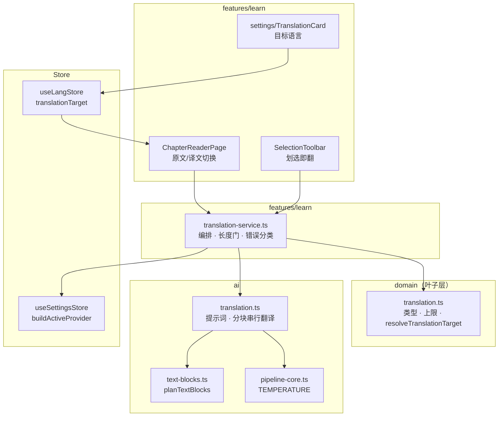
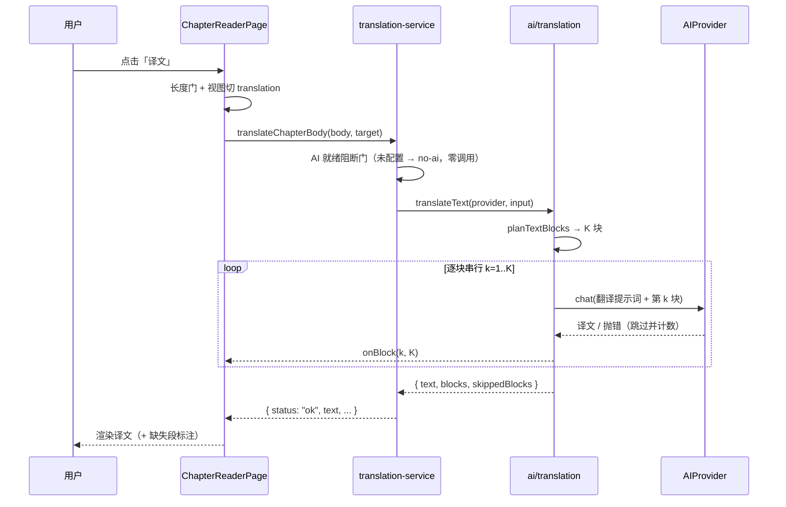

# 章正文 AI 翻译 技术方案

| 字段 | 内容 |
|------|------|
| 作者 | Agent |
| 日期 | 2026-10-21 |
| 状态 | **已完成首版**（2026-10-22 实施，D1–D7 确认；实测偏差见 §13）<br>**2026-10-22 修订**：D3 由「不落库」改判 **C 落 SQLite**，并新增「整库翻译」范围 —— 见 **§14**。§14 之前的内容保留首版原文，涉及 ①②③⑤ 的口径**以 §14 为准**<br>**2026-10-22 已完成 v6 实施**（T13–T28 全部落地，Rust schema 6 / 5 命令 / 级联三处 / 存储三实现 / 渐进渲染 / 整库任务 / 设置页 UI；实施记录与 7 条偏差见 **§15**，门禁结果为 §15.3 快照） |
| 关联需求 | 用户口述：「增加一个翻译的功能，把内容用 AI 翻译成对应的语言」 |

---

## 1. 背景

导入的资料**语言不可控**：PDF / EPUB / 网页摘录里英文技术文档、日文笔记占比很高，而 PLOS 的学习闭环（章内提问、复述、要点、出卷）全部基于 `doc.textPreview` 的原文切片。用户若在中文界面下读一章英文原文，实际是「用第二语言学第一语言的知识」，认知负荷翻倍。

现有 AI 能力（要点提炼 / 章内提问 / 复述 / 即时解释）**都不产出译文**：它们改变的是「对原文的组织与解释」，不是「把原文换成另一种语言」。这是本能力的空白区。

- **痛点**：外文资料读得慢、划线与复述都卡在语言关；机翻工具要复制出去再粘贴回来，脱离学习上下文。
- **与现有模块的关系**：翻译是**只读派生能力** —— 输入是章正文切片，输出是等义文本，**不改任何已落库实体**。
- **不做的影响**：外文资料的完读率与掌握度会系统性偏低，/progress 上的"弱点"其实是语言问题而非知识问题。

## 2. 方案目标

| 类型 | 描述 |
|------|------|
| **主要目标** | 章节阅读页可一键把本章正文 AI 翻译成目标语言（默认跟随界面语言，可覆盖），并可划选任意片段即时翻译；长章自动分块、失败段落如实告知 |
| **非目标** | ~~①译文不落库~~（→ §14 落 SQLite）· ~~③不做整份资料批量翻译~~（→ §14 整库翻译）· ~~⑤不改 `src-tauri/**`~~（→ §14 新增 `translations` 表与 5 个命令）。**仍然成立**：②不做原文/译文逐句对齐与双栏对照；④不引入第三方翻译 API（只走既有 AI provider）；⑥不翻译 UI 文案；⑦译文**不进** F4 导出白名单与 F10 知识包（体积，见 §14.9）；⑧不进证据流、不影响掌握度 |
| **成功标准** | ①阅读页「译文」按钮在 AI 就绪时可点，长章（≤24 000 字）自动分块且拼接后可读；②目标语言可设为"跟随界面语言"或指定语言；③AI 未就绪 / 正文超长 / 调用失败都有明确中文（英文界面下为英文）提示，无白屏无静默截断；④译文模式下划线入口自动隐藏（偏移只对原文有效）；⑤`typecheck` / `layer:check` / `ui:check` / `copy:check` / `test:i18n` 与新增单测全绿 |

## 3. 项目现状

### 3.1 相关代码与模块

| 位置 | 现状 |
|------|------|
| `src/features/learn/ChapterReaderPage.tsx`（625 行，实测） | 左栏渲染章正文：`body = doc.textPreview.slice(chapter.contentRef.start, chapter.contentRef.end)`，`Renderer = pickRenderer(doc.format)`；右栏六区；`SelectionToolbar` 挂在 `bodyBoxRef` 上 |
| `src/features/learn/reader/SelectionToolbar.tsx` | 选区浮层，`mode: "idle" \| "note"`，落库走 `onCreate`；选区长度已被 `ANNOTATION_LIMITS.minQuoteChars / maxQuoteChars` 过滤（≤2 000 字才弹） |
| `src/ai/types.ts` | `AIProvider.chat(input)` 唯一契约；`AiProviderError(code: not-configured / not-implemented / request-failed)` |
| `src/ai/pipeline-core.ts` | `PIPELINE_LIMITS` / `TEMPERATURE` / `chatJson`（**JSON 通道，翻译不需要**）/ `isRecord` / `str` |
| `src/ai/text-blocks.ts` | `planTextBlocks({text, chunkChars, maxChunks, anchorOffsets?})`，语义边界优先（段落空行）的分块内核，已有单测守住「拼接 === 原文」 |
| `src/ai/chapter-map-reduce.ts` | 长章 map-reduce 既有范式：**逐块串行**、单块失败只计数跳过、全失败才判失败 —— 翻译直接沿用这套语义 |
| `src/features/learn/restatement-service.ts` | 服务层范式：长度校验 → 取数 → **AI 就绪阻断门先于任何写入** → 调用 → 错误只产分类（`aiFailureKindOf`），文案由 UI 走 i18n |
| `src/stores/useLangStore.ts` | 界面语言偏好（`plos:lang:v1`，mode: auto/zh/en），`partialize` 只存 `mode` |
| `src/stores/useSettingsStore.ts` | `buildActiveProvider()` 是 provider 唯一构造入口；`providerReady` 经 `hooks/useAiReady` 响应式订阅 |
| `src/features/settings/SettingsPage.tsx` | 分区内容由 URL 段派生；`ai` 分区渲染 `AIModelsSection`，`appearance` 分区持有界面语言切换 |
| `src/features/learn/render/renderer-registry.ts` | `pickRenderer(format)`：markdown → GFM，code → 等宽行号，其余纯文本。**译文复用同一渲染器**以保留 markdown 结构 |

### 3.2 相关文档与约定

- `AGENTS.md`（分层：`domain → engine/ai/storage → stores/services → features`；`engine/` `ai/` 不 import `features/`）
- `docs/learn-highlight-note-design-2026-09.md`（选区浮层与「划选」交互基线）
- `docs/learn-chapter-qa-design-2026-09.md` / `docs/learn-feynman-restatement-design-2026-09.md`（AI 面板的错误分类与降级文案范式）
- `docs/ai-chapter-mapreduce-design-2026-09.md`（长章分块与串行 map 的既有口径）
- `docs/copy-terminology-2026-10.md` + `scripts/copy-scan.mjs`（`copy:check`：设置页 i18n 值不得含实现层技术词）
- `rules/dropdown-select.mdc`：下拉唯一来源 `components/ui/select`，`ariaLabel` 必传

### 3.3 约束与依赖

| 约束 | 说明 |
|------|------|
| ~~**零 `src-tauri` 改动**~~ | **已被 §14 取代（2026-10-22）**。首版以此红线为前提选 D3-A「不落库」；实测重翻代价（7~14 分钟/章，见 §14.1）推翻了该权衡 ⇒ 现新增 `translations` 表。红线**其余部分仍守**：不动任何既有表结构与迁移步骤，只**追加** v6；`storage/tauri.ts` 只加方法不改既有方法 |
| **AI 输出长度** | builtin 侧 `maxTokens` 默认 4096（见 `ai/types.ts` 注释）。翻译输出长度 ≈ 输入长度 ⇒ **块尺寸必须远小于** 要点抽取的 12 000（中文 1 字 ≈ 1 token） |
| **本地小模型** | 默认 `qwen3.5:4b`：长上下文一致性差 ⇒ 必须分块，且每块带章标题保持术语一致 |
| **译文与偏移** | 译文字符偏移与 `doc.textPreview` 无对应关系 ⇒ **译文模式下必须禁用划线 / 引用高亮** |
| **i18n** | 新增文案 zh/en 成对；`ai/` 层**禁值导入 i18n** ⇒ AI 提示词里的语言名用 `domain` 层的英文字面量表，UI 展示名走 i18n |

### 3.4 决策点（D1–Dn）

| ID | 决策点 | 选项 | 推荐 | 理由 |
|----|--------|------|------|------|
| **D1** | 目标语言来源 | A 跟随界面语言 + 设置可覆盖（含 ja/ko/fr/de/es/ru）／B 每次翻译前弹选择／C 固定跟随界面语言 | **A（已确认 2026-10-21）** | 零额外交互覆盖默认场景；「界面中文但想看英文原文」一类反例由设置项兜住 |
| **D2** | 触发入口与范围 | A 整章 + 划选片段／B 仅整章／C 仅划选 | **A（已确认 2026-10-21）** | 整章对应"通读"，划选对应"卡在一句上"，两者互补且共用同一翻译内核 |
| **D3** | 译文是否持久化 | A 不落库（仅当前会话）／B localStorage 独立键缓存／C 主数据库新实体 | **C（2026-10-22 改判，原为 A）** | ⚠️ 原否决理由两条**均不成立**：①「清库留孤儿」现由 `delete_document_impl` 同事务级联 + `clear_library` 加表解决（§14.5）；②「违反红线」是首版排期策略而非永久约束，实测重翻 7~14 分钟/章使 A 不可接受。B 仍排除：整库译文体积远超 localStorage 5–10 MB 配额（与 D12 下沉文档/章节是同一堵墙）。详见 §14.1 |
| **D4** | 译文展示形态 | A 原文/译文切换（同一栏）／B 左右双栏对照 | **A（已确认 2026-10-22，即推荐档）** | 阅读页左栏仅 1fr 宽，双栏会把正文压到不可读；切换式零布局改动，且译文模式顺带禁用划线 |
| **D5** | 译文渲染方式 | A 复用 `pickRenderer(doc.format)`／B 一律纯文本 | **A（已确认 2026-10-22，即推荐档）** | markdown 资料的标题/列表/代码块在译文里应保持结构（提示词要求保留语法），本地模型可做到 |
| **D6** | 分块失败策略 | A 跳过失败块 + 如实标注缺失段数／B 整章判失败 | **A（已确认 2026-10-22，即推荐档）** | 与 `chapter-map-reduce` 既有口径一致；全块失败才判失败 |
| **D7** | 设置项落位 | A AI 分区（模型中心下方）／B appearance 分区（与界面语言并列）／C 新增分区 | **A（已确认 2026-10-22，即推荐档）** | 翻译是 AI 行为，且未配模型时该设置无意义；A 不新增分区键，不动 `settings-nav.ts` / 路由 / `settings.sections` |

---

## 4. 技术架构

### 4.1 总体架构



### 4.2 模块职责

| 模块/层级 | 职责 | 技术选型 |
|-----------|------|----------|
| `domain/translation.ts`（新增） | 目标语言联合类型、翻译上限常量、**目标语言解析纯函数**、AI 提示词用的英文语言名表 | 纯 TS，零依赖 |
| `ai/translation.ts`（新增） | 翻译提示词构造 + 分块串行调用 + 结果拼接；**只产文本，不产 JSON** | `AIProvider.chat` + `planTextBlocks` |
| `ai/pipeline-core.ts`（修改） | 追加 `TEMPERATURE.translation` | — |
| `features/learn/translation-service.ts`（新增） | 长度门 → AI 就绪阻断门 → 调用 → 错误分类；~~**不落库**~~ → **已改判：读写 `translations` 表（§14.5 / §14.12 T24）** | 纯 TS，可 node 直跑 |
| `stores/useLangStore.ts`（修改） | 持久化 `translationTarget`（沿用 `plos:lang:v1`） | zustand persist |
| `features/learn/ChapterReaderPage.tsx`（修改） | 译文状态、切换按钮、错误内联、译文模式禁用划线 | React + i18n |
| `features/learn/reader/SelectionToolbar.tsx`（修改） | 新增「翻译」入口与译文态 | React + i18n |
| `features/settings/TranslationCard.tsx`（新增） | 目标语言下拉（AI 分区内） | `components/ui/select` |

### 4.3 数据模型与 API

**新增类型（`src/domain/translation.ts`）**

```ts
/** 用户可选的翻译目标（auto = 跟随界面语言）。 */
export const TRANSLATION_TARGETS = ["auto","zh","en","ja","ko","fr","de","es","ru"] as const;
export type TranslationTarget = (typeof TRANSLATION_TARGETS)[number];
/** 解析后的实际目标语言（无 auto）。 */
export type TranslationLang = Exclude<TranslationTarget, "auto">;

/**
 * 翻译上限（UI 与服务层共用同一常量，避免两处口径漂移）。
 * ⚠️ bodyMaxChars 由 block* 派生，**不得**另写数字 —— 分块与总量是同一把尺子。
 */
export const TRANSLATION_LIMITS = {
  /** 单块目标字符（输出长度 ≈ 输入长度，须留足 builtin maxTokens=4096 的余量）。 */
  blockChars: 2_000,
  /** 块数硬上限（⇒ 整章正文硬上限 = 2_000 × 12 = 24_000）。 */
  blockMax: 12,
  /** 整章正文硬上限：由上面两项派生。超出 → 拒绝，不静默截断。 */
  get bodyMaxChars(): number { return this.blockChars * this.blockMax; },
} as const;

/** auto → 界面语言；显式值 → 原样返回。唯一解析入口（UI 与 service 共用）。 */
export function resolveTranslationTarget(t: TranslationTarget, uiLang: ResolvedLang): TranslationLang {
  return t === "auto" ? uiLang : t;
}
```

> ⚠️ **实施修正（2026-10-22）**：`TRANSLATION_LIMITS` 最终**没用 getter**，改为「显式标注 `number` 的类型 + 由 `BLOCK_CHARS * BLOCK_MAX` 在**值**上派生」。原因：getter 里的 `this` 在 `as const` 对象里推断不稳，且既有 `LIMITS` 已证明 `as const` 会带出字面量类型（TS2345 的坑）。派生关系靠**计算**保证而非注释，语义与 getter 方案等价（见 §13 偏差 1）。

**AI 层接口（`src/ai/translation.ts`）**

```ts
export interface TranslateInput {
  text: string;              // 待译正文（调用方已切片）
  target: TranslationLang;   // 已解析的目标语言
  /** 上下文：章标题 + 要点，用于保持术语一致（可选）。 */
  context?: { title?: string; keyPoints?: readonly string[] };
  /** 块进度回调（k 从 1 起，K 为总块数）。 */
  onBlock?: (k: number, K: number) => void;
}
export interface TranslateOutput {
  text: string;              // 拼接后的译文
  blocks: number;            // 实际块数
  skippedBlocks: number;     // 失败被跳过的块数（诚实标注，不补写占位）
}
export async function translateText(provider: AIProvider, input: TranslateInput): Promise<TranslateOutput>;
export function buildTranslationMessages(input: {...}): ChatMessage[]; // 纯函数，可单测
```

**服务层接口（`src/features/learn/translation-service.ts`）**

```ts
export type TranslationErrorKind = "no-body" | "too-long" | "no-ai" | AiFailureKind; // AiFailureKind: not-configured|parse|generic|fetch
export type TranslationResult =
  | { status: "ok"; text: string; target: TranslationLang; blocks: number; skippedBlocks: number }
  | { status: "error"; errorKind: TranslationErrorKind; target: TranslationLang };

export async function translateChapterBody(input: {
  body: string; chapterTitle?: string; keyPoints?: readonly string[];
  target: TranslationLang; provider?: AIProvider;
}): Promise<TranslationResult>;

export async function translateSnippet(input: {
  text: string; target: TranslationLang; provider?: AIProvider;
}): Promise<TranslationResult>;
```

**数据读写（遵循 `rules/layer-import-boundaries.mdc`）**

- **读**：页面已持有 `doc` / `chapter` 并算出 `body`，**service 不二次读库**（避免两次 `listChapters` 之间夹着导入导致的"两把尺子"）。
- **写**：~~**无**~~ → **已改判（§14）**：单章翻译成功后写 `translations`（`saveTranslation`），整库任务逐章写。首版「只活在 `useState`」的口径作废。
- **持久化**：仅 `useLangStore.translationTarget` 一个字符串进 `plos:lang:v1`（既有 UI 偏好键，**不新增 key ⇒ 不动导出白名单、不动 `clearAll`**）。
- **桌面能力**：无新增 `invoke`。AI 调用经 `buildActiveProvider()` → 既有 `vault_*` / `llm_*` 链路，纯浏览器预览下由 `providerReady` 守卫。

### 4.4 状态与副作用

| 状态 | 位置 | 说明 |
|------|------|------|
| `viewMode: "source" \| "translation"` | `ChapterReaderPage` 局部 state | 切换视图；切章 / 目标语言变化时重置为 `source` 并清空译文 |
| `translation: { text; target; skippedBlocks } \| undefined` | 同上 | ~~会话内缓存~~ → **已改判（§14.10）**：改为 `parts: (string \| null)[]` + `total`（渐进渲染），且持久化后由 `useTranslationIndexStore` + `getTranslation` 提供跨会话命中 |
| `translationError` | 同上 | 内联错误 + 重试 |
| `translationTarget` | `useLangStore`（persist） | 全局偏好；设置页与阅读页共享 |
| AI 任务进度 | `useAiTaskStore`（既有） | 复用 `useAiTask("translation:<chapterId>")` 的 `run/report`，与全站 loading 口径一致 |

**副作用时机**：整章翻译**只在用户点击「译文」时触发**（不自动翻译 —— 长章多块调用耗时长且烧 token，自动触发是体验灾难）。目标语言在设置页被修改 → 阅读页 `useEffect` 监听 `resolvedTarget` 变化 → 清空译文并回到原文视图。

---

## 5. 交互流程

### 5.1 主流程（整章翻译）

1. 用户打开 `/learn/chapter/<id>`，左栏显示原文。
2. 标题行右侧出现「译文」按钮（AI 未就绪时禁用 + 提示去配置）。
3. 点「译文」→ 按钮转 loading（复用 `useAiTask` 进度文案："正在翻译… 2/5"）。
4. service 依次：正文非空校验 → 长度门（≤24 000）→ AI 就绪阻断门 → 分块串行翻译 → 拼接。
5. 成功：左栏改为渲染译文（同一 `pickRenderer`），标题行变「原文 / 译文」切换组；若 `skippedBlocks > 0`，正文下方如实标注「N 段未翻译」。
6. 失败：左栏保持原文，按钮下方内联错误文案 + 「重试」。

### 5.2 分支与异常流程

| 场景 | 触发条件 | 系统行为 | UI 反馈 |
|------|----------|----------|---------|
| AI 未就绪 | `useAiReady() === false` | 不调用 | 「译文」按钮禁用，旁注「AI 未就绪——请先到设置配置模型」+ 去配置链接 |
| 无正文快照 | `doc.textPreview` 为空 / 章切片为空 | 不调用 | 沿用既有 `t.noSnapshot` |
| 正文超长 | `body.length > 24_000` | 不调用、不截断 | 「这一章太长了（N 字，上限 24 000），暂时无法整章翻译；可划选片段翻译。」 |
| 模型输出为空 | `chat` 返回空串 | 该块计 skipped | 全部跳过 → 判 `parse` 错误 + 重试 |
| 部分块失败 | 某块抛错 | 跳过该块、计数 | 成功但标注「N/K 段未翻译，其余为原文」 |
| 全部块失败 | `skippedBlocks === blocks` | 抛错 | 判 `parse` / `generic`，内联错误 + 重试 |
| 译文模式下划选 | 用户在译文里选文本 | 不弹工具条 | 静默（译文偏移无意义，不给无效入口） |
| 划选片段翻译失败 | 片段调用抛错 | 工具条切回 idle | 工具条内联错误文案 |

### 5.3 时序图（整章翻译）



---

## 6. 用户用例（User Cases）

### UC-01：整章翻译为界面语言

| 项 | 内容 |
|----|------|
| 角色 | 学习者（界面中文，资料为英文） |
| 前置条件 | 已配置 AI 模型；章正文非空且 ≤24 000 字 |
| 主流程 | 1. 打开章节 → 2. 点「译文」→ 3. 等待进度 → 4. 阅读译文 |
| 期望结果 | 左栏显示流畅中文译文，markdown 结构（标题/列表/代码块）保留；可随时切回原文 |
| 异常/边界 | AI 未就绪 → 按钮禁用；正文超长 → 明确上限提示；部分块失败 → 标注缺失段数 |

### UC-02：指定目标语言（覆盖界面语言）

| 项 | 内容 |
|----|------|
| 角色 | 学习者（界面中文，但想看英文资料的中英对照感 / 或想把中文资料译成日文） |
| 前置条件 | 设置 → AI 分区已选模型 |
| 主流程 | 1. 设置 → AI → 翻译目标语言选「日本語」→ 2. 回到章节点「译文」 |
| 期望结果 | 译文为日文；偏好持久化，换章/重启后仍是日文；切回「跟随界面语言」即恢复默认 |
| 异常/边界 | 界面语言切换时，若目标为 auto，已缓存译文按新目标失效并回到原文视图 |

### UC-03：划选片段即时翻译

| 项 | 内容 |
|----|------|
| 角色 | 学习者（整章不翻，只卡在某一段） |
| 前置条件 | 在原文视图中选中 2–2 000 字 |
| 主流程 | 1. 选中 → 浮层出现 → 2. 点「翻译」→ 3. 浮层内显示译文 → 4. 关闭 |
| 期望结果 | 单次调用即出译文、不影响划线；工具条原有「划线」行为零回归。**片段翻译不落库**（§14.5 末注）—— 落库的只有整章译文 |
| 异常/边界 | 译文模式下不弹浮层；片段翻译失败 → 工具条内联错误并回到 idle |

### UC-04：AI 未就绪

| 项 | 内容 |
|----|------|
| 前置条件 | 未选模型 / 模型不可用 |
| 期望结果 | 「译文」按钮禁用并说明原因；划选浮层「翻译」按钮同样禁用（与「问这一章」面板同款口径） |

---

## 7. 线框 UI（Wireframe）

### 7.1 章节阅读页左栏 — 默认（原文）

```
┌──────────────────────────────────────────────────────┐
│ 3.2 Attention Is All You Need          [ 译文 ⇄ ]    │  ← 标题行右侧按钮
├──────────────────────────────────────────────────────┤
│  The dominant sequence transduction models are based   │
│  on complex recurrent…                                │
│                                                       │
└──────────────────────────────────────────────────────┘
```

### 7.2 译文视图（成功 / 部分缺失 / 加载 / 错误）

```
成功：
┌──────────────────────────────────────────────────────┐
│ 3.2 …                        [ 原文 ] [ 译文 ✓ ]      │  ← 切换组（Button sm + aria-pressed）
├──────────────────────────────────────────────────────┤
│  主流序列转换模型基于复杂的循环…                        │
└──────────────────────────────────────────────────────┘

部分缺失（skippedBlocks=1 / K=4）：
├──────────────────────────────────────────────────────┤
│  主流序列转换模型…                                     │
│  ⓘ 4 段中有 1 段未翻译，该段仍显示原文                  │  ← text-xs text-ink-3，data-testid
└──────────────────────────────────────────────────────┘

加载中：译文按钮区显示「正在翻译… 2/4」（useAiTask 进度）
错误：  ┌────────────────────────────────────────────┐
        │ 翻译失败：<按 errorKind 取 i18n>   [ 重试 ]  │
        └────────────────────────────────────────────┘
```

### 7.3 划选浮层（新增「翻译」）

```
   ┌────────────────────────────────┐
   │ ▏划线  ▏划线并记笔记  ⇄ 翻译    │   ← idle 态新增第三按钮
   └────────────────────────────────┘

   ┌────────────────────────────────┐
   │ 主流序列转换模型基于复杂的…      │   ← translate 态：可滚动，max-h-40
   │ ─────────────────────────────  │
   │                        [ 关闭 ] │
   └────────────────────────────────┘
```

- 布局：沿用既有浮层容器（`absolute z-20 rounded-lg border border-line bg-surface shadow-lg`），译文区 `max-h-40 overflow-y-auto text-xs leading-5`。
- `data-testid`：`reader-selection-translate`（按钮）、`reader-selection-translation`（译文区）。
- 键盘可达性：Esc 关闭（既有）；新增按钮纳入 Tab 序（`Button` 原生支持）。
- **不用 Toast**：所有反馈就近内联（与既有面板一致）。

### 7.4 设置 → AI 分区（新增卡片，位于模型中心下方）

```
┌──────────────────────────────────────────────┐
│ 翻译                                          │
│ 把资料正文翻成哪种语言                          │
│   [ 跟随界面语言            ▾ ]                │  ← components/ui/select，ariaLabel 必传
│   译文只在当前阅读页生效，不会保存到你的资料里    │  ← ⚠️ 作废（§14.11）：落库后这是假话，必须删
└──────────────────────────────────────────────┘
```

---

## 8. 涉及文件及改动伪代码

### 8.1 `src/domain/translation.ts`（新增）

**改动说明**：类型 + 上限常量 + 解析纯函数 + AI 提示词用的英文语言名表（**不放 i18n**，因为 `ai/` 禁值导入 i18n）。

```ts
// 伪代码 — 仅表达意图
import type { ResolvedLang } from "../i18n/types"; // ⚠️ 仅 import type（domain 是叶子层，类型引用可接受）

export const TRANSLATION_TARGETS = ["auto","zh","en","ja","ko","fr","de","es","ru"] as const;
export type TranslationTarget = (typeof TRANSLATION_TARGETS)[number];
export type TranslationLang = Exclude<TranslationTarget, "auto">;

export const TRANSLATION_LIMITS = {
  blockChars: 2_000,
  blockMax: 12,
  get bodyMaxChars() { return this.blockChars * this.blockMax; }, // 24_000，派生而非另写
};

/** AI 提示词用的英文语言名（机器读；UI 展示名在 i18n，两侧各自独立）。 */
export const TRANSLATION_LANG_EN: Record<TranslationLang, string> = {
  zh: "Simplified Chinese", en: "English", ja: "Japanese", ko: "Korean",
  fr: "French", de: "German", es: "Spanish", ru: "Russian",
};

export function isTranslationTarget(v: unknown): v is TranslationTarget { /* 白名单包含判定 */ }

export function resolveTranslationTarget(t: TranslationTarget, uiLang: ResolvedLang): TranslationLang {
  return t === "auto" ? uiLang : t;
}
```

> ⚠️ **块尺寸不做自适应**：翻译的块尺寸恒取 `TRANSLATION_LIMITS.blockChars`（2 000），与要点抽取的 `adaptiveChunkChars`（按 `ceil(len/maxChunks)` 缩块）**刻意不同** —— 翻译的约束是「输出长度 ≈ 输入长度且受 `maxTokens` 限制」，块越小越安全；按长度反推缩块会在长章上把块压到几百字、碎成十几块（术语割裂 + 调用变慢）。块数上限由 `blockMax` 保证，超限由 `bodyMaxChars` 提前拒绝，因此不需要第二把尺子。

> ⚠️ `domain` 引用 `ResolvedLang` 若触发 `layer:check` 的叶子层断言，改为在 `domain/translation.ts` 内联 `type UiLang = "zh" | "en"`；实施时以门禁实测为准。

### 8.2 `src/ai/translation.ts`（新增）

**改动说明**：翻译提示词 + 分块串行调用。**不走 `chatJson`**（译文是纯文本，套 JSON 会浪费 token 且增加截断风险）。

```ts
import { planTextBlocks } from "./text-blocks";
import { TEMPERATURE } from "./pipeline-core";
import { TRANSLATION_LANG_EN, TRANSLATION_LIMITS } from "../domain/translation";

export function buildTranslationMessages(input: {
  target: TranslationLang;
  text: string;
  context?: { title?: string; keyPoints?: readonly string[] };
  /** 多块时为模型提供位置感（避免重复开头/结尾套话）。 */
  blockIndex?: number; blockTotal?: number;
}): ChatMessage[] {
  const lang = TRANSLATION_LANG_EN[input.target];
  // system：翻译规则（唯一真源，勿复制到别处）
  //   1. 只输出译文，不加任何说明、注释、前后缀；
  //   2. 保留原文的 Markdown 结构与代码块内容（命令/标识符/路径不译）；
  //   3. 专有名词、人名、产品名首次出现保留原文并括注译名；
  //   4. 不补充原文没有的内容，不省略任何段落。
  // user：可选「本章标题 / 本章要点」作术语上下文 + 正文。
  return [ { role: "system", content: SYSTEM }, { role: "user", content: user } ];
}

export async function translateText(provider: AIProvider, input: TranslateInput): Promise<TranslateOutput> {
  const text = input.text.trim();
  if (text.length === 0) throw new AiProviderError("request-failed", "正文为空，无法翻译。");
  if (!provider.isConfigured()) throw new AiProviderError("not-configured", "AI 未就绪。");

  const blocks = planTextBlocks({ text, chunkChars: TRANSLATION_LIMITS.blockChars, maxChunks: TRANSLATION_LIMITS.blockMax });
  // 单块（短章）：一次调用，与多块共用同一提示词构造。
  if (blocks.length <= 1) {
    const { content } = await provider.chat({
      messages: buildTranslationMessages({ target: input.target, text, ...(input.context ? { context: input.context } : {}) }),
      temperature: TEMPERATURE.translation,
    });
    if (!content?.trim()) throw new AiProviderError("request-failed", "AI 返回了空译文。");
    return { text: content.trim(), blocks: 1, skippedBlocks: 0 };
  }

  const parts: string[] = [];
  let skipped = 0;
  for (let k = 0; k < blocks.length; k++) {
    input.onBlock?.(k + 1, blocks.length);
    try {
      const { content } = await provider.chat({
        messages: buildTranslationMessages({
          target: input.target,
          text: text.slice(blocks[k].start, blocks[k].end),
          blockIndex: k, blockTotal: blocks.length,
          ...(input.context ? { context: input.context } : {}),
        }),
        temperature: TEMPERATURE.translation,
      });
      if (!content?.trim()) { skipped++; continue; }
      parts.push(content.trim());
    } catch { skipped++; }
  }
  if (parts.length === 0) throw new AiProviderError("request-failed", "全部段落翻译失败。");
  // 块间用空行拼接（保持段落边界，与 planTextBlocks 的语义边界口径同源）。
  return { text: parts.join("\n\n"), blocks: blocks.length, skippedBlocks: skipped };
}
```

### 8.3 `src/ai/pipeline-core.ts`（修改）

**改动说明**：温度表追加一档。翻译偏稳定（与 `refine` 同档 0.2）—— 温度高小模型会开始"润色"甚至改写。

```ts
export const TEMPERATURE = { /* 既有 */ refine: 0.2, quiz: 0.3, grade: 0.1, concept: 0.2, keyPoint: 0.2, explain: 0.1,
  /** 翻译：忠实优先，禁止模型自由发挥。 */
  translation: 0.2 } as const;
```

### 8.4 `src/features/learn/translation-service.ts`（新增）

**改动说明**：编排层。长度门 → AI 就绪阻断门 → 调用 → 错误只产分类；~~**零写入**（D3-A）~~ → **已改判（§14.5）**：新增 `readCachedTranslation` / `persistTranslation` 两个读写入口，`translateChapterBody` 本身仍不直接碰 storage（写入由调用方决定，片段翻译不写库）。

```ts
export async function translateChapterBody(input: {
  body: string; target: TranslationLang;
  chapterTitle?: string; keyPoints?: readonly string[];
  provider?: AIProvider;
}): Promise<TranslationResult> {
  const body = input.body.trim();
  if (body.length === 0) return { status: "error", errorKind: "no-body", target: input.target };
  if (body.length > TRANSLATION_LIMITS.bodyMaxChars)
    return { status: "error", errorKind: "too-long", target: input.target };

  const provider = input.provider ?? buildActiveProvider();
  if (!provider.isConfigured()) return { status: "error", errorKind: "no-ai", target: input.target }; // 阻断门，零调用

  try {
    const out = await translateText(provider, {
      text: body,
      target: input.target,
      ...(input.chapterTitle || input.keyPoints?.length
        ? { context: { ...(input.chapterTitle ? { title: input.chapterTitle } : {}),
                       ...(input.keyPoints?.length ? { keyPoints: input.keyPoints } : {}) } }
        : {}),
    });
    return { status: "ok", text: out.text, target: input.target, blocks: out.blocks, skippedBlocks: out.skippedBlocks };
  } catch (err) {
    return { status: "error", errorKind: aiFailureKindOf(err), target: input.target };
  }
}

/** 划选片段：单次调用，长度上限复用 ANNOTATION_LIMITS.maxQuoteChars（同为「用户选区」口径，不造第二把尺子）。 */
export async function translateSnippet(input: { text: string; target: TranslationLang; provider?: AIProvider; }): Promise<TranslationResult> {
  const text = input.text.trim();
  if (text.length === 0) return { status: "error", errorKind: "no-body", target: input.target };
  if (text.length > ANNOTATION_LIMITS.maxQuoteChars) return { status: "error", errorKind: "too-long", target: input.target };
  const provider = input.provider ?? buildActiveProvider();
  if (!provider.isConfigured()) return { status: "error", errorKind: "no-ai", target: input.target };
  try {
    const out = await translateText(provider, { text, target: input.target });
    return { status: "ok", text: out.text, target: input.target, blocks: out.blocks, skippedBlocks: out.skippedBlocks };
  } catch (err) {
    return { status: "error", errorKind: aiFailureKindOf(err), target: input.target };
  }
}
```

### 8.5 `src/stores/useLangStore.ts`（修改）

**改动说明**：加翻译目标偏好。**沿用 `plos:lang:v1`** ⇒ 不新增 localStorage key、不动导出白名单、不动 `clearAll`。

```ts
interface LangState {
  mode: LangMode;
  /** 翻译目标语言（auto = 跟随界面语言）。缺省 auto，零迁移成本。 */
  translationTarget: TranslationTarget;
  setMode: (mode: LangMode) => void;
  setTranslationTarget: (t: TranslationTarget) => void;
}
// persist({ name: "plos:lang:v1", partialize: (s) => ({ mode: s.mode, translationTarget: s.translationTarget }) })
// ⚠️ 旧数据缺字段 → 由 zustand merge 补默认 auto（persist 默认浅合并，实测确认；若不合并在 merge 里补）
```

### 8.6 `src/features/learn/ChapterReaderPage.tsx`（修改）

**改动说明**：新增译文视图与切换；**译文模式下不挂载 `SelectionToolbar`**。

```tsx
const { m, lang } = useI18n();
const tt = m.learn.reader.translation;
const uiTarget = useLangStore((s) => s.translationTarget);
const target = resolveTranslationTarget(uiTarget, lang);          // 唯一解析入口
const aiReady = useAiReady();
const [view, setView] = useState<"source" | "translation">("source");
const [tr, setTr] = useState<{ text: string; target: TranslationLang; blocks: number; skipped: number } | undefined>();
const [trErr, setTrErr] = useState<TranslationErrorKind | undefined>();
const task = useAiTask(`translation:${chapterId}`);

// 目标语言变化 → 已缓存译文失效（不重翻，回到原文，避免用户读到"上一次的日语"）
useEffect(() => { setView("source"); setTr(undefined); setTrErr(undefined); }, [target, chapterId]);

const showTranslation = async () => {
  if (tr && tr.target === target) { setView("translation"); return; }   // 会话内复用
  setTrErr(undefined);
  const r = await task.run(async (report) =>
    translateChapterBody({
      body, target,
      ...(chapter?.title ? { chapterTitle: chapter.title } : {}),
      ...(keyPoints.length ? { keyPoints } : {}),
      // 进度由 translateText 的 onBlock 回调驱动（service 需透传 onBlock —— 实施时补参数）
    }),
  ).catch(() => undefined);
  if (!r) return;
  if (r.status === "ok") { setTr({ text: r.text, target: r.target, blocks: r.blocks, skipped: r.skippedBlocks }); setView("translation"); }
  else setTrErr(r.errorKind);
};

// 渲染
<h1>…<div className="flex gap-1">
  {view === "translation" ? <Button size="sm" variant="ghost" onClick={() => setView("source")} data-testid="reader-view-source">{tt.source}</Button> : null}
  <Button size="sm" variant={view === "translation" ? "secondary" : "ghost"} disabled={!aiReady || task.running}
          aria-pressed={view === "translation"} onClick={() => void showTranslation()}
          data-testid="reader-translation-toggle">
    {task.running ? tt.running : tt.target}
  </Button>
</div></h1>

<div ref={bodyBoxRef} className="relative mt-4 border-t border-line pt-5">
  <div ref={bodyRef} className="break-words">
    {view === "translation" && tr ? (
      <RenderErrorBoundary resetKey={`tr:${chapter.id}`} fallback={<PlainTextRenderer text={tr.text} doc={doc} />}>
        <Renderer text={tr.text} doc={doc} />
      </RenderErrorBoundary>
    ) : body.length > 0 ? ( /* 既有原文渲染 */ ) : ( <p>{t.noSnapshot}</p> )}
  </div>
  {view === "translation" && tr && tr.skipped > 0 ? (
    <p data-testid="reader-translation-skipped" className="mt-3 text-xs text-ink-3">{tt.skipped(tr.skipped, tr.blocks)}</p>
  ) : null}
  {trErr ? (
    <div data-testid="reader-translation-error" className="mt-3 flex items-center gap-2 text-xs text-ink-2">
      <span>{errorText(trErr)}</span>
      <Button size="sm" variant="ghost" onClick={() => void showTranslation()} data-testid="reader-translation-retry">{tt.retry}</Button>
    </div>
  ) : null}
  {/* ⚠️ 译文模式下不挂载：译文偏移与 doc.textPreview 无关，划线会产出假引用 */}
  {view === "source" ? (
    <SelectionToolbar rootRef={bodyRef} hostRef={bodyBoxRef} onCreate={handleCreateAnnotation}
                      onTranslate={handleTranslateSelection} translateEnabled={aiReady} />
  ) : null}
</div>
```

### 8.7 `src/features/learn/reader/SelectionToolbar.tsx`（修改）

**改动说明**：`mode` 增 `"translate"`；新增 `onTranslate` / `translateEnabled` props。

```tsx
interface SelectionToolbarProps {
  rootRef; hostRef; onCreate;
  /** 划选翻译（服务层调用由页面注入）；AI 未就绪时按钮禁用。 */
  onTranslate: (quote: string) => Promise<{ status: "ok"; text: string } | { status: "error"; kind: TranslationErrorKind }>;
  translateEnabled: boolean;
}
type Mode = "idle" | "note" | "translate";
// idle 态追加：<Button size="sm" variant="ghost" disabled={!translateEnabled || busy}
//                data-testid="reader-selection-translate" onClick={runTranslate}>⇄ {t.translate.action}</Button>
// translate 态：<div className="max-h-40 w-72 overflow-y-auto p-2 text-xs leading-5" data-testid="reader-selection-translation">{sel.translation}</div> + [关闭]
```

### 8.8 `src/features/settings/TranslationCard.tsx`（新增）

**改动说明**：AI 分区内的目标语言下拉。`components/ui/select`（`rules/dropdown-select.mdc`：`ariaLabel` 必传、`className` 只覆写宽度与背景）。

```tsx
export default function TranslationCard({ st }: { st: Messages["settings"] }) {
  const t = st.ai.translation;
  const target = useLangStore((s) => s.translationTarget);
  const setTarget = useLangStore((s) => s.setTranslationTarget);
  return (
    <Card className="space-y-2">
      <div><p className="text-sm font-medium text-ink-1">{t.title}</p><p className="text-xs text-ink-3">{t.desc}</p></div>
      <Select value={target} onValueChange={(v) => isTranslationTarget(v) && setTarget(v)}
              ariaLabel={t.title} className="w-56"
              items={TRANSLATION_TARGETS.map((v) => ({ value: v, label: t.options[v] }))} />
      <p className="text-xs text-ink-3">{t.sessionOnly}</p>
    </Card>
  );
}
```

> ⚠️ `Select` 的真实 API（`items` / `onValueChange` 签名）以 `src/components/ui/select.tsx` 实测为准，实施时先读该文件。

### 8.9 `src/features/settings/SettingsPage.tsx`（修改）

**改动说明**：`section === "ai"` 分支在 `AIModelsSection` 之后追加 `<TranslationCard st={st} />`。**不新增分区键**（D7-A）。

### 8.10 `src/i18n/messages/zh.ts` / `en.ts`（修改，成对）

**改动说明**：新增两组键，zh/en 严格同构（`test:i18n` 只锁同构）。

```ts
// m.learn.reader.translation
{ source: "原文", target: "译文", running: "翻译中…", retry: "重试",
  runningAt: (k: number, total: number) => `翻译中… ${k}/${total}`,
  skipped: (n: number, total: number) => `${total} 段里有 ${n} 段没能翻译出来，已跳过。`,
  tooLong: (n: number, max: number) => `这一章太长了（${n} 字，上限 ${max} 字），暂时无法整章翻译；可以划选片段翻译。`,
  noAi: "AI 未就绪——请先到「设置 → AI 模型中心」配置模型。", goConfigure: "去配置 AI →",
  errors: { "no-body": "这一章没有正文，无法翻译。", "too-long": "内容太长，无法一次翻译。", "no-ai": "…",
            "not-configured": "…", parse: "AI 这次没有给出可用的译文，请重试。",
            generic: "翻译失败，请稍后重试。", fetch: "读取资料失败，请重试。" } }
// m.learn.reader.annotations.translate（工具条内）
{ action: "翻译", loading: "翻译中…", failed: "这段没能翻译出来，请重试。", close: "关闭" }
// m.settings.models.translation —— ⚠️ 实施修正：不存在 settings.ai 命名空间，
// AI 分区的文案节实际是 models（见 §13 偏差 2）
{ title: "翻译", desc: "阅读时把资料正文翻成哪种语言。",
  options: { auto: "跟随界面语言", zh: "中文", en: "English", ja: "日本語", ko: "한국어", fr: "Français", de: "Deutsch", es: "Español", ru: "Русский" },
  sessionOnly: "译文只在当前阅读页生效，不会写进你的资料。",
  noAi: "配置 AI 模型后才会生效。" }
```

> `copy:check`：以上设置页文案不含实现层技术词（"跟随界面语言""译文只在当前阅读页生效"均为用户语言），语言名为专有名词属 E/F 类豁免。

> ⚠️ **`skipped` 措辞是实施修正**：方案初稿写「该段仍显示原文」，但实现里失败块是
> **纯跳过**（不写占位、也不回填原文）—— 照初稿写就是**文案撒谎**。已改为
> 「已跳过」，与 `translateText` 的 `parts.join("\n\n")` 行为一致（见 §13 偏差 3）。

### 8.11 `tests/learn-translation.test.ts`（新增）

**改动说明**：纯逻辑单测（node `--experimental-strip-types` 直跑，不 import `.tsx`）。

---

## 9. 任务清单（Tasks）

> ⚠️ 本表是**首版（T1–T12，已完成）**的记录。2026-10-22 修订新增的 T13–T28 见 **§14.12**，
> 依赖关系跨两表（T14 依赖 T13、T21 依赖 T18…），排期以 §14.12 为准。

| ID | 任务 | 依赖 | 预估 |
|----|------|------|------|
| T1 | `domain/translation.ts`：类型 + `TRANSLATION_LIMITS` + `resolveTranslationTarget` + 英文语言名表 | — | S |
| T2 | i18n：zh/en 新增 `learn.reader.translation` / `reader.annotations.translate` / `settings.ai.translation` | T1 | S |
| T3 | `ai/pipeline-core.ts` 追加 `TEMPERATURE.translation` | — | S |
| T4 | `ai/translation.ts`：提示词 + 分块串行翻译 + 空输出/全失败处理 | T1 T3 | M |
| T5 | `features/learn/translation-service.ts`：长度门 + AI 阻断门 + 错误分类 | T4 | M |
| T6 | `stores/useLangStore.ts`：加 `translationTarget` 与持久化 | T1 | S |
| T7 | `ChapterReaderPage.tsx`：译文视图 + 切换 + 错误内联 + 译文模式禁用划线 | T5 T6 T2 | M |
| T8 | `SelectionToolbar.tsx`：划选翻译入口与译文态 | T5 T2 | M |
| T9 | `settings/TranslationCard.tsx` + `SettingsPage.tsx` 接线（AI 分区） | T6 T2 | M |
| T10 | `tests/learn-translation.test.ts` 单测 | T1 T4 T5 | M |
| T11 | 门禁全量：`typecheck` / `layer:check` / `ui:check` / `copy:check` / `test:i18n` / 新增单测 | T7–T10 | S |
| T12 | 文档同步：本方案状态 + runbook 收尾 | T11 | S |

## 10. 实施步骤

1. **T1 → T3 → T4**：先落地纯逻辑内核（domain + ai），用单测锁住分块与常量派生关系。
   - 验证：`node --experimental-strip-types --no-warnings --import ./tests/register-loader.mjs tests/learn-translation.test.ts`（先写 T10 的纯函数部分）
2. **T5**：服务层编排（无 UI，可单测）。
3. **T6 + T2**：偏好与文案（i18n 早于 UI，符合提交惯例）。
4. **T7**：阅读页整章译文（主路径）。
5. **T8**：划选翻译（在 T7 稳定后接，避免两个入口同时调试）。
6. **T9**：设置卡片。
7. **T10 → T11**：补齐单测并跑全部门禁。
8. **T12**：回写文档。

**回滚策略**：能力集中在 1 新增 domain + 1 新增 ai + 1 新增 service + 3 处 UI 接线；`git revert` 按提交分组回退即可。偏好字段 `translationTarget` 留在 `plos:lang:v1` 是**无害残留**（旧版本读不到该键直接忽略），不需要数据迁移。

## 11. 测试方案

### 11.1 范围与策略

| 层级 | 工具/方式 | 覆盖重点 | 不负责 |
|------|-----------|----------|--------|
| 单元 | `tests/learn-translation.test.ts`（node 直跑） | 目标语言解析、上限派生、分块连续性与拼接、错误分类、空输出跳过 | React 渲染 |
| 集成 | 手工（桌面实跑，非 headless） | 整章翻译结果可读性、markdown 结构保留、进度文案 | 自动化断言 |
| E2E | 不新增（受 `no-headless-browser-validation` 约束，默认禁用） | — | — |
| 手工 | 用户实跑 | 本地 4b 模型译文质量、长章耗时、划选浮层体验 | — |
| 门禁 | `typecheck` / `layer:check` / `ui:check` / `copy:check` / `test:i18n` | 分层边界、原生 select 禁用、设置页文案、zh/en 同构 | — |

### 11.2 环境与数据

- mock provider：实现 `AIProvider` 的 `chat` 返回固定串 / 按块抛错（用于 skipped 分支）。
- fixture：一段 markdown 正文（含标题、列表、代码块），长度分别取 800（单块）/ 5 000（多块）/ 25 000（超长）。

### 11.3 通过标准

- 新增单测全绿；`typecheck` / `layer:check` / `ui:check` / `copy:check` / `test:i18n` 全绿。
- 桌面端人工确认：AI 就绪时整章译文可读、划选翻译可用、AI 未就绪时两处入口均禁用且有说明。

## 12. 测试用例

| ID | 关联 UC | 步骤 | 输入/操作 | 期望结果 | 类型 |
|----|---------|------|-----------|----------|------|
| TC-UC01-01 | UC-01 | 解析目标语言 | `resolveTranslationTarget("auto","zh")` | `"zh"` | 单元 |
| TC-UC01-02 | UC-01 | 解析目标语言 | `resolveTranslationTarget("auto","en")` | `"en"` | 单元 |
| TC-UC01-03 | UC-02 | 显式覆盖 | `resolveTranslationTarget("ja","zh")` | `"ja"` | 单元 |
| TC-UC01-04 | UC-01 | 上限派生 | `TRANSLATION_LIMITS.bodyMaxChars` | `24_000`（= 2 000 × 12） | 单元 |
| TC-UC01-05 | UC-01 | 短章单块 | `planTextBlocks({text: 1_500 字, chunkChars: 2_000, maxChunks: 12})` | `blocks.length === 1`，`[0, 1_500)` | 单元 |
| TC-UC01-06 | UC-01 | 分块覆盖 | `planTextBlocks({text: 5_000 字, chunkChars: 2_000, maxChunks: 12})` | 块数 ≤ 12（**实测 3 块**：无空行 ⇒ 硬切 2 000/2 000/1 000）；首块 start=0、末块 end=5 000；相邻块 `end === next.start`；各块切片拼接 === 原文 | 单元 ✅ |
| TC-UC01-15 | UC-01 | 上限处刚好装下 | `planTextBlocks({text: 24_000 字, chunkChars: 2_000, maxChunks: 12})` | 块数 ≤ 12（实测 12 块）；拼接 === 原文 | 单元 ✅ |
| TC-UC01-07 | UC-01 | 超长拒绝 | `translateChapterBody({body: 25_000 字})` | `{status:"error", errorKind:"too-long"}`，provider 零调用 | 单元 |
| TC-UC01-08 | UC-01 | 空正文 | `translateChapterBody({body:""})` | `errorKind:"no-body"` | 单元 |
| TC-UC01-09 | UC-04 | AI 阻断门 | provider `isConfigured()===false` | `errorKind:"no-ai"`，`chat` 零调用 | 单元 |
| TC-UC01-10 | UC-01 | 全块失败 | mock provider 每块抛错 | 抛错 → `errorKind:"parse"`（AiProviderError request-failed） | 单元 |
| TC-UC01-11 | UC-01 | 部分块失败 | 5 块中第 2、4 块抛错 | `{status:"ok", skippedBlocks:2}`，译文由 3 块拼接且不含占位文本 | 单元 |
| TC-UC01-12 | UC-01 | 空输出块 | 某块返回 `""` | 该块计 skipped，不写入空串占位 | 单元 |
| TC-UC03-01 | UC-03 | 片段翻译 | `translateSnippet({text: 500 字})` | 单次调用（mock 记录 `chat` 次数 === 1），返回 ok | 单元 |
| TC-UC03-02 | UC-03 | 片段超长 | `translateSnippet({text: 2_001 字})` | `errorKind:"too-long"` | 单元 |
| TC-UC02-01 | UC-02 | 偏好持久化 | 设置选「日本語」→ 重载页面 | `useLangStore.translationTarget === "ja"`，阅读页解析为 `ja` | 手工 |
| TC-UC01-13 | UC-01 | 译文质量 | 桌面实跑：英文 markdown 章 → 译文 | 标题/列表/代码块结构保留；代码标识符未被翻译 | 手工 |
| TC-UC01-14 | UC-01 | 译文模式划线 | 译文视图中选中文本 | 不弹出选区浮层 | 手工 |

### 12.1 边界与回归

| ID | 场景 | 期望 |
|----|------|------|
| TC-EDGE-01 | 目标语言从 `ja` 切回 `auto`（界面 zh） | 已缓存译文失效、视图回到原文，不会读到旧译文 |
| TC-EDGE-02 | 切到另一章再切回 | 译文缓存按 `chapterId` 隔离；重翻而非串章 |
| TC-EDGE-03 | 章正文含代码块 | 代码内容保持原样（提示词约束 + 人工确认） |
| TC-EDGE-04 | 既有「划线」「划线并记笔记」 | 行为零回归（TC-UC01-14 之外，原文视图下完全一致） |
| TC-EDGE-05 | 导出 / 清库 | 译文不入导出；`plos:lang:v1` 多一个字段不影响既有导入导出 |
| TC-EDGE-06 | `layer:check` | service 不 import 新的上游层；`ai/` 未 import `features/` |

> ✅ **已实测回写（2026-10-22）**：TC-UC01-06 = 3 块、TC-UC01-15 = 12 块（fixture 为无空行正文，故只发生硬切）。
> 单测里除「精确块数」外仍保留「≤ 12 / 覆盖全文 / 相邻块首尾相接 / 拼接 === 原文」四条硬断言 —— 前者锁当前算法，
> 后者才是真不变式（将来若给 `planTextBlocks` 加段落边界微调，改一个数字即可，不会误报）。

---

## 13. 实施记录（2026-10-22）

### 13.1 落地文件

| 文件 | 类型 | 说明 |
|------|------|------|
| `src/domain/translation.ts` | 新增 | `TRANSLATION_TARGETS` / `TranslationLang` / `TRANSLATION_LIMITS` / `TRANSLATION_LANG_EN` / `isTranslationTarget` / `resolveTranslationTarget` |
| `src/domain/index.ts` | 修改 | re-export `./translation` |
| `src/ai/translation.ts` | 新增 | `buildTranslationMessages` / `translateText`（纯文本通道、恒 2 000 字分块、串行、跳过计数、`onBlock` 进度） |
| `src/ai/pipeline-core.ts` | 修改 | `TEMPERATURE.translation = 0.2` |
| `src/features/learn/translation-service.ts` | 新增 | `translateChapterBody` / `translateSnippet`（长度门 → 就绪门 → 调用 → 分类；~~零写入~~ 首版结论，**已被 §14 改判**） |
| `src/stores/useLangStore.ts` | 修改 | `translationTarget` + `setTranslationTarget`，沿用 `plos:lang:v1` |
| `src/stores/ai-task-types.ts` | 修改 | `AiTaskId` 增 `translation:${string}`（**方案未列，实施必需**） |
| `src/features/learn/ChapterReaderPage.tsx` | 修改 | 译文视图 / 切换 / 进度 / 缺失标注 / 内联错误 / 译文模式禁划线 + 高亮副作用跳过 |
| `src/features/learn/reader/SelectionToolbar.tsx` | 修改 | `mode: "translate"`、`onTranslate` / `translateEnabled`、译文区与关闭 |
| `src/features/settings/TranslationCard.tsx` | 新增 | 目标语言下拉（`components/ui/select`，`ariaLabel` 必传） |
| `src/features/settings/AIModelsSection.tsx` | 修改 | AI 分区内追加 `<TranslationCard />`（不新增分区键） |
| `src/i18n/messages/{zh,en}.ts` | 修改 | `learn.reader.translation` / `learn.reader.annotations.translate` / `settings.models.translation` 三组成对新增 |
| `tests/learn-translation.test.ts` | 新增 | 23 条纯逻辑单测（`npm run test:translation`，已并入 `test:library`） |

### 13.2 与方案的偏差（均为实施期实测结论，不改变任何决策方向）

| # | 方案原文 | 实际做法 | 原因 |
|---|----------|----------|------|
| 1 | `TRANSLATION_LIMITS` 用 **getter** 派生 `bodyMaxChars` | 显式 `number` 类型 + 值上由 `BLOCK_CHARS * BLOCK_MAX` 派生 | getter 的 `this` 在 `as const` 里推断不稳；`as const` 带字面量类型的坑本项目已踩过。派生关系仍由**计算**保证 |
| 2 | 设置文案挂 `m.settings.ai.translation` | 实际是 `m.settings.models.translation` | 仓库里根本不存在 `settings.ai` 命名空间 —— AI 分区的文案节就叫 `models`（`AIModelsSection` 读 `m.settings.models`）。照抄方案会 TS 报错 |
| 3 | `skipped` 文案「该段仍显示原文」 | 「已跳过」 | 实现里失败块**纯跳过**（不写占位、不回填原文）。照初稿写就是文案撒谎 |
| 4 | 工具条 `onTranslate` 返回 `{status:"error", kind}` | 返回 `{status:"error", message}`（页面已映射） | `errorKind → 文案` 只该有一份；工具条再写一份必然漂移 |
| 5 | `translateChapterBody` 无进度参数（§8.6 注「实施时补」） | 增 `onProgress(k, total)` | 接 `useAiTask` 的 report；长章 12 块没有进度就是黑屏 |
| 6 | 译文模式仅「不挂载 `SelectionToolbar`」 | 另让**两处高亮 effect** 在译文视图跳过 | 只摘工具条不够：`markRanges` / `highlightSourceRange` 仍会在译文 DOM 上按原文引文做贪心匹配，可能标到「碰巧同形」的片段 |

### 13.3 门禁结果（2026-10-22 实跑）

| 门禁 | 结果 |
|------|------|
| `npx tsc --noEmit` | ✅ 0 错 |
| `npm run layer:check` | ✅ 违规 0 条 / 新增环 0 组（基线仍是 3 边 2 环） |
| `npm run ui:check` | ✅ 原生下拉 0 命中、sticky 残影 0 命中、palette 差值 0 |
| `npm run copy:check` | ✅ zh/en 各 1 881 个用户可见值 0 命中；无绕过 i18n 的中文 UI 字面量 |
| `npm run test:i18n` | ✅ 7/7（zh/en 结构同构） |
| `npm run test:translation` | ✅ 23/23 |
| 回归：`test:aitask` / `test:ai` / `test:aimap` / `test:restatement` / `test:annotation` / `test:qa` | ✅ 全绿 |

### 13.4 仍需人工验证（自动化覆盖不到）

| 项 | 方式 | 关注点 |
|----|------|--------|
| TC-UC01-13 译文质量 | 桌面实跑（本地 `qwen3.5:4b`） | 标题/列表/代码块结构是否保留；代码标识符、URL 是否未译；术语是否跨块一致 |
| TC-UC01-14 译文模式划线 | 桌面实跑 | 译文里选中文本**不弹**工具条；切回原文后划线全部恢复 |
| TC-UC02-01 偏好持久化 | 桌面实跑 | 设「日本語」→ 重启 → 仍日文；切回「跟随界面语言」→ 回到界面语言 |
| 长章耗时 | 桌面实跑（≤24 000 字） | 串行 12 块的等待体验与进度文案是否可接受 |

---

## 14. 修订（2026-10-22）：译文持久化 SQLite + 整库翻译

> 本章**取代** §2 非目标 ①③⑤、§3.3 约束「零 `src-tauri` 改动」、§3.4 的 D3-A。
> 其余章节（§4–§12）的双入口、渲染复用、失败语义仍然有效。

### 14.1 为什么改判（逐条回应原否决理由）

原 D3 选 A（不落库）建立在两条论据上，现在两条都不成立：

| 原论据 | 代码事实 | 结论 |
|--------|----------|------|
| ①「localStorage 缓存会在清库后留下指向已删章的孤儿」 | `delete_document_impl`（`src-tauri/src/db/commands.rs`）本就是「单事务先删子后删父」，加一张表只是同事务多一条 `DELETE`；`clear_library` 也是同一处集中清表 | 孤儿是**实现细节**，不是方案固有缺陷。用 SQLite 后在同事务内解决 |
| ②「C 违反项目红线」 | 红线原话是「改 `src-tauri/**`」，属于**首版排期策略**（当时目标是快）。DB 侧加表有完整先例：v4 加 4 列、v5 加 2 表，且新表**不需要 ALTER**（`apply_schema` 的 `CREATE TABLE IF NOT EXISTS` 每次启动都跑） | 前提变了：现在要的是可用性，不是最省事 |

决定性的量化依据（本机 `qwen3.5:4b` 实测，取自应用日志）：

- 682 字 / 24.8s、715 字 / 20.5s ⇒ **约 30 字符/秒**
- 单块（2 000 字正文）≈ **70 秒**；整章 24 000 字上限（12 块）≈ **14 分钟**
- 「不落库」的代价因此不是「重看需重翻」这一句话，而是**每次回到这章都要再等 14 分钟**；整库场景下该代价不可用

⚠️ 同时排除 D3-B（localStorage）：整库译文体积 = 全库正文字节量级，远超 localStorage 5–10 MB 配额 —— 这正是 D12 把文档/章节下沉 SQLite 的同一个理由（见 `schema.sql` 中 `documents` 表的注释）。

### 14.2 表结构（`src-tauri/src/db/schema.sql`）

```sql
-- ===== 章译文（Translation；v6）=====
-- 语义：一章 × 一种目标语言 = 一行。**覆盖写**，不追加历史版本 ——
-- 译文是派生数据，旧版本没有留存价值（原文还在，随时可重翻）。
--
-- ⚠️ 为什么不把 body_hash 放进主键：章节每改一次就多一行垃圾。
--    改为「覆盖写 + 读时比对哈希」，内容变了哈希不匹配 ⇒ 视为无缓存。
CREATE TABLE IF NOT EXISTS translations (
  document_id  TEXT NOT NULL,     -- 冗余存资料 id：删资料 / 按资料清译文都要它
  chapter_id   TEXT NOT NULL,
  target       TEXT NOT NULL,     -- TranslationLang（zh/en/ja/...）
  body_hash    TEXT NOT NULL,     -- 原文指纹（失效判据，见 §14.6）
  text         TEXT NOT NULL,     -- 译文全文（本表唯一的大列）
  blocks       INTEGER NOT NULL,  -- 实际块数（UI 显示「N/K 段未翻译」）
  skipped      INTEGER NOT NULL,  -- 失败/空输出被跳过的块数
  source_chars INTEGER NOT NULL,  -- 原文长度（整库预估与统计）
  created_at   INTEGER NOT NULL,  -- epoch ms
  PRIMARY KEY (document_id, chapter_id, target)
);
CREATE INDEX IF NOT EXISTS idx_translations_document ON translations(document_id);
```

`_schema_version` 的注释需同批补一行：`v6 = translations 表（章译文持久化 · D3 改判）`，并把「当前版本 = 5」改成 6。

### 14.3 Rust 侧：迁移与命令

**迁移（`src-tauri/src/db/mod.rs`）** —— 照抄 v5 的形态（新表由 `apply_schema` 建，本步只写版本号）：

```rust
async fn migrate(pool: &SqlitePool) -> Result<(), Box<dyn std::error::Error>> {
    // ...v2..v5 不变
    migrate_v6(&mut conn).await?;
    Ok(())
}

/// v5 → v6：`translations` 表（章译文持久化 · D3 改判）。
/// 与 v5 同理：不 ALTER 任何已有表，新表由 schema.sql 的 CREATE IF NOT EXISTS 建好。
async fn migrate_v6(conn: &mut sqlx::SqliteConnection) -> Result<(), Box<dyn std::error::Error>> {
    let cur: i64 = sqlx::query_scalar("SELECT COALESCE(MAX(version), 0) FROM _schema_version")
        .fetch_one(&mut *conn).await?;
    if cur >= 6 { return Ok(()); }
    sqlx::query("INSERT INTO _schema_version (version, applied_at) VALUES (6, ?)")
        .bind(now_ms()).execute(&mut *conn).await?;
    Ok(())
}
```

**⚠️ 必须同批改的既有测试**（漏了 `cargo test` 直接红）：

| 位置 | 现状断言 | 改成 |
|------|----------|------|
| `commands.rs::migrate_v5_is_idempotent_and_keeps_applied_at` | `assert_eq!(v, 5)` / `assert_eq!(rows.len(), 5)` | `6` / `6`，函数名改 `migrate_is_idempotent_and_keeps_applied_at`（它测的是「迁移幂等」，不该锁死版本号） |
| `commands.rs::clear_library_empties_nine_tables_and_keeps_schema_version` | 名字与断言都写死九表 | 改 `..._ten_tables...`，并补一条 `INSERT INTO translations ...` + 断言清空后为 0 |

**命令（`commands.rs`，5 个，全部注册进 `lib.rs`）**：

| 命令 | 签名 | 说明 |
|------|------|------|
| `db_translation_index` | `() -> Vec<TranslationIndexRow>` | **不含 `text` 列**。整库索引轻量（几百行），启动时读一次 |
| `db_get_translation` | `(documentId, chapterId, target) -> Option<TranslationOut>` | 含 `text`，按需读 |
| `db_save_translation` | `(input: TranslationInput) -> ()` | `INSERT ... ON CONFLICT(document_id,chapter_id,target) DO UPDATE` |
| `db_delete_translation` | `(documentId, chapterId, target) -> ()` | 单章单语言 |
| `db_delete_translations_by_document` | `(documentId) -> ()` | 「清掉这份资料的全部译文、重翻」 |

> ⚠️ **索引与正文必须分成两个命令**。若 `db_translation_index` 顺手把 `text` 也返回，
> 整库 500 章的译文几十 MB 会在每次启动时全量 IPC 进内存 —— 那是把下沉 SQLite
> 省下的内存又原样搬回来。这条与 `db_list_embedding_vectors`（检索用轻量视图）
> 是同一口径。

### 14.4 级联删除（三处，缺一即孤儿）

| 位置 | 加什么 | 不加的后果 |
|------|--------|-----------|
| `delete_document_impl`（事务内，删 chapters 之后） | `DELETE FROM translations WHERE document_id = ?` | 删资料后译文永久残留，且 `db_translation_index` 会把它读进取值域 → 界面出现指向不存在章节的「已翻译」标记 |
| `save_chapters_impl` 的 diff-delete 分支 | `DELETE FROM translations WHERE document_id = ? AND chapter_id NOT IN (...)` | 章被删/合并（F7-a）后译文跟着留；⚠️ 空数组必须特判（`NOT IN ()` 是语法错误，该函数已有先例注释） |
| `clear_library` | `DELETE FROM translations` | 「清库」后译文还在 ⇒ 重新导入同名资料会**直接命中旧译文**（哈希可能一致），显示的是上一份库的内容 |

> 注意区分两种「失效」：**章节还在但正文改了**（F7 章节编辑 / 重切分）→ 只让 `body_hash`
> 不匹配，**不删行**（删了要重翻，但用户可能只是微调）；**章节没了** → 必须删行。

### 14.5 TS 存储层（三实现）

`StorageAdapter` 新增 5 个方法，与 `listChapters` / `saveChapters` 相邻：

```ts
// src/storage/types.ts
listTranslationIndex(): Promise<TranslationIndexRow[]>;        // 全库索引（无正文）
getTranslation(documentId: string, chapterId: string, target: TranslationLang): Promise<TranslationRecord | undefined>;
saveTranslation(record: TranslationRecord): Promise<void>;
deleteTranslation(documentId: string, chapterId: string, target: TranslationLang): Promise<void>;
deleteTranslationsByDocument(documentId: string): Promise<void>;
```

| 实现 | 行为 |
|------|------|
| `memory.ts`（`InMemoryStorage`） | `Map<"${docId}:${chapterId}:${target}", TranslationRecord>`；`clearAll` 里同批 `translations.clear()` |
| `local.ts`（`LocalStorageAdapter`） | **不落盘**：不进 `persistRest()`、不进 `ALL_KEYS`，直接用基类的内存实现。理由同 `persistDocuments()` 的空实现 —— 整库译文正是 localStorage 装不下的那堵墙；浏览器预览因此**刷新即丢**（可接受：该环境本就没有 builtin 推理，翻译自身不可用） |
| `tauri.ts`（`TauriStorage`） | 覆写 5 个方法走 `trySqlite` + DTO 映射，模式照抄 `listChapters` / `saveChapters`（失败抛 `StorageUnavailableError`，**不静默降级**） |

> ⚠️ **只有整章译文落库，划选片段翻译不写库**。片段是「即时查询」而非「章节资产」：
> 选区随用户动作变化，存了也没有复用路径（下次选的可能是另外几个字），
> 反而会把表撑成按选区碎片的高基数集合。`translateSnippet` 保持零写入。

### 14.6 失效判据 `bodyFingerprint`

```ts
// src/domain/translation.ts
/**
 * 原文指纹（同步、零依赖）。
 * ⚠️ 不用 crypto.subtle：它是异步的，且 SSR（renderToStaticMarkup 测试）环境没有。
 * 采样 = 长度 + 首 48 + 中 32 + 尾 48：编辑/重切分必然改变其中至少一项。
 * 极低概率碰撞的后果是「显示了旧译文」——不丢数据，可重翻纠正。
 */
export function bodyFingerprint(text: string): string {
  const n = text.length;
  if (n === 0) return "0::";
  const mid = n > 192 ? text.slice(n >> 1, (n >> 1) + 32) : "";
  return `${n}:${text.slice(0, 48)}:${mid}:${n > 48 ? text.slice(-48) : ""}`;
}
```

读取流程：`getTranslation` → 命中且 `record.bodyHash === bodyFingerprint(body)` → 直接用；否则视为无缓存（**不删行**，重翻后会覆盖）。

### 14.7 整库翻译任务

新增 `src/features/learn/translation-library-service.ts`。

**进度模型：译文表本身就是进度。** 不建队列表、不持久化任务状态 ——
「哪些章还没翻」= `listTranslationIndex()` 与 `listDocuments() × listChapters()` 的差集。
应用重启后点「继续」即可接着跑，无需额外状态。

```ts
export interface LibraryJobInput {
  target: TranslationLang;
  /** 只翻这些资料（缺省 = 全部）。 */
  documentIds?: readonly string[];
  signal?: AbortSignal;
  onProgress?: (p: {
    doneChapters: number; totalChapters: number;
    doneChars: number; totalChars: number;
    currentTitle?: string;
  }) => void;
  /** 每章完成即回调（UI 可立刻点亮该章的「已翻译」标记）。 */
  onChapterDone?: (documentId: string, chapterId: string) => void;
  provider?: AIProvider;
}

export async function translateLibrary(input: LibraryJobInput): Promise<{
  translated: number; skippedExisting: number; failed: number; cancelled: boolean;
}>;
```

执行顺序与判据：

1. 遍历 `listDocuments()`（跳过 `textPreview` 为空的），再 `listChapters(docId)`；
2. 每章算 `body = textPreview.slice(contentRef.start, contentRef.end)`；
   空正文 / 超 `bodyMaxChars` → 计入 `failed`（不中断整库）；
3. 索引里已有 `(doc, chapter, target)` 且 `bodyHash` 一致 → `skippedExisting`，零调用；
4. 否则 `translateChapterBody` → 成功后**立即 `saveTranslation`**（断点续翻的依据）；
5. `signal.aborted` → 当前章结束后退出，返回 `cancelled: true`；
6. 失败章不重试、不阻塞后续（与单章口径一致：全失败才判失败，整库则继续下一章）。

**并发**：`ai/translation.ts` 新增

```ts
/**
 * 翻译并发度。builtin 恒 1 —— 不是保守，是 `sidecar.rs::generate` 用
 * `self.io.lock().await` 做**全局串行临界区**（同一 helper 进程的 stdin/stdout），
 * 并发请求只会排队，还更容易撞 `GENERATION_TIMEOUT_SECS`。
 * HTTP provider（openai-compatible 家族）是独立请求，可并发。
 */
export function translationConcurrencyOf(kind: ProviderKind): number {
  return kind === "builtin" ? 1 : 3;
}
```

整库任务按 `translationConcurrencyOf(provider.kind)` 消费待翻队列；**写库串行**（一章一次 IPC，避免并发写竞争）。

**取消的真实边界**：`AbortSignal` 只能在**块与块之间**生效 —— builtin 的 `llm_generate` 没有 cancel 命令，Rust 侧会跑完当前推理。所以点「暂停」后最多还要等**当前块**（2 000 字约 70 秒）。这一点必须写进 UI 文案，不能让用户以为立刻停。

### 14.8 成本预估门（诚实提示，不是可选项）

整库翻译在本地模型上是**数十小时级**任务，点之前必须让用户知道：

| 规模假设 | 字数 | 本地 4b（30 字/s，串行） | 云端（100 字/s，并发 3） |
|----------|------|--------------------------|--------------------------|
| 20 份 × 10 章 × 3 000 字 | 60 万字 | **约 5.6 小时** | 约 33 分钟 |
| 50 份 × 10 章 × 3 000 字 | 150 万字 | **约 14 小时** | 约 1.4 小时 |

- 换算只在 UI 层做（`features/`），**不放进 domain** —— 30 字/s 是本机实测值，不是产品承诺，写进 domain 会把实测值固化成契约；
- `provider.kind === "builtin"` 时按钮文案旁必须出现「本地模型整库翻译预计需要 N 小时，建议只翻当前在读资料，或切换到云端模型」；
- 预估用「约」，且给出**章数与字数**两个确数（用户能自己判断值不值）。

### 14.9 与既有口径的关系

| 口径 | 结论 | 理由 |
|------|------|------|
| `clearAll` | **进** | `db_clear_library` 9 表 → 10 表（§14.4） |
| F4 导出白名单（`FIELD_SPECS` 21 项） | **刻意不进** | 体积：整库译文可达原文量级（几十 MB），进包会让导出/导入直接失去可用性；且译文可由 AI 重生成。⚠️ 必须在该数组注释里**显式登记「刻意排除 + 理由」** —— 否则违反「新实体同批接线」的红线，后来者会以为是漏接 |
| F10 知识包 | **不进** | 同体积理由；知识包已有 `PACK_*_BYTES` 体积尺子，塞译文会直接撞上限 |
| 证据流 / 掌握度 | **不进** | 译文是只读派生，不构成学习证据（首版 D3 的这条判断仍然成立） |
| 换目标语言 | 旧语言行**保留** | 用户可能来回切；`(doc, chapter, target)` 主键天然支持多语言共存。清理由「清空译文」入口负责 |

### 14.10 阅读页读取与渐进渲染（与存储同批，不能拆）

存储落地后，阅读页的取数路径变成：

```
点「译文」→ useTranslationIndexStore 有该 (doc,chapter,target)?
    ├─ 有 → getTranslation → 校验 bodyHash → 命中：直接渲染（0 等待）
    └─ 无 / 哈希不符 → 调 AI（渐进渲染）
```

**渐进渲染**：`translateText` 增 `onBlockDone?: (index: number, text: string) => void`，
UI 用 `parts: (string | null)[]` 累积渲染（`null` = 未完成，显示「第 k/N 段翻译中…」）。
理由：当前是 `tr.text` 整串渲染 ⇒ 整章 14 分钟全程白屏。渐进后首段即出，**总时长不变但感知完全不同**。

**块尺寸 2 000 → 700**（推翻 §4.3「恒定 2 000」）：

| 原口径 | 现在的事实 |
|--------|-----------|
| 「块尺寸受 `maxTokens=4096` 约束，块越小越碎、调用越多、越慢」 | 块大小**几乎不影响总时长**（总 token 守恒，仅是 prefill 次数从 12 次×4s 变 34 次×2s，净增约 20 秒）；它影响的是**首字延迟**：2 000 字 ≈ 70s，700 字 ≈ 25s |
| 代价「术语跨块漂移」 | 仍然存在，用「每块带章标题 + 前 5 条要点」补偿；且整库场景下用户更在意「什么时候能看到东西」 |

⇒ `BLOCK_CHARS = 700`、`BLOCK_MAX = 40`，`bodyMaxChars` 保持 **24 000 的显式常量**
（不再是 `BLOCK_CHARS * BLOCK_MAX` 的派生 —— 两者已解耦，注释必须写明，否则下次有人「顺手修正」成乘积，上限会变成 28 000）。

### 14.11 UI

**设置 → AI → 翻译卡片**（在原卡片内追加，不新增分区键）：

```
┌─ 翻译 ────────────────────────────────────────────────┐
│ 目标语言   [ 跟随界面语言 ▾ ]                          │
│ 译文只在当前阅读页生效，不会写进你的资料。  ← 删掉这句 │
│                                                       │
│ 整个资料库          已翻 12 / 486 章（约 5.6 小时）    │
│ [ 翻译整个资料库 ]   [ 暂停 ]   [ 清空译文 ]           │
│ ⚠️ 本地模型整库翻译约需 5.6 小时，建议切云端模型       │
└───────────────────────────────────────────────────────┘
```

- 原「译文只在当前阅读页生效」文案**必须删掉** —— 落库后它变成假话；
- 进度走 `useAiTaskStore`（`translation:library`），与全站 AI 任务同一口径；
- 「清空译文」需 `AlertDialog` 二次确认（不可撤销，且重翻要再等数小时）。

**阅读页**：按钮三态 `译文 / 译文 ✓（已缓存）/ 翻译中 N%`；译文视图底部保留「缺失段」标注与重试。

### 14.12 任务清单

> 执行状态（2026-10-22）：**T13–T28 全部已落地**，落地单据见 §15.1，偏差见 §15.2。

| ID | 任务 | 依赖 | 规模 | 状态 |
|----|------|------|------|------|
| T13 | `schema.sql` 加 `translations` 表 + 索引 + 版本注释改 6 | — | S | ✅ |
| T14 | `db/mod.rs` 加 `migrate_v6`；**同批**改既有两处 Rust 测试断言 | T13 | S | ✅ |
| T15 | `db/models.rs` 加 `TranslationInput` / `TranslationIndexRow` / `TranslationOut` | T13 | S | ✅ |
| T16 | `db/commands.rs` 5 个命令 + **级联三处**（§14.4）+ `clear_library` 加表 + Rust 测试 | T14,T15 | M | ✅ |
| T17 | `lib.rs` 注册 5 个命令 | T16 | S | ✅ |
| T18 | `domain/translation.ts`：`TranslationRecord` / `TranslationIndexRow` / `bodyFingerprint` / 块尺寸 700+40 | — | S | ✅ |
| T19 | `storage/types.ts` + `memory.ts`：接口与内存实现（含 `clearAll` 清 Map） | T18 | S | ✅ |
| T20 | `storage/local.ts`：确认**不**进 `persistRest` / `ALL_KEYS`（显式注释理由） | T19 | S | ✅ |
| T21 | `storage/tauri.ts`：覆写 5 方法 + DTO 映射 | T18 | M | ✅ |
| T22 | `stores/useTranslationIndexStore.ts`：索引缓存（`Map<key, row>` + refresh/upsert/clear） | T19,T21 | S | ✅ |
| T23 | `ai/translation.ts`：`onBlockDone` + `signal` + `translationConcurrencyOf` | T18 | M | ✅ |
| T24 | `translation-service.ts`：加 `readCachedTranslation`（校验哈希）与 `persistTranslation` | T21,T23 | S | ✅ |
| T25 | `translation-library-service.ts`：整库遍历 + 跳过 + 逐章写库 + 进度 + 取消 | T24 | M | ✅ |
| T26 | UI：阅读页命中/渐进/三态按钮；设置页整库按钮 + 预估 + 暂停 + 清空 | T22,T25 | M | ✅ |
| T27 | i18n zh/en（**删** `sessionOnly` 假文案，加整库/预估/清空三组） | T26 | S | ✅ |
| T28 | 测试与门禁：Rust `cargo test --lib`、TS 单测、`typecheck`/`layer:check`/`ui:check`/`copy:check`/`test:i18n`、`npm run build` | 全部 | M | ✅ |

### 14.13 测试要点

**Rust（`cd src-tauri && ~/.cargo/bin/cargo test --lib`）**

| 用例 | 断言 |
|------|------|
| 迁移幂等 | 连续 `init_pool` 两次：版本最大值 6、`applied_at` 不重写、`translations` 存在且为空 |
| 清库十表 | 各表插一行 → `clear_library` → 全为 0，`_schema_version` 保留 |
| upsert 覆盖 | 同 `(doc,chapter,target)` 写两次 → 行数为 1、`text` 为后者 |
| 删资料级联 | 插 doc + chapter + translation → `delete_document_impl` → translations 为 0 |
| 章节 diff-delete 级联 | 存 2 章 + 2 条译文 → `save_chapters_impl` 传 1 章 → 被删章的译文消失、保留章的不动 |

> 实测：以上 5 条全部落地（`translation_upsert_overwrites_and_index_omits_text` /
> `delete_document_cascades_its_translations` / `save_chapters_cascades_translations_of_removed_chapters`
> + 改写的 `clear_library_empties_ten_tables_and_keeps_schema_version` /
> `migrate_is_idempotent_and_keeps_applied_at`）。**`cargo test --lib` 81 passed**。

**TS（`tests/learn-translation.test.ts` 扩展）**

`bodyFingerprint`（长度不同/首部不同/尾部不同/中间不同皆不等；同文本稳定）、
`planTextBlocks(700/40)` 覆盖全文且 ≤ 40 块、`translationConcurrencyOf("builtin")===1`、
`translationConcurrencyOf("deepseek")===3`、整库任务的「跳过已翻」判据（哈希一致跳过、不一致重翻）。

> 实测：45 项（原 23 项 + 新增 22 项），见 §15.3。**实施期修正两处测试口径**：
> ① 块数断言不再写死数字，改由 `TRANSLATION_LIMITS` 反推（否则改块尺寸就一片红）；
> ② 「中间不同即不等」只在**采样段内**成立（中 32 字），已拆成两条用例 ——
> 一条断言采样段命中，一条把「未采样区不命中」写成**既定取舍**（见 §14.14 第 5 行）。

### 14.14 已知限制（诚实列出，不当作待办）

| 限制 | 原因 | 能否解 |
|------|------|--------|
| 本地模型整库翻译需数小时~数十小时 | decode 速率 ≈ 30 字/秒是本机上限，与并发无关 | 换云端模型；或只翻在读资料 |
| 点「暂停」后最多还要等一整块（约 25 秒） | builtin 的 `llm_generate` 无 cancel 命令，Rust 侧跑完当前推理才返回 | 需在 Rust 侧加中断协议（独立议题） |
| 浏览器预览不持久化译文 | localStorage 装不下，与 D12 同因 | 不支持（该环境本就不能跑 builtin） |
| 译文不随导出/知识包走 | 体积 | 若将来需要，走 F4 独立开关 + 单独体积上限 |
| 指纹碰撞会显示旧译文 | 采样指纹而非全量哈希 | 重翻即纠正；概率极低 |

---

## 15. 实施记录（v6 · 2026-10-22）

### 15.1 落地文件

**Rust（`src-tauri/`）**

| 文件 | 类型 | 说明 |
|------|------|------|
| `db/schema.sql` | 修改 | `translations` 表（主键 `document_id, chapter_id, target`）+ `idx_translations_document`；版本注释改 6，补 v6 行 |
| `db/mod.rs` | 修改 | `migrate()` 追加 `migrate_v6`（与 v5 同形，**只写版本号**，不重跑 `apply_schema`） |
| `db/models.rs` | 修改 | `TranslationInput`（写入）/ `TranslationIndexRow`（**无 text**）/ `TranslationOut`（含 text） |
| `db/commands.rs` | 修改 | 5 个命令 + `*_impl`；**级联三处**（§14.4）；`db_status` 加 `translations` 计数；`clear_library` 改十表；3 条新测试 + 2 条改写 |
| `lib.rs` | 修改 | 注册 5 个命令；`db_clear_library` 注释改「v6 起清 **10** 表」 |

**TS**

| 文件 | 类型 | 说明 |
|------|------|------|
| `src/domain/translation.ts` | 修改 | 加 `TranslationIndexRow` / `TranslationRecord` / `translationKeyOf` / `bodyFingerprint`；尺寸改 `700 / 40 / 24 000` 三常量 |
| `src/storage/types.ts` | 修改 | `StorageAdapter` 加 5 方法 |
| `src/storage/memory.ts` | 修改 | `translations: Map`；`forgetDocument` / `clearAll` 级联；索引行**逐字段构造**（防新字段漏进索引） |
| `src/storage/local.ts` | 修改 | 显式登记「译文不落 localStorage、不进 `ALL_KEYS`」；不覆写 5 方法（继承内存实现） |
| `src/storage/tauri.ts` | 修改 | 5 DTO + 3 映射 + 覆写 5 方法（读失败回退内存；**写/删失败抛 `StorageUnavailableError`**）；写后同步内存镜像 |
| `src/ai/translation.ts` | 修改 | `onBlockDone` / `signal` / `cancelled`；`translationConcurrencyOf`；`onBlock` 语义改「块结束后、done 从 1 起」 |
| `src/features/learn/translation-service.ts` | 修改 | `readCachedTranslation`（读时比指纹）/ `persistTranslation`（返回记录、吞异常） |
| `src/features/learn/translation-library-service.ts` | 新增 | `translateLibrary`（两遍：算量+剔除缓存 → 按并发度消费队列；写库串行化） |
| `src/stores/useTranslationIndexStore.ts` | 新增 | 索引缓存（`Map` + refresh/upsert/remove/clear/get），**不持久化** |
| `src/features/learn/ChapterReaderPage.tsx` | 修改 | `TrView`；三路径取译文；渐进上屏；三态按钮；部分缺失的「重翻」 |
| `src/features/settings/TranslationCard.tsx` | 重写 | 目标语言 + 整库区（统计 / 进度 / 开始-继续-暂停-清空 / 成本预估 / 通知） |
| `src/stores/ai-task-types.ts` | 修改 | 注释登记 `translation:library` 与 `translation:${chapterId}` 共用命名空间 |
| `src/i18n/messages/{zh,en}.ts` | 修改 | **删** `sessionOnly`；加 `cached` / `progressHint` / `refresh`（阅读页）与 `library*` / `clear*` / `cleared` / `libraryFailed`（设置页） |
| `tests/learn-translation.test.ts` | 修改 | 23 → **45** 项；修好「异步用例不参与结算」的 harness 缺陷（§15.2 第 7 条） |

### 15.2 与方案的偏差（实施期实测结论）

| # | 方案原文 | 实际做法 | 原因 |
|---|----------|----------|------|
| 1 | `body_hash` 进主键 | 不进主键，改「覆盖写 + 读时比指纹」 | 进主键会让每改一次章节多留一行永远读不到的垃圾；而「失效」的判据本来就是**读时**比对 |
| 2 | `persistTranslation` 返回 `boolean` | 返回 `TranslationRecord \| undefined` | UI / 整库服务都要 `upsert(记录)` 更新索引；返回 bool 还得再算一次索引行（两把尺子） |
| 3 | 设置页取消句柄用 `useRef` | 模块级 `let libraryAbort` | 切页会卸载组件、ref 丢失，而任务仍在跑 —— 那时点「暂停」静默无效（比没有按钮更糟） |
| 4 | 整库 `doneChapters` 起始 = 跳过 + 失败 | 起始**只含跳过** | 失败章（空正文 / 超上限）不在分母里，算进分子会让进度条先跳到 30% 再倒算 |
| 5 | 取消判定 `aborted && cursor < tasks.length` | 只看 `signal.aborted` | `cursor` 在**取任务时**自增：最后一章按下暂停时 `cursor === tasks.length`，而那章其实被丢弃了 ⇒ 会谎报「跑完了」 |
| 6 | `translateChapterBody` 的 `no-ai` 走 `AiProviderError` | 沿用 `errorKind: "no-ai"`（整库侧才抛机器令牌 `translation:no-ai`） | 单章入口已有 `TranslationErrorKind` 分类，UI 按 kind 映射文案；整库是**服务级**入口，没有 kind 通道，只能抛令牌 |
| 7 | 未提及测试 harness | 修掉 `void check(...)` + 同步汇总 | 汇总跑在所有 `await` 之前 ⇒ 结果数组为空、`failures` 恒 0、「全部通过」无条件打印。**改坏了也照绿**（同仓库 `annotation.test.ts` 用 `await check(...)` 是对的） |

### 15.3 门禁结果（2026-10-22 实跑快照）

| 门禁 | 结果 |
|------|------|
| `npx tsc --noEmit` | ✅ 0 错 |
| `npm run layer:check` | ✅ 违规 0 条 / 新增环 0 组（298 文件，1450 条合规跨层边；基线仍 3 边 2 环） |
| `npm run ui:check` | ✅ 原生下拉 0、sticky 残影 0 |
| `npm run copy:check` | ✅ zh/en 各 **1 901** 个用户可见值 0 命中；无绕过 i18n 的中文 UI 字面量 |
| `npm run test:i18n` | ✅ 7/7 |
| `npm run test:translation` | ✅ **45/45** |
| `cd src-tauri && cargo test --lib` | ✅ **81 passed** |
| `npm run test:library`（33 套件） | ✅ `ALL PASS`（`✗` 命中 0） |
| `npm run build` | ✅ `✓ built in 1.55s`（5 861 modules → 2 383 kB）—— ⚠️ 本机需 `CODEBUDDY_SAFE_DELETE_ENABLED=0`，否则 `vite:prepare-out-dir` 清 `dist/assets` 时被 safe-delete 的批量阈值（105 > 50）拦下 |

### 15.4 仍需人工验证（自动化覆盖不到）

| 项 | 方式 | 关注点 |
|----|------|--------|
| 译文落库跨重启 | 桌面实跑 | 翻一章 → 关窗 → 重开 → 打开同章应 0 等待、按钮显示「译文 ✓」 |
| 整库断点续翻 | 桌面实跑 | 跑 3 章后暂停 → 关窗 → 重开 → 「继续翻译」应从第 4 章起（不是从头） |
| 渐进上屏 | 桌面实跑（本地 `qwen3.5:4b`） | 首段是否约 25 秒出现；进度文案是否随块递增；不再出现整章白屏 |
| 章节编辑后的失效 | 桌面实跑 | 编辑一章正文（改标题或增删段落）→ 译文按钮的 ✓ 应消失，点翻译应重翻而不是显示旧译文 |
| 「暂停」延迟 | 桌面实跑 | 点暂停后最多等一块（≈25 秒）；提示文案与实际一致 |
| 清空译文 | 桌面实跑 | 清空后按钮回到「翻译」态；`db_status` 的 `translations` 归 0 |

---

## 变更记录

| 日期 | 变更 | 作者 |
|------|------|------|
| 2026-10-21 | 初稿（D1/D2/D3 已确认；D4–D7 待确认） | Agent |
| 2026-10-22 | 实施完成：D4–D7 确认（全取推荐档）、13 个文件落地、实测块数回写、补 §13 实施记录与 6 条偏差 | Agent |
| 2026-10-22 | **修订**：D3 由 A（不落库）改判 C（SQLite），新增整库翻译；追加 §14（表结构/迁移/级联/存储三实现/整库任务/成本预估/渐进渲染/12 项任务/测试/限制），并改判 §2 非目标与 §3.3 约束 | Agent |
| 2026-10-22 | **v6 实施完成**：T13–T28 全部落地（schema 6 / 5 命令 / 级联三处 / 存储三实现 / 渐进渲染 / 整库任务 / 设置页 UI / i18n）；追加 §15 实施记录与 7 条偏差；TS 单测 23→45、Rust 81 passed | Agent |
