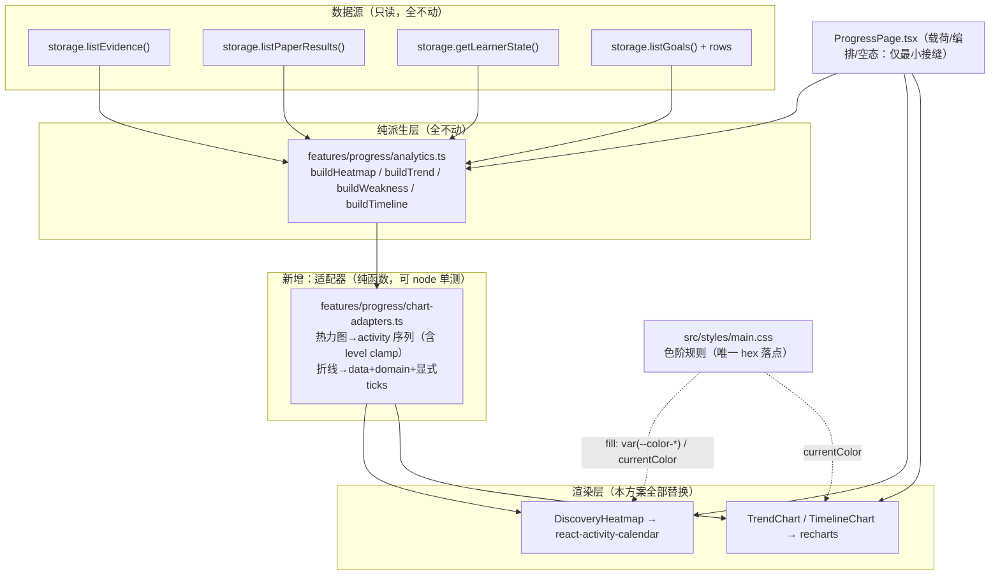
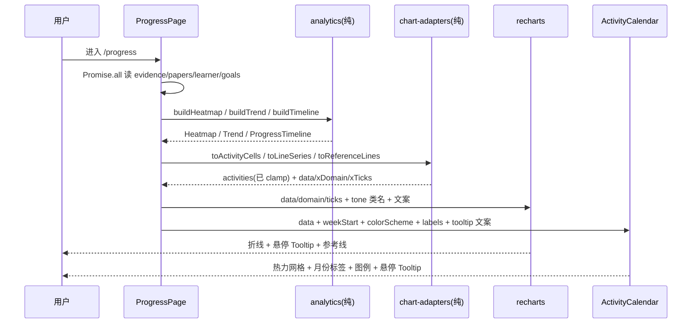

# /progress 进度可视化改用第三方图表包 技术方案

| 字段 | 内容 |
|------|------|
| 作者 | Agent（WorkBuddy）× 许一 |
| 日期 | 2026-09-29（v3） |
| 状态 | **D1–D6 全部已确认**（2026-09-29）。用户已下达「按方案实施」→ **执行中**；runbook 见 `docs/progress-chart-library-runbook-2026-09.md` |
| 关联需求 | 用户诉求原话：「进度采用轻量级的 npm 包的方式实现，先生成方案」→ 澄清三问已答：① 引入**现成第三方包**（非自研封装）② 不建 workspace 包 ③ 第三方包**要覆盖 UI 图表层**。第二轮拍板：**「使用 recharts」**（D1）；第三轮拍板：**热力图另装活动日历包**（D2=C）＋ **加 tooltip + 高亮游标**（D5=B）＋ **网格线开 · 动画关**（D4） |
| 影响范围 | `/progress` 页**全部三块可视化**改由第三方包渲染：热力图 → `react-activity-calendar`；趋势 / 时间线 → `recharts`。**派生层 `analytics.ts` 不动** |

---

## 1. 背景

### 1.1 触发原因

用户要求「进度（`/progress`）改用 npm 包实现」，并逐轮拍板：折线类用 **recharts**、热力图用专用的 **react-activity-calendar**、补悬停交互、网格开动画关。目标是把手写 SVG 的坐标映射、刻度、边界处理、tooltip 定位这些「通用但易错」的代码交给库维护。

### 1.2 现状与痛点（实测）

`/progress` 的图表是**全仓唯一的手写 SVG**，共 313 行（`wc -l` 实测）：

| 组件 | 行数 | 手写内容 |
|------|------|----------|
| `DiscoveryHeatmap` | ~58 | 26×7 网格、`<rect>` 逐格、5 档 opacity 色阶、自绘图例、`<title>` 原生 tooltip |
| 折线共用坐标层 | ~78 | `xAt` / `yAt` / `YAxis`（5 档刻度）/ `XAxis`（首中尾 3 刻度）/ 单点居中除零保护 |
| `TrendChart` | ~55 | 语义参考线（虚线）+ polyline + 逐点 circle + 单点退化 |
| `TimelineChart` | ~70 | 同上 + 截止日竖线 + x 轴右端纳入 deadline + 点色随 readiness 变档 |

痛点（用户视角）：

1. **没有悬停交互** —— 折线只有 `<circle>` 点，热力图只有 `<title>`（Safari 下延迟显示、样式不可控），无法可靠读出「这个点是多少、是哪一天」；
2. **通用代码要自己维护** —— 坐标映射、刻度、padding、除零退化、tooltip 定位，每加一种图就再抄一遍；
3. **视觉精度受限** —— 手写刻度与环境观感差距明显，且无月份标签等成熟热力图常见元素。

### 1.3 与现有模块的关系

| 模块 | 关系 |
|------|------|
| `features/progress/analytics.ts`（442 行） | **不动**。四块派生（热力图 / 趋势 / 弱点榜 / 时间线）是 PLOS 私有口径，两个库都无从提供 |
| `features/progress/ProgressPage.tsx`（283 行） | 载荷与编排不动；仅当换库需要额外容器 / props 时做最小接缝 |
| `docs/progress-analytics-design-2026-09.md` | ⚠️ **被本方案推翻**：其 §1.3 / §2 非目标 ④ / §3.1 G10 / §3.3 / §4.1 mermaid / §8.3 伪代码共 6 处声明「不引图表库」，必须同批回扫（清单见 §10.3） |
| `src/features/progress/charts.tsx` 头注 | ⚠️ **本方案要推翻的正是它**：头注第 3 条**点名 recharts** 说不划算（原文见 G5）—— 全仓最需「换理由而非删句」的一处 |
| `src/styles/main.css` | ⚠️ **从 v2 的「预计不改」变为「必须改」**：两库的色阶都走 CSS 覆盖（见 D3），色阶规则落在这里（token 真源） |
| `features/knowledge/`（知识图谱，`@xyflow/react`） | 相邻但**不在本次范围**：`docs/interaction-design-research-2026-09.md:145` 有「d3-force 单依赖」的**建议**，属另一 feature，本方案不改 |

### 1.4 不做会有什么影响

- `/progress` 只能靠数字块 + 三条无交互曲线承载「复盘」这个核心场景，F3 的信息价值打折；
- 每新增一种可视化（streak、能力雷达、目标对比）都要再手写一份坐标层，重复度持续上升（触碰 `rules/code-structure-and-dependencies.mdc` 的「≥10 行 × ≥3 处必抽取」）；
- 用户已逐轮拍板 —— 不换就是需求未交付。

---

## 2. 方案目标

| 类型 | 描述 |
|------|------|
| **主要目标** | `/progress` 三块可视化改由两个包渲染：① 26 周活动热力图 → `react-activity-calendar`；② 掌握度趋势折线；③ 目标进度时间线 → `recharts`。并用两库内建能力补齐悬停 tooltip。**组件对外契约保持不变**（props 形态 + `tone` 传 Tailwind 类的约定 + 3 个 `data-testid`），因此 `analytics.ts` 与页面载荷零改动。 |
| **非目标** | ① **不改派生口径**（累积快照趋势 / 弱点榜只收有信号章 / readiness 分母=已考章节数，三条硬口径一字不动）；② 不新增 storage 方法、不碰 `local.ts`/`tauri.ts`/`src-tauri/**`；③ 不做数据导出（F4）；④ 不新增图表类型（不趁机加 streak / 雷达 / 对比图）；⑤ 不做暗色模式（PLOS 当前**单主题**，G10）；⑥ **只引入这两个包**（`recharts` + `react-activity-calendar`，共带来 13 个直接依赖、1 个懒加载 chunk），**不再引入第三个**；⑦ 不启用两库的「自动/花哨」特性（recharts 的自动 nice 刻度、curve 平滑、入场动画；热力图的 totalCount 统计与 loading 动画）—— 凡与现口径冲突的一律显式关掉。 |
| **成功标准** | ① 三块可视化均由第三方包渲染，**自写坐标映射归零**（`xAt` / `yAt` / 手写 polyline / 逐点 `<circle>` / 逐格 `<rect>` 从源码消失）——⚠️ 注意是「自写映射归零」而非「行数必然下降」，两库的 JSX 与配置本身也有体量，`charts.tsx` 行数**可能持平**；② 语义 token 仍然生效（`primary` / `line` / `state-mastered` / `state-failed` / `ink-3`），**不出现两库自带配色**，且**不新增任何硬编码色值**（`main.css` 仍是 hex 唯一落点）；③ 3 个 `data-testid` 与三组件 props 形态**零变化**；④ `typecheck` / `layer:check` / `ui:check` / `test:progress` / `test:library` / `build` 全绿；⑤ 新增依赖体积实测登记（`npm ls` 差值 + `dist` 增量）；⑥ 无运行期网络请求（离线可用）、无 telemetry；⑦ 文档回扫清单（§10.3）逐条处理完毕。 |

---

## 3. 项目现状

### 3.1 相关代码与模块（全部实测取证）

**A. 现有实现与契约**

| # | 事实 | 出处（实测） |
|---|------|--------------|
| G1 | 三块可视化 = `charts.tsx` 三个导出：`DiscoveryHeatmap` / `TrendChart` / `TimelineChart`，共 **313 行** | `wc -l src/features/progress/charts.tsx` |
| G2 | 组件纪律三条（本次**必须继承**）：只吃已算好的结构、**不取 `Date.now()`**、**零 i18n**（文案与日期格式化由页面注入） | `charts.tsx:4-9` |
| G3 | 契约面：`data-testid` = `progress-heatmap` / `progress-trend` / `progress-timeline`；折线**单点退化不画线**、x 轴**首中尾 3 刻度**、y 轴**固定 0..1 五档刻度** | `charts.tsx:44,193,266,139-167` |
| G4 | 时间线 x 轴右端 = `max(最后判卷, now, deadline)`（**刻意**把未来截止日纳入范围，`design §14` 登记过偏离） | `charts.tsx:262` |
| G5 | ⚠️ **`charts.tsx:8-9` 头注原文**：「3. 不引图表库：热力图 = 网格、趋势 = 一条折线、时间线 = 折线 + 竖线（方案 §3.3 —— **这个规模引 recharts + d3 传递依赖不划算**）」—— **本方案推翻的正是这句，且它点名了 recharts** | 实读 `charts.tsx:4-9` |
| G6 | 该「不引图表库」结论在全仓有残留（源码 1 + 设计文档 5 + runbook 1，另 1 处线框表待核） | **具体行号由 T8 全量重扫确认** |
| G7 | ⚠️ **「零可视化依赖」的论据本身已失效**：`package.json` 直接依赖含 `mermaid` 与 `@xyflow/react`，`package-lock.json` 中 **d3 7.9.0 + `@types/d3` 全家桶**已在依赖树内（`mermaid → d3-sankey / dagre-d3-es`；`@xyflow/react → d3-drag / d3-zoom / d3-selection / d3-interpolate`） | `package-lock.json:2679-2712,2429-2437` |
| G8 | 进度四块派生为纯函数、零 IO：`buildHeatmap` / `buildTrend` / `buildWeakness` / `buildTimeline` + `heatLevel` / `dateKeyOf` / `mondayIndex` | `analytics.ts:204,284,331,400,189,156,176` |
| G9 | ⚠️ **单测不覆盖渲染层**：`tests/progress-analytics.test.ts`（457 行）只 import `analytics`；全仓 `tests/` 对 `charts` / `<svg>` / `polyline` / 三个 testid **零命中** ⇒ 换渲染层不会红任何 node 单测，**也意味着没有自动化回归网** | Grep `tests/` |
| G10 | 主题为**单一浅色**：`main.css` 无 `.dark`、无 `prefers-color-scheme`、无 `color-scheme` 声明 | Grep `src/styles/main.css` |
| G11 | 图表当前使用的 token：`text-primary`（线/点）、`text-line`（空格）、`text-ink-3`（轴/图例）、`text-state-mastered`（达标线/点）、`text-state-failed`（截止标记）。⚠️ **传的是 Tailwind 类名（走 `currentColor`），不是色值** —— 这是色值方案能优雅收口的关键 | `charts.tsx:61,76,130,205,213,307` |
| G12 | **热力图现有色阶语义**：`HEAT_OPACITY = [0.5, 0.15, 0.35, 0.6, 1]`（索引＝`heatLevel`），level 0 用 `text-line` 色、level 1–4 用 `text-primary` 色 + 逐档递增 `fillOpacity`；**自绘图例用同一数组渲染 5 个方块**（`less` / `more` 文案由 props 注入） | `charts.tsx:17,52-64,72-80` |

**B. recharts（D1）实测**

| # | 事实 | 出处 |
|---|------|------|
| G13 | recharts **3.10.1**，直接依赖 **11 个** = `clsx` / `immer@^11` / `reselect@5.2.0` / `es-toolkit` / `react-redux` / `eventemitter3` / `tiny-invariant` / `victory-vendor@^37` / `@reduxjs/toolkit` / `decimal.js-light` / `use-sync-external-store`。⚠️ **d3 不在直接依赖**：由 `victory-vendor@37.3.6` 内含 `d3-array/ease/interpolate/scale/shape/time/timer`（7 子模块 + 7 个 `@types/d3-*`）⇒ **G5 头注的「d3 传递依赖」论据在 3.x 下已不成立** | `npm view recharts dependencies` + `npm view victory-vendor dependencies` |
| G14 | peer：`react` / `react-dom` / `react-is`（均 `^16.8.0 \|\| ^17 \|\| ^18 \|\| ^19`）。项目 `react@19.2.8` 满足；**项目未声明 `react-is`**（npm 7+ 自动装 peer，`--dry-run` 无 ERESOLVE）。`dist.unpackedSize` = **7,452,998 B** | `npm view` + `package.json:81-82` |

**C. react-activity-calendar（D2=C）实测 —— 拆 tarball 读源码得到**

| # | 事实 | 出处（拆包实测） |
|---|------|------------------|
| G15 | **3.2.1**，依赖 **2 个**：`@floating-ui/react@^0.27.19`（tooltip 定位）、`date-fns@^4.2.1`；peer `react: ^18 \|\| ^19` ✅；MIT；**活跃维护**（最近提交 2026-09-26） | `npm view` + `src/package.json` |
| G16 | ⭐ **色阶可用 CSS 覆盖**：格子的 DOM 是 `<rect data-date="YYYY-MM-DD" data-level="0..4" fill="<theme色值>" style="stroke: rgba(0,0,0,.08)">` —— **`fill` 是 presentation attribute，内联 style 只含 `stroke`（不含 fill）** ⇒ CSS 规则的 `fill: var(--color-*)` **优先于 attribute**，色阶可 100% 落在 `main.css`，**零 JS 读值** | `src/components/ActivityCalendar.tsx:295-311` + `src/styles/styles.ts:25-28` |
| G17 | ⭐ **未来格天然不渲染**：`fillHoles` 只填充 **首条→末条之间** 的日子（`eachDayOfInterval`），**不会补到年末**；`groupByWeeks` 只做左填充对齐周起点 ⇒ **只要 data 里不放未来日期，就不出现未来格**，**完全符合现口径** | `src/lib/calendar.ts:34-89` |
| G18 | ⚠️ **默认 `weekStart = 0`（周日）**，而 PLOS 是**周一首**（`mondayIndex`）⇒ **必须显式传 `weekStart={1}`** | `ActivityCalendar.tsx:220` |
| G19 | ⚠️ **会 throw 的两种情况**：① `data.length === 0` → `Error('Activity data must not be empty.')`；② 任一 `level` 越界 [minLevel, maxLevel] → `RangeError`。**未捕获即整页白屏** | `src/lib/calendar.ts:16-32` |
| G20 | ⚠️ **默认跟随系统主题**：`useColorScheme()` 读 `prefers-color-scheme`，未传 `colorScheme` 时暗色系统会取 `theme.dark`（默认灰阶）⇒ **必须显式 `colorScheme="light"`** 或同时给 `theme.dark` | `ActivityCalendar.tsx:237-239` + `src/hooks/useColorScheme.ts` |
| G21 | **可覆盖全部内建文案**：`labels: { months[], weekdays[], totalCount, legend:{less,more} }`，默认值为英文（Jan…/Sun…/`'{{count}} activities in {{year}}'`/Less/More）。⚠️ 合并是**浅合并**（`Object.assign({}, DEFAULT_LABELS, labelsProp)`）⇒ 传 `legend` 必须**同时给 less 与 more** | `src/types.ts:23-31` + `src/constants.ts:19-27` + `ActivityCalendar.tsx:260` |
| G22 | **tooltip 内建且懒加载**：`tooltips={{ activity: { text: (activity) => string, placement?, ... } }}`，`<Tooltip>` 由 `lazy(() => import('./Tooltip'))` **单独分包** ⇒ 不用 tooltip 就不加载；定位由 `@floating-ui/react` 负责（**我们零手写浮层**） | `ActivityCalendar.tsx:40,317-330,183-190` |
| G23 | **尺寸模型是固定像素**：默认 `blockSize=12` / `blockMargin=4` / `blockRadius=2`；容器 `width: max-content`（**不铺满**）、外层 `scroll-container` 自带 `overflowX: auto`；格子间距/圆角可精确调 | `ActivityCalendar.tsx:201-203,272-277` + `styles.ts:5-24` |
| G24 | 其他可用开关：`showTotalCount`（默认 **true**，会多渲染「N activities in YYYY」）、`showColorLegend`（默认 true）、`showMonthLabels`（默认 true）、`showWeekdayLabels`（默认 false）、`renderBlock` / `renderColorLegend`（cloneElement 口子，可加 className）、`ref` 直接作 prop（React 19 风格） | `ActivityCalendar.tsx:120-139,211-216` |
| G25 | ⚠️ **图例的 rect 没有 `data-level`**（`styles.rect` 也无 fill）⇒ 若复用库图例，色阶需经 `renderColorLegend` 注入 className | `ActivityCalendar.tsx:376-415` |

**D. 工程与规范**

| # | 事实 | 出处 |
|---|------|------|
| G26 | ⚠️ **`stroke="var(--x)"`（SVG presentation attribute）的 `var()` 行为「规范未定、引擎不一致」**：W3C svgwg 两个 open issue（#987 要求明确支持；#1031 指出 SVG2 的 parse-grammar 路径**本质不解析 var()**）；实测 color 类（stroke/fill）可用、Chromium 的 length 类不可用 ⇒ **色值方案不押注此行为**（见 D3） | W3C svgwg #987 / #1031 + 独立实测 |
| G27 | ⚠️ **`npm install <pkg> --dry-run` 报「added 99 packages」不可采信**：输出掺入 `@napi-rs/canvas-*` / `lightningcss-*` 等**既有依赖的 optional 平台变体**，非本次新增 | `npm install recharts --dry-run --no-save` 逐行核对 |
| G28 | `test:library` 是 **29 个 `&&` 串联的长链**，**不含** chart 套件 ⇒ 新增 `test:chart` 需**手工并入该链** | `package.json:52` |
| G29 | `npm run build` = `npm run typecheck && vite build`（**build 内置 typecheck**）⇒ 类型层面的契约回归已由 build 覆盖 | `package.json:9` |

### 3.2 相关文档与约定

| 文档 | 需遵守的点 |
|------|-----------|
| `rules/code-structure-and-dependencies.mdc` | 单文件 ≤700 行；≥10 行 × ≥3 处必抽取；无环（`layer:check`） |
| `rules/layer-import-boundaries.mdc` | 本次是纯 UI 层替换：`features/` 可 import 第三方包，不得反向 import 到 `engine`/`domain` 之外的层级 |
| `rules/engineering-code-style.mdc` | 相对导入为主（`@/*` 仅豁免 `components/ui` 与 `lib/utils`）；中文注释；i18n 双语成对 |
| `rules/no-headless-browser-validation.mdc` | ⚠️ **不得**起浏览器截图自检；校验 = typecheck + node 单测 + 代码自审，视觉交付给用户目测 |
| `rules/react.mdc` / `rules/dropdown-select.mdc` | ⚠️ **禁止手写浮层**。本方案**不手写任何浮层**：tooltip 分别由 recharts 内建组件与 `@floating-ui/react` 负责定位 |
| `docs/progress-analytics-design-2026-09.md` | 口径真源（§4.3 三条硬口径、§7 线框、§8.3 伪代码）—— 本次只改其中「不引图表库」相关表述，**不动任何口径** |
| `docs/ui-component-system-shadcn-design-2026-09.md` | UI Kit 层政策；图表组件属 `features/`，不进 `components/ui/` |
| `skills/pre-task-technical-design/SKILL.md` 自检清单 | 量纲一致 / 时间基准唯一 / 用例输入期望自洽 / 不凭计数记忆 |

### 3.3 约束与候选对比

**必须守住的约束**

| 约束 | 内容 |
|------|------|
| 契约冻结 | 三组件 props 形态 + 3 个 `data-testid` 不变（页面零改动；§11.3 有源码级断言） |
| 色值单一真源 | 两库都**不得**引入自带配色，也**不得**新增硬编码色值。方案：**全部走 CSS**（折线 `className` + `currentColor`；热力图 `.plos-heat[data-level]` + `fill: var(--color-*)`，见 G16）；`main.css` 仍是 hex 唯一落点 |
| 离线与隐私 | 两包必须本地打包运行、无运行期网络与 telemetry（local-first 红线）。均已核：纯前端 SVG，无网络调用 |
| 交互增强**不得**改变口径 | 加 tooltip / 参考线可以；**不得**改动 `analytics.ts` 数值定义，**不得**把折线 x 轴交给 recharts 自动 nice 刻度（会破坏「首中尾 3 刻度」现口径） |
| 时间基准唯一 | 两库**不得**配置任何会读「当前时间」的特性（禁 `ReferenceLine x={Date.now()}`；热力图 data 不含未来日期）。⚠️ 热力图额外注意 **G20**（`prefers-color-scheme` 是系统态读取，必须显式锁定 `colorScheme="light"`） |
| 包体预算 | ⚠️ 两包**已知会突破**原「首屏 gzip 增量 ≤ 60 KB」软目标（recharts 153–168 KiB 受控口径 + 热力图两依赖）。这是 D1/D2 决策已接受的取舍；T1 必须**实测登记真实增量**，不接受估算 |

**候选包实测（`npm view`，2026-09-28 / 29）**

| 候选 | 版本 | License | React 19 | 传递依赖 | 渲染 | 权威体积口径 | 结论 |
|------|------|---------|----------|----------|------|--------------|------|
| **`recharts`** | **3.10.1** | MIT | ✅ peer `^19` | **11 直接依赖**（G13；d3 经 `victory-vendor` 内含） | SVG | 153.08–168.27 KiB（外置 React 后 94.96–109.96 KiB） | ✅ **D1 选定**（折线类）—— 声明式 API、Tooltip/ReferenceLine 内建、SVG 可接 `className` |
| **`react-activity-calendar`** | **3.2.1** | MIT | ✅ peer `^18 \|\| ^19` | **2**（`@floating-ui/react`、`date-fns`） | SVG | 未取权威值 → T1 实测 | ✅ **D2 选定**（热力图）—— 唯一维护活跃的专用活动热力图包；`data-level` 可作 CSS 钩子（G16） |
| `@visx/shape` + `scale` + `group` | 4.0.0 | MIT | ✅ | 每包 3–5 | SVG | `@visx/xychart` 主导出 ~49 KB gzip | 未选：体积更优但**仍需自己组装轴与线**，只省一半手写量 |
| `uplot` | 1.6.32 | MIT | —（需自写 wrapper） | **0** | Canvas | 22 KB gzip | 未选：Canvas 主题桥 + 定制摩擦大 |
| `@tanstack/charts` | 0.18.0 | MIT | ✅ | 多（含 d3 types） | SVG/Canvas | 36.73–42.64 KiB | 未选：**0.x 未稳定** |
| `chart.js` + `react-chartjs-2` | 4.5.1 / 5.3.1 | MIT | ✅ | 1 | Canvas | 44.70–58.21 KiB | 未选：Canvas ⇒ 需色值桥 |
| `react-calendar-heatmap` | 1.10.0 | MIT | ⚠️ peer 仍写 `>=0.14.0` | 2 | SVG | ~5.14 kB min | 未选：最后发版 2025-02、仓库 161 open issues ⇒ **维护风险高** |

> ⚠️ **体积口径不同不可直接横比**：22 KB / 49 KB 为 gzip；36.73–42.64 KiB 与 153.08–168.27 KiB 出自同一份受控对比（基线 2026-08-07，12 个独立构建的 minified 消费者，覆盖 line/bar/area/scatter 三档）；「外置 React」与「外部主导出」是不同计量方式。方案内一律标注来源，**不要**写成「X 是 Y 的 1/3」。

**五条从实测推出的选型约束**

1. **d3 已在依赖树里**（G7），且 **recharts 3.x 已把 d3 收进 `victory-vendor`**（G13）⇒ G5 头注那句的两半**都已不成立**；反对理由只剩**依赖数量 11 个**本身，而这是 D1 已接受的代价。
2. **无暗色模式**（G10）⇒ 主题桥只需一次性成本。**但热力图必须显式锁定 `colorScheme="light"`**（G20），否则系统暗色会串色。
3. **单测不覆盖渲染**（G9）⇒ 换库的最大风险是**视觉回归无人守**，必须用「契约断言（grep）+ 适配器纯函数单测 + 用户目测」三段式兜住。
4. **两库都能走 CSS 管色**（G11 的 `tone` 类约定 + G16 的 `data-level` 钩子）⇒ **零 JS 读色值、零 hex、零新 token**，这是本次最省事的一条接缝（D3）。
5. **热力图换库的收益小于折线** ⇒ 它的注意事项有 8 条（§8.3 清单），其中 3 条是**必踩的坑**（周首日 G18、锁浅色 G20、空/越界 throw G19）。这些已在方案里逐条给出对策，**不是不可做，但要知道成本**。

### 3.4 决策点

| ID | 决策点 | 结论 | 状态 |
|----|--------|------|------|
| **D1** | 折线（趋势 + 时间线）用哪个包 | **recharts 3.10.1** | ✅ 已确认 2026-09-29。取舍：接受 11 个直接依赖与 153–168 KiB，换取声明式 API 与内建 Tooltip/ReferenceLine |
| **D2** | 热力图（26×7 活动网格）是否也用库 | **C：另装 `react-activity-calendar@3.2.1`** | ✅ 已确认 2026-09-29。⚠️ 相关代价与 8 条注意事项见 §8.3；推荐配置线已给出 |
| **D3** | 色值来源（token 接缝） | **A：全 CSS 管色** —— 折线 `className` + `stroke="currentColor"`；热力图 `.plos-heat[data-level="n"] { fill: var(--color-*) }`（依 G16） | ✅ 随 D1/D2 定；**不采用**「把 `var()` 直接传进库的色值 prop」（G26 已证明该行为规范未定；热力图 theme 还有 `CSS.supports` 校验拦一道） |
| **D4** | 视觉回归容忍度与观感基调 | **A：允许视觉变化**，用户目测确认；**网格线开 · 入场动画关** | ✅ 已确认 2026-09-29。已知必然变化见 §7.4（**必读**：热力图不再铺满、多出格子描边、多出月份标签） |
| **D5** | 交互增强程度 | **B：等价替换 + 悬停 tooltip + 高亮游标**（两库内建，仅注入文案） | ✅ 已确认 2026-09-29。不启用缩放/区间选择 |
| **D6** | 派生层（`analytics.ts`）是否也改用第三方统计/进度库 | **A 保持自研**（只换渲染） | ✅ 已确认 2026-09-29（随「按方案实施」一并确认）：四块口径全为 PLOS 私有（累积快照 / 弱点三因子 / readiness 分母=已考章节数），无库可替；§2 非目标已锁 |

---

## 4. 技术架构

### 4.1 总体架构（分层不变，只换最底层渲染）



### 4.2 模块职责

| 模块/层级 | 职责 | 技术选型 |
|-----------|------|----------|
| `analytics.ts`（既有） | 口径真源：四块派生结构 | 纯 TS，不动 |
| `chart-adapters.ts`（新增） | **本方案唯一的纯逻辑新增**：① 热力图 → activity 序列（**level clamp 到 [0,4]**，G19 兜底）；② 折线 → `data` / `domain` / **显式 `ticks`**（保住首中尾 3 刻度） | 纯 TS，零 React（供 node 单测） |
| `charts.tsx`（改造） | 渲染层：三块改为两库组件；折线色值经 `className` + `currentColor`；文案经 tooltip 注入 | React + recharts + react-activity-calendar |
| `main.css`（**改动**） | 热力图色阶规则（`.plos-heat[data-level="n"]`）+ 图例色阶 —— **唯一 hex 落点**（预计仍用 `var(--color-*)`，无新 hex） | 语义 token |
| `ProgressPage.tsx`（如需要） | 载荷、编排、空态、下钻 Select（已统一为 `ui/select`） | 不动或最小接缝 |

### 4.3 数据模型与 API

**契约冻结（不变）**

```ts
// charts.tsx 对外导出签名保持不变（仅内部实现换掉）
export function DiscoveryHeatmap(p: {
  heatmap: Heatmap;
  labelOf: (dateKey: string, count: number) => string;   // 页面注入 i18n 文案
  legend: { less: string; more: string };
}): JSX.Element;

export function TrendChart(p: {
  points: { at: number; value: number }[];
  lines: { value: number; dashed?: boolean; tone: string }[];  // tone = Tailwind 文本色类（走 currentColor）
  axisLabelOf: (at: number) => string;
}): JSX.Element | null;

export function TimelineChart(p: {
  timeline: ProgressTimeline;
  now: number;                       // 页面 mount 时取一次，组件不取时钟
  deadlineLabel: string;
  axisLabelOf: (at: number) => string;
}): JSX.Element | null;
```

**新增：适配器（纯函数）**

```ts
// src/features/progress/chart-adapters.ts

/* --- 热力图 → react-activity-calendar --- */
/** ⚠️ level 必须 clamp 到 [0,4]：越界会让库抛 RangeError ⇒ 整页白屏（G19）。 */
export interface ActivityCell { date: string; count: number; level: 0 | 1 | 2 | 3 | 4 }

/** **只为已过去的格子产出行**（未来格继续不给，库便天然不渲染，G17）。 */
export function toActivityCells(h: Heatmap): ActivityCell[];

/* --- 折线 → recharts --- */
/** ⚠️ **xTicks 必须显式给出**：不许让 recharts 自选 nice 刻度（会破坏「首中尾 3 刻度」现口径）。
 *  ⚠️ **x 域最小时间窗 = 15 日**（2026-09-29 用户要求「折线至少展示 15 日的数据」）：
 *  判卷跨度不足 15 日时**向左扩展**补齐（右端语义不动），单点同规则。 */
export const MIN_X_WINDOW_MS = 15 * 24 * 60 * 60 * 1000;

export interface LineSeriesShape {
  data: { at: number; value: number }[];
  xDomain: [number, number]; // 跨度恒 ≥ MIN_X_WINDOW_MS
  xTicks: number[];          // 首中尾（2026-09-29 更正：最小窗下域恒非零宽，单点也给 3 个）
  isSinglePoint: boolean;
}

export function toLineSeries(points: { at: number; value: number }[]): LineSeriesShape | undefined;

/** 参考线规整（默认虚线，除显式 dashed:false）。 */
export function toReferenceLines(
  lines: { value: number; dashed?: boolean; tone: string }[],
): { y: number; dashed: boolean; tone: string }[];
```

**数据读写（按 `rules/layer-import-boundaries.mdc`）**

- 读：`ProgressPage` → `storage.listEvidence/listPaperResults/getLearnerState/listGoals`（**既有路径，零改动**）；
- 写：**无**。本页是纯只读；不新增任何 storage 方法，不碰 `local.ts` / `tauri.ts` / `src-tauri/**`；
- 桌面能力：无 `invoke` 调用。

### 4.4 状态与副作用

| 项 | 结论 |
|----|------|
| 页面 state | 不变：`data`（一次 `Promise.all`）、`now`（mount 取一次）、`chapterId`（下钻） |
| 新增 state | 仅库内部：recharts Tooltip hover state + `ResponsiveContainer` 尺寸 state；热力图 tooltip state（`@floating-ui/react`）——**均在库内，不外溢到页面** |
| 时间基准 | **唯一**：`now` 由页面注入。⚠️ 两处额外注意：① **不得**给 recharts 配任何读时钟的特性；② 热力图 data **不得**含未来日期；③ 热力图必须显式 `colorScheme="light"`（G20，否则跟随系统暗色） |
| 副作用 | 库内部：`ResizeObserver`（recharts `ResponsiveContainer`）、`requestAnimationFrame`（recharts 入场动画，**已关**）、`lazy` 动态 chunk（热力图 Tooltip）、`date-fns` 纯日期计算。**无网络、无 storage 写、无定时器、无 telemetry** |

---

## 5. 交互流程

### 5.1 主流程

1. 用户进入 `/progress`；
2. 页面 `Promise.all` 读四类数据（不变），`now` 取一次；
3. `analytics` 四块派生（不变）；
4. 适配器翻译：热力图 → activity 序列（含 clamp）；折线 → `data` / `xDomain` / **显式 `xTicks`**（新增）；
5. 渲染：热力图（`ActivityCalendar`，26 周网格 + 月份标签 + 图例）+ 趋势折线（`LineChart`，语义参考线 + 点）+ 时间线（readiness + 截止竖线）；
6. 用户悬停 → 两库各自的内建 Tooltip 显示「日期 + 数值」（文案由 props / `text` 回调注入）；
7. 用户切换「趋势章节下钻」Select → 曲线换成该章序列（不变）。

### 5.2 分支与异常流程

| 场景 | 触发条件 | 系统行为 | UI 反馈 |
|------|----------|----------|---------|
| 全空 | `entries.length === 0 && results.length === 0` | 整页空态（**不变**，不渲染空坐标系）。⚠️ **必须拦住**：热力图传空 data 会 throw（G19） | 既有空态卡 + 去规划 CTA |
| 热力图无任何证据 | `toActivityCells()` 返回 `[]` | **不挂载** `ActivityCalendar`（渲染既有空态文案）——这是 G19 的唯一对策 | 既有空态文案 |
| 单点 | 折线点数为 1 | **不画线**，只画点（现口径；用 `ReferenceDot` 或等价手段）；x 域走**最小 15 日窗**（2026-09-29 更正：原「居中处理」已废，右端 = 该点） | 页脚提示「再测一次才有趋势」（既有文案） |
| 未来格 | `Heatmap.weeks` 中 `undefined` | **不产行** ⇒ 库也不渲染该格（G17 已核对：库只填充首末之间） | 无 |
| 上限截断 | `entries.length >= EVIDENCE_LOG_MAX` | 显示诚实性告警（既有） | `⚠ heatmapTruncated` |
| 章已删除 | `titleOf(id) === undefined` | 折线游标仍在（历史保留），下钻 Select 用「章已不存在」兜底文案（**绝不显示裸 id**） | 既有兜底 |
| 库渲染失败 | 适配器输入异常（NaN / level 越界 / 超长序列） | 适配器 clamp + 组件返回 `null` 或退化态，**不得抛错整页白屏**（G19 是真实风险，不是假设） | 保持页面其它两块可用 |
| 容器宽度为 0 | recharts `ResponsiveContainer` 处于隐藏/折叠容器内 | 渲染为 0 宽（**不报错**） | 页面必须在可见卡片内挂载（§7.4 已登记） |
| 系统为暗色 | macOS 暗色模式 | 热力图因显式 `colorScheme="light"` **不受影响**（G20 对策） | 无 |
| deadline 超右端 | `deadlineAt > max(lastAt, now)` | x 轴右端纳入 deadline（现刻意口径；用显式 `domain` 保） | 截止竖线始终可见 |

### 5.3 时序图



---

## 6. 用户用例

### UC-01：查看学习活动热力图

| 项 | 内容 |
|----|------|
| 角色 | 学习者 |
| 前置条件 | 至少有 1 条 evidence |
| 主流程步骤 | 1. 进入 `/progress`；2. 定位「学习活动」区块；3. 悬停某格 |
| 期望结果 | 26 周 × 7 天网格按 5 档色阶着色（**周一首**对齐）；**未来日期不显示**；悬停显示「日期 + 条数」 |
| 异常/边界 | 0 条 → 区块显示既有空态文案（**不挂载库组件**）；达上限 → 顶部告警 |

### UC-02：查看掌握度趋势并下钻某章

| 项 | 内容 |
|----|------|
| 角色 | 学习者 |
| 前置条件 | 至少判过 1 次卷 |
| 主流程步骤 | 1. 定位「掌握度趋势」；2. 悬停点读数值；3. 用 Select 选某章 |
| 期望结果 | 曲线为累积快照口径；0.6 / 0.8 两条语义参考线可见且配色来自状态 token；下钻后曲线换该章序列；悬停出 Tooltip |
| 异常/边界 | 单点 → 不画线仅画点 + 提示；章已删除 → Select 兜底文案 |

### UC-03：查看目标进度时间线与截止日

| 项 | 内容 |
|----|------|
| 角色 | 学习者 |
| 前置条件 | 有 activeGoal 且其范围内有判卷记录 |
| 主流程步骤 | 1. 定位「目标进度」；2. 观察曲线与截止竖线；3. 悬停读某日 readiness |
| 期望结果 | readiness 曲线；截止竖线在范围内始终可见（含未来截止日）；`covered/required` 标注仍在区块右上 |
| 异常/边界 | 无目标 / 范围空 / 范围内从未判卷 → 既有三类提示文案 |

### UC-04：在无数据时不出现「空白坐标系」

| 项 | 内容 |
|----|------|
| 角色 | 新用户 |
| 前置条件 | 无 evidence 且无试卷 |
| 主流程步骤 | 进入 `/progress` |
| 期望结果 | 整页空态卡 + CTA，**不出现任何空白图表** |
| 异常/边界 | — |

### UC-05：主题一致性（token 生效）

| 项 | 内容 |
|----|------|
| 角色 | 开发者 / 用户 |
| 前置条件 | 改动 `main.css` 中 `--plos-state-mastered`（折线参考线）与 `--color-primary`（热力图格子） |
| 主流程步骤 | 重新构建并查看两处图表 |
| 期望结果 | 参考线与热力图色阶**同时**跟随变化（**无两库自带配色残留**，源码中**无新增硬编码色值**） |
| 异常/边界 | 系统切到暗色模式后，热力图**不得**变色（G20 对策的验证点） |

---

## 7. 线框 UI

### 7.1 `/progress` 默认状态（区块结构不变，渲染方式与区块内尺寸变化）

```
┌──────────────────────────────────────────────────────────┐
│ 复盘与趋势                                    [入口不变]  │
│ 把已记下来的证据流变成看得见的轨迹                        │
├──────────────────────────────────────────────────────────┤
│ 目标进度                              已考 3/8 章          │
│ ┌──────────────────────────────────────────────────────┐ │
│ │  100%┤·  ·                                             │ │
│ │   80%┤ ✓ 语义达标线（state-mastered, 虚线）            │ │
│ │   60%┤   ╱‾‾╲   ┈┈ 水平网格线（本次新增）              │ │
│ │   40%┤  ╱    ╲        │ ← 截止竖线（state-failed）     │ │
│ │    0%└──┴─────┴───────┴────────────                   │ │
│ │        9/1   9/15    9/28                               │ │
│ └──────────────────────────────────────────────────────┘ │
│ ⓘ 时间线按历史试卷近似重建（既有提示）                    │ │
├──────────────────────────────────────────────────────────┤
│ 学习活动                              近 26 周 · 137 条    │
│ ┌──────────────────────────────────────────────────────┐ │
│ │  Mar      Apr      May     Jun    Jul   Aug  Sep      │ │ ← 月份标签（库内建）
│ │  ▫▫▪▫▫▫▫  ▫▪▫▫▫▫▫  ▫▫▫▪▪▫▫  …（26 列 × 7 行，周一首）   │ │
│ │                                    少 ▫▪◾◼⬛ 多        │ │ ← 库内建图例（文案注入）
│ └──────────────────────────────────────────────────────┘ │
│ 2026-03-30 ~ 2026-09-28                                   │
├──────────────────────────────────────────────────────────┤
│ 掌握度趋势      8 份卷 · 12 章     [全部章节 ▾]           │
│ ┌──────────────────────────────────────────────────────┐ │
│ │  recharts 折线区（含悬停 Tooltip，D5=B）               │ │
│ └──────────────────────────────────────────────────────┘ │
├──────────────────────────────────────────────────────────┤
│ 最该补的                                                  │
│  章 A   掌握度 45%  卷面 60%  误解 2      ▰▰▱▱▱  →        │
└──────────────────────────────────────────────────────────┘
```

- **布局**：不新增区块、不改区块间距（`Section` + `Card` 沿用 `primitives.tsx`）；⚠️ 两个区块内的图表容器尺寸模型都变了（见 §7.4）；
- **组件映射**：区块容器 `Section` / `Card` / `Bar` 不变；仅区块内图表替换；
- **设计 token**：一律沿用 G11 的 5 个 token，**不引入两库自带色板**。

### 7.2 其他状态

| 状态 | 表现 |
|------|------|
| 加载中 | 既有「加载中」文案（不变） |
| 全空 | 既有虚线卡 + CTA（不变）；**热力图组件不挂载**（G19） |
| 单点 | 只画点、不画线 + 既有提示（不变） |
| 错误 | 页面级无独立错误态（既有）；渲染层异常须**局部降级**（返回 `null`），不得白屏 |
| 上限截断 | 热力图区块顶部 `⚠` 告警（不变） |

### 7.3 交互说明

- **新增（D5=B）**：折线悬停出 recharts 内建 Tooltip（日期 + 数值 + 高亮游标）；热力图格悬停出 `@floating-ui/react` 定位的 Tooltip（替代现 `<title>`，**文案仍由页面注入**）；
- **键盘可达性**：不新增可聚焦元素（图表仍非交互控件）；下钻 Select 已由 `ui/select` 提供键盘支持（既有）；
- **弹层**：**不手写任何浮层** —— 两处 tooltip 的定位与渲染都由库负责（热力图的 Tooltip 还是懒加载 chunk，G22）。热力图「少/多」图例文案经 `labels.legend` 注入。

### 7.4 ⚠️ 已知视觉变化（D4=A 需你逐条知悉）

**折线（recharts）**

| # | 变化 | 原因 | 能否避免 |
|---|------|------|----------|
| 1 | 折线区块容器由**自适应宽高比**改为**固定高度** | `ResponsiveContainer` 需要父容器有确定高度 | 不能（库机制）；取与现观感接近的高度即可 |
| 2 | **多出水平网格线** | 本次**主动开启**（你的选择：网格开）——可读性更好 | 能（不写 `<CartesianGrid>` 即无） |
| 3 | **无入场动画** | 本次**主动关闭**（`isAnimationActive={false}`，你的选择）——与现「静态即出」一致，也不为月级少量点付 rAF 成本 | 能（一行开关） |
| 4 | Tooltip 视觉由 recharts 定基调 | 只能定制到 `contentStyle` / slot 级 | 部分可调；若要完全对齐 PLOS 浮层需自定义 `content`（D3=A 下可行，但代码量上升） |

**热力图（react-activity-calendar）** ⚠️ 这四条是本次**最需要你目测确认**的

| # | 变化 | 原因 | 能否避免 |
|---|------|------|----------|
| 5 | **不再铺满卡片宽度**（宽度 = `26 × (blockSize + blockMargin)`，默认约 336–390px，靠左） | 库容器是 `width: max-content`（G23），**不吃 `viewBox` 自适应** | 部分：调大 `blockSize`（如 16）或包一层居中/拉伸容器。**建议 T5 时按你的观感定 `blockSize`** |
| 6 | **格子多出极淡描边**（`rgba(0,0,0,.08)`） | 库给每个 rect 打了**内联 style** 的 `stroke`（G16），**内联 style 无法被常规 CSS 覆盖** | 能：用 `renderBlock` + `cloneElement` 传 `style={{}}` 清掉（代价：多一层 render prop） |
| 7 | **多出月份标签**（Mar / Apr / …） | 库 `showMonthLabels` 默认 true（G24） | 能：`showMonthLabels={false}`。若保留则 `labels.months` **必须中文化**，否则显示英文 |
| 8 | 图例由库渲染（视觉略有差别） | 改用库的 `legend`（`showColorLegend`）+ 注入 less/more 文案；自绘图例可删 | 能：`showColorLegend={false}` 保留现自绘图例（但要多维护 12 行） |

> ⚠️ 以上变化**不得**用自动化截图比对（`no-headless-browser-validation`）；T9 由你 `npm run dev` 目测确认。

---

## 8. 涉及文件及改动伪代码

### 8.1 `package.json` / `package-lock.json`（修改）

**改动说明**：新增 2 个依赖；新增 `test:chart` 脚本并**手工并入 `test:library` 长链**（G28）。

```jsonc
{
  "dependencies": {
    "recharts": "^3.10.1",                 // D1（折线类）
    "react-activity-calendar": "^3.2.1"    // D2=C（热力图）
  },
  "scripts": {
    "test:chart": "node --experimental-strip-types --no-warnings --import ./tests/register-loader.mjs tests/progress-chart-adapters.test.ts",
    // ⚠️ G28：test:library 是 29 个 && 串联的长链，须把 test:chart 手工并进去
    "test:library": "npm run test:anchor && … && npm run test:chart && …"
  }
}
```

> ⚠️ ① 版本以 `npm install` 实际解析为准；② `react-is` 是 recharts 的 peer，**项目未声明**（G14）——npm 7+ 自动安装，若出现 ERESOLVE 则显式加；③ **体积登记禁用 `--dry-run` 的包数**（G27 已证明不可信），T1 用 `npm ls --all --parseable | wc -l` 前后差值 + `du -sh dist` 增量。

### 8.2 `src/features/progress/chart-adapters.ts`（新增）

**改动说明**：本方案唯一新增纯逻辑。零 React、零 IO、零 i18n。

```ts
// 伪代码 — 仅表达意图

/* --- 热力图 --- */
export function toActivityCells(h: Heatmap) {
  const out: ActivityCell[] = [];
  for (const col of h.weeks) {
    for (const day of col) {
      if (!day) continue;                                  // 未来格：不产行（库便不渲染，G17）
      const raw = heatLevel(day.count);
      // ⚠️ clamp 到 [0,4]：越界会让库抛 RangeError ⇒ 整页白屏（G19）
      const level = Math.min(4, Math.max(0, Math.round(raw))) as ActivityCell["level"];
      out.push({ date: day.dateKey, count: day.count, level });
    }
  }
  return out;
}

/* --- 折线 --- */
export function toLineSeries(points: { at: number; value: number }[]) {
  if (points.length === 0) return undefined;
  const xs = points.map((p) => p.at);
  let min = Math.min(...xs);
  let max = Math.max(...xs);
  if (opts.extendRightTo > max) max = opts.extendRightTo;   // 时间线 G4 口径
  // 最小时间窗（2026-09-29）：跨度不足 15 日 → 左端回退，右端不动
  if (max - min < MIN_X_WINDOW_MS) min = max - MIN_X_WINDOW_MS;
  return {
    data: points,
    xDomain: [min, max] as [number, number],
    // 首中尾 3 刻度（现口径）；最小窗下域恒非零宽（单点也给 3 个）
    xTicks: [min, min + (max - min) / 2, max],
    isSinglePoint: points.length === 1,
  };
}

export function toReferenceLines(lines: { value: number; dashed?: boolean; tone: string }[]) {
  return lines.map((l) => ({ y: l.value, dashed: l.dashed !== false, tone: l.tone }));
}
```

### 8.3 `src/features/progress/charts.tsx`（改造）

**改动说明**：三个导出**签名不变**，内部全部换成两库。头注第 3 条「不引图表库」改写为现行理由，**保留历史决策被推翻的时点记录**（不静默删除）。

#### (a) `DiscoveryHeatmap` → `ActivityCalendar`

⚠️ **必踩的坑有三条，逐条有对策**（G18 / G19 / G20）：

```tsx
// 伪代码
import { ActivityCalendar } from "react-activity-calendar";
import { toActivityCells } from "./chart-adapters";

export function DiscoveryHeatmap({ heatmap, labelOf, legend }: Props) {
  const cells = toActivityCells(heatmap);

  // ⚠️ G19：data 为空时库**会 throw**（不是渲染空图）⇒ 必须在这里拦住
  if (cells.length === 0) return <div data-testid="progress-heatmap" />;

  return (
    <div data-testid="progress-heatmap">           {/* testid 契约保留 */}
      <ActivityCalendar
        data={cells}
        weekStart={1}                    /* ⚠️ G18：默认 0=周日，PLOS 是周一首 */
        colorScheme="light"              /* ⚠️ G20：默认跟随系统暗色 ⇒ 必须锁浅色 */
        minLevel={0}
        maxLevel={4}                     /* 5 档，对齐 heatLevel */
        blockSize={11}                   /* 复刻现 CELL；⚠️ 观感待定，见 §7.4 变化 5 */
        blockMargin={2}                  /* 复刻现 GAP */
        blockRadius={2}                  /* 复刻现 rx */
        showTotalCount={false}           /* ⚠️ 默认 true 会多出「N activities in YYYY」，与页面「近 26 周 · N 条」重复 */
        showWeekdayLabels={false}        /* 与现状一致 */
        showMonthLabels                        /* §7.4 变化 7：新能力；保留则必须中文化下方 labels.months */
        labels={{
          months: /* 页面的 axisLabelOf 系列无法直接复用 ⇒ 新增 12 个月短名 i18n 键，或中文常量表 */,
          legend: { less: legend.less, more: legend.more },   /* ⚠️ G21 浅合并：less/more 必须同时给 */
        }}
        tooltips={{ activity: { text: (a) => labelOf(a.date, a.count) } }}  /* 文案仍由页面注入（G22） */
        renderBlock={(block, activity) =>
          /* G16 + §7.4 变化 6：加 className 供 CSS 定色；清掉库的内联描边 */
          cloneElement(block, { className: "plos-heat", style: {} })
        }
        renderColorLegend={(block, level) =>
          /* ⚠️ G25：图例 rect 没有 data-level ⇒ 只能靠 className 定色 */
          cloneElement(block, { className: `plos-heat plos-heat--legend-${level}` })
        }
      />
    </div>
  );
}
```

对应 `main.css` 新增（**色阶唯一落点**，见 §8.6）：

```css
/* 热力图色阶：fill 走 var(token)，透明度按 data-level —— 与现有 HEAT_OPACITY 语义一致（G12） */
.plos-heat { fill: var(--color-primary); }
.plos-heat[data-level="0"] { fill: var(--color-line); fill-opacity: .5; }
.plos-heat[data-level="1"] { fill-opacity: .15; }
.plos-heat[data-level="2"] { fill-opacity: .35; }
.plos-heat[data-level="3"] { fill-opacity: .6; }
.plos-heat[data-level="4"] { fill-opacity: 1; }
/* 图例（无 data-level，G25） */
.plos-heat--legend-0 { fill: var(--color-line); fill-opacity: .5; }
/* …legend-1..4 同色阶 */
```

> ⚠️ **为什么不用 `theme` prop**：`theme` 的色值会被 `CSS.supports('color', c)` 校验（G16/G26 相关源码），且最终落到 **SVG attribute**，正是 G26 那个规范未定的路径；走 CSS 规则则 100% 可靠，且色阶回到 token 真源。

#### (b) `TrendChart` / `TimelineChart` → `LineChart`

```tsx
// 伪代码
import {
  CartesianGrid, Line, LineChart, ReferenceDot, ReferenceLine,
  ResponsiveContainer, Tooltip, XAxis, YAxis,
} from "recharts";

const Y_TICKS = [0, 0.4, 0.6, 0.8, 1];   // 现口径五档（含 0.6/0.8 语义线）

export function TrendChart({ points, lines, axisLabelOf }: Props) {
  const s = toLineSeries(points);
  if (!s) return null;
  const refs = toReferenceLines(lines);

  return (
    <div data-testid="progress-trend" className="h-56 w-full">   {/* ⚠️ 固定高度（§7.4 变化 1） */}
      <ResponsiveContainer width="100%" height="100%">
        <LineChart data={s.data} margin={{ top: 8, right: 12, bottom: 4, left: 0 }}>
          <CartesianGrid className="text-line" vertical={false} />   {/* 网格开（D4 你的选择） */}

          {/* ⚠️ type="number" + 显式 domain/ticks —— 不许用 scale="time" 让库自选 nice 刻度（破现口径） */}
          <XAxis dataKey="at" type="number" domain={s.xDomain} ticks={s.xTicks}
                 tickFormatter={axisLabelOf}                    /* 文案仍由页面注入 */
                 className="text-ink-3" tickLine={false} axisLine={{ stroke: "currentColor" }} />
          <YAxis domain={[0, 1]} ticks={Y_TICKS} width={36}
                 tickFormatter={(v: number) => `${Math.round(v * 100)}%`}
                 className="text-ink-3" tickLine={false} axisLine={{ stroke: "currentColor" }} />

          {/* D5=B：内建 Tooltip，仅注入文案；定位由库负责（不手写浮层） */}
          <Tooltip
            formatter={(value: number, _n, item) => [value.toFixed(2), axisLabelOf(item.payload.at)]}
            contentStyle={{ background: "var(--color-surface)", border: "1px solid var(--color-line)" }}
            labelStyle={{ color: "var(--color-ink-1)" }}
            cursor={{ stroke: "currentColor" }}          /* 高亮游标（十字线） */
          />

          {/* 语义参考线：tone 仍是 Tailwind 类 → className + currentColor（D3，零色值） */}
          {refs.map((r) => (
            <ReferenceLine key={`${r.value}-${r.tone}`} y={r.y} className={r.tone}
                           stroke="currentColor" strokeDasharray={r.dashed ? "3 3" : undefined} />
          ))}

          {s.isSinglePoint ? (
            /* 单点：不画线，只画点（现口径） */
            <ReferenceDot x={s.data[0].at} y={s.data[0].value} r={4} className="text-primary" fill="currentColor" />
          ) : (
            <Line type="linear"            /* ⚠️ 不用 monotone：曲线会改变「折线」的数据表达 */
                  dataKey="value" className="text-primary" stroke="currentColor"
                  dot={{ r: 3 }} activeDot={{ r: 5 }}
                  isAnimationActive={false} /* D4：动画关 */ />
          )}
        </LineChart>
      </ResponsiveContainer>
    </div>
  );
}

export function TimelineChart({ timeline, now, deadlineLabel, axisLabelOf }: Props) {
  // x 域右端 = max(最后判卷, now, deadline) —— **现刻意口径（G4），必须保留**：用显式 domain，不靠库自动
  // 截止竖线：<ReferenceLine x={deadline} className="text-state-failed" stroke="currentColor" label={deadlineLabel} />
  // 点色随 readiness：值 >= 1 的点走 text-state-mastered
}
```

> ⚠️ **recharts 3.x 的 API 细节（`dot` 渲染、`label` 形状、`formatter` 签名、是否需显式 `stroke`）以 T3 实施时按官方文档核对**；本方案只锁「契约 + 口径 + 色值路径」，不锁 API 形状。
> ⚠️ **`stroke="currentColor"` 的必要性**：recharts 对 `<Line>` / axis 有默认色值，若不显式改为 `currentColor`，`className` 设的 `color` 不会作用到描边。T3 逐组件实测这一步。

### 8.4 `src/features/progress/ProgressPage.tsx`（可能微改）

**改动说明**：契约不变时**零改动**。仅在这些情况下改动：① 高度容器放在 `charts.tsx` 内（**推荐**）则零改动；② 热力图若需外层居中/拉伸容器（§7.4 变化 5），可能需要包一层；③ D5 的 tooltip 文案若需新 i18n 键。

### 8.5 `src/i18n/messages/{zh,en}.ts`（视 D5 与热力图月份而定）

**改动说明**：
- tooltip 文案优先复用既有键（如 `heatmapCell`）⇒ **可能零改动**；
- ⚠️ **若保留月份标签**（§7.4 变化 7），需 **12 个月短名**的中/英文案（zh/en **必须同批成对**）；
- ⚠️ 组件**禁止直接 import i18n 值**（G2：文案由页面/调用方注入），故月份名应由页面传入或作为常量表定义在 `charts.tsx`（**不可**从 i18n 取值）。

### 8.6 `src/styles/main.css`（**必须改**）

**改动说明**：新增热力图色阶规则（§8.3a 已给样式）。色值仍用现有 token（`--color-primary` / `--color-line`），**预计不新增 hex**；若最终需要新增，**必须落在本文件**。

### 8.7 `tests/progress-chart-adapters.test.ts`（新增）

```ts
// 伪代码
import { toActivityCells, toLineSeries, toReferenceLines } from "../src/features/progress/chart-adapters.ts";
// TC-EDGE：空数组 / 单点 / 首中尾刻度 / level clamp（越界输入 → 不越界输出）/ 未来格不产行
```

### 8.8 文档回扫（见 §10.3，共 9 处）

`docs/progress-analytics-design-2026-09.md`（6 处）、`docs/progress-analytics-task-runbook-2026-09.md`（1 处 + 追加本次条目）、`src/features/progress/charts.tsx` 头注（1 处）、runbook 线框表措辞（待核）。

---

## 9. 任务清单（与 runbook 对齐）

| ID | 任务 | 依赖 | 复杂度 |
|----|------|------|--------|
| T0 | 确认 D6；本方案状态改「已确认」 | — | S |
| T1 | 安装 2 个依赖；**用 `npm ls` 差值**登记增包数与 `du -sh dist` 增量（禁采信 `--dry-run` 包数，G27）；确认无运行期网络/telemetry | T0 | S |
| T2 | **接缝 spike（gate）**：① recharts `<Line className>` + `stroke="currentColor"` 是否吃到 `text-primary`；② `<ReferenceLine>` 同法；③ `<Tooltip contentStyle>` 里 `var()` 是否生效；④ 热力图 `.plos-heat[data-level]` CSS 是否**覆盖掉**库的 fill；⑤ `renderBlock` 清描边是否有效。**任一项不通 → 色值改走「读计算值传实色」（D3 后备档），不阻塞主线** | T0 | M |
| T3 | 新增 `chart-adapters.ts` + 单测（`npm run test:chart`）；并入 `test:library` 长链 | T0 | S |
| T4 | 替换 `TrendChart`（Tooltip 文案注入 + `isAnimationActive={false}` + 网格） | T1,T2,T3 | M |
| T5 | 替换 `TimelineChart`（保 G4 的 x 域右端 + 截止竖线 + readiness 点色） | T4 | M |
| T6 | **热力图替换**（§8.3a 清单逐条落实：周首日 / 锁浅色 / 空态拦住 / 月份标签 / 图例 / `blockSize` 观感） | T1,T2,T3 | **L** |
| T7 | `main.css` 色阶规则 + `ProgressPage` / i18n 最小接缝 | T4,T6 | S |
| T8 | 门禁全跑（typecheck / layer:check / ui:check / test:progress / test:library / build）+ 体积记录 | T4,T5,T6,T7 | S |
| T9 | 文档回扫（§10.3，含**全量重扫确认行号**）+ runbook 追加记录 + 更新 `charts.tsx` 头注 | T8 | S |
| T10 | **用户目测确认**（`npm run dev` → `localhost:1420`，重点看 §7.4 的 8 条变化；禁自动化截图） | T8 | S |

> ⚠️ T6 是本次最重的一块（复杂度 L）：热力图换库的注意事项有 8 条（G18–G25 + §7.4），且 3 条会**直接导致白屏或串色**。若 T6 推进不顺，**回落方案**＝保留手写网格（即原 D2=A），折线部分不受影响 —— 这条退路已预留（见 §10.2）。

---

## 10. 实施步骤

### 10.1 执行顺序

1. **T0 确认** —— 输入：本方案 §3.4；输出：状态改「已确认」。
2. **T1 依赖安装** —— 输出：`package.json` 变更 + **可信**体积数字（`npm ls` 差值）。
3. **T2 接缝 spike（gate，先于任何生产改动）** —— 输出：五问五答结论；若色值路径不通 → 改走读计算值，**不阻塞主线**。
4. **T3 适配器 + 单测** —— 纯函数先绿；此时页面尚未切换，可安全并行。
5. **T4/T5 折线替换** —— 一次一个组件，每个后跑 typecheck。
6. **T6 热力图替换** —— 按 §8.3a 清单逐条落实；**先做最小可跑版本**（只 data + weekStart + colorScheme + 尺寸），再逐项加 labels / 图例 / renderBlock。
7. **T7 色阶 CSS + 接缝**。
8. **T8 门禁** —— 全量套件 + build；记录 `dist` 前后体积。
9. **T9 回扫** —— 逐条勾掉 §10.3（**汇总节优先复核**）。
10. **T10 目测交付** —— 由你确认观感（D4=A）。

### 10.2 回滚策略

- **分层回滚**：三块的替换**各自独立成提交**（折线 / 热力图 / 色阶 CSS 分开）⇒ 热力图不顺可单独 `git revert`，折线收益保留；
- **热力图退路**：若 T6 判定「成本 > 收益」（§7.4 变化 5–8 你无法接受），回落为**保留手写网格**，此时 `react-activity-calendar` 卸载、`main.css` 色阶规则回退 —— **对折线部分零影响**；
- **不引 feature flag**：PLOS 无此机制，为一个图表引入运行时开关不划算；以「契约不变」作为回滚成本低的保证。

### 10.3 文档回扫清单（**被推翻事实**，逐条必须处理）

| # | 位置 | 现表述 | 处置 |
|---|------|--------|------|
| 1 | `src/features/progress/charts.tsx:8-9` | 「3. 不引图表库 …… **这个规模引 recharts + d3 传递依赖不划算**」 | ⚠️ **最需小心的一处**：结论被推翻，且**原句点名 recharts**。改写为现行理由（折线用 recharts、热力图用 react-activity-calendar），并保留「原结论已于 2026-09-29 被本方案推翻」的时点标注 |
| 2 | `docs/progress-analytics-design-2026-09.md:61` | §1.3「全仓首个手写 SVG 图表（无图表库）」 | 加时点更正（历史事实保留 + 指向本方案） |
| 3 | 同上 `:77` | §2 非目标 ④「不引入图表库」 | 标为「已被后续方案推翻」 |
| 4 | 同上 `:97` | §3.1 G10「无图表库」 | 标注：**该条论据本身已失效**（G7 + G13：d3 早已在依赖树，且 recharts 3.x 改用 `victory-vendor`） |
| 5 | 同上 `:128` | §3.3「无新增依赖 …… 零可视化依赖」 | 同上 |
| 6 | 同上 `:154` | §4.1 mermaid「（手写 SVG）」 | 改指本方案（**三块都改**，须写清，勿笼统写「改用图表库」） |
| 7 | 同上 `:824` | §8.3 伪代码头注「手写 SVG；§3.3 不引图表库」 | 加时点更正 |
| 8 | `docs/progress-analytics-task-runbook-2026-09.md:47,49` | T4「三个手写 SVG 组件」 | 追加本方案条目（不改历史记录） |
| 9 | 同上 `:481-483`（§7 线框 testid 表） | 「原生 `<svg>`」 | **待核**：testid 不变，但三块渲染方式描述需按 T4/T6 结果核对措辞 |

> ⚠️ 遵守仓库记忆 §0.4：**汇总层（§0 判断 / 状态表 / mermaid /「验收结果」）最先腐烂** —— 回扫时**同批**过一遍 §4.1 mermaid 与 §2 表格。
> ⚠️ 只改**已被推翻的事实**；结论仍成立 ⇒ **换理由而非删句**。
> ⚠️ 全仓再扫一遍 `不引图表库` / `手写 SVG` / `零可视化依赖` 的**其它模块源码注与用户可见文案**，T9 逐条登记。

---

## 11. 测试方案

### 11.1 测试范围与策略

| 层级 | 工具/方式 | 覆盖重点 | 不负责 |
|------|-----------|----------|--------|
| 单元 | `npm run test:chart`（新增） | **适配器纯函数**：空输入、单点标记、首中尾刻度、**level clamp**、未来格不产行 | 渲染输出（node 不能跑 JSX；两库都需 DOM） |
| 单元（回归） | `npm run test:progress`（既有 457 行） | 派生口径**必须零变化**（未改 `analytics.ts` 的证明） | 渲染层 |
| 类型 | `npm run typecheck`（`build` 内置，G29） | 两库组件的 props 契约与 TS 类型（**换库后唯一的自动化契约网**） | 视觉 |
| 静态 | `npm run layer:check` / `ui:check` | 分层；`ui:check` 锁「无原生控件复发」 | 视觉 |
| 集成 | `npm run build` | 打包成功、体积记录、**热力图 Tooltip 是否正常分包** | 视觉 |
| 手工 | 用户目测（`npm run dev`） | 观感、token 生效、tooltip 文案、**§7.4 的 8 条变化** | — |
| E2E | **不做** | `rules/no-headless-browser-validation.mdc`：禁止自动化浏览器校验 | — |

### 11.2 测试环境与数据

- 数据：既有本地库即可；边界数据用单测构造（不依赖真实库）；
- 命令：`npm run test:chart && npm run test:progress && npm run typecheck && npm run layer:check && npm run ui:check && npm run build`；
- 不新增 mock 依赖（适配器为纯函数，直接 import）。

### 11.3 通过标准（可合并）

1. `test:chart` / `test:progress` 全绿，`test:library` 全绿（未红任何既有套件）；
2. `typecheck` / `layer:check` / `ui:check` exit 0；
3. `build` 成功且体积增量已登记（**`npm ls` 差值 + `dist` 增量**，数字写入 runbook）；
4. **源码级断言**（grep 复核）：
   - 三个 `data-testid` 仍存在（`progress-heatmap` / `progress-trend` / `progress-timeline`）；
   - `charts.tsx` 不再出现自写坐标映射（`xAt` / `yAt` / 手写 `Polyline` 点串 / 逐格 `<rect>`）；
   - 未出现硬编码 hex（含两库 props 内）；
   - 三导出签名未变（含 `lines[].tone` 仍是 Tailwind 类名）；
   - ⚠️ **热力图三个坑的对策在源码可见**：`weekStart={1}`、`colorScheme="light"`、空数组早返回。
5. §10.3 回扫完成（逐条勾）+ **全仓重扫无残留**；
6. 用户目测通过（D4=A，含 §7.4 逐条确认）。

---

## 12. 测试用例

| ID | 关联 UC | 步骤 | 输入/操作 | 期望结果 | 类型 |
|----|---------|------|-----------|----------|------|
| TC-UC01-01 | UC-01 | 调用 `toActivityCells` | 含 `undefined` 未来格的 Heatmap | 产出行数 = 已过去格数；**不含未来日期** | 单元 |
| TC-UC01-02 | UC-01 | 调用 `toActivityCells` | `heatLevel` 返回越界值（模拟） | 输出 level **被 clamp 在 [0,4]**（G19 兜底） | 单元 |
| TC-UC01-03 | UC-01 | 调用 `toActivityCells` | 全 `undefined` 网格 | 返回 `[]`（页面据此不挂载组件） | 单元 |
| TC-UC01-04 | UC-01 | 渲染热力图 | 26 周全有数据 | 网格 26 列、**周一首对齐**；5 档色阶与 token 一致 | 手工 |
| TC-UC01-05 | UC-01 | 悬停某格 | count=3 | Tooltip 文案 = 页面注入的 `heatmapCell(date,3)` | 手工 |
| TC-UC01-06 | UC-01 | 系统切暗色模式后查看 | — | 热力图配色**不变**（`colorScheme="light"` 生效，G20） | 手工 |
| TC-UC02-01 | UC-02 | 调用 `toLineSeries` | 单点 | `isSinglePoint === true`；x 域为**最小 15 日窗**（右端 = 该点，2026-09-29 更正：原「xDomain 两端相等、xTicks 只 1 个」已被最小窗口径取代） | 单元 |
| TC-UC02-02 | UC-02 | 调用 `toLineSeries` | ≥3 点 | `xTicks` = [min, mid, max]（**首中尾现口径**） | 单元 |
| TC-UC02-03 | UC-02 | 渲染趋势 | 1 个点 | 只画点、不画线，页脚提示出现 | 手工 |
| TC-UC02-04 | UC-02 | 渲染趋势 | ≥2 点 | 曲线 + 0.6/0.8 两条参考线（配色来自 token）+ 水平网格线；折线**平滑**（`type="monotone"`，2026-09-29 用户拍板，原「直线段」口径作废）；**无入场动画** | 手工 |
| TC-UC02-05 | UC-02 | 悬停折线某点 | — | Tooltip 出现，显示「日期 + 数值」，文案来自注入的 `axisLabelOf` | 手工 |
| TC-UC02-06 | UC-02 | 下钻选择 | 选某章 | 曲线换为该章序列；章已删 → 兜底文案（非裸 id） | 手工 |
| TC-UC03-01 | UC-03 | 渲染时间线 | `deadlineAt` 在未来 | x 轴右端含 deadline；竖线可见 | 手工 |
| TC-UC03-02 | UC-03 | 渲染时间线 | 点 `readiness >= 1` | 该点用 `state-mastered` 色 | 手工 |
| TC-UC04-01 | UC-04 | 进入页面 | 无 evidence 且无试卷 | 整页空态卡；**不出现空坐标系**；**热力图组件不挂载**（无 throw） | 手工 |
| TC-UC05-01 | UC-05 | 改 `--color-primary` / `--plos-state-mastered` 后重建 | — | 热力图色阶与参考线颜色均跟随；**无两库自带色残留** | 手工 |

### 12.1 边界与回归

| ID | 场景 | 期望 |
|----|------|------|
| TC-EDGE-01 | 空数组输入适配器 | `toLineSeries([]) === undefined`；`toActivityCells(全 undefined 网格)` 返回 `[]` |
| TC-EDGE-02 | evidence 达上限（`EVIDENCE_LOG_MAX`） | `heatmap.truncated` 告警仍显示（既有） |
| TC-EDGE-03 | 26 周跨越闰年 / 月末 | 网格列数与 `dateKeyOf` 一致（既有单测已覆盖，须保持绿） |
| TC-EDGE-04 | 参考线值 = 点值的边界（点恰好 0.8） | 不出现除零 / NaN 坐标 |
| TC-EDGE-05 | 库输入异常（NaN / 超长序列） | 组件局部返回 `null`，页面其它块仍可用 |
| TC-EDGE-06 | **容器宽度为 0**（折叠/隐藏卡片） | 不抛错；展开后正常渲染（§5.2 已登记） |
| TC-EDGE-07 | **热力图 data 为空**（新用户仅有试卷无证据） | 不挂载组件 ⇒ **不触发库的 `Error('Activity data must not be empty.')`**（G19） |
| TC-EDGE-08 | 派生口径回归 | `test:progress` 457 行断言**全绿**（证明 `analytics.ts` 未被顺手改动） |

---

## 13. 风险与未决项

| # | 风险 / 未决 | 影响 | 处置 |
|---|-------------|------|------|
| R1 | **体积显著上升**（recharts 153–168 KiB 受控口径 + 热力图 2 依赖） | 首屏加载（桌面 Tauri 应用，影响有限但仍需知悉） | D1/D2 已接受；T1 实测登记；§3.3 保留对照表以便日后重评 |
| R2 | **热力图换库成本 > 预期**（8 条注意事项，3 条会白屏/串色） | T6 可能返工 | T6 复杂度标记为 **L**；§10.2 预留「回落保留手写网格」退路（对折线零影响） |
| R3 | ⚠️ **热力图不再铺满卡片**（G23 `width: max-content`） | 视觉变化明显，你可能不接受 | §7.4 变化 5 已列；T6 时按你的观感定 `blockSize`；最坏回落手写网格 |
| R4 | **视觉回归无人守**（G9：单测不覆盖渲染） | 换两库后观感变化只能靠目测 | 三段式：契约 grep + 适配器单测 + T10 目测（D4=A） |
| R5 | **色值路径押注「CSS 覆盖 attribute」** | 若某处失效，token 不生效 | T2 five-question gate；失败回落「读计算值传实色」，**不阻塞主线** |
| R6 | 两库 API 细节（recharts 的 `dot`/`label`/`formatter`；热力图的月份标签中文化）未逐一核对 | 实施时需查文档返工 | 方案只锁契约与口径；T4/T6 逐项核对，typecheck 兜类型 |
| R7 | `react-is` 未显式声明（G14） | 潜在 ERESOLVE | npm 7+ 自动装 peer；若报错则显式加 |
| R8 | ⚠️ **「recharts / 活动日历是轻量包」的对外表述** | 与实测体积不符 | **不得**在 README / 文档里写「轻量图表库」—— 统一表述为「成熟图表库，体积已登记」 |
| R9 | 热力图月份标签中文化依赖 12 个新 i18n 键（zh/en 成对） | 若漏 en 会被 `test:i18n` 拦 | T7 与 UI 同批；或直接 `showMonthLabels={false}` 规避 |

---

## 变更记录

| 日期 | 变更 | 作者 |
|------|------|------|
| 2026-09-28 | 初稿（D1–D6 待拍板；D1 推荐 `@visx` 子集，T2 为热力图可行性 gate） | Agent × 许一 |
| 2026-09-29 | **v2：D1 拍板 recharts**。① §3.3 recharts 转「选定」，其余候选改记「未选 + 理由」；② §2 非目标 ⑥ 显式改写（原判据会把 recharts 判为重）；③ 新增 recharts 实测事实（依赖形态 / `var()` 规范未定 / `--dry-run` 包数不可信 / `test:library` 长链 / build 内置 typecheck）；④ 色值从「读计算值」改为 **`className` + `currentColor`**；⑤ §8 伪代码改 recharts；⑥ 新增 §7.4 视觉变化表；⑦ 成功标准① 修正为「自写坐标映射归零」 | Agent × 许一 |
| 2026-09-29 | **v3：D2/D4/D5 拍板**（热力图另装活动日历包 / 网格开动画关 / 加 tooltip + 游标）。① **拆 tarball 读源码**得到热力图的 11 条硬事实（G15–G25），其中 **三个必踩的坑**：默认周日（必须 `weekStart={1}`）、默认跟随系统暗色（必须 `colorScheme="light"`）、空 data 与 level 越界**会 throw 白屏**；② 发现 **`data-level` + CSS 规则可覆盖 `fill`**（库的内联 style 只含 `stroke`）⇒ 色阶 100% 落 `main.css`，**零 JS 读值**；③ 适配器新增 `toActivityCells`（含 **level clamp** 这条白屏兜底）；④ `main.css` 从「预计不改」改为**必须改**；⑤ §7.4 视觉变化从 4 条扩到 **8 条**（新增热力图「不再铺满 / 格子描边 / 月份标签 / 图例换库」）；⑥ 任务表新增 T6 热力图（复杂度 **L**）与 **§10.2 分层回滚 + 热力图退路**；⑦ 新增 §13 风险表（含 R2/R3/R8） | Agent × 许一 |
