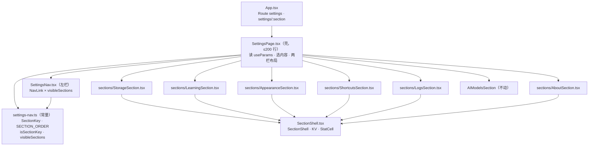
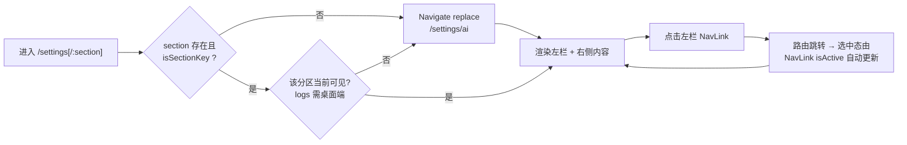

# 设置页外层分区导航改为左侧菜单 + 右侧内容 技术方案

| 字段 | 内容 |
|------|------|
| 作者 | Agent |
| 日期 | 2026-10-20 |
| 状态 | **已实施**（2026-10-20，T1–T10 全数落地；逐提交清单与门禁结果见 `docs/settings-left-menu-layout-runbook-2026-10.md`） |
| 关联需求 | 第一轮：用户「重新设计设置页布局，改成左边菜单，右边内容的布局方式，先生成详细方案」<br>第二轮：用户「移除开发或技术性的内容表述，如『本地优先与 AI』这种技术性的描述，更新方案」⇒ 新增 §9 |
| 前序方案 | `docs/settings-top-tab-layout-design-2026-09.md`（**本方案推翻其 §4.1 布局决策**，见 §1.3） |

## 1. 背景

### 1.1 当前形态

设置页 `/settings` 现为「顶部横向 Segment Tab + 平级内容区」：`SectionTitle` → 一行 7 项等分胶囊 → 下方按 `section` state 分发 7 个分区内容（`src/features/settings/SettingsPage.tsx`，实测 515 行）。

### 1.2 触发原因

分区从 6 涨到 7（`tauri-log-config` 新增「日志」分区），顶部等分后每项可用宽度被摊薄：

- 内容容器 `PageContainer` = `mx-auto max-w-5xl px-8`（**1024px**），减去 `px-8` 内边距（64px）＝ 960px；
- 7 项等分 ≈ 137px/项，减去按钮 `px-3`（24px）与边框 gap，实际文本区 ≈ 105px；
- en 文案最宽的 `Appearance & language`（21 字符，text-sm ≈ 7px/char ≈ 147px）**在等分布局下必然溢出**——现在靠 `whitespace-nowrap` + `overflow-x-auto` 兜底，代价是横向滚动条与「设置项藏起来」的隐性成本。

同时，`SettingsPage.tsx` 单文件已承载「布局壳 + 6 个分区组件 + 共享壳函数」共 515 行，分区数是唯一增长项；再加导航形态变更会继续膨胀。

### 1.3 ⚠️ 与前序方案的冲突（正面回应）

`docs/settings-top-tab-layout-design-2026-09.md` **正是把「左侧竖排 220px 菜单 + 右侧内容」改成顶部 Tab** 的方案，其 §1 给出的两条理由是：

| 前序理由 | 2026-10 现状 | 本方案如何化解 |
|----------|--------------|----------------|
| **双重侧栏**：应用已有 240px 主侧栏，进入设置页又出现第二根侧栏，视觉冗余 | 主侧栏 `NavSidebar` 仍是 `w-60`（240px），设置左栏无法回避并置 | 左栏取 **200px、无边框、无底色**（D1），与主侧栏靠留白和选中底色区分而非边框/底色；主侧栏是「品牌 + 全局导航 + 页脚徽标」，设置左栏是「当前页内的分区」，层级语义不同、视觉重量不同 |
| **内容区被压缩**：`max-w-5xl` 再减 220px | 内容区若仍 1024px，左栏吃掉 200px 后只剩 ≈760px | 容器改 `PageContainer size="wide"`（D4，上限 1600px），左栏 200px 固定、右侧随窗口伸展；常见桌面窗宽下右侧可用宽度 **不低于** 今天的 960px |

**结论**：前序方案的前提（6 分区 / 1024px 容器 / 带边框侧栏）已全部变化，本次是有依据的反转，不是反复横跳。前序文档按 `doc-truth-rescan` 纪律**保留原文 + 追加「已被取代」指针**（不删句，因为它的两条分析在原前提下依然成立）。

### 1.4 不做的后果

分区继续增长时，顶部等分胶囊会在 zh/en 两种语言下都出现截断或横向滚动，设置页可发现性下降；单文件继续变大，后续新增分区（如 E5 收口的能力证书、加密同步设置）改动面更宽。

### 1.5 第二轮需求：文案去技术化（新增）

用户原话：「移除开发或技术性的内容表述，如『本地优先与 AI』这种技术性的描述」。

这不是布局问题，是**语言层**问题，且与布局强耦合（左栏会把这些名字放大成 7 个常驻条目，技术词被反复看到）。实测现状：设置页用户可见文案里存在大量**实现层表述**与**开发里程碑词**——

| 位置 | 现文案（节选） | 问题 |
|------|----------------|------|
| `nav.settings.hint`（zh/en） | 「本地优先与 AI」/「Local-first & AI」 | 产品定位语，不是页面功能说明；同一串出现在**主侧栏小字、命令面板、设置页副标题**三处 |
| `settings.storage.desc` | 「预览态使用 localStorage；桌面端将切到 SQLite / 文件系统后端，接口不变」 | 纯后端实现，用户看不懂也不需要知道 |
| `settings.storage.backend` | 「当前后端」→「本机 localStorage」 | 「后端」「localStorage」都是开发者词汇 |
| `settings.learning.desc` + 4 条 items | 「自适应引擎…固定语义」「卷面掌握度 ≥ 0.8」「遗忘模型：按间隔调度，读时折算不写回」 | 引擎/阈值/调度/折算全是内部机制 |
| `settings.shortcuts.more` | 「更多快捷键随桌面端（Tauri）接入后补充」 | 框架名 |
| `settings.about.*` | 「开源 · 本地优先…」「Pre-MVP」「U6 · UI Workbench 收官」「代码可在项目仓库查看」 | 定位语 + 里程碑编号 + 仓库指向 |
| `settings.logs.*` | 「文件日志」「写入目录」「级别」 | 排障工具语言，用户不知道「级别」该选哪个 |
| `settings.storage.data` / `pack` | 「纯 JSON 文件」「.plosbak.json」「.ploskp.json」「明文 JSON」 | 文件格式与扩展名 |

**判断口径**：一处文案该不该改，问「**用户在做什么决定**」——
- 用户要决定「我的数据在哪 / 会不会丢」⇒ 改（讲结论，不讲实现）；
- 用户要决定「填什么」⇒ **不改**（`Base URL`、`模型名`、`API Key` 是必须填的外部服务参数，换说法会让人填错）；
- 技术标识（键名、`data-testid`、URL 段、错误码）⇒ 不进 UI，不属文案范围。

详见 §9。

## 2. 方案目标

| 类型 | 描述 |
|------|------|
| **主要目标** | ① 设置页外层改为「左侧分区菜单 + 右侧分区内容」两栏；② 分区 URL 路由化（`/settings/:section`）；③ 容器放宽到 `wide`；④ `< lg` 窄窗左栏转为内容上方的全宽列表；⑤ **设置页用户可见文案去技术化**（§9）：移除实现层表述（localStorage / SQLite / Tauri / JSON / 引擎 / 阈值 / 文件扩展名）与开发里程碑词（Pre-MVP / U6 / Workbench） |
| **非目标** | ① 不改任何分区**内容组件**的行为（AI 双 Tab、Storage 计数、日志读写、语言三选、快捷键表、关于卡的结构全部保留）；② 不新增**结构性**文案键（复用 `settings.sections` + `nav.settings.label`）；唯一新增是 §9.3 的 4 个日志级别显示名 `logs.levels.*`（协议值 `debug/info/warn/error` 不变）；③ 不做分区搜索/分组折叠；④ 不改主壳 `NavSidebar`；⑤ **不改** `AIModelsSection` / `ApiModelsTab` / `VectorIndexCard` / `ImportEnrichCard` / `KnowledgePackCard` 的**结构与交互**——允许的例外只有三处，且都属 §9：`BuiltinModelsPanel` 合并 Head/Tail 删 `<code>`（§9.4）、`DataPortabilityCard` 的后端名改走 `storagePlacementOf`（§9.2-B）、各卡片的**文案值**（§9.2-G） |
| **成功标准** | ① 7 分区在左侧菜单中可点选，选中态明确；② `/settings/logs` 可深链直达、刷新与浏览器前进后退均保持当前分区；③ `/settings` 与非法分区（如 `/settings/nope`、非桌面端下的 `/settings/logs`）均落到 `/settings/ai`；④ zh/en 下菜单文案完整不截断；⑤ `SettingsPage.tsx` ≤ 200 行，6 个分区组件各自成文件；⑥ `typecheck` 0 error、`layer:check` 无新增环、`ui:check` 不新增违规、`test:i18n` 通过；⑦ **设置页各分区文案中不再出现 §9.1 列出的技术词清单**（Grep 零命中） |

## 3. 项目现状

### 3.1 相关代码与模块（实测，2026-10-20）

| 路径 | 行数 | 现状 |
|------|------|------|
| `src/features/settings/SettingsPage.tsx` | 515 | 布局壳 + 6 个分区组件（`StorageSection` / `LearningSection` / `AppearanceSection` / `ShortcutsSection` / `LogsSection` / `AboutSection`）+ 共享 `SectionShell` / `KV` / `StatCell` + `backendLabelOf` + Storage 计数 effect |
| `src/features/settings/AIModelsSection.tsx` | 105 | AI 分区内容（自带「本地/API」双 Tab + `VectorIndexCard` + `ImportEnrichCard`），**本次不动** |
| `src/features/settings/{ApiModelsTab,BuiltinModelsPanel,VectorIndexCard,ImportEnrichCard}.tsx` | 286/366/374/45 | 本次不动 |
| `src/features/data/portability/{DataPortabilityCard,KnowledgePackCard}.tsx` | — | Storage 分区内挂载，本次不动 |
| `src/components/layout/AppShell.tsx` | 144 | `PageContainer` 已支持 `size: "default" \| "wide"`（wide = `max-w-[1600px] px-4 py-6 sm:px-6 lg:px-8 lg:py-8`）——**无需改动，直接传参** |
| `src/components/layout/NavSidebar.tsx` | 83 | 主侧栏 `w-60`；`NAV_ITEMS` 中 `/settings` **无 `end`** ⇒ `/settings/ai` 下仍高亮「设置」，**无需改动** |
| `src/App.tsx` | 82 | 路由 `settings` 单段；本次增 `settings/:section`（同组件） |
| `src/i18n/messages/{zh,en}.ts` | — | `settings.sections` 7 键齐备（zh/en 同构）；键**结构**不变，但 §9 要**重写约 24 个键的值** + 新增 4 个 `settings.logs.levels.*`（日志级别显示名）+ 改 `nav.settings.hint` 的值 |
| `src/i18n/messages/{zh,en}.ts` · `settings.sections` | 7 键 | 现值：AI 模型 / 本地存储 / 学习行为 / 外观与语言 / 快捷键 / 日志 / 关于；§9.2 改 3 个（storage / learning / logs） |

**门禁基线（实测）**：`npm run typecheck` = **0 error**；`npm run layer:check` = 无新增环，基线豁免 5 条（`CommandPalette` 3 边 + 2 环）；`npm run ui:check` = 原生下拉 0、sticky 残影 0，仅 focus 环透明度漂移（`/25` 3 处 · `/40` 3 处 · `/50` 2 处，**非本批范围**）。

### 3.2 相关文档与约定

- `docs/settings-top-tab-layout-design-2026-09.md`（前序，§1.3 已回应）
- `docs/tauri-log-config-design-2026-09.md`（日志分区来源；`isDesktopLogAvailable()` 控制可见性）
- `docs/nav-sidebar-redesign-design-2026-09.md`（主侧栏形态；其「`<nav>` 禁 `overflow-*`」的坑对本方案左栏**同样适用**）
- `rules/react.mdc`、`rules/dropdown-select.mdc`、`rules/code-structure-and-dependencies.mdc`（≤700 行 / ≥10 行×≥3 处先抽取）
- `skills/ui-impl-tokens/SKILL.md`（token-first；相对导入；禁 `useCallback` 默认添加）
- `skills/plos-ui-system/SKILL.md` + `scripts/ui-consistency-scan.mjs`（视觉模式跨 ≥3 文件必抽）

### 3.3 约束与依赖

- React 19 + Vite 8 + Tailwind 4 + react-router-dom 7（`HashRouter`）；无 ESLint/Prettier，跟随文件风格。
- `AiModelsSection` 等内容组件的 props 契约**不变** ⇒ 拆分只搬代码、不改签名。
- 桌面端日志分区依赖 `isDesktopLogAvailable()`（`src/lib/desktop-log`）—— 纯前端判定，无 IPC。

### 3.4 决策点（D1–D7）

| ID | 决策点 | 选项 | 状态 | 理由 |
|----|--------|------|------|------|
| D1 | 左栏形态 | A 带边框面板式 / **B 无边框轻量式** / C 极窄图标栏 | **已确认（2026-10-20，用户选 B）** | 化解前序方案「双重侧栏」反对理由；与主侧栏靠留白 + 选中底色而非边框区分 |
| D2 | 是否 URL 路由化 | A 路由化 / B 本地 state | **已确认（2026-10-20，用户选 A）** | 可深链（尤其 `/settings/logs` 这类排查入口）；刷新与前进后退保持分区 |
| D3 | 窄窗降级 | A 顶部横向 Tab / **B 左栏转顶部纵向列表** / C 不降级 | **已确认（2026-10-20，用户选 B）** | 一份 DOM 换方向，无双份选中态同步问题；实现最简 |
| D4 | 内容区宽度 | A 保持 1024 / **B 放宽到 wide** | **已确认（2026-10-20，用户选 B）** | 左栏吃掉 200px 后，wide 保证右侧可用宽度不低于今天 |
| D5 | 分区是否分组 | A 平铺 7 项 / B 分组 | **已确认（2026-10-20，选 A）** | 7 项未过分组阈值；分组会引入 i18n 新键与额外层级 |
| D6 | 文件拆分粒度 | **A 一次拆到 `sections/`** / B 只抽 `SectionShell` | **已确认（2026-10-20，按推荐 A 实施）** | `SectionShell` 被 6 处复用已触发 `code-structure-and-dependencies` 的强制抽取线；6 个分区组件同文件会让新分区继续堆在同一文件 |
| D7 | 文案去技术化的**深度** | **A 三层分级**（§9.5：本批做 P0+P1，`embedding` 整卡术语与 `brandSub` 另案）/ B 一次做到底（含向量索引卡、主壳品牌语、README） | **已确认（2026-10-20，按推荐 A 实施）** | A 把风险关在「纯文案值」内，一提交可回滚；B 会牵动 `VectorIndexCard` 信息结构 + README 双语对齐 + meta，且「向量/维度」换成用户语言需要重新设计该卡的表达，属于另一个方案 |
| D7-a | 「AI 模型」分区名是否也改 | **保留** / 改「智能助手」等 | 推荐保留 | 是功能名（模型下载与切换），改名降低可发现性；用户点名的是「本地优先」这个定位语 |
| D7-b | `Base URL` / `模型名` / `API Key` 等外部参数标签 | **保留** / 全部口语化 | 推荐保留 | 填的是第三方服务真实字段，换说法会让人填错（C 类） |

## 4. 技术架构

### 4.1 总体架构



**纯布局重构**：`section` 的真源从 `useState` 迁移到 URL 参数；其余状态（Storage 计数 effect、日志配置读写）原样保留。

### 4.2 模块职责

| 模块 | 职责 | 技术选型 |
|------|------|----------|
| `settings-nav.ts` | 分区键、顺序、可见性判定的**单一事实源** | 纯 TS 常量 + 类型守卫；`isSectionKey` 用 `SECTION_ORDER.includes` 收窄 |
| `SettingsNav.tsx` | 渲染左栏菜单（宽屏 200px sticky / 窄屏全宽列表，同一份 DOM） | `NavLink`（原生锚点：⌘/中键点击、复制链接、浏览器状态全可用） |
| `SettingsPage.tsx` | 路由参数 → 分区解析 + 非法分区重定向 + `wide` 两栏布局 + 内容分发 | `useParams` + `<Navigate replace>` |
| `sections/*.tsx` | 6 个分区内容（原样搬迁） | 逐字复制，props 契约不变 |
| `SectionShell.tsx` | 分区内容的标题/描述壳 + `KV` + `StatCell` | 纯展示 |

### 4.3 数据模型与 API

**数据读写：无新增、无变更。** 沿用现状链路，本次不触碰任何 store / storage / IPC：

| 用途 | 现状链路（不变） |
|------|------------------|
| 当前使用模型 | `features/settings/*` → `stores/useSettingsStore` → `storage` |
| Storage 计数与知识包候选 | `SettingsPage` → `stores/useLoopStore` 导出的 `storage` 单例（`listDocuments` / `listChapters` / `listPapers` / `listGoals` / `listEvidence`） |
| 日志配置 | `lib/desktop-log` → `invoke("log_get_config")` 等（Tauri，非 Tauri 下 `isDesktopLogAvailable()` 为 false ⇒ 分区不可见） |
| 界面语言 | `stores/useLangStore`（`plos:lang:v1`） |

⚠️ `counts` 与 `packCandidates` **必须继续同源一次读取**（现有注释已说明：分两次读库就是「两把尺子」，两次 `listDocuments()` 之间可能夹着导入/删除）。拆分时这段逻辑整体搬进 `SettingsPage`，**不得**顺手拆成两个 effect。

### 4.4 状态与副作用

| 状态 | 原 | 新 |
|------|-----|-----|
| 当前分区 | `useState<SectionKey>("ai")` | `useParams().section` → `isSectionKey` 校验 → 否则 `<Navigate to="/settings/ai" replace />` |
| Storage 计数 / 候选 | `useState` + `useEffect(reloadCounts, [])` | **不变**（仍在 `SettingsPage`） |
| 日志配置 / 预览 / 错误 | `LogsSection` 内部 `useState` | **不变**（整体搬进 `sections/LogsSection.tsx`） |
| AI 分区双 Tab | `AIModelsSection` 内部 `useState` | **不变** |

副作用触发时机无变化；新增的只有一条**渲染期校验副作用**（非法分区 → `<Navigate replace>`），无网络/存储写入。

## 5. 交互流程

### 5.1 主流程

1. 用户从主侧栏点「设置」→ 导航到 `/settings` → `SettingsPage` 判定无 `section` 参数 → `<Navigate replace>` 到 `/settings/ai` → 地址栏变为 `#/settings/ai`，用户无感；
2. 页面呈现两栏：左侧 200px 分区菜单（`lg` 以上 sticky 跟随滚动），右侧 `wide` 内容区显示「AI 模型」分区；
3. 用户点击左栏「数据与备份」→ `NavLink` 导航到 `/settings/storage` → 地址栏更新、浏览器历史新增一条 → 右侧内容切换，左栏选中态随路由自动更新（无 `useState` 同步）；
4. 用户刷新页面 → 分区保持在 `/settings/storage`；点浏览器「后退」→ 回到上一个分区。

### 5.2 分支与异常流程

| 场景 | 触发条件 | 系统行为 | UI 反馈 |
|------|----------|----------|---------|
| 非法分区深链 | `/settings/nope` | `isSectionKey` 失败 → `<Navigate replace>` | 地址栏被改写为 `#/settings/ai`，显示 AI 分区 |
| 不可见分区深链 | 浏览器预览态访问 `/settings/logs`（`isDesktopLogAvailable()` 为 false） | 同样走 `<Navigate replace>` | 落到 `#/settings/ai`，左栏不出现「帮助与诊断」项 |
| 窄窗（< lg） | 视口宽度 < 1024px | 左栏转为内容上方的全宽列表（`max-h-56` 限高可纵向滚动） | 分区项横向铺满整行宽度，仍是选中底色 |
| 窄窗 + 7 项 | 同上 | 列表占 7 行、最多 224px 高，不挤压首屏 | 内容区在列表下方正常展示 |
| en 长文案 | `Appearance & language` | 菜单项 `truncate` + `title` 兜底 | 不换行、不撑破 200px |
| 直接改地址栏 hash | 手动输入 `#/settings/about` | 路由匹配 → 正常渲染 | 左栏「关于」高亮 |

### 5.3 流程图



## 6. 用户用例

### UC-01：左侧菜单切换分区

| 项 | 内容 |
|----|------|
| 角色 | 设置页用户 |
| 前置条件 | 进入 `/settings`（自动落到 `/settings/ai`），窗口宽度 ≥1024px |
| 主流程步骤 | 1. 看到左侧 7 项菜单，「AI 模型」选中 2. 依次点击「数据与备份」「学习规则」「外观与语言」「快捷键」「帮助与诊断」「关于」 3. 观察右侧内容与地址栏 |
| 期望结果 | 每次点击：左栏选中底色唯一移动、右侧内容整体替换、地址栏 hash 同步为 `#/settings/<key>`；无白屏、无闪烁、无横向滚动条 |
| 异常/边界 | 重复点击已选中项无副作用；快速连点不同项不出现内容错配（内容严格由 URL 派生，不存在 state 竞态） |

### UC-02：深链 / 刷新 / 前进后退

| 项 | 内容 |
|----|------|
| 角色 | 设置页用户（含排查问题的用户） |
| 前置条件 | 无 |
| 主流程步骤 | 1. 直接在地址栏输入 `#/settings/logs` 2. 刷新页面 3. 点「数据与备份」后按浏览器「后退」 |
| 期望结果 | ① 直达「帮助与诊断」分区（桌面端）；② 刷新后仍是该分区；③ 后退回到上一个分区，菜单选中态与内容同时回退 |
| 异常/边界 | 浏览器预览态访问 `#/settings/logs` → 自动落到 `#/settings/ai`（不出现空内容区） |

### UC-03：非法与边界 URL

| 项 | 内容 |
|----|------|
| 角色 | 设置页用户 |
| 前置条件 | 无 |
| 主流程步骤 | 依次访问 `#/settings/nope`、`#/settings/`、`#/settings/AI`（大写） |
| 期望结果 | 三者均被规范化到 `#/settings/ai`；无空白页、无报错页；地址栏被 `replace` 改写（不污染后退历史） |
| 异常/边界 | `/settings/AI` 大小写不匹配 ⇒ 视为非法并重定向（`SectionKey` 为小写字面量联合） |

### UC-04：窄窗降级

| 项 | 内容 |
|----|------|
| 角色 | 设置页用户 |
| 前置条件 | 窗口宽度 < 1024px |
| 主流程步骤 | 1. 进入设置页 2. 观察左栏位置 3. 点击任一分区 |
| 期望结果 | 左栏出现在内容区**上方**，全宽、最多 224px 高、超出可纵向滚动；选中态与内容切换正常 |
| 异常/边界 | 极窄窗（<640px）下菜单文案不截断（`truncate` + `title`） |

### UC-05：文案不出现开发/实现表述

| 项 | 内容 |
|----|------|
| 角色 | 设置页用户（不懂编程） |
| 前置条件 | 进入设置页，默认 zh |
| 主流程步骤 | 1. 读页面副标题与左栏 7 项 2. 逐分区阅读说明文案（重点：数据与备份、学习规则、帮助与诊断、关于）3. 切 en 重读一遍 |
| 期望结果 | 全部分区**读不到**实现层词汇（localStorage / SQLite / Tauri / JSON / 引擎 / 阈值 / 后端 / 文件扩展名）与开发里程碑词（Pre-MVP / U6 / Workbench / `npm run`）；每条说明都能一句话说清「这对我有什么用」 |
| 异常/边界 | AI 分区的 `Base URL` / `模型名` / `API Key` **应当保留**（外部服务真实字段）——不要误判为漏改；日志级别按钮显示中文，但 `data-testid` 仍是 `debug/info/warn/error` |

## 7. 线框 UI（Wireframe）

### 7.1 宽屏默认状态（≥1024px，`#settings/ai`）

```
┌─ AppShell ─────────────────────────────────────────────────────────────────┐
│┌ NavSidebar ┐┌ Header:  [⌘K 全局搜索……]              ＋导入资料   ● AI 就绪 ┐│
││ 今日       │└──────────────────────────────────────────────────────────────┘│
││ 计划       │┌ PageContainer size="wide" (max-w-1600, px-8) ───────────────┐ │
││ 资料库     ││ 设置 · 按你的习惯调整                   ← SectionTitle      │ │
││ 图谱       ││ ──────────────────────────────────────────────────────────── │ │
││ 测评       ││ ┌─ 左栏 200px ────────┐┌─ 右侧内容（随窗口伸展）──────────┐ │ │
││ 目标       ││ │ ▎AI 模型      ←选中 ││ AI 模型                          │ │ │
││ 我的画像   ││ │   数据与备份       ││ ┌──────────────────────────────┐ │ │
││ 复盘       ││ │   学习规则         ││ │ [本地] [API]        ← 内层双Tab│ │ │
││ 记忆       ││ │   外观与语言       ││ ├──────────────────────────────┤ │ │
││ 设置   ●   ││ │   快捷键           ││ │ 本地模型列表 / 下载进度 / 激活 │ │ │
│└────────────┘│ │   帮助与诊断       ││ └──────────────────────────────┘ │ │
│              │ │   关于             ││ ┌ 状态卡 ┐ ┌ 状态卡 ┐              │ │
│              │ └────────────────────┘│ └────────┘ └────────┘              │ │
│              │ ↑ 无边框/无底色       │ ┌ 向量索引卡 ─────────────┐        │ │
│              │ ↑ lg:sticky top-6     │ ┌ 导入后 AI 整理卡 ──────┐        │ │
│              │ ↑ 选中 = bg-subtle    └──────────────────────────┘        │ │
│              └────────────────────────────────────────────────────────────┘ │
└───────────────────────────────────────────────────────────────────────────┘
```

- **布局说明**：外层 `grid gap-6 lg:grid-cols-[200px_minmax(0,1fr)] lg:gap-8`；左栏 `lg:sticky lg:top-6 lg:self-start lg:w-50 lg:shrink-0`；右侧 `min-w-0`。
- **组件映射**：`PageContainer size="wide"`（既有，不改）+ `NavLink`（react-router）+ `nav-items` 无关；分区内容组件全部复用现有。
- **设计 token**：`bg-subtle`（选中底）/ `text-ink-1`（选中字）/ `text-ink-2`（未选中）/ `hover:bg-subtle hover:text-ink-1` / `border-line`（仅 SectionTitle 下方无；本布局不新增边框）/ `shadow-sm`（不用于左栏）。

### 7.2 窄屏状态（<1024px）

```
┌──────────────────────────────────────────────────┐
│ [NavSidebar 仍在，主壳不变]                        │
│ ┌ PageContainer ────────────────────────────────┐ │
│ │ 设置 · 按你的习惯调整                          │ │
│ │ ┌ 左栏转全宽列表（max-h-56 overflow-y-auto）─┐ │ │
│ │ │ ▎AI 模型                            ←选中 │ │ │
│ │ │   数据与备份                                │ │ │
│ │ │   学习规则                                  │ │ │
│ │ │   外观与语言   （7 项，最多 224px，超出滚动）│ │ │
│ │ └────────────────────────────────────────────┘ │ │
│ │ ┌ 右侧内容 ──────────────────────────────────┐ │ │
│ │ │ …分区内容…                                  │ │ │
│ │ └────────────────────────────────────────────┘ │ │
│ └────────────────────────────────────────────────┘ │
└──────────────────────────────────────────────────┘
```

- **组件映射**：**同一份 DOM**，只换 class（`lg:` 断点）；不存在「宽屏一套 / 窄屏一套」的双份渲染 ⇒ 选中态天然同步。

### 7.3 其他状态

| 状态 | 表现 |
|------|------|
| 加载中 | 无独立加载态（分区内容自持；Storage 计数 `undefined` 时显示 `m.common.loading` 现状不变） |
| 非法 URL | 内容区**不出现**任何空壳；`Navigate` 在渲染前完成，视觉上等同直接访问 `/settings/ai` |
| 帮助与诊断不可用 | 左栏**不渲染**该项（`visibleSections()` 过滤），不占位、不置灰 |
| Hover / Focus | 菜单项 `hover:bg-subtle hover:text-ink-1`；键盘 Tab 可聚焦，`focus-visible:ring-2 focus-visible:ring-ring/50`（与 `NavSidebar` 一致） |
| 当前项语义 | `NavLink` 自动输出 `aria-current="page"`；左栏容器 `<nav aria-label={m.nav.settings.label}>` |

### 7.4 交互说明

- **不用 `backdrop-filter`**：`ui:check` 第 6 类（macOS WKWebView sticky 残影）—— 左栏 sticky **纯不透明背景、无 blur**；若后续想加毛玻璃必须同时配 `key` 重挂载。
- **不用 `overflow-*` 于 `<nav>` 的横向**：沿用 `NavSidebar` 的坑——CSS 中一个方向非 visible 会把另一方向的 visible 计算成 auto。窄屏限高滚动用 `overflow-y-auto`（单一方向），不构成该问题。
- **弹层**：无。

## 8. 涉及文件及改动伪代码

### 8.1 `src/features/settings/settings-nav.ts`（新增）

**改动说明**：把 `SectionKey` / `SECTION_ORDER` 从 `SettingsPage.tsx` 抽出为单一事实源，并新增可见性与校验两个纯函数（放模块级，避免渲染期重复计算）。

```ts
// 伪代码
import { isDesktopLogAvailable } from "../../lib/desktop-log";
import type { Messages } from "../../i18n";

/** 设置分区键（= URL 段）。 */
export type SectionKey = "ai" | "storage" | "learning" | "appearance" | "shortcuts" | "logs" | "about";

/** 展示顺序 = 单一事实源；左栏与校验都读它，不再各写一份数组。 */
export const SECTION_ORDER: readonly SectionKey[] = [
  "ai", "storage", "learning", "appearance", "shortcuts", "logs", "about",
] as const;

/** URL 段是否合法分区键（大小写敏感：小写字面量联合）。 */
export function isSectionKey(v: string | undefined): v is SectionKey {
  return !!v && (SECTION_ORDER as readonly string[]).includes(v);
}

/** 当前环境可见的分区（日志仅桌面端）。 */
export function visibleSections(): SectionKey[] {
  return SECTION_ORDER.filter((k) => k !== "logs" || isDesktopLogAvailable());
}

/** 左栏 i18n 取词：settings.sections 已 7 键，无需新增。 */
export function sectionLabel(st: Messages["settings"], k: SectionKey): string {
  return st.sections[k];
}
```

### 8.2 `src/features/settings/SettingsNav.tsx`（新增）

**改动说明**：左栏菜单。**一份 DOM**，靠 `lg:` 断点切换「200px sticky 竖列」与「全宽限高列表」。

```tsx
// 伪代码
import { NavLink } from "react-router-dom";
import { useI18n } from "../../i18n";
import { visibleSections, type SectionKey } from "./settings-nav";

export default function SettingsNav({ current }: { current: SectionKey }) {
  const { m } = useI18n();
  return (
    <nav
      aria-label={m.nav.settings.label}
      data-testid="settings-nav"
      className={[
        // 窄屏：全宽纵向列表，限高可滚（单一方向 overflow，不触发 NavSidebar 那个 CSS 坑）
        "flex max-h-56 flex-col gap-0.5 overflow-y-auto",
        // 宽屏：固定 200px 竖列 + sticky 跟随滚动
        "lg:max-h-none lg:w-50 lg:shrink-0 lg:overflow-visible lg:self-start lg:sticky lg:top-6",
      ].join(" ")}
    >
      {visibleSections().map((key) => (
        <NavLink
          key={key}
          to={`/settings/${key}`}
          end                       // 精确匹配，避免未来子路由误高亮
          title={m.settings.sections[key]}
          data-testid={`settings-tab-${key}`}   // ⚠️ 沿用旧 testid，不让既有选择器失效
          className={({ isActive }) =>
            `rounded-md px-3 py-2 text-sm transition-colors focus-visible:outline-none focus-visible:ring-2 focus-visible:ring-ring/50 ${
              isActive || current === key
                ? "bg-subtle font-medium text-ink-1"
                : "text-ink-2 hover:bg-subtle hover:text-ink-1"
            }`
          }
        >
          <span className="block truncate">{m.settings.sections[key]}</span>
        </NavLink>
      ))}
    </nav>
  );
}
```

> `data-testid` 沿用 `settings-tab-<key>`（与被删除的顶部 Tab 同名）⇒ 既有 Playwright 选择器零改动。`current === key` 是 `Navigate` 换 URL 前的极短窗口内的兜底（此时 `NavLink` 尚未拿到新路由），消除「闪一下无高亮」。

### 8.3 `src/features/settings/SettingsPage.tsx`（重写，515 → ≤200 行）

**改动说明**：只保留「路由解析 + 重定向 + 两栏布局 + 内容分发 + Storage 计数」；6 个分区组件与 `SectionShell` 全部搬出。

```tsx
// 伪代码（全文骨架）
import { useEffect, useState } from "react";
import { Navigate, useParams } from "react-router-dom";
import { SectionTitle } from "../../components/primitives";
import { PageContainer } from "../../components/layout/AppShell";
import { useLangStore } from "../../stores/useLangStore";
import { useI18n } from "../../i18n";
import { storage } from "../../stores/useLoopStore";
import AIModelsSection from "./AIModelsSection";
import SettingsNav from "./SettingsNav";
import { isSectionKey, visibleSections, type SectionKey } from "./settings-nav";
import StorageSection from "./sections/StorageSection";
import LearningSection from "./sections/LearningSection";
import AppearanceSection from "./sections/AppearanceSection";
import ShortcutsSection from "./sections/ShortcutsSection";
import LogsSection from "./sections/LogsSection";
import AboutSection from "./sections/AboutSection";

interface StorageCounts { docs: number; chapters: number; papers: number; goals: number; evidence: number; }

export default function SettingsPage() {
  const { m } = useI18n();
  const { section } = useParams<{ section?: string }>();

  // 非法分区 / 不可见分区（日志在浏览器预览态）→ 规范化到 ai，replace 不污染后退历史。
  const fallback = <Navigate to="/settings/ai" replace />;
  if (!isSectionKey(section)) return fallback;
  if (!visibleSections().includes(section)) return fallback;

  return (
    <SettingsLayout section={section}>
      {section === "ai" ? <AIModelsSection /> : section === "storage" ? (
        <StorageSectionSection counts={counts} packCandidates={packCandidates} st={m.settings}
          loading={m.common.loading} onDataChanged={reloadCounts} />
      ) : section === "learning" ? <LearningSection st={m.settings} />
      : section === "appearance" ? <AppearanceSection ... />
      : section === "shortcuts" ? <ShortcutsSection st={m.settings} />
      : section === "logs" ? <LogsSection st={m.settings} />
      : <AboutSection st={m.settings} />}
    </SettingsLayout>
  );
}

/** 布局壳：wide 容器 + 两栏；counting effect 留在同一文件（与 counts/packCandidates 同源）。 */
function SettingsLayout({ section, children }: { section: SectionKey; children: ReactNode }) {
  const { m } = useI18n();
  const langMode = useLangStore((s) => s.mode);  // AppearanceSection 需要，照旧透传
  const setLangMode = useLangStore((s) => s.setMode);
  const [counts, setCounts] = useState<StorageCounts>();          // ⚠️ 与 packCandidates 同源一次读
  const [packCandidates, setPackCandidates] = useState<PackCandidate[]>();
  const reloadCounts = () => { /* 原样搬入：Promise.all + 逐文档 chapters，产出 counts 与 candidates */ };
  useEffect(reloadCounts, []);

  return (
    <PageContainer size="wide">
      <SectionTitle title={m.nav.settings.label} subtitle={m.nav.settings.hint} />
      <div className="mt-6 grid gap-6 lg:grid-cols-[200px_minmax(0,1fr)] lg:gap-8">
        <SettingsNav current={section} />
        <div className="min-w-0">{children}</div>
      </div>
    </PageContainer>
  );
}
```

> ⚠️ 上面的 `SettingsLayout` 只是**示意拆分**（`children` 与 `counts` 的归属需在实施时收敛到单文件内、不引入跨组件 state 提升）。实施口径：**`SettingsPage.tsx` 保持单组件**（`counts` / `packCandidates` / `reloadCounts` 都在其中），只是把渲染树改成两栏；`AppearanceSection` 的 `langMode/setLangMode` 仍由 `SettingsPage` 读取后透传。**不引入新的抽象层**——这是布局重构，不是架构重构。

### 8.4 `src/features/settings/SectionShell.tsx`（新增）

**改动说明**：`SectionShell` / `KV` / `StatCell` 被 6 个分区组件复用（触发 `code-structure-and-dependencies` 的「≥10 行 × ≥3 处先抽取」），从 `SettingsPage.tsx` 原样搬出。

```tsx
// 伪代码 —— 原样搬运，不改任何 className / props
export function SectionShell({ title, desc, children }: { title: string; desc?: string; children: ReactNode }) { /* … */ }
export function KV({ k, v }: { k: string; v: string }) { /* … */ }
export function StatCell({ label }: { label: string }) { /* … */ }
```

### 8.5 `src/features/settings/sections/{Storage,Learning,Appearance,Shortcuts,Logs,About}Section.tsx`（新增，6 个文件）

**改动说明**：从 `SettingsPage.tsx` **逐字搬迁**，只改 import 来源（`Card`/`SectionTitle` 路径不变、`SectionShell`/`KV`/`StatCell` 改为从 `../SectionShell` 导入）。**props 契约、className、i18n 取词、`data-testid`、副作用一律不变**。

| 文件 | 迁入内容 | 额外 import |
|------|----------|-------------|
| `sections/StorageSection.tsx` | `StorageSection` + `StatCell` 引用 | `DataPortabilityCard` / `KnowledgePackCard`（`../../data/portability/…`）、`storage`、`lib/storage-label` 的 `storagePlacementOf` |
| `sections/LearningSection.tsx` | `LearningSection` | `Card` |
| `sections/AppearanceSection.tsx` | `AppearanceSection` | `Card` |
| `sections/ShortcutsSection.tsx` | `ShortcutsSection` | `Card` |
| `sections/LogsSection.tsx` | `LogsSection` + `LOG_LEVELS` | `Card` + `lib/desktop-log` 全部 |
| `sections/AboutSection.tsx` | `AboutSection` | `Card` |

> ⚠️ `backendLabelOf` **不再随 `StorageSection` 搬入**——§9.2-B 已查明它把 `"tauri"` 误判成内存，且 `DataPortabilityCard` 也需要同一映射（两处消费 ⇒ 触发 `code-structure-and-dependencies` 的抽取线）。改为新建 `src/lib/storage-label.ts::storagePlacementOf(name): "device" | "temporary"`（**返回 enum，不返回文案**，文案由 UI 映射），`StorageSection` 与 `DataPortabilityCard` 共同引用。原 `backendLabelOf` 函数删除。

### 8.6 `src/App.tsx`（修改，1 行）

```diff
- <Route path="settings" element={<SettingsPage />} />
+ {/* 分区 URL 化（D2）：`/settings` 与 `/settings/<key>` 同组件，无段时内部 replace 到 /settings/ai */}
+ <Route path="settings" element={<SettingsPage />} />
+ <Route path="settings/:section" element={<SettingsPage />} />
```

> **为什么写两条而不是 `settings/:section?`**：react-router 7 支持可选段语法，但两条显式路由对 `grep`／后人阅读更友好，且不依赖可选参数与「空段」在 `HashRouter` 下的解析细节。**不要**引入第二份组件实例——两条路由指向同一个 `SettingsPage`，反正是按 URL 派生的无状态渲染。
>
> 实施后必须实测三条：`/settings` 能进（并被 replace 到 `#/settings/ai`）、`#/settings/ai` 能进、`#/settings/nope` 被重定向。

### 8.7 `src/i18n/messages/zh.ts` / `en.ts`（修改：注释 + §9 的值重写）

**改动说明**：键**结构**不变（`sections` 仍 7 键、其余键名一律不动），改动分两部分——

1. 注释同步：「顶部横向导航」→「左侧菜单」语义，防止后来者按旧注释找 Tab；
2. **值重写**：按 §9.2 表逐条替换（约 24 个键），并新增 4 个 `settings.logs.levels.*`。⚠️ 值改写**必须 zh/en 同批**（`test:i18n` 只锁键同构，**不报**值为空的孤儿；漏改一侧不会报错，只会静默显示中文）。

```diff
- /** Settings 分区 Tab（顶部横向导航）。 */
+ /** Settings 分区（左侧菜单 + URL 分区；文案口径见 docs/settings-left-menu-layout-design-2026-10.md §9）。 */
  sections: { /* 7 键不变，值按 §9.2 重写 3 个 */ },

+    /** 日志级别显示名（值是 Rust 协议常量 debug/info/warn/error，此处只做用户语言映射）。 */
+    levels: { debug: "详细", info: "常规", warn: "提醒", error: "出错" },
```

> ⚠️ **键名不动、只改值**：`storage.desc` 仍是 `storage.desc`、URL 段仍是 `storage`。改名会让 §9 从「语言修订」变成「跨文件重命名」，牵动 `settings-nav.ts`、路由、既有深链与测试选择器——**收益为零**（用户看不到键名）。

### 8.8 `docs/settings-top-tab-layout-design-2026-09.md`（修改，回扫）

**改动说明**：按 `doc-truth-rescan` 纪律——**结论被推翻**（顶部 Tab 不再是当前布局）⇒ 追加状态指针而非删文。

- 头部「状态」行追加：`⚠️ 2026-10-20 布局决策已被 docs/settings-left-menu-layout-design-2026-10.md 取代（改回左侧菜单 + URL 分区 + wide 容器）；本文 §1 的两条反对理由在原前提下仍成立，化解方式见新方案 §1.3。`
- 「变更记录」追加一行。

## 9. 用户可见文案去技术化（第二轮需求）

> 范围：`src/i18n/messages/{zh,en}.ts` 的 `settings` 子树（含 `settings.models` / `settings.embedding`）**值**。键名、`data-testid`、URL 段、Rust 协议常量一律不动。

### 9.1 判据：什么该改、什么必须留

三类文案三种处理，判据是「**用户拿这条信息要做什么决定**」：

| 类型 | 例子 | 处理 | 理由 |
|------|------|------|------|
| **A 实现层描述**（讲系统怎么做的） | 「预览态使用 localStorage；桌面端将切到 SQLite / 文件系统后端」 | **必改**：改讲结论 | 用户要决定的是「我的数据在哪、会不会丢」，不是后端选型 |
| **B 开发侧指令 / 里程碑 / 内部代号** | 「请运行 `npm run tauri dev`」「Pre-MVP」「U6 · UI Workbench 收官」「.plosbak.json」 | **必删**：用户不该看到开发者工作流 | 这类内容会把用户带去执行一条他根本跑不了、也不需要跑的命令 |
| **C 必须填的外部参数 / 协议常量** | `Base URL`、`模型名`、`API Key`、日志级别值 `debug/info/warn/error` | **保留**（值可加显示映射） | 是第三方服务的真实字段名，换说法会让人填错；协议值改了会与 Rust 侧不一致 |

**§9 内的黑名单（改完后应在 `settings` 子树内 0 命中）**：
`localStorage`、`SQLite`、`Tauri`、`JSON`、`Keychain`/`钥匙串`、`npm run`、`引擎`、`阈值`、`后端`、`Pre-MVP`、`Workbench`、`.plosbak`、`.ploskp`。

> ⚠️ **`向量` 刻意不入黑名单**：`embedding` 整卡的术语（向量 / 维度 / 块）按 §9.5 划到另案，若列进判据，§9.7 的「0 命中」永远无法达成 —— 判据必须只覆盖本批真会改的词，否则它会退化成一个永远红着的假门禁。

### 9.2 替换表（P0，本批必做）

#### A. 页面级与导航（3 处值 + 2 处 title）

| 键 | 现 zh | 新 zh | 现 en | 新 en |
|----|-------|-------|-------|-------|
| `nav.settings.hint` | 本地优先与 AI | **按你的习惯调整** | Local-first & AI | **Make it yours** |
| `settings.sections.storage` | 本地存储 | **数据与备份** | Local storage | **Data & backups** |
| `settings.sections.learning` | 学习行为 | **学习规则** | Learning behavior | **Learning rules** |
| `settings.sections.logs` | 日志 | **帮助与诊断** | Logs | **Help & diagnostics** |
| `settings.sections.ai` / `appearance` / `shortcuts` / `about` | AI 模型 / 外观与语言 / 快捷键 / 关于 | **保留** | AI models / Appearance & language / Shortcuts / About | 保留 |

> ⚠️ `nav.settings.hint` 有 **3 个消费方**：主侧栏小字（`NavSidebar.tsx:67` + `:37` title）、命令面板说明（`CommandPalette.tsx:163`）、设置页副标题（`SettingsPage.tsx:100`）。改值一次三处同时生效——这是它必须改的首要原因：主侧栏底下那行小字写着「本地优先与 AI」，对用户零信息量。
>
> ⚠️ 「AI 模型」**保留不改**：它是功能名（里面就是模型下载与切换），改名会降低可发现性；「AI」不是开发术语。用户点名的是「本地优先」这个定位语，不是「AI」。

#### B. 数据与备份（`settings.storage`）

| 键 | 现 zh | 新 zh | 新 en |
|----|-------|-------|-------|
| `storage.title` | 本地存储 | 数据与备份 | Data & backups |
| `storage.desc` | 一切数据都写在本机。预览态使用 localStorage；桌面端将切到 SQLite / 文件系统后端，接口不变。 | 你的资料、笔记和学习记录都留在这台设备上，不会上传。换设备时用下面的备份带走。 | Your documents, notes and study records stay on this device — nothing is uploaded. Use the backup below when you switch devices. |
| `storage.backend` | 当前后端 | 保存位置 | Stored on |
| `storage.storageMemory` | 内存（预览态） | 临时（关掉就清空） | Temporary (cleared on close) |
| `storage.storageLocal` | 本机 localStorage | 这台设备 | This device |
| `storage.counts` | 数据规模 | 内容统计 | Contents |
| `storage.note` | 导出 / 导入与整库替换都在上方卡片里。整库清空只作为「替换导入」的一部分提供，且会先自动备份。 | 替换导入会先自动备份本机数据，再写入新内容，不会无声覆盖。 | Replace-import backs this device up first, then writes the new content — never a silent overwrite. |

> 🔴 **改这两个 label 前必须先修一个既存缺陷**（实测，`SettingsPage.tsx:54`）：
> ```ts
> return name.includes("local") ? sg.storageLocal : sg.storageMemory;
> ```
> `storage.name` 有三个值：`"local"`（`local.ts:106`）/ `"memory"`（`memory.ts:54`）/ **`"tauri"`（`tauri.ts:398`）**。`"tauri".includes("local")` = **false** ⇒ **桌面端当前把保存位置显示成「内存（预览态）」**。改文案后这句会变成「临时（关掉就清空）」——从「错了但含糊」变成「错得很具体，且会让用户以为数据会丢」。**必须同批修**。
>
> 修法（按仓库 i18n 纪律：**服务层只产 enum，文案由 UI 映射**）——新增 `src/lib/storage-label.ts`：
> ```ts
> export type StoragePlacement = "device" | "temporary";
> /** memory 之外的 local / tauri 都是「数据在这台设备上」。 */
> export function storagePlacementOf(name: string): StoragePlacement {
>   return name === "memory" ? "temporary" : "device";
> }
> ```
> 两个消费方共用：`sections/StorageSection.tsx`（保存位置 KV）与 `DataPortabilityCard.tsx:376`（`previewMeta` 的 `${backend}` 现在直接显示 `storage.name` 原文 ⇒ **用户会看到「来源 local」**，同样要换成 label）。

#### C. 学习规则（`settings.learning`）

| 键 | 现 | 新 zh | 新 en |
|----|----|-------|-------|
| `learning.title` | 学习行为 | 学习规则 | Learning rules |
| `learning.desc` | 自适应引擎按你目前数据自动决策；以下阈值是本版固定语义，暂不提供用户设置。 | 学什么、什么时候复习，由应用按你的记录安排。下面是目前的规则。 | What you study and when you review is planned from your own records. Current rules: |
| `items[0]` | 达标线 80%：卷面掌握度 ≥ 0.8 视为该章已掌握 | 一章测到 80 分及以上，就算学会了 | 80 or above on a chapter test counts as learned |
| `items[1]` | 及格线 60%：卷面低于 0.6 进入待补考 | 低于 60 分要重考 | Below 60 means a re-take |
| `items[2]` | 遗忘模型：到期复习按间隔调度，读时折算不写回 | 学过的内容会隔一段时间再出现，提醒你复习 | Learned material comes back at intervals as review |
| `items[3]` | 补考卷降一档难度，仅客观题（本地确定性题库） | 重考卷会容易一些，只考客观题 | Re-take papers are easier and use objective questions only |

> 4 条规则**语义必须与代码一致**（真源：`engine/quiz-engine.ts` + `engine/learning-planner.ts`）：80/60 两个分数线、复习按间隔、重考降难度且只出客观题——只换说法，**不改数字与条件**。删掉的只有「卷面掌握度」「确定性题库」这类实现词。

#### D. 快捷键（`settings.shortcuts`）

| 键 | 现 | 新 zh | 新 en |
|----|----|-------|-------|
| `shortcuts.more` | 更多快捷键随桌面端（Tauri）接入后补充。 | 更多快捷键会在后续版本补上。 | More shortcuts will come in later versions. |

#### E. 帮助与诊断（`settings.logs`）

| 键 | 现 zh | 新 zh | 新 en |
|----|-------|-------|-------|
| `logs.title` | 日志 | 帮助与诊断 | Help & diagnostics |
| `logs.desc` | 文件日志（仅桌面端）：写入目录按天分文件，自动保留 7 天，用于离线排查问题。 | 应用会记录自己的运行情况。遇到问题时，把这里的内容发给我们，能帮忙定位原因。只保留最近 7 天。 | The app keeps a record of its own activity. If something goes wrong, send it to us — it helps us find the cause. Kept for 7 days. |
| `logs.enabledLabel` | 写入文件 | 记录运行情况 | Keep a record |
| `logs.enabledHint` | 关闭后停止写入，已有文件保留；配置会记住。 | 关掉后不再记录，已有的记录不会被删除。 | Turn off to stop recording; existing records are kept. |
| `logs.levelLabel` | 级别 | 详细程度 | Detail |
| `logs.dirLabel` | 写入目录 | 保存位置 | Saved in |
| `logs.previewTitle` | 最近日志 | 最近记录 | Recent records |
| `logs.previewEmpty` | 今日暂无日志。 | 今天还没有记录。 | Nothing recorded today. |
| `logs.writeError` | 写入异常 | 记录失败 | Recording failed |

> 「日志」这个词本身是开发者词汇，但分区**功能**不能删（排障入口）。做法是：**分区名改「帮助与诊断」，内部保留可直接复制的内容**——用户需要的是「出问题时有个东西能发给我」，不是「日志文件在哪」。

#### F. 关于（`settings.about`）

| 键 | 现 zh | 新 zh | 新 en |
|----|-------|-------|-------|
| `about.tagline` | 开源 · 本地优先的自适应学习系统 | 开源 · 数据始终在你手里 | Open source · your data stays with you |
| `about.badge` | Pre-MVP | 预览版 | Preview |
| `about.desc` | 由「阅界」品牌出品。学习闭环：资料 → 章节 → 测评 → 掌握度 → 下一步该学什么。 | 由「阅界」出品。把资料拆成章节，读一读、测一测，就知道下一步该学什么。 | Made by 阅界. Split a document into chapters, read and test yourself, and you will know what to learn next. |
| `about.repoNote` | 代码可在项目仓库查看；本版为 Pre-MVP 里程碑（U6 · UI Workbench 收官）。 | 本版仍在完善中，功能会持续补充。 | This build is still being completed; more features are on the way. |

> `badge` 选「改值」而非「删元素」：删掉要改 `sections/AboutSection.tsx` 做可选渲染（多一处分支），而「预览版」既去掉里程碑代号、又诚实告知这是早期版本。代价可忽略。

#### G. 备份 / 知识包的格式名（P1，同批做，纯值）

| 键 | 现 zh | 新 zh |
|----|-------|-------|
| `storage.data.desc` | …备份是纯 JSON 文件，包含你的资料、章节、笔记、进度与证据。 | …备份是一个文件，包含你的资料、章节、笔记、进度与学习记录。 |
| `storage.data.notice` | 备份是明文 JSON，含你的全部笔记与学习记录（不含 API Key）；请自行妥善保管。 | 备份文件不加密，含你的全部笔记与学习记录（不含模型密钥），请妥善保管。 |
| `storage.data.errNotJson` | 文件不是合法 JSON。 | 这个文件打不开，可能已损坏。 |
| `storage.data.errNotBackup` | 这不是 PLOS 备份文件。 | 这不是备份文件。 |
| `storage.data.backupsEmpty` | 备份目录为空。先导出一份，或把 .plosbak.json 放进该目录。 | 还没有备份。先导出一份，或把备份文件放进这个文件夹。 |
| `storage.data.previewMeta` | 来源 ${backend} · 导出格式 v${version} · ${time} | 来自 ${backend} · 版本 ${version} · ${time} |
| `pack.desc` | 把选中的资料打包成一份 .ploskp.json，可在任意渠道分享… | 把选中的资料打包成一个知识包文件，可以在任何地方分享… |
| `pack.notice` | 知识包是明文 JSON，…本机路径与目标关联已自动剥离。 | 知识包不加密，…你的本机路径等私人信息已自动去除。 |
| `pack.errNotJson` / `pack.errNotPack` | 文件不是合法 JSON。/ 这不是 PLOS 知识包文件。 | 这个文件打不开，可能已损坏。/ 这不是知识包文件。 |
| `pack.warnNoChunks` | ${n} 份资料没有切片，对方导入后无法检索。 | ${n} 份资料缺少可供搜索的内容，对方导入后搜不到。 |

> en 侧逐条同义改写（保留 `version` / `backend` 两个排障必需字段，去掉 `JSON` / 扩展名）。`errTooLarge`（「超过 100 MB」）**保留**：100 MB 是可操作的上限信息，不是实现细节。

### 9.3 日志级别：唯一新增的键（显示层映射）

`LOG_LEVELS = ["debug","info","warn","error"]` 是**与 Rust `LogLevel` 对应的协议常量**，值绝不能改（改了日志配置写不进去）。做法是**只加显示层映射**：

```ts
// sections/LogsSection.tsx —— 值仍是协议常量，只换展示文案
const LOG_LEVELS: LogLevel[] = ["debug", "info", "warn", "error"];
// 渲染处：{lg.levels[level]}   ← 新增 4 键
```

| 新增键 | zh | en |
|--------|----|----|
| `settings.logs.levels.debug` | 详细 | Verbose |
| `settings.logs.levels.info` | 常规 | Normal |
| `settings.logs.levels.warn` | 提醒 | Warnings |
| `settings.logs.levels.error` | 出错 | Errors |

> ⚠️ `data-testid="settings-log-level-<value>"` 继续用**协议值**，不用显示名——否则既有测试选择器会跟着语言变。
> ⚠️ 这 4 个键是本批**唯一**新增。`test:i18n` 只锁 zh/en 键同构，**不报孤儿键** ⇒ 加了 zh 忘了 en 不会报错，必须手工核对（见 TC-EDGE-04 + TC-UC05-06）。

### 9.4 AI 分区：只删「开发者指令」，不动功能标签（P1）

`settings.models` / `settings.embedding` 里有 3 处**纯 B 类**文案（开发指令 / 实现名），改值零结构风险：

| 键 | 现 zh | 新 zh | 影响 |
|----|-------|-------|------|
| `models.api.keychainNote` | API Key 在「使用该模型」时写入系统钥匙串(Keychain),不在本机明文保存。 | 密钥保存在系统的安全存储里，不会写进备份文件。 | 纯值 |
| `models.api.localStorageNote` | 纯浏览器预览:API Key 以明文保存在本机 localStorage,仅供本应用调用对应端点。 | 当前是浏览器预览，密钥只保存在这个浏览器里。 | 纯值 |
| `embedding.previewDisabled` | 本地向量模型需桌面端（npm run tauri dev 或打包版），浏览器预览下不可用。 | 语义搜索需要桌面版，浏览器预览下不可用。 | 纯值 |
| `models.builtin.previewNoticeHead` / `Tail` | 内置本地模型需在桌面端使用。请运行 **`npm run tauri dev`** 或安装包打开应用;当前是纯浏览器预览。 | 内置本地模型只能在桌面版使用。当前是浏览器预览，装好桌面版再回来。 | ⚠️ **需同批改 `BuiltinModelsPanel.tsx`**：Head/Tail 中间夹了一个 `<code>` 片段，改值后中间内容无处安放，必须把两段合并成一句、删掉 `<code>` 节点 |

> en 侧同义改写：`keychainNote` → "The key is kept in the system's secure storage — never written into a backup."；`localStorageNote` → "Browser preview: the key is kept in this browser only."；`previewDisabled` → "Semantic search needs the desktop app; unavailable in browser preview."；`previewNoticeHead`/`Tail` 合并为 "Built-in local models work in the desktop app only. This is a browser preview — install the desktop app and come back."
>
> 用户**看不见**的项一律不动：`Base URL`、`模型名`、`API Key` 输入标签（C 类，填的是外部服务真实字段）；`Qwen3.5-4B`、`约 2.5 GB`、`已就绪` 等状态词（信息量都是用户需要的）。

### 9.5 明确不做（边界 + 理由）

| 内容 | 决定 | 理由 |
|------|------|------|
| `countLabels` 的实体名（切片 / 向量 / 概念关系 / 证据 / 能力项 / 前置修正…） | 保留（仅 3 个加括注：`chunks: "切片（正文分段）"`、`embeddings: "向量（搜索索引）"`、`evidence: "证据（学习记录）"`） | 这是「清掉了什么」的**准确指代**；改口语会失真，用户反而不知道删了什么。只给最难懂的 3 个加短注。 |
| `embedding.title`「向量索引（本地）」+ `spec`「${dim} 维 · ${ctx}k 上下文 · CPU 推理」+ `coverageValue`「块」 | **另案** | 整卡术语重构要把「向量 / 维度 / 块」换成用户语言，牵动 `VectorIndexCard.tsx` 的信息结构与 `coverageValue` 的分母语义（块数是真源）。本批只改 `previewDisabled` 一条。 |
| 主壳 `nav.brandSub`「本地优先 · 学习闭环」、`nav.footerBadge`「Pre-MVP」、`appDesc` meta、README、`package.json` description | **另案** | 属**产品定位语**（面向开源仓库与搜索引擎），不是设置页 UI。改动牵动 README 双语严格对齐 + SEO meta，不在本次范围。⚠️ 但要注意：`footerBadge` 与 `about.badge` 是**同值不同键**，本次只改后者 ⇒ 改完后主侧栏页脚仍显示「Pre-MVP」，这是有意为之（另案统一）。 |
| 键名 / `data-testid` / URL 段（`/settings/storage` 等） | 不动 | 技术标识，用户看不到。改名＝跨文件重命名，收益为零 |
| 错误文案里的「数据库」（`errSqliteBlocked`） | 保留 | 替换导入失败必须说清「是清空这一步失败、数据未改动」；模糊成「出错了」会让人误以为数据已丢 |
| 图表 / 复盘 / 画像等设置页外的文案 | 不在本方案 | 本次只做设置页 |

### 9.6 与布局的耦合：左栏 200px 的宽度预算

分区改名会影响左栏截断，先算一遍再改（可用宽 = 200 − `px-3`×2 = 176px，`text-sm` 西文 ≈7px/字符）：

| 文案 | 字符/字数 | 估算宽 | 结论 |
|------|-----------|--------|------|
| `Appearance & language`（en，最宽） | 21 字符 | ≈147px | ✓ 不截断（`truncate` 仅兜底） |
| `Help & diagnostics`（en，新） | 18 字符 | ≈126px | ✓ |
| `Data & backups`（en，新） | 14 字符 | ≈98px | ✓ |
| `Learning rules`（en，新） | 14 字符 | ≈98px | ✓ |
| 外观与语言（zh，最宽） | 5 字 | 70px | ✓ |

⇒ 新文案**全部短于**既有的 `Appearance & language`，不会引入新的截断风险。200px 也不必因改名而调整。

### 9.7 验证判据

**自动（`npm run copy:check`，扫 settings 子树 + `nav.settings.hint` 的**值**，0 命中）**：

```bash
npm run copy:check     # ⚠️ 2026-10-21 起为 scripts/copy-scan.mjs（本文写作时是 settings-copy-scan.mjs，已被全局版取代，见 docs/copy-terminology-2026-10.md）
# ✅ zh：设置页用户可见文案无技术术语（0 命中）
# ✅ en：设置页用户可见文案无技术术语（0 命中）
```

> ⚠️ **判据必须只扫「值」**（实施时推翻初稿的 grep 写法）：初稿那条 `sed | grep` 会把**键名与源码注释**一起算进去 ——
> `localStorageNote:`、`errSqliteBlocked:`、`previewMeta: (backend: string…)`、
> `docs/tauri-log-config-design-2026-09.md` 这些标识符永远命中，门禁于是恒红、失去意义。
> 实施后的实测：raw grep zh **1** / en **8**（全部是键名 / 参数名 / 文档路径，无一是用户可见文案），
> 值级扫描 zh **0** / en **0**。脚本按 i18n 实际对象摊平叶子值判定，`exit 1` 即失败。
>
> ⚠️ 反向自检（证明门禁不是恒绿）：把改动前的字典（`HEAD~5`）喂给同一正则 ⇒ **17 命中**；改动后 ⇒ **0**。

**人工**：`npm run dev` 逐个分区走查，对照 §9.2 表逐条朗读——判据是「这句话读给一个不懂编程的用户，他要不要追问『那是什么』」。

---

## 10. 任务清单（Tasks）

| ID | 任务 | 依赖 | 预估复杂度 | 验证 |
|----|------|------|------------|------|
| T1 | 抽 `settings-nav.ts`（`SectionKey` / `SECTION_ORDER` / `isSectionKey` / `visibleSections` / `sectionLabel`），`SettingsPage` 改为从它导入（**纯搬家，行为不变**） | — | S | typecheck 0 error；行为零变化 |
| T2 | 抽 `SectionShell.tsx`（`SectionShell` / `KV` / `StatCell`），6 处引用改为具名导入 | T1 | S | typecheck 0 error |
| T3 | 6 个分区组件搬到 `sections/*.tsx`（逐字迁移） | T2 | M | typecheck 0 error；`SettingsPage.tsx` ≤200 行；`git diff --stat` 应显示纯删除+新增 |
| T4 | 路由化：`App.tsx` 增 `settings/:section` 一条（与 `settings` 同组件）；`SettingsPage` 用 `useParams` + 非法/不可见 → `<Navigate replace>` | T3 | S | 实测 `/settings` `/settings/ai` `/settings/nope` 三条 |
| T5 | 布局改两栏：`PageContainer size="wide"` + `SettingsNav` 左栏 + `grid lg:grid-cols-[200px_minmax(0,1fr)]`；**删除顶部横向 Tab 整块** | T4 | M | 窄窗/宽窗形态符合 §7；`data-testid="settings-tab-*"` 仍可点 |
| T6 | **修保存位置判定缺陷**（§9.2-B 🔴）：新增 `src/lib/storage-label.ts::storagePlacementOf`，`sections/StorageSection.tsx` 与 `DataPortabilityCard.tsx` 改用它，删 `backendLabelOf` | T5 | S | 桌面端显示「这台设备」（不再是「内存（预览态）」）；预览态「临时」；`previewMeta` 不再输出 `local`/`tauri` 原文 |
| T7 | **文案去技术化 P0**：按 §9.2 表重写 `nav.settings.hint` + `sections`(3) + `storage`(7) + `learning`(6) + `shortcuts`(1) + `logs`(9) + `about`(4) + §9.2-G(11)，**zh/en 同批** | T6 | M | §9.7 Grep 黑名单 0 命中（zh + en） |
| T8 | **日志级别显示映射**：新增 `settings.logs.levels.*` 4 键（zh/en），`LogsSection` 渲染改 `lg.levels[level]`，`data-testid` 仍用协议值 | T7 | S | 4 档可点且显示中文；`grep settings-log-level-debug` 仍命中 |
| T9 | **AI 分区 4 条**（§9.4）：`keychainNote` / `localStorageNote` / `embedding.previewDisabled` 改值 + `BuiltinModelsPanel` 合并 Head/Tail 并删 `<code>` 节点 | T8 | S | typecheck 0 error；浏览器预览下不再出现 `npm run` |
| T10 | i18n 注释同步 + 前序文档回扫（§8.8）+ 全量门禁 + 文案复扫 | T9 | S | `typecheck` / `layer:check` / `ui:check` / `test:i18n` 全跑并记录；§9.7 两语言各 0 命中 |

**提交粒度**：T1–T10 各自单独提交（每提交可编译、相关门禁绿）。T1–T3 是纯搬家，合并为一个 `refactor` 提交也合理——实施时按「逐提交可编译且相关套件绿」裁决，**被推翻的断言必须同批**（顶部 Tab 的删除与两栏布局同批，不留中间态）。

**文案分组的提交纪律**（违反会留下半中半英的中间态）：

| 提交 | 内容 | 为什么不能拆 |
|------|------|--------------|
| T6 | 判定修复（`storage-label.ts` + 两处消费） | 与文案**分开提交**：它是逻辑修正（`"tauri"` 被误判成 memory），有独立的可验证行为；混进 40 条文案里以后查不出是哪个改动修的 |
| T7 | §9.2 全部值，**zh 与 en 同一提交** | `test:i18n` 只锁键同构、不锁值 ⇒ 拆两次提交，中间态是「中文已改、英文还是 Local-first & AI」 |
| T8 | 4 个新键 + 消费方渲染 | 键与消费方必须同批（仓库 i18n 纪律：**新增键可先于 UI，改名/删键必须同批**）；本组是新增键 + 首次消费，同批最干净 |
| T9 | i18n 值 + `BuiltinModelsPanel.tsx` | 删掉 `<code>` 节点后 Head/Tail 文案才有意义；只改文案不改组件会渲染出「请运行  或安装包打开应用」这种断句 |

## 11. 实施步骤

1. **步骤 1（T1）**：新建 `settings-nav.ts`，`SettingsPage.tsx` 删除本地 `SectionKey` / `SECTION_ORDER` 改为导入。
   - 验证：`npm run typecheck` 0 error；页面行为逐字不变。
2. **步骤 2（T2 + T3）**：新建 `SectionShell.tsx` 与 `sections/` 六个文件，`SettingsPage.tsx` 只留壳。
   - 验证：typecheck 0 error；`wc -l src/features/settings/SettingsPage.tsx` ≤ 200；`git diff` 确认无逻辑改动（仅 import 与函数搬家）。
3. **步骤 3（T4）**：`App.tsx` 增 `settings/:section` 路由；`SettingsPage` 接 `useParams` + `<Navigate replace>`。
   - 验证：dev 下实测 `/settings`、`/settings/ai`、`/settings/nope`、`/settings/logs`（预览态应重定向）。
4. **步骤 4（T5）**：新增 `SettingsNav.tsx`；`SettingsPage` 换 `size="wide"` + 两栏 grid；删顶部 Tab 块。
   - 验证：宽窗左栏 sticky、窄窗转顶部列表；`settings-tab-*` testid 可点；en 长文案不撑破。
5. **步骤 5（T6）**：新建 `src/lib/storage-label.ts`；`StorageSection` 的 KV 与 `DataPortabilityCard` 的 `previewMeta` 改用 `storagePlacementOf`；删 `backendLabelOf`。
   - 验证：桌面端（Tauri）「保存位置」= 这台设备；浏览器预览 = 临时；导入预览里不再出现 `local` / `tauri` 原文。
   - ⚠️ 这一步**必须在改文案之前**：先修判定再改 label 值，否则「临时（关掉就清空）」会短暂出现在桌面端。
6. **步骤 6（T7）**：按 §9.2 A→G 逐组改值，**每改一组立刻改完 zh/en 两句**，不攒批。
   - 验证：`npm run typecheck`（`Messages = typeof zh` 会揪出键改名/漏改）+ §9.7 Grep 两语言 0 命中（此时若 §9.4 未做，命中数应从 19/24 降到个位数，剩的都属 models/embedding）。
   - ⚠️ 顺序建议：先 A（导航）→ B/C/F（用户最长停留的分区）→ E（日志）→ G（备份/知识包）。A 最先，因为它是用户点名的那条。
7. **步骤 7（T8）**：加 `logs.levels` 4 键（zh/en）+ `LogsSection` 渲染改显示名。
   - 验证：桌面端切 4 档，写盘值与按钮显示分别正确；`grep -rn "settings-log-level-" src` 仍为协议值。
8. **步骤 8（T9）**：改 §9.4 三条值 + `BuiltinModelsPanel` 合并 Head/Tail、删 `<code>` 节点。
   - 验证：浏览器预览下 AI 分区不再出现命令行；桌面端「下载并激活」流程不受影响；**此时 §9.7 两语言才可能真正归零**。
9. **步骤 9（T10）**：i18n 注释同步 + 前序文档回扫 + 四项门禁 + §9.7 文案复扫。
   - 验证：`npm run typecheck` / `layer:check` / `ui:check` / `test:i18n` 全绿（focus 环漂移为既存基线，不新增）；zh/en 黑名单各 0 命中。

**回滚策略**：改动集中在 `src/features/settings/**` + `App.tsx` 一行 + `src/i18n/messages/{zh,en}.ts` 的值区 + `BuiltinModelsPanel.tsx` 一处渲染，`git revert` 单个提交或 `git checkout --` 即可完整回退；无数据/迁移/存储副作用。⚠️ 文案提交与布局提交**分开**，所以「文案改坏了」可单独 revert 而不丢布局。

## 12. 测试方案

### 12.1 测试范围与策略

| 层级 | 工具/方式 | 覆盖重点 | 不负责 |
|------|-----------|----------|--------|
| 单元 | `npm run test:i18n` | zh/en 键同构（**本次新增 4 键**，两侧必须都有） | 值是否合理、是否能读懂 |
| 静态门禁 | `npm run typecheck` | 类型、`useParams` 收窄、`SectionKey` 联合、**`lg.levels` 是否存在**（`Messages = typeof zh`） | 运行时 |
| 静态门禁 | `npm run layer:check` | 无新增模块环（`SettingsNav` 只依赖 `react-router-dom` + `i18n` + 本目录） | — |
| 静态门禁 | `npm run ui:check` | 无原生下拉、stickly 无 backdrop-blur、focus 环不新增漂移值 | 文案 |
| **文案扫描** | §9.7 的 `sed \| grep -E` 黑名单 | 设置页子树内技术词 0 命中（zh + en 各跑一次） | 语义是否失真 |
| 手工 | dev 走查（`npm run dev`，**不启浏览器自动化**） | 两栏形态、URL 同步、刷新/后退、窄窗降级、双语、**逐条朗读 §9.2 文案** | — |

> ⚠️ 仓库规则 `no-headless-browser-validation`：**禁止**主动起浏览器做视觉校验；`data-testid` 已按 `playwright-test-ids` 约定保留，供用户显式要求时使用。
>
> ⚠️ 文案层**没有自动判据能判断「是否去掉了技术味」**——`test:i18n` 只锁键同构，Grep 只锁黑名单词。语义失真（比如把「80 分」写成「80%」、把「只考客观题」漏掉）只能靠人读。§9.2 C 组 4 条规则尤其要对着 `quiz-engine.ts` 的常量核一遍。

### 12.2 测试环境与数据

- `npm run dev`（1420）；无 mock / fixture / 账号需求。
- 「帮助与诊断」分区（日志读写）相关用例必须在 **Tauri 桌面端**验证（浏览器预览态该项按设计不可见）。
- 文案双语核对：设置页右上角/外观分区切 zh ↔ en 逐分区对照（§9.2 表左右两列）。

### 12.3 通过标准

`typecheck` 0 error；`layer:check` 无新增环；`ui:check` 无新增违规；`test:i18n` 绿；§9.7 黑名单两语言各 0 命中；UC-01～UC-04 + UC-05（文案）全部通过；`SettingsPage.tsx` ≤200 行；顶部横向 Tab 代码块与相关死代码零残留。

## 13. 测试用例

| ID | 关联 UC | 步骤 | 输入/操作 | 期望结果 | 类型 |
|----|---------|------|-----------|----------|------|
| TC-UC01-01 | UC-01 | 1 | 进入 `/settings` | 自动落到 `#/settings/ai`；左栏 7 项（桌面端）可见，「AI 模型」选中 | 手工 |
| TC-UC01-02 | UC-01 | 2 | 依次点击左栏 7 项 | 每次仅一项选中；右侧内容整体替换；地址栏同步 `#/settings/<key>` | 手工 |
| TC-UC01-03 | UC-01 | 3 | 重复点击已选中项 | 无异常、无重挂载闪烁 | 手工 |
| TC-UC01-04 | UC-01 | 4 | 快速连点 3 个不同分区 | 最终内容与地址栏一致（内容由 URL 派生，无 state 竞态） | 手工 |
| TC-UC02-01 | UC-02 | 1 | 地址栏直接输入 `#/settings/logs`（桌面端） | 直达「帮助与诊断」分区，左栏该项选中 | 手工 |
| TC-UC02-02 | UC-02 | 2 | 在某分区按 F5 刷新 | 停留在同一分区 | 手工 |
| TC-UC02-03 | UC-02 | 3 | 切换分区后点浏览器「后退」 | 回到上一分区，菜单与内容同步回退 | 手工 |
| TC-UC03-01 | UC-03 | 1 | 访问 `#/settings/nope` | 地址栏被 replace 为 `#/settings/ai`，显示 AI 分区，无空白页 | 手工 |
| TC-UC03-02 | UC-03 | 2 | 访问 `#/settings/AI`（大写） | 同上（大小写敏感，视为非法） | 手工 |
| TC-UC03-03 | UC-03 | 3 | 浏览器预览态访问 `#/settings/logs` | 重定向到 `#/settings/ai`；左栏无「帮助与诊断」项 | 手工 |
| TC-UC04-01 | UC-04 | 1 | 窗口拖窄至 <1024px | 左栏出现在内容上方、全宽、高度 ≤224px | 手工 |
| TC-UC04-02 | UC-04 | 2 | 窄窗下点击「关于」 | 内容切换正常，选中态同步 | 手工 |
| TC-UC04-03 | UC-04 | 3 | 窄窗 + en 语言 | 菜单文案 `truncate` 不换行、不溢出 | 手工 |
| TC-UC05-01 | UC-05 | 1 | 读页面副标题 + 左栏 7 项 | 「按你的习惯调整」；7 项无「本地存储 / 学习行为 / 日志」 | 手工 |
| TC-UC05-02 | UC-05 | 2 | 读「数据与备份」分区全部文案 | 无 localStorage / SQLite / 后端 / JSON 字样 | 手工 |
| TC-UC05-03 | UC-05 | 3 | 读「学习规则」4 条 | 出现 80 分 / 60 分 / 复习 / 只考客观题；无「引擎 / 阈值 / 卷面掌握度」 | 手工 |
| TC-UC05-04 | UC-05 | 4 | 读「帮助与诊断」分区 | 无「日志 / 级别 / 写入目录」；级别按钮显示 详细/常规/提醒/出错 | 手工 |
| TC-UC05-05 | UC-05 | 5 | 读「关于」分区 | 无 Pre-MVP / U6 / Workbench / 项目仓库；badge 显示「预览版」 | 手工 |
| TC-UC05-06 | UC-05 | 6 | 切 en，重读上述 5 处 | 同上语义；无 `Local-first` / `Preview uses` / `plain JSON` / `npm run` | 手工 |
| TC-UC05-07 | UC-05 | 7 | 浏览器预览下进 AI 分区 | 不出现 `npm run tauri dev` 之类命令行；`Base URL` / `模型名` / `API Key` 仍在 | 手工 |
| TC-EDGE-01 | — | — | `npm run typecheck` | 0 error | 工具 |
| TC-EDGE-02 | — | — | `npm run layer:check` | 无新增环 | 工具 |
| TC-EDGE-03 | — | — | `npm run ui:check` | 无新增违规（focus 环漂移为既存基线） | 工具 |
| TC-EDGE-04 | — | — | `npm run test:i18n` | 绿（含新增 4 个 `logs.levels.*` 两侧齐备） | 工具 |
| TC-EDGE-05 | — | — | `wc -l src/features/settings/SettingsPage.tsx` | ≤200 | 工具 |
| TC-EDGE-06 | — | — | Grep `role="tablist"` 于 `src/features/settings/` | 0 命中（顶部 Tab 已删；`AIModelsSection` 内层双 Tab 也不该用 tablist 角色） | 工具 |
| TC-EDGE-07 | — | — | `npm run copy:check`（zh） | 0 命中（值级扫描，不含键名） | 工具 |
| TC-EDGE-08 | — | — | `npm run copy:check`（en） | 0 命中（值级扫描，不含键名） | 工具 |

### 13.1 边界与回归

| ID | 场景 | 期望 |
|----|------|------|
| TC-REG-01 | AI 分区内部「本地 / API」双 Tab | 完全不受影响（`AIModelsSection.tsx` 不改） |
| TC-REG-02 | Storage 分区计数 + 保存位置徽标 + 数据可携带卡 + 知识包卡 | 全部照旧；`counts` 与 `packCandidates` 仍同源一次读取 |
| TC-REG-03 | 「帮助与诊断」分区的配置读写 / 打开目录 / 恢复默认 / 预览 | 功能照旧；`data-testid="settings-log-*"` 全部保留（含 `settings-log-level-debug` 等协议值） |
| TC-REG-04 | 主壳侧栏「设置」项高亮 | `/settings/ai` 下仍高亮（`NAV_ITEMS` 无 `end`，前缀匹配生效） |
| TC-REG-05 | 主壳 Header「AI 就绪」绿点 | 由 `AppShell` 自己的 store 订阅驱动，不受影响 |
| TC-REG-06 | 资料库「索引管理」入口（指向设置 AI 分区的向量索引卡） | ⚠️ 该入口现状是普通卡片说明文案、非深链；本次**不改**，但若将来要深链需引 `/settings/ai` |
| TC-REG-07 | `layer:check` 基线 5 条豁免 | 数量不得增加 |
| TC-REG-08 | 前序文档 `settings-top-tab-layout-design-2026-09.md` | 保留原文 + 追加「已被取代」指针；不得删段 |
| TC-REG-09 | 主侧栏「设置」小字 + 命令面板 `/settings` 说明 | 随 `nav.settings.hint` 一起变为「按你的习惯调整」（3 个消费方同源） |
| TC-REG-10 | 主侧栏页脚 `nav.footerBadge` | **仍是「Pre-MVP」**——本次只改 `about.badge`（§9.5 边界），不是漏改 |
| TC-REG-11 | 学习规则的数字与条件 | 80 / 60 / 按间隔复习 / 只考客观题，与 `quiz-engine.ts` + `learning-planner.ts` 常量一致（**只换说法不改值**） |
| TC-REG-12 | `countLabels` 统计项的指代 | 3 个括注（切片/向量/证据）之外的实体名保持原样；`StatCell` 仍单行 `truncate` |
| TC-REG-13 | 保存位置判定（T6 缺陷修复） | Tauri 桌面端 = 「这台设备」；浏览器预览 = 「临时（关掉就清空）」；导入预览 meta 不再出现 `local`/`tauri` 原文。**修前**：桌面端误显示「内存（预览态）」 |
| TC-REG-14 | `src/lib/storage-label.ts` 的分层 | 只导出 enum（`"device" \| "temporary"`），**不含任何文案**；`layer:check` 无新增环 |

---

## 变更记录

| 日期 | 变更 | 作者 |
|------|------|------|
| 2026-10-20 | 初稿：左侧菜单 + 右侧内容；URL 路由化；wide 容器；窄窗左栏转顶部列表；6 个分区组件拆出。§1.3 正面回应前序 top-tab 方案的两条反对理由 | Agent |
| 2026-10-20 | 修订 2（第二轮需求）：新增 §1.5 + **§9 用户可见文案去技术化**——判据三分类（实现层 / 开发指令 / 必需参数）；§9.2 六组替换表（zh/en 对照）；§9.3 日志级别显示映射（唯一新增 4 键）；§9.4 AI 分区 4 条（含 `BuiltinModelsPanel` 合并 Head/Tail）；§9.5 边界（Base URL / countLabels / brandSub 等 6 项明确不做）；§9.6 200px 宽度预算实测。目标/现状/线框/任务/步骤/测试/用例同步更新（新增 T6–T9、UC-05、TC-UC05-*、TC-REG-09～12） | Agent |
| 2026-10-20 | 修订 3（实施回扫）：状态 → 已实施；D6/D7 → 按推荐 A 已确认。**三处按实测修正**：① §9.7 判据由 `sed \| grep` 改为 `npm run copy:check`（值级扫描）——按初稿写法，`localStorageNote:` / `errSqliteBlocked:` / `previewMeta(backend…)` 等标识符永久命中，raw 计数 zh 1 / en 8 全是键名与注释；② `KV`/`StatCell` 留在 `sections/StorageSection.tsx`（`SectionShell.tsx` 只放 `SectionShell`）——初稿说这三者「被 6 个分区复用」不实，实际只有数据与备份分区用；③ `builtin.previewNoticeHead/Tail` 合并为 `previewNotice`（单键）而非「两键改值」——删掉 `<code>` 后 Tail 无消费方，会留下孤儿键，而 `test:i18n` 不报孤儿 | Agent |
