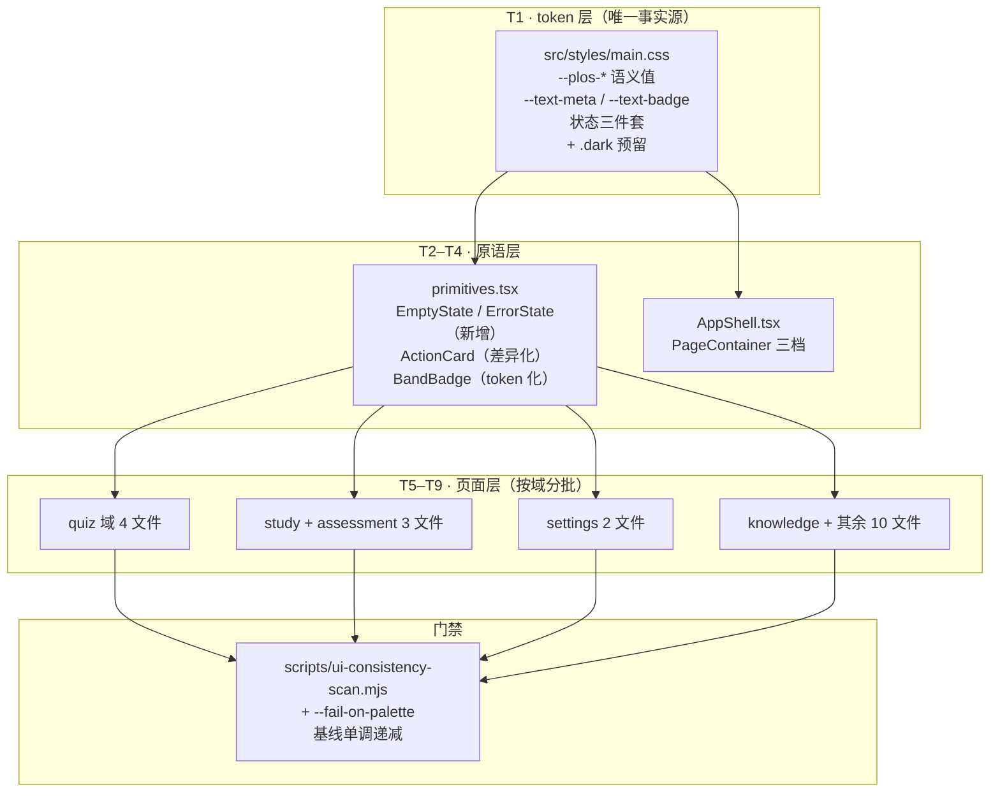
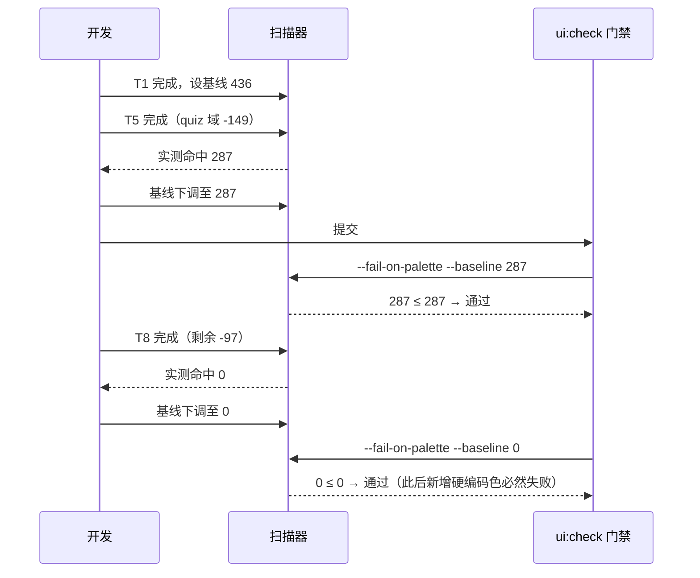

# UI 设计系统整改 技术方案

| 字段 | 内容 |
|------|------|
| 作者 | Agent |
| 日期 | 2026-10-21 |
| 状态 | 草案（待确认） |
| 关联需求 | 2026-10-21 全量页面设计评审结论（P0/P1/P2 共 9 条问题的系统化整改） |
| 关联文档 | `docs/ui-component-system-shadcn-design-2026-09.md`、`docs/ui-workbench-plan-2026-09.md`、`skills/plos-ui-system/SKILL.md`、`skills/ui-impl-tokens/SKILL.md` |

---

## 1. 背景

2026-10-21 对全部 80 个页面/组件做了一轮设计评审，结论是：**信息架构与交互逻辑是清醒的，但承载它的设计系统地基本来裂了，而且裂缝集中在核心学习流程，不在边缘页面。**

评审实测出三组硬事实（均为 `node scripts/ui-consistency-scan.mjs` 与 Grep 实跑结果，非记忆）：

| 事实 | 实测值 | 影响 |
|------|--------|------|
| 硬编码调色板色 | **436 处 / 19 文件** | 核心学习流程与首页/资料库是两套色 |
| 裸字号（无语义名） | **170 处 / 47 文件**（`text-[11px]`×117、`text-[10px]`×38，另 15/13/12/14px 共 15 处） | 无法做一次性可读性调整 |
| 自写空态容器 | `mx-auto max-w-3xl px-8 py-16 text-center` **12 处 / 5 文件**；`border-dashed`（空态卡样式）命中跨 **23 文件**（含 3 处渲染器占位等非空态用途） | 空态是全站最没人管的区域 |
| 容器宽度口径 | **4 套**（1024 / 1600 / 自写 1500 / 自写 768），**19 处**绕过 `PageContainer` | 连续跳转时内容宽度跳三次 |
| 主行动卡 | `ActionCard` 与 `Card` 样式 **完全相同** | 注释承诺的"唯一抬升"没落到视觉上 |

三条被文档承诺、但被代码堵死的能力：

1. **暗色模式**。`src/styles/main.css:7` 写明"暗色预留（D4）：未来在 `.dark` 覆盖 `--plos-*` 即可"，但 436 处硬编码不会跟着 `.dark` 变 —— 物理上不可能落地。
2. **token-first 规则**。`rules/react.mdc` 与 `skills/ui-impl-tokens` 都规定"新 hex 只允许进 `main.css`"，19 个文件正在违反。
3. **"同一模式跨 ≥3 文件必抽取"**。空态容器 12 处、徽标 `px-2 py-0.5 text-xs font-medium` 7 处，均已在 `primitives.tsx` 有对应原语（`Card`/`BandBadge`）却未被使用。

**不做的影响**：每新增一个页面就多一处硬编码色、多一套空态卡；暗色模式永远进不了排期；"主行动"这个产品最核心的视觉信号会继续被普通卡片淹没。

---

## 2. 方案目标

| 类型 | 描述 |
|------|------|
| **主要目标** | 把 PLOS 的视觉表达收回到单一事实源（`main.css` + `primitives.tsx`），使"改一处即全站生效"重新成立，并让暗色模式在物理上成为可能 |
| **量化目标** | ① 硬编码调色板色 **436 → 0**；② 裸字号 **170 → 0**（全部走语义 token）；③ 空态容器 **12 处自写 → 0**（全部走 `EmptyState`/`ErrorState`）；④ 容器宽度口径 **4 套 → 3 档语义档**，绕过数 **19 → 0**；⑤ `ActionCard` 与 `Card` 视觉可区分 |
| **非目标** | 不做暗色模式本体（只清障）；不做组件库换型（Base UI/shadcn 不变）；不改任何业务逻辑、数据读写、路由与 i18n 键；不顺手重排无关 JSX；不引入 antd / Radix / 新依赖 |
| **成功标准** | ① `node scripts/ui-consistency-scan.mjs` 第 2 类（硬编码调色板）为 **0**；② 新增门禁 `--fail-on-palette` 在基线 0 下通过；③ `npm run typecheck` / `layer:check` / `ui:check` / `test:library` 全绿；④ 首页、答题、复习、设置四处抽查，灰阶与主色肉眼一致；⑤ 空态/错误态全站 4 种形态统一 |

---

### 2.1 评审问题 → 任务映射（含本轮不做的项）

| 评审编号 | 问题 | 严重度 | 承接任务 | 是否本轮 |
|---------|------|--------|---------|---------|
| 1 | 436 处硬编码调色板色 | 🔴 | T1 + T5–T8 | ✅ |
| 2 | 170 处裸字号无语义层级 | 🔴 | T1 + T9 | ✅ |
| 3 | 空态/错误态无原语 | 🔴 | T2 + T4 | ✅ |
| 4 | `ActionCard` 与 `Card` 同款 | 🟠 | T10 | ✅ |
| 5 | 容器宽度 4 套口径 | 🟠 | T11 | ✅ |
| 6 | 阅读页右栏 300px 塞 7 区 | 🟠 | T12 | ✅ |
| 7 | 两个搜索入口 + 检索口径两套 | 🟠 | T12 | ✅（统一口径，入口保留） |
| 8 | 侧栏 tooltip 手搓、无键盘/触屏路径 | 🟡 | — | ❌ 见下方说明 |
| 9 | 焦点环透明度三种并存 | 🟡 | T1 | ✅ |

**第 8 条本轮不做**的理由：它属于无障碍专项（需补 `aria-describedby`、focus 延迟、触屏长按需产品决策），与"设计系统收敛"不是同一条链路；强行并入会拖长 T1 的改动面。建议单独立项，与本方案无依赖冲突。

---

## 3. 项目现状

### 3.1 相关代码与模块

| 位置 | 现状 | 问题 |
|------|------|------|
| `src/styles/main.css` | `:root` 定义 14 个 `--plos-*` 语义值；`@theme inline` 桥接 PLOS 语义 + shadcn 角色 | 无字号 token、无状态色"浅底/描边"变体、无 focus 环 token |
| `src/components/primitives.tsx` | `Card` / `SectionTitle` / `Bar` / `Stat` / `Section` / `KnowledgeRow` / `EvidenceRow` / `ActionCard` / `SegmentedTabs` / `BandBadge` | **缺 `EmptyState` / `ErrorState`**；`ActionCard`(:272) 与 `Card`(:49) 同款；`bandStyles`(:30-35) 硬编码 emerald/amber/red |
| `src/components/layout/AppShell.tsx:126` | `PageContainer` 两档：`default`(max-w-5xl=1024) / `wide`(1600) | 5 个页面绕过自写容器 |
| `src/features/quiz/*` | 答题/判卷/报告/出卷 4 页 | 硬编码色 149 处，全站最重 |
| `src/features/study/*` + `assessment/*` | 复习/卡片/能力测评 | 硬编码色 103 处 |
| `src/features/settings/*` | 内置模型面板 / API 模型 Tab | 硬编码色 87 处 |
| `src/features/knowledge/*` + 其余 | 图谱 + 章徽标 + 首页/计划等 | 硬编码色 97 处 |
| `src/components/ui/*` | focus 环三档：`/50`（button、NavSidebar、SettingsNav）、`/25`（select、input、textarea）、`/40`（tabs、checkbox、dialog） | shadcn 生成层与 PLOS 自定义层两套口径 |
| 检索 | `LibraryPage.tsx:135-168` 与 `CommandPalette.tsx` **各自**调 `hybridSearch`，limit 8 vs 5、debounce 300 vs 250 | 同一能力两套参数 = 典型的"两把尺子" |

### 3.2 相关文档与约定

- `AGENTS.md`：编码速记 —— "新 hex 只允许进 `main.css`"、"同一视觉模式跨 ≥3 文件重复 → 必须抽取"
- `rules/react.mdc`：Tailwind 4 + 语义 token + UI Kit 优先；状态色仅 dot/徽标
- `skills/ui-impl-tokens/SKILL.md`：focus 环统一 `focus-visible:ring-2 ring-ring/50`
- `skills/plos-ui-system/SKILL.md`：≥3 处必抽，判据 `scripts/ui-consistency-scan.mjs`
- `docs/ui-component-system-shadcn-design-2026-09.md`：三层架构与 token 桥接表 §5.3

### 3.3 约束与依赖

- Tailwind **4**（CSS-first，`@tailwindcss/vite`，无 `tailwind.config.js`）→ 字号/颜色 token 只能在 `@theme inline` 内声明
- Tailwind 4 默认调色板为 `oklch`，`slate-*` / `indigo-*` 与 PLOS `--plos-*` 为**视觉等价映射**，不追求数值逐位相同
- React 19 + Base UI；`ui/` 层为 shadcn 同构手写，可自由修改
- 桌面壳 Tauri 2；本方案**不涉及** `src-tauri/**`、不涉及 IPC
- **无 i18n 改动**：新增原语为纯展示控件，文案由调用方传（符合 `ui-impl-tokens` §4「ui/ 层不含文案」）
- 门禁现状：`ui:check` = `--fail-on-native --fail-on-sticky-glass`，**硬编码色只报告不闸**

### 3.4 决策点（D1–D7）

> 全部为 `待确认`。正文按**推荐档**书写，改档后需全量回扫（架构/伪代码/任务表/测试用例）。

| ID | 决策点 | 选项 | 推荐 | 理由 |
|----|--------|------|------|------|
| **D1** | 436 处硬编码色的收敛批次 | A. 一次性全量替换<br>B. **按域分 5 批，逐批独立提交 + 基线递减**<br>C. 只收敛学习主流程 | **B** | A 一次改 19 文件无法 review、不可回滚；C 留尾巴则暗色仍落不了地。B 每批可编译、可门禁、可回滚 |
| **D2** | 是否新增"状态语义三件套" token（`*-soft` / `*-border` / `*-ink`） | A. **新增 4 组（mastered/weak/failed/learning）**<br>B. 沿用现有 `state-*` + Tailwind `/10` 透明度 | **A** | 现有 `state-*` 是**实色**（用于 dot/徽标），直接加透明度做浅底会与实色语义混用；徽标组合（底/边/字）在 6 个文件重复出现，必须收口 |
| **D3** | 字号语义化方式 | A. **`@theme` 新增 `--text-meta`(11px) / `--text-badge`(10px)，全量替换**<br>B. 只新增 token 不改存量<br>C. 强行并入 `text-xs`/`text-sm` | **A** | B 等于没做；C 会改变现有视觉密度（117 处元信息行会变粗）。A 保持像素不变，只换名字 |
| **D4** | `ActionCard` 差异化形态 | A. **左侧 3px primary 竖条 + `shadow-md`**<br>B. `ring-1 ring-primary/15` + `shadow-md`<br>C. 背景改 `subtle` 区块 | **A** | 竖条不改变背景层级（不与 `Card` 抢"面"），且在窄屏/打印/暗色下都稳定；B 的 ring 与 focus 环语义冲突；C 会让主卡变"次级块" |
| **D5** | 容器宽度收口 | A. 统一两档，答题流改 `default`(=1024)<br>B. **升为三档：`default`(1024) / `wide`(1600) / `focus`(768)** | **B** | 答题/判卷/报告的 768 是**有意设计**（专注型窄阅读），不应抹掉；把它升为正式档位才是真收口。阅读页 1500 无语义，改 `wide` |
| **D6** | 两个搜索入口 | A. 资料库搜索框改为唤起 ⌘K<br>B. **保留两个入口，但统一检索口径 + 形态区分**<br>C. 不动 | **B** | A 破坏页面内即时过滤（含 RAG 命中段展示）；真正的病灶是 `hybridSearch` 两套参数（limit 8 vs 5），不是入口数量。B 治本且不动 IA |
| **D7** | 阅读页右栏 300px 塞 7 区 | A. **加宽到 380px + "问这一章/讲给我听"收敛为右栏内分区切换**<br>B. 保持 300px，两区移到左栏底部<br>C. 保持 300px，内部折叠 | **A** | "问这一章"是本页主交互之一，输入框在 300px 里过窄；B 打断"边读边问"的同屏关系；C 只藏不治 |

---

## 4. 技术架构

### 4.1 总体架构

本次是**纯展示层整改**，不改变分层边界（仍为 `domain → engine/ai/storage → stores/services → features/components`）。改动全部落在「token 层 → 原语层 → 页面层」这条纵向链路上：



### 4.2 模块职责

| 模块/层级 | 职责 | 技术选型 |
|-----------|------|----------|
| `src/styles/main.css` | 颜色/字号的唯一出处；新增字号 token、状态三件套、focus 环 token | Tailwind 4 `@theme inline` |
| `src/components/primitives.tsx` | 领域展示原语；新增 `EmptyState` / `ErrorState`；`ActionCard` 差异化；`bandStyles` token 化 | React 19 + Tailwind |
| `src/components/layout/AppShell.tsx` | `PageContainer` 三档（`default`/`wide`/`focus`） | React 19 + Tailwind |
| `src/components/ui/*` | focus 环透明度统一到 `/50`；表单控件保留 3px 宽度 | cva + Base UI |
| `src/features/**` | 按域分批替换硬编码色与裸字号，改用原语 | React 19 + Tailwind |
| `scripts/ui-consistency-scan.mjs` | 新增 `--fail-on-palette` 与基线机制，防止反弹 | Node .mjs |

### 4.3 数据模型与 API

**N/A（本次为纯展示层整改）**。

- 无新增实体、无 storage 读写、无 IPC 调用、无路由变更。
- 唯一与"逻辑"相关的改动是 D6 的检索口径统一，它只抽取**已存在**的 `hybridSearch` 调用参数，不改变检索算法、不改返回值形状。
- `src-tauri/**` 零改动。

### 4.4 状态与副作用

- 本次不引入任何新 state。所有新增原语为**纯展示、无状态**（`EmptyState` / `ErrorState` 由调用方传 `title` / `desc` / `action`）。
- `PageContainer` 三档为编译期常量，无运行时状态。
- D7 右栏分区切换引入**一个** `useState`（当前分区），属页面局部状态，不进 store、不进 URL（与 `DocumentDetailPage` 的 Tab 走 URL 的做法**刻意不同**：阅读页的右栏分区是临时视图，不值得占历史栈）。

---

## 5. 交互流程

### 5.1 主流程（整改执行流）

1. **定义 token**（T1）→ `main.css` 新增字号/状态三件套/focus 环 token；同时给扫描器加 `--fail-on-palette` 并设初始基线 436。
2. **建原语**（T2–T4）→ `primitives.tsx` 新增 `EmptyState` / `ErrorState`；把 12 处自写空态容器、23 文件的 `border-dashed` 空态卡替换为原语调用；`PageContainer` 升三档。
3. **按域收敛颜色**（T5–T8）→ 每批改动后立即跑门禁，把基线值下调到该批后的实测值（436 → 287 → 184 → 97 → 0）。
4. **字号替换**（T9）→ 机械替换 `text-[11px]` → `text-meta`、`text-[10px]` → `text-badge`；剩余 15 处（15/13/12/14px）逐处人工判定后归入最近档位。
5. **主次层级**（T10）→ `ActionCard` 加左侧竖条 + `shadow-md`；同步更新 `docs` 中"Card 仅用于主行动卡/空态卡"的口径。
6. **容器收口**（T11）→ 5 个绕过页面改用 `PageContainer` 的对应档位。
7. **IA 两处**（T12）→ 抽取共享检索口径；阅读页右栏加宽并做分区切换。

### 5.2 分支与异常流程

| 场景 | 触发条件 | 系统行为 | UI 反馈 |
|------|----------|----------|---------|
| 替换后视觉回归 | 某处 `slate-*` 实际语义不是"灰阶"而是"禁用态" | 归入 `ink-3` + `opacity-*`，不裸改 token | 抽查比对，逐处人工确认 |
| 徽标底色缺失 | 某 badge 用了未覆盖的调色板组合（如 `sky-50`） | 归入最近的 `state-learning` 三件套 | 不新增第 5 组状态色 |
| 基线门禁恒红 | 某批未收敛完就提交 | 门禁按**当前基线**判定，未超基线即通过 | 基线值写在 `package.json` 脚本内，随批次下调 |
| 字号替换后换行 | `text-meta` 与 `text-badge` 像素未变 → 不应有换行变化 | 若出现，说明误替换了非元信息文本 | 抽查 3 处高密度页面 |
| 暗色模式仍不可用 | 本方案只清障不实现 | 不在本轮范围 | 方案末尾记录：清障完成后暗色可作为独立任务排期 |
| 右栏分区切换丢失输入 | 用户在「问这一章」输入到一半切到「讲给我听」 | **两个面板都保持挂载**，仅用 `hidden` 切换可见性 | 切回后输入内容与 AI 任务状态仍在 |
| 整页空态对齐变化 | 5 处 `text-center` 空态收口 | 统一左对齐（见 §7.1） | 属**有意视觉变更**，验收时不得判为缺陷 |

### 5.3 时序图（基线门禁的单调递减机制）



> ⚠️ **基线必须单调递减且最终归零**。停在某个非零值 = 恒红的门禁（本项目已有一条教训：`settings-copy-scan.mjs` 因扫键名导致恒红，等于没有门禁）。

---

## 6. 用户用例（User Cases）

### UC-01：开发者新增一个页面时，颜色只能来自 token

| 项 | 内容 |
|----|------|
| 角色 | 开发者 |
| 前置条件 | T1（token 扩展）+ 门禁 `--fail-on-palette --baseline 0` 已上线 |
| 主流程步骤 | 1. 写新页面，用 `bg-slate-50`；2. 跑 `npm run ui:check` |
| 期望结果 | 门禁**失败**，报错指出文件与命中类名；改用 `bg-subtle` 后通过 |
| 异常/边界 | 若确有特殊需求（如图表库要求 hex），需在 `main.css` 新增 token 并注明，不得在组件内写 hex |

### UC-02：全站空态形态统一

| 项 | 内容 |
|----|------|
| 角色 | 最终用户 |
| 前置条件 | T2、T4 完成 |
| 主流程步骤 | 1. 打开资料库（空库）；2. 打开复盘页（无证据）；3. 触发一次读库失败 |
| 期望结果 | 三处空态/错误态的容器宽度、内边距、标题字号、按钮位置完全一致；错误态额外显示技术细节行与「重试」出口 |
| 异常/边界 | 错误态**必须排在空态之前**渲染（`LibraryPage` 已有此判断，抽原语时不得丢失）；读库失败时副标题"导入一份资料…"必须隐藏（误导性文案） |

### UC-03：首页主行动卡被一眼认出

| 项 | 内容 |
|----|------|
| 角色 | 最终用户 |
| 前置条件 | T10 完成 |
| 主流程步骤 | 1. 打开首页（有章节、有下一步动作） |
| 期望结果 | NEXT BEST ACTION 卡有左侧 3px primary 竖条与更深的阴影，与上方的错误卡/下方的空态卡在 1 秒内可区分 |
| 异常/边界 | 窄屏（≤640px）下竖条不得挤压内容；暗色下竖条用 primary 仍可见 |

### UC-04：连续跳转时内容宽度稳定

| 项 | 内容 |
|----|------|
| 角色 | 最终用户 |
| 前置条件 | T11 完成 |
| 主流程步骤 | 1. 资料详情（`wide`）→ 2. 章节阅读（`wide`）→ 3. 去测验（`focus`） |
| 期望结果 | 前两跳宽度一致（同为 `wide`），第三跳切到 `focus` 是**有意的**（专注答题），且三档都有语义名 |
| 异常/边界 | 窗口缩小到 1024 以下时三档都退化为流式，不出现横向滚动 |

### UC-05：同一查询在两个搜索入口得到一致结果

| 项 | 内容 |
|----|------|
| 角色 | 最终用户 |
| 前置条件 | T12 完成 |
| 主流程步骤 | 1. 在 ⌘K 输入「RAG」；2. 在资料库页搜索框输入「RAG」 |
| 期望结果 | 两者命中**同一批** chunk（同一 `limit`、同一防抖口径），仅展示形态不同（⌘K = 跳转列表，资料库 = 页面内命中段） |
| 异常/边界 | 检索失败时两者行为一致：静默清空命中段，不影响页面其余部分 |

---

## 7. 线框 UI（Wireframe）

### 7.1 `EmptyState` / `ErrorState`（T2 新增原语）

```
┌──────────────────────────────────────────────┐
│                                              │
│           还没有资料                          │  ← text-base font-semibold text-ink-1
│   导入第一份资料，开始你的学习循环。            │  ← text-sm text-ink-2
│                                              │
│         [ ＋ 导入资料 ]   [ 查看计划 ]         │  ← Button(default) + Button(outline)
│                                              │
└──────────────────────────────────────────────┘
   容器：PageContainer 内 · border-dashed · rounded-xl · p-6
   data-testid="empty-state" / "error-state"
```

```
ErrorState（错误态，额外两行）
┌──────────────────────────────────────────────┐
│  ⚠ 无法读取资料库                             │  ← text-base font-semibold text-state-failed
│  本地存储不可用，资料未被删除。                 │  ← text-sm text-ink-2
│  StorageUnavailableError: sqlite busy         │  ← text-xs text-ink-3 break-all（排障用）
│                                [ 重试 ]       │  ← 可选 action（调用方传 Button/Link，文案走 i18n）
└──────────────────────────────────────────────┘
```

- 组件映射：`Card` + `Button`（`ui/button`）；两个原语的 `title`/`desc`/`detail`/`action` 全部由调用方传，**组件内零文案**
- 响应式：`action` 区 `flex-wrap`，窄屏纵向堆叠
- token：`border-line` + `border-dashed`、`bg-surface`、`text-ink-1/2/3`、`text-state-failed`
- ⚠️ **有意变更：对齐统一为左对齐**。现有 12 处自写空态中，页面级空态卡（资料库/计划/复盘/测验中心）本就是左对齐，只有 5 处「整页居中空态」（答题/判卷/报告/阅读/章图谱）是 `text-center`。收口后统一左对齐 —— 这是**视觉变更**，验收时不要当成缺陷回退；理由：居中空态在宽内容页里会让行动按钮脱离用户视线起点

### 7.2 `ActionCard` 差异化（T10）

```
改前（与 Card 完全相同）              改后（左侧竖条 + 深阴影）
┌────────────────────────┐          ┃┌────────────────────────┐
│ REVIEW                 │          ┃│ REVIEW                 │
│ RAG 指南 · 第 3 章      │          ┃│ RAG 指南 · 第 3 章      │
│                        │          ┃│                        │
│ · 上次测评 3 天前       │          ┃│ · 上次测评 3 天前       │
│ · 掌握度低于达标线       │          ┃│ · 掌握度低于达标线       │
│              [ 复习 → ] │          ┃│              [ 复习 → ] │
└────────────────────────┘          ┃└────────────────────────┘
                                     ↑ border-l-[3px] border-l-primary
                                       + shadow-md（Card 保持 shadow-sm）
```

### 7.3 阅读页右栏（T12 · D7）

```
改前：grid-cols-[minmax(0,1fr)_300px]        改后：grid-cols-[minmax(0,1fr)_380px]

  300px                                       380px
┌──────────────┐                          ┌────────────────────┐
│ 章状态        │                          │ 章状态              │
│ Why it matters│                          │ Why it matters      │
│ Knowledge     │                          │ Knowledge           │
│ 问这一章      │ ← 输入框过窄             │ ┌──────┬──────┐    │
│ 讲给我听      │                          │ │提问  │复述  │    │ ← 分区切换
│ 我的划线      │                          │ └──────┴──────┘    │
│ Evidence      │                          │ [当前分区内容]      │
└──────────────┘                          │ 我的划线            │
                                          │ Evidence            │
                                          └────────────────────┘
```

- 分区切换用 `SegmentedTabs`（`primitives.tsx` 已有），本地 `useState`，不进 URL
- 输入框最小宽度 ≥ 320px（380 − 容器 padding 后满足）

### 7.4 交互说明

- **Hover / Focus**：所有 focus 环统一 `ring-ring/50`；按钮/导航 2px，表单控件 3px（保留 shadcn 表单视觉重量）
- **键盘可达性**：`EmptyState` 的行动按钮为 `Button` 原生可聚焦；右栏分区切换用 `SegmentedTabs`（已有 `role="tablist"`）
- **无新增浮层/Toast**：空态与错误态都是**页面内区块**，不引入新浮层体系

---

## 8. 涉及文件及改动伪代码

### 8.1 `src/styles/main.css`（修改 · T1）

**改动说明**：新增字号 token、状态语义三件套、focus 环透明度 token。颜色值仍只在此文件出现。

```css
@theme inline {
  /* … 既有一字不改 … */

  /* ── 新增：字号语义档（D3-A）── 像素值与现状逐一对齐，只换名字 ── */
  --text-badge: 0.625rem;   /* 10px —— 徽标/角标 */
  --text-meta: 0.6875rem;   /* 11px —— 元信息行 */

  /* ── 新增：状态语义三件套（D2-A）—— 徽标「浅底 / 描边 / 字」组合收口 ── */
  --color-mastered-soft: #ecfdf5;   --color-mastered-border: #a7f3d0;  --color-mastered-ink: #047857;
  --color-weak-soft: #fffbeb;       --color-weak-border: #fde68a;      --color-weak-ink: #b45309;
  --color-failed-soft: #fef2f2;     --color-failed-border: #fecaca;    --color-failed-ink: #b91c1c;
  --color-learning-soft: #eef2ff;   --color-learning-border: #c7d2fe;  --color-learning-ink: #4338ca;

  /* ── 新增：focus 环（统一 /50；宽度按控件类型两套）── */
  --plos-ring-alpha: 0.5;
}

/* 暗色预留（D4）：清障完成后在此覆盖，业务代码零改动 */
/* .dark { --plos-surface: …; --color-mastered-soft: …; } */
```

> 同时把 4 组状态三件套的 `:root` 变量一并加入（与 `--plos-state-*` 并列），保证 `.dark` 可整组覆盖。

### 8.2 `src/components/primitives.tsx`（修改 · T2/T3/T10）

**改动说明**：新增 `EmptyState` / `ErrorState`；`bandStyles` token 化；`ActionCard` 差异化。

```tsx
/* ── 新增：空态原语（T2）── */
/**
 * 空态 / 错误态 —— 全站唯一形态（12 处自写容器 + 23 文件 border-dashed 卡收口于此）。
 * 纯展示：文案由调用方经 i18n 传入，本组件不含任何文案与状态逻辑。
 */
export function EmptyState({
  title, desc, action, className = "",
}: { title: string; desc?: string; action?: ReactNode; className?: string }) {
  return (
    <div data-testid="empty-state"
      className={`rounded-xl border border-dashed border-line bg-surface p-6 ${className}`}>
      <p className="text-base font-semibold text-ink-1">{title}</p>
      {desc ? <p className="mt-1 text-sm text-ink-2">{desc}</p> : null}
      {action ? <div className="mt-4 flex flex-wrap gap-3">{action}</div> : null}
    </div>
  );
}

/**
 * 错误态：在空态之上追加「技术细节行」+ 一个行动出口（action）。
 *
 * ⚠️ 刻意**不提供** `onRetry`/`retryLabel` 便捷 props —— 那需要组件内给默认文案
 * （「重试」），违反「ui/ 与原语层不含文案」的约定。行动出口一律由调用方传
 * `<Button onClick={…}>{m.xxx.retry}</Button>`，文案始终走 i18n。
 */
export function ErrorState({
  title, desc, detail, action, className = "",
}: { title: string; desc?: string; detail?: string; action?: ReactNode; className?: string }) {
  return (
    <div data-testid="error-state"
      className={`rounded-xl border border-dashed border-line bg-surface p-6 ${className}`}>
      <p className="text-base font-semibold text-state-failed">{title}</p>
      {desc ? <p className="mt-1 text-sm text-ink-2">{desc}</p> : null}
      {detail ? <p className="mt-2 break-all text-xs text-ink-3">{detail}</p> : null}
      {action ? <div className="mt-4 flex flex-wrap gap-3">{action}</div> : null}
    </div>
  );
}

/* ── 修改：bandStyles token 化（T3）── */
const bandStyles: Record<MasteryBand, string> = {
  "not-started": "bg-subtle text-ink-3 border-line",
  learning: "bg-learning-soft text-learning-ink border-learning-border",
  proficient: "bg-weak-soft text-weak-ink border-weak-border",
  mastered: "bg-mastered-soft text-mastered-ink border-mastered-border",
};

/* ── 修改：ActionCard 差异化（T10，D4-A）── */
// 仅改根元素 className，其余结构一字不动：
//   "rounded-xl border border-line bg-surface p-5 shadow-sm"
// → "rounded-xl border border-line border-l-[3px] border-l-primary bg-surface p-5 shadow-md"
```

### 8.3 `src/components/layout/AppShell.tsx`（修改 · T11）

**改动说明**：`PageContainer` 升为三档（D5-B）。

```tsx
export function PageContainer({
  children,
  size = "default",
}: {
  children: ReactNode;
  /**
   * `default`(1024) —— 全站默认：首页 / 计划 / 资料库 / 复盘 / 目标 …
   * `wide`(1600)    —— 宽屏内容：设置 / 资料详情 / 章节阅读
   * `focus`(768)    —— 专注型窄阅读：答题 / 判卷 / 报告（有意设计，勿并回 default）
   */
  size?: "default" | "wide" | "focus";
}) {
  const cls =
    size === "wide"
      ? "mx-auto w-full max-w-[1600px] px-4 py-6 sm:px-6 lg:px-8 lg:py-8"
      : size === "focus"
        ? "mx-auto w-full max-w-3xl px-8 py-8"
        : "mx-auto max-w-5xl px-8 py-8";
  return <div className={cls}>{children}</div>;
}
```

### 8.4 页面层：调色板 → token 映射表（T5–T8 通用）

> 本表是 436 处替换的**唯一依据**。替换是确定性的，不做逐处审美判断。

| 现有类 | Tailwind 近似 hex | 替换为 | token hex |
|--------|-------------------|--------|-----------|
| `bg-slate-50` | #f8fafc | `bg-subtle` | #f1f3f5 |
| `bg-slate-100` | #f1f5f9 | `bg-subtle` | #f1f3f5 |
| `border-slate-200` / `-300` | #e2e8f0 / #cbd5e1 | `border-line` | #e4e4e7 |
| `text-slate-400` | #94a3b8 | `text-ink-3` | #a1a1aa |
| `text-slate-500` / `-600` | #64748b / #475569 | `text-ink-2` | #71717a |
| `text-slate-700` / `-800` / `-900` | #334 / #1e2 / #0f1 | `text-ink-1` | #18181b |
| `bg-indigo-500` | #6366f1 | `bg-primary` | #6366f1（**完全相等**） |
| `bg-indigo-600` / `text-indigo-600` | #4f46e5 | `bg-primary` / `text-primary` | #6366f1 |
| `text-indigo-700` | #4338ca | `text-learning-ink` | #4338ca |
| `bg-indigo-50` | #eef2ff | `bg-learning-soft` | #eef2ff |
| `border-indigo-200` / `-400` | #c7d2fe / #818cf8 | `border-learning-border` | #c7d2fe |
| `bg-emerald-50` / `border-emerald-200` / `text-emerald-600`·`700` | — | `bg-mastered-soft` / `border-mastered-border` / `text-mastered-ink` | — |
| `bg-amber-50` / `border-amber-200` / `text-amber-700` | — | `bg-weak-soft` / `border-weak-border` / `text-weak-ink` | — |
| `bg-red-50` / `border-red-200` / `text-red-500`·`600` | — | `bg-failed-soft` / `border-failed-border` / `text-failed-ink` | — |
| `bg-sky-50` | #f0f9ff | `bg-learning-soft` | #eef2ff |
| `bg-white` | #ffffff | `bg-surface` | #ffffff |

> ⚠️ 两处**必须人工判定**（不可机械替换）：
> 1. `text-slate-300`（QuizAnswerPage ×4）—— 若语义是"禁用/占位"→ `text-ink-3` + `opacity-*`；若是分隔线 → `border-line`。
> 2. `text-amber-700`（PlanPage:1、SplitTab:1）—— 若语义是"落后警示"→ `text-state-weak`（已有语义）；若是徽标字 → `text-weak-ink`。

### 8.5 `src/features/quiz/QuizAnswerPage.tsx`（修改 · T5）

**改动说明**：55 处硬编码色 → token；`missing`/`opening` 两个自写空态容器 → `ErrorState`/`EmptyState`；自写 `max-w-3xl` → `PageContainer size="focus"`。

```tsx
// 容器：<div className="mx-auto max-w-3xl px-8 py-8">
//   → <PageContainer size="focus">
// 空态（原 :130 与 :142 两处同款）：
if (missing) {
  return (
    <PageContainer size="focus">
      <ErrorState title={a.missingTitle} desc={a.missingDesc}
        action={<Link to="/quiz" className={cn(buttonVariants({ variant: "outline" }))}>{a.backToCenter}</Link>} />
    </PageContainer>
  );
}
// 颜色：text-slate-900 → text-ink-1；text-slate-500 → text-ink-2；
//       text-slate-400 → text-ink-3；border-indigo-200 → border-learning-border；
//       bg-indigo-50 → bg-learning-soft；text-indigo-600 → text-primary；
//       Bar 的 bg-indigo-500 → bg-primary（数值本就相等）
```

### 8.6 `src/features/study/ReviewSession.tsx`（修改 · T6）

**改动说明**：63 处（全站最多）硬编码色 → token。`bg-slate-50` → `bg-subtle`、`text-slate-500` → `text-ink-2`、`text-indigo-600` → `text-primary`。已用 `PageContainer`，容器不动。

### 8.7 `src/features/settings/BuiltinModelsPanel.tsx` / `ApiModelsTab.tsx`（修改 · T7）

**改动说明**：55 + 32 处。`border-slate-200` → `border-line`、`bg-indigo-50` → `bg-learning-soft`、`border-indigo-400` → `border-learning-border`。

### 8.8 `src/features/learn/chapter-badge.ts` / `plan/chapter-action.ts`（修改 · T8）

**改动说明**：共 27 处（12 + 15）。这两个文件是**类名字符串工厂**，替换后需同步核对消费方（章行、章卡、动作卡）的视觉不变。

```ts
// 例：bg-amber-50 text-amber-700 border-amber-200
//   → "bg-weak-soft text-weak-ink border-weak-border"
// 例：bg-sky-50 → bg-learning-soft
```

### 8.9 `src/components/ui/{select,input,textarea,tabs,checkbox,dialog}.tsx`（修改 · T1）

**改动说明**：focus 环透明度统一到 `/50`；**宽度保留差异**（表单控件 3px、其余 2px）。

```tsx
// select.tsx:72  focus-visible:ring-ring/25 → /50
// input.tsx:18   focus-visible:ring-[3px] ring-ring/25 → ring-[3px] ring-ring/50
// textarea.tsx:15 同上
// tabs.tsx:49 / checkbox.tsx:23 / dialog.tsx:55  ring-ring/40 → /50
// button.tsx:15 / NavSidebar.tsx:40 / SettingsNav.tsx:34 已是 /50，不动
```

### 8.10 `scripts/ui-consistency-scan.mjs`（修改 · T1）

**改动说明**：新增 `--fail-on-palette` 与 `--palette-baseline`，把第 2 类从"只报告"升级为"可闸"。

```js
// 新增参数解析：--fail-on-palette / --palette-baseline <N>（默认 0）
// 判定：paletteHits > baseline → process.exitCode = 1
// 输出：在报告里同时打印「当前命中 / 基线 / 差值」，便于逐批下调
```

`package.json` 同步：`"ui:check": "node scripts/ui-consistency-scan.mjs --fail-on-native --fail-on-sticky-glass --fail-on-palette --palette-baseline 436"`，每批收敛后下调基线值。

### 8.11 `src/features/learn/ChapterReaderPage.tsx`（修改 · T11/T12）

**改动说明**：自写 `max-w-6xl … xl:max-w-[1500px]` → `PageContainer size="wide"`；右栏 300px → 380px 并把「问这一章 / 讲给我听」收敛为 `SegmentedTabs` 分区；两个自写空态容器 → 原语。

```tsx
// <div className="mx-auto w-full max-w-6xl px-4 py-6 sm:px-6 lg:px-8 xl:max-w-[1500px]">
//   → <PageContainer size="wide">
// <div className="grid gap-6 lg:grid-cols-[minmax(0,1fr)_300px]">
//   → <div className="grid gap-6 lg:grid-cols-[minmax(0,1fr)_380px]">
const [panel, setPanel] = useState<"qa" | "restate">("qa");
// 右栏 4/5 区之间插入：
//   <SegmentedTabs value={panel} onChange={setPanel} testIdPrefix="reader-panel"
//     items={[{value:"qa",label:t.qaEyebrow},{value:"restate",label:t.restateEyebrow}]} />
//
// ⚠️ 关键：两个面板**都保持挂载**，只切可见性 —— 不能用三元表达式渲染。
//    理由：ChapterQaPanel / ChapterRestatementPanel 内部持有用户正在写的输入草稿与
//    useAiTask 任务态（`qa:${chapter.id}` / `restate:${chapter.id}`）。卸载会丢草稿，
//    并让进行中的 AI 任务失去订阅者（看似"卡住"）。
<div hidden={panel !== "qa"}><ChapterQaPanel …/></div>
<div hidden={panel !== "restate"}><ChapterRestatementPanel …/></div>
```

### 8.12 检索口径统一（T12 · D6）

**改动说明**：把 `LibraryPage` 与 `CommandPalette` 各自的那份 `hybridSearch` 参数收口为共享常量，消除"两把尺子"。

```ts
// 新增 src/features/learn/search/content-search.ts（纯常量 + 可选 hook）
export const CONTENT_SEARCH = {
  debounceMs: 300,   // 两处取较慢者（250 → 300），避免 ⌘K 抖动
  minChars: 2,       // 两处相同
  limit: 8,          // 两处取较大者（5 → 8），⌘K 展示上限不变（取前 5 渲染）
  snippetChars: 120, // 两处相同
} as const;
// LibraryPage.tsx:135-168 与 CommandPalette.tsx 的 useEffect 均改为消费该常量
```

> ⚠️ **边界**：`src/ai/retrieval/chapter-context.ts:71/:89` 也调 `hybridSearch`，但它是「章内问答的上下文召回」，用途与参数语义都不同（不是用户搜索入口），**本轮不动**。TC-UC05-01 只断言两个**用户搜索入口**消费同一常量。

### 8.13 资料库搜索框形态区分（T12 · D6）

**改动说明**：`LibraryPage.tsx:337-345` 的手写 `input` 加左侧放大镜图标与清除按钮，与顶栏 ⌘K 的"跳板"形态拉开（⌘K 是 `⌘K` kbd 徽标 + 占位文案；本框是图标 + 可清空输入）。

```tsx
// 外层包 relative；左侧 <Search className="size-3.5 text-ink-3" />；
// 有值时右侧 <button aria-label={lib.searchClear}><X /></button>
// placeholder 保持 lib.searchPlaceholder（i18n 不改）
```

### 8.14 T9 字号替换：逐文件清单的裁减说明

模板要求"列出每一个将修改的文件"。T9 涉及 **47 个文件**的机械替换，逐个列伪代码无信息量，故本方案只给**替换规则**与**必须人工判定的例外**，实施时的逐文件清单由 `Grep` 现场产出：

| 规则 | 匹配 | 替换为 | 处数 |
|------|------|--------|------|
| 元信息行 | `text-[11px]` | `text-meta` | 117 |
| 徽标/角标 | `text-[10px]` | `text-badge` | 38 |
| 人工判定 | `text-[15px]`(10) / `text-[13px]`(3) / `text-[12px]`(1) / `text-[14px]`(1) | 归入最近档位（`text-sm` / `text-meta` / `text-xs`） | 15 |

⚠️ 像素值**不变**（`--text-meta: 0.6875rem` = 11px，`--text-badge: 0.625rem` = 10px），故本次替换**不应产生任何换行/回流变化**；若抽查到变化，说明误替换了非元信息文本，需回退该处。

---

## 9. 任务清单（Tasks）

| ID | 任务 | 依赖 | 预估复杂度 | 改动文件数 |
|----|------|------|------------|-----------|
| **T1** | token 扩展（字号/状态三件套/focus 环）+ 扫描器 `--fail-on-palette` | — | M | 8 |
| **T2** | `primitives` 新增 `EmptyState` / `ErrorState` | T1 | S | 1 |
| **T3** | 徽标 token 化（`bandStyles` / `DeltaBadge` / `chapter-badge` / `chapter-action`） | T1 | S | 4 |
| **T4** | 空态容器收口（12 处自写容器 + 20 处 dashed 空态卡） | T2 | M | 6 |
| **T5** | quiz 域收敛（answer/grading/report/new）+ 容器改 `focus` | T1,T2 | L | 4 |
| **T6** | study + assessment 域收敛 | T1 | M | 3 |
| **T7** | settings 域收敛 | T1 | M | 2 |
| **T8** | knowledge + learn + 首页/计划 剩余收敛 | T1,T3 | M | 10 |
| **T9** | 字号全量替换（170 处 / 47 文件 → `text-meta` / `text-badge`） | T1 | M | 47 |
| **T10** | `ActionCard` 差异化 + `Card` 降级约定 | T1 | S | 2 |
| **T11** | `PageContainer` 三档 + 5 个页面收口 | T1 | M | 6 |
| **T12** | 检索口径统一 + 搜索框形态区分 + 阅读页右栏分区 | T1,T11 | M | 4 |

**基线递减表（T1 起效，逐批下调）**

| 批次 | 收敛命中 | 基线应设为 | 备注 |
|------|---------|-----------|------|
| T1 后（初始） | 436 | **436** | 仅记录，闸不失败 |
| T5 后（quiz 149） | 287 | **287** | 55+36+21+37 |
| T6 后（study+assessment 103） | 184 | **184** | 63+40 |
| T7 后（settings 87） | 97 | **97** | 55+32 |
| T8 后（剩余 97） | 0 | **0** | 25+18+15+12+9+6+5+3+2+1+1 |
| T9 后 | 0 | 0 | 字号，不影响该计数 |

> 合计校验：149 + 103 + 87 + 97 = **436** ✓

---

## 10. 实施步骤

1. **步骤 1（T1）**：改 `main.css` 新增三批 token → 改 6 个 `ui/` 文件的 focus 环 → 改扫描器加 `--fail-on-palette` → `package.json` 设基线 436。
   - 验证：`npm run ui:check` 在基线 436 下通过；`typecheck` 绿；抽查一处 `bg-primary` 渲染值仍为 #6366f1。
2. **步骤 2（T2/T3）**：新增 `EmptyState` / `ErrorState`；`bandStyles`/`DeltaBadge`/两个 badge 工厂改 token。
   - 验证：`test:card` 绿（`library-card-status.test.ts` 覆盖 `docStatus`）；抽查章徽标 4 档颜色不变。
3. **步骤 3（T4）**：12 处自写空态容器 + 20 处 dashed 空态卡替换为原语（`border-dashed` 另有 3 处属渲染器占位，不在收敛范围）。
   - 验证：`grep -c "mx-auto max-w-3xl px-8 py-16 text-center"` 应为 **0**（改前 12）。
4. **步骤 4（T5）**：quiz 域 4 文件收敛；容器改 `size="focus"`。基线下调至 287。
5. **步骤 5（T6）**：study + assessment 3 文件。基线 → 184。
6. **步骤 6（T7）**：settings 2 文件。基线 → 97。
7. **步骤 7（T8）**：knowledge + learn + 首页/计划 10 文件。基线 → **0**。
8. **步骤 8（T9）**：字号机械替换 155 处；剩余 15 处（15/13/12/14px）逐处判定后归入最近档位。
   - 验证：`grep -c "text-\[1[0-9]px\]"` 应为 **0**（改前 170）。
9. **步骤 9（T10）**：`ActionCard` 加竖条 + `shadow-md`。
10. **步骤 10（T11）**：`PageContainer` 三档；5 个绕过页面收口。
    - 验证：`grep -rn "mx-auto max-w" src/features` 仅剩 `AppShell` 内的三档定义。
11. **步骤 11（T12）**：抽取 `CONTENT_SEARCH` 常量；资料库搜索框形态区分；阅读页右栏 380px + 分区切换。

**回滚策略**：每个 T 为独立提交（`git add` 精确路径，不 `-a`），可逐提交 revert。token 变更（T1）与页面收敛（T5–T9）分离，即使页面批次回滚，token 层仍可保留。基线值写在 `package.json`，回滚某批时同步上调即可，不会造成门禁恒红。

---

## 11. 测试方案

### 11.1 测试范围与策略

| 层级 | 工具/方式 | 覆盖重点 | 不负责 |
|------|-----------|----------|--------|
| 静态扫描 | `node scripts/ui-consistency-scan.mjs` | 硬编码色命中数 ≤ 基线；原生 select = 0；sticky 玻璃 = 0 | 视觉正确性 |
| Grep 断言 | Grep 工具 | 空态容器 = 0；裸字号 = 0；`mx-auto max-w` 仅剩 3 处定义 | — |
| 类型 | `npm run typecheck` | 新增原语 props 类型；`PageContainer` 三档字面量 | — |
| 分层 | `npm run layer:check` | 新增 `content-search.ts` 不破坏分层 | — |
| 单元 | `npm run test:library` / `test:card` / `test:quiz` | 既有领域断言不回归 | 视觉 |
| 手工 | 桌面端肉眼抽查 | 首页/答题/复习/设置四处灰阶与主色一致；空态四形态一致；主卡可辨识 | — |

### 11.2 测试环境与数据

- 无需 mock / fixture / 测试账号；本项目禁止主动启动浏览器（见 `rules/no-headless-browser-validation.mdc`）
- 手工抽查由**用户在桌面端执行**（`npm run tauri dev`），不在本方案内自动执行

### 11.3 通过标准

- `ui:check` 在 **基线 0** 下通过（T8 之后）
- `typecheck` / `layer:check` / `test:library` / `test:quiz` / `test:card` 全绿
- 三条 Grep 断言全部归零
- 用户桌面端抽查：4 处页面灰阶一致、4 种空态形态一致、首页主卡可辨识

---

## 12. 测试用例

| ID | 关联 UC | 步骤 | 输入/操作 | 期望结果 | 类型 |
|----|---------|------|-----------|----------|------|
| TC-UC01-01 | UC-01 | 1 | 在任一 `features` 文件写入 `bg-slate-50`，跑 `npm run ui:check` | 门禁失败，输出含文件名与 `bg-slate-50` | 静态 |
| TC-UC01-02 | UC-01 | 2 | 改为 `bg-subtle` 后重跑 | 门禁通过 | 静态 |
| TC-UC01-03 | UC-01 | 3 | T8 完成后跑 `node scripts/ui-consistency-scan.mjs` | 第 2 类「合计 **0** 处」 | 静态 |
| TC-UC02-01 | UC-02 | 1 | `grep -c "mx-auto max-w-3xl px-8 py-16 text-center" src/` | **0**（改前 12） | Grep |
| TC-UC02-02 | UC-02 | 2 | 打开资料库（空库） | 渲染 `data-testid="empty-state"` | 手工 |
| TC-UC02-03 | UC-02 | 3 | 触发读库失败 | 渲染 `data-testid="error-state"`，含技术细节行与 action 出口 | 手工 |
| TC-UC02-04 | UC-02 | 4 | 读库失败时看副标题 | 「导入一份资料…」**不显示**（误导文案） | 手工 |
| TC-UC03-01 | UC-03 | 1 | 打开首页（有下一步动作） | 主卡含 `border-l-[3px] border-l-primary` 与 `shadow-md` | 静态 |
| TC-UC03-02 | UC-03 | 2 | 首页同时存在错误卡与主卡 | 两者视觉可区分（错误卡无竖条、阴影更浅） | 手工 |
| TC-UC04-01 | UC-04 | 1 | `grep -rn "mx-auto max-w" src/features` | 仅剩 0 处（全部走 `PageContainer`） | Grep |
| TC-UC04-02 | UC-04 | 2 | 资料详情 → 章节阅读 | 两页容器宽度一致（同 `wide`） | 手工 |
| TC-UC04-03 | UC-04 | 3 | 进入答题页 | 容器为 `focus`（768），为有意收窄 | 手工 |
| TC-UC05-01 | UC-05 | 1 | `grep -rn "CONTENT_SEARCH" src/` | **3 处**：定义 1（`content-search.ts`）+ 消费 2（`CommandPalette.tsx`、`LibraryPage.tsx`）；两处消费点不再各写一套 `limit`/`debounce` 字面量 | Grep |
| TC-UC05-02 | UC-05 | 2 | 两处输入同一查询 | 命中同一批 chunk | 手工 |
| TC-UC05-03 | UC-05 | 3 | 断网/检索失败 | 两者均静默清空命中段，页面其余部分正常 | 手工 |

### 12.1 边界与回归

| ID | 场景 | 期望 |
|----|------|------|
| TC-EDGE-01 | `text-slate-300`（QuizAnswerPage ×4） | 人工判定后归入 `text-ink-3`（+`opacity-*`）或 `border-line`，**不得**漏替换 |
| TC-EDGE-02 | `text-amber-700`（PlanPage / SplitTab 各 1） | 落后警示 → `text-state-weak`；徽标字 → `text-weak-ink`；不得混用 |
| TC-EDGE-03 | 章徽标 4 档（`not-started`/`learning`/`proficient`/`mastered`） | `npm run test:card` 绿，且 4 档视觉与改前一致 |
| TC-EDGE-04 | 阅读页右栏分区切换 | 切换不改变左栏正文的高亮/划线状态（`markRanges` 副作用不受影响） |
| TC-EDGE-04b | 右栏分区切换保留草稿 | 在「问这一章」输入未提交文本 → 切到「讲给我听」→ 切回 | 输入内容仍在，进行中的 AI 任务状态不丢（两面板始终挂载，`hidden` 切可见性） |
| TC-EDGE-05 | 基线门禁 | 回滚任一批次时同步上调基线，**不得**出现门禁恒红 |
| TC-EDGE-06 | 暗色模式 | 本轮**仍不可用**（只清障）；本方案不引入 `.dark`，不产生"看起来能开关"的假象 |
| TC-EDGE-07 | i18n | 全流程**无 i18n 改动**；`npm run test:i18n` 仍绿，zh/en 键数不变 |

---

## 变更记录

| 日期 | 变更 | 作者 |
|------|------|------|
| 2026-10-21 | 初稿（基于全量页面设计评审结论，D1–D7 待确认） | Agent |
