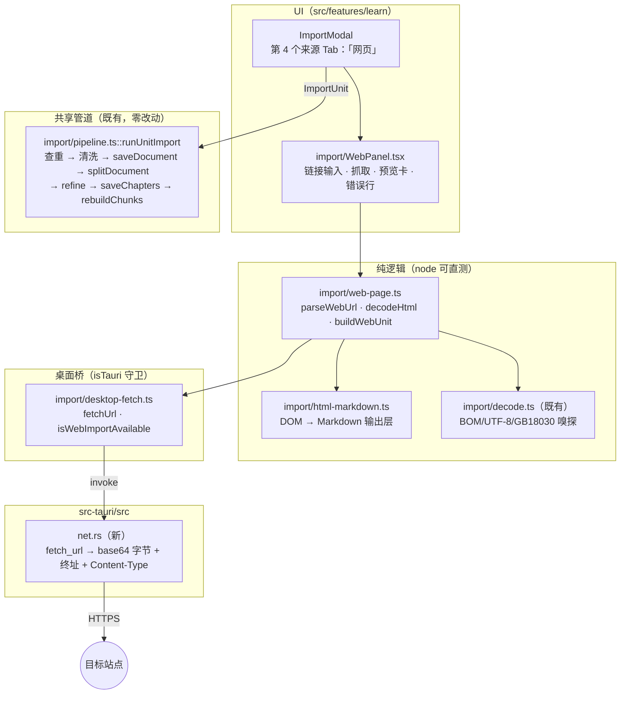
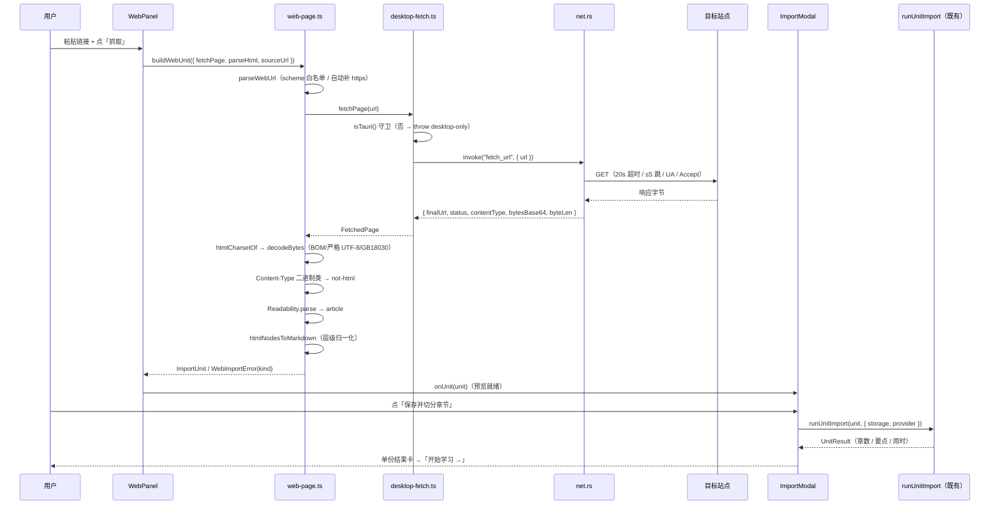

# 通过 URL 抓取网页导入 技术方案（F8 范围 5）

| 字段 | 内容 |
|------|------|
| 作者 | Agent |
| 日期 | 2026-10-16 |
| 状态 | **已实施**（2026-10-16，T1–T12 done；T13 桌面手工验收待用户实跑）<br>⚠️ 本方案**首次**在 `src-tauri/**` 开一道网络口，边界见 §8.1–§8.2 |
| 关联需求 | README 双语 `Fetch a web page by URL` / `通过 URL 抓取网页`（`P2`，**无 Feature 编号**）· `docs/roadmap-next-features-plan-2026-09.md` §F8 范围 5「URL 抓取（readability 类正文提取）」· `docs/code-gap-review-2026-09.md` §六 #3 |

---

## 1. 背景

**要解决的事**：用户看到一篇在线文章想学它，当前**只有一条路** —— 手工选中正文、复制、切到「粘贴」Tab、粘贴、再手填标题。代价是**标题层级全丢**：`splitDocument` 拿到的是一坨纯文本，`resolveFormat` 探测不到 `#`/`##` ⇒ 落到段落聚类，切出来的「章节」与文章真实小节无关（`splitter-engine.ts:73-77`）。

**现状证据（本轮实测）**：

| 事实 | 证据 |
|------|------|
| 导入来源只有四路 | `import/types.ts:14` `ImportTab = "paste" \| "local" \| "github"`；`import/` 目录仅 md / txt / pdf / docx / github 五种归属化器（`local-files.ts` / `pdf.ts` / `docx.ts` / `github.ts`） |
| 无任何抓取依赖 | `package.json` 无 `readability` / `jsdom` / `linkedom` / `cheerio` 类依赖 |
| 无抓取入口 | 全仓 Grep `readability\|urlImport\|fetch-url` 零命中 |
| roadmap 已登记 | §F8 范围 5「**URL 抓取**（readability 类正文提取）」，§F8 现状证据行「无 URL 抓取入口 ✅ **实测为真**」 |
| README 已登记 | `README.md:424` / `README.zh-CN.md:428` 均为 `[ ]` |

**不做的影响**：F8 这条线永远缺一角；README 双语该条永远是 `[ ]`；用户最自然的「我在网上读到一篇好文章」动作没有产品路径。

---

## 2. 方案目标

| 类型 | 描述 |
|------|------|
| **主要目标** | 导入弹窗新增第四个来源 Tab「网页」，粘贴一个 http(s) 链接即可抓取正文 → 提取可读正文 → 保留标题层级 → 交**同一条**共享管道（`runUnitImport`）产出 `Document` + `Chapter[]`，与 GitHub 导入同口径（一次快照、可重导入、走查重） |
| **非目标** | ① **不做 JS 渲染**（不起无头浏览器、不执行页面脚本）⇒ SPA / 反爬 / 纯图站点抓不到正文时**明确报错**；② 不做登录态 / Cookie / 付费墙穿透；③ 不做图片下载与正文内嵌（跳过并计数，遵守 DOCX 先例「绝不内联 base64」）；④ 不做网页归档 / 增量更新 / 变更检测（一次性快照）；⑤ 不做 RSS / 站点地图批量抓取；⑥ 不做 EPUB / OCR（属 §F8 另两条范围）；⑦ **不改任何存储契约**（零新 key、零迁移、F4 导出白名单不动） |
| **成功标准** | ① 桌面端粘贴一篇静态博客文章链接 → 结果卡显示章数与正文量，章节标题等于文章小标题；② 整条链路走 `runUnitImport`（五阶段进度、查重面板、AI 精修、后台向量化、后台 AI 整理**全部自动生效**，零重复实现）；③ 浏览器预览下 Tab 可见但**不可用且有明确说明**（不出现「点了没反应的死按钮」）；④ 抓不到正文 / 非网页 / 站点报错三类失败各有**可行动**文案；⑤ `typecheck` / `layer:check` / `ui:check` / `test:i18n` / `test:web` / `test:library` / `cargo test --lib` 全绿 |

---

## 3. 项目现状

### 3.1 相关代码与模块

| 位置 | 现状 |
|------|------|
| `import/types.ts` | `ImportTab` / `ImportUnit`（`title`+`titleSource`+`format`+`splitFormat`+`text`+`source`+`extract`）/ `LIMITS`（体积护栏，注释里明确区分「**文件字节**」与「**入库正文**」两把尺子） |
| `import/pipeline.ts` | 共享管道 `runUnitImport`：查重 → markdown 来源 `stripMarkdownNoise` → `saveDocument` → `splitDocument` → `refineSplitResult` → `saveChapters` → `rebuildChunks` |
| `import/github.ts` | **本方案的结构范本**：纯函数（`parseGithubUrl` / `buildRepoMarkdown`）+ 可注入 `FetchLike` 的薄封装 + `GithubImportError(kind, detail)` **不携带用户文案** + 体积护栏「超限不静默截断」 |
| `import/error-text.ts` | 导入层错误 → 文案的**唯一映射点**：`GithubErrorLabels = Record<GhErrorKind, string>`、`LocalErrorLabels = Record<LocalFileErrorKind, string>` ⇒ 新增 kind 时 typecheck 强制 zh/en 同时补齐 |
| `import/docx.ts` / `docx-markdown.ts` | **输出层先例**：抽取器只当「读取器」，Markdown 由自写输出层产；`DocxMarkdownResult` 带 `headings` / `tables` / `skippedImages` 可观测性 |
| `import/ImportModal.tsx` | 三来源 Tab（`sourceTab`）+ `runTabAction()` 按 Tab 组装 `ImportUnit` + 冲突预检 `findConflicts` + 五阶段进度 + 单份/批量结果卡 |
| `import/decode.ts` | 编码嗅探（BOM → UTF-8 严格试探 → GB18030 兜底），**回传实际采用的编码名**供 UI 明示 |
| `src/engine/splitter-engine.ts` | `mdHeadingMaxLevel` 默认 **2**（`#` / `##` 切章）；唯一 `#` 且其后无正文 → 识别为「文档主标题」**不单独成章**（`:115-128`）；**首章吸收标题前的导言**（`:136`），不会丢内容 |
| `src/domain/document.ts:7-17` | `DocumentFormat` **已含 `"web"`** ⇒ domain 零改动 |
| `src-tauri/src/lib.rs:122` | `generate_handler![…]`（app_status / llm_* / embed_* / log_* / vault_* / backup_* / memory_doc_* / db_*） |
| `src-tauri/Cargo.toml:33` | `reqwest = { version = "0.12", default-features = false, features = ["stream", "rustls-tls"] }` |
| `src-tauri/capabilities/default.json` | `permissions: ["core:default"]` —— 现有 `vault_*` / `backup_*` / `memory_doc_*` 等**自定义命令都不需要额外权限项** ⇒ 本方案也不改 capabilities |

### 3.2 相关文档与约定

- `docs/knowledge-import-design-2026-09.md` §4.2 / §4.3（导入适配层契约）、§7.3 / §8.7（来源面板职责）——**本方案落地后该文档的来源清单需回扫**
- `docs/library-import-docx-design-2026-09.md` D6（为何自写 Markdown 输出层；其「HTML→Markdown 在 Node 需 DOM」的顾虑在 §3.3 给出实测解法）
- `skills/tauri-ipc/SKILL.md`（命令落点 → `lib.rs` 注册 → `src/**` 薄封装；`isTauri()` 守卫；参数 snake_case / camelCase 自动映射）
- `rules/rust.mdc`（模块 → `lib.rs` 注册；命令 `Result<T,String>`）、`rules/layer-import-boundaries.mdc`、`rules/no-headless-browser-validation.mdc`、`rules/dropdown-select.mdc`、`AGENTS.md` 编码速记
- `src/features/data/portability/desktop-backup.ts`、`src/features/memory/desktop-memory-doc.ts`——**非 AI 类 Rust 命令的封装范本**（`isTauri()` 守卫 + 一层薄封装，落在属主 feature 目录，而非 `src/ai/*`）

### 3.3 约束与依赖（全部本轮实测）

| 约束 | 实测事实 | 影响 |
|------|----------|------|
| **⚠️ CORS 挡死 webview 直抓** | 现有 GitHub 导入能用 webview `fetch`，是因为 `api.github.com` / `raw.githubusercontent.com` **主动发 `Access-Control-Allow-Origin`**。普通站点不发该头 ⇒ 桌面 webview 与浏览器预览下 `fetch("https://某博客")` 都读不到响应体 | **唯一可行路径是在 Rust 侧发请求** ⇒ 本方案**首次**在 `src-tauri/**` 开一道口（改动边界见 §8.1–§8.2） |
| `reqwest` 已就位 | `Cargo.toml:33` 已在用；`llm/manager.rs` 已用它下载模型 ⇒ **零新增 crate** | 网络能力不需要新依赖 |
| `base64` 已在依赖图 | `src-tauri/Cargo.lock:107` `base64 0.22.1`（reqwest 的传递依赖）⇒ 提升为直接依赖**不引入任何新 crate** | 字节回传可走 base64，代价仅 `Cargo.toml` 一行 |
| `reqwest` **无 `charset` feature** | features 只有 `["stream","rustls-tls"]`；`encoding_rs` 在 lock 里（0.8.35）但未被编译进 reqwest 的 `text()` 路径 ⇒ `res.text()` 对无 charset 头的 GBK 页会**乱码** | 不在 Rust 侧解码（见 D4）；字节原样回传给 TS，复用既有 `decode.ts` |
| `@mozilla/readability@0.6.0` 可被 node ESM import | 包 **无 `exports` 字段**、`main: index.js`（CJS）、`types: index.d.ts`、**零运行时依赖**；本机实测 `import { Readability } from "@mozilla/readability"` 成功 | 生产依赖只加 1 个包 |
| `linkedom@0.18.13` 能跑 Readability | 本机实测：真实感 fixture（nav + article + footer + script）→ `Readability.parse()` 成功；导航/页脚**未进正文**、正文关键句保留；`textContent` 有缩进空白需再归一化 | 单测 DOM 用 `linkedom`（**devDependency**）；5 个传递依赖 |
| ⚠️ `linkedom` 片段解析的坑 | `parseHTML(article.content).document` 的 **`body` 是空的**，内容落在 `documentElement.children`；自带 `<body>` 包裹才拿得到稳定入口（本机实测） | DOM→Markdown 的入口必须**自己包 body**（见 §8.4） |
| ⚠️ Readability 的清洁度不是无限的 | 小文档 / 内容量不足时 **nav 可能残留在 `content` 里**，且会把 `<h1>` 降级为 `<h2>`（本机实测） | 输出层**必须自己跳** `nav/header/footer/aside/script/...`；章节边界不能假定是 `##`（见 D6 层级归一化） |
| `stripMarkdownNoise` 会拍平链接 | `normalize-text.ts:44` `[text](url)` → `text`，且它对**所有** `splitFormat === "markdown"` 的来源统一生效（`pipeline.ts:102`） | 输出层**不需要**解析/补全 href（见 D7） |
| `tsconfig.json` `include: ["src"]` | **`tests/` 不进 typecheck** ⇒ `typecheck` 绿 ≠ 测试绿 | 测试必须**现跑**（`npm run test:web`），不能靠 typecheck 代言 |

### 3.4 决策点（D1–D9）

> ⚠️ **诚实声明**：D1–D3 曾以 AskUserQuestion 征询，但该问答在会话压缩中丢失、未记录到答复 ⇒ **本轮按推荐档继续**，并在本表标注。若任一项要改档，说一声即可 —— 改档后按模板约定**全量回扫**（架构 / 伪代码 / 任务表 / 用例 / 变更记录）。

| ID | 决策点 | 选项 | 推荐 | 理由 |
|----|--------|------|------|------|
| D1 | 网络通道 | A 新增 Rust 命令 `fetch_url` / B `@tauri-apps/plugin-http` / C 只用 webview `fetch` | **A**（本轮取推荐档） | `reqwest` 已在依赖里 ⇒ 零新 crate；B 要同时加 npm + Cargo 依赖与 capabilities 权限项，改动面更大；C 被 CORS 挡死，功能近乎不可用 |
| D2 | 正文提取实现 | A `@mozilla/readability` + 单测 DOM `linkedom` / B 自写启发式 / C Rust 侧 readability crate | **A**（本轮取推荐档） | roadmap 原话即「readability 类」；A 的零运行时依赖 + `linkedom` 已实测可跑；C 会让提取逻辑在 TS 侧完全不可测 |
| D3 | 抓不到正文的兜底 | A 明确报错 + 引导改用粘贴 / B 顺带做「粘贴 HTML 源码」入口 | **A**（本轮取推荐档） | 与 F8 范围 1「0 字符 PDF 明确报错」同口径；B 多一层 UI 与文案，且绝大多数场景「改用粘贴」已经解决 |
| D4 | 字节传输 vs 文本传输 | A Rust 回 base64 **原始字节**，TS 解码 / B Rust 用 header charset 解码后回文本 | **A** | 编码判定是**产品语义**（要回传 `encoding` 名给 UI、要 GB18030 兜底），留在 TS 层 ⇒ 复用 `decode.ts`、node 可直测、结果卡能显示「已按 gb18030 解码」；B 会把 GBK 页静默弄成乱码 |
| D5 | 浏览器预览（非 Tauri） | A Tab 可见但禁用 + 说明原因 / B 直接隐藏 Tab | **A** | 与 `VectorIndexCard`（非桌面端整卡禁用 + 说明）同构；隐藏会让用户根本不知道有这个能力 |
| D6 | 标题层级归一化 | A 按「页面最浅标题 → `#`」整体上移 + 保留标题行 / B 原样透传 | **A** | Readability 会把 `h1` 降级为 `h2`（实测）；页面若用 `h3/h4` 当小节，原样透传会**一个章节都切不出来**（`mdHeadingMaxLevel` 默认 2）。刻意**不删**标题行：`#`+无正文时引擎自己会识别成「文档主标题」不成章，删了反而要额外判据 |
| D7 | 链接保真 | A `a` 只取文字、不产链接语法 / B 产 `[text](href)` 并补全为绝对 URL | **A** | 共享管道 `stripMarkdownNoise` 本就把 `[t](u)` 拍平成 `t`（单一真源）；页面里的相对 href 出库即无意义。产出来再被拍平 = 白做一层 |
| D8 | 体积护栏 | A 「入库正文」沿用既有尺子 `1_500_000` 字符 + Rust 侧另有**传输**护栏 | **A** | `LIMITS` 注释已把「文件字节」与「入库正文」区分开（`pasteMaxChars`/`githubTotalChars`/`docxMaxChars` 同一把尺子）；传输护栏是**另一个目的**（防内存暴涨），不是第二把产品尺子 |
| D9 | Rust 错误怎么跨 IPC | A `Result<T, String>` 但内容为**机器令牌**（`"http-error:404"`）/ B 结构化错误对象 `{kind, detail}` | **A** | 守住 `rules/rust.mdc` 的字面约定（零规则摩擦）；同时满足导入层 G2 纪律（**Rust 绝不携带用户文案**）。TS 侧 `split(":")` 解析 + 单测锁契约 |

---

## 4. 技术架构

### 4.1 总体架构



### 4.2 模块职责

| 模块/层级 | 职责 | 技术选型 |
|-----------|------|----------|
| `src-tauri/src/net.rs`（新） | **唯一一条用户任意 URL 的出网命令**：scheme 白名单校验 → `reqwest` 抓取（超时/重定向上限/UA）→ 流式累积并卡传输上限 → base64 编码 → 回 `FetchedPage` | `reqwest`（既有）+ `base64`（已 vendored） |
| `import/web-error.ts`（新） | 错误类别 `WebErrorKind` + `WebImportError` + **令牌 → 类别的唯一解析点**（独立成模块以避免 `web-page.ts` ⇄ `desktop-fetch.ts` 成环，见 §8.3） | 纯 TS |
| `import/desktop-fetch.ts`（新） | 命令薄封装：`isTauri()` 守卫 + `FetchedPage` 镜像 + 令牌 → 异常转译，**零判定逻辑** | `@tauri-apps/api/core`（照 `desktop-backup.ts`） |
| `import/web-page.ts`（新） | 纯逻辑：URL 解析/规范化 → base64 解码 + 编码判定 → Readability 提取 → 编排成 `ImportUnit`；错误只产 `kind` | `@mozilla/readability`，DOM 解析器**注入** |
| `import/html-markdown.ts`（新） | DOM → Markdown 输出层（标题层级归一化 / 列表 / 代码块 / 引用 / GFM 表格 / 跳噪声标签 / 图片跳过计数） | 纯函数，结构化 DOM 类型（照 `docx-markdown.ts`） |
| `import/WebPanel.tsx`（新） | 来源面板：输入 + 「抓取」+ 预览卡（字符数/标题数/终址）+ 行内错误 + 非桌面端说明 | UI Kit（`Button` / `Input`）+ token |
| `import/ImportModal.tsx`（改） | 第四 Tab 接线 + `runTabAction` 分支 + 主按钮启用条件 + 复用既有查重/进度/结果卡 | — |
| `import/types.ts`（改） | `ImportTab` 加 `"web"`；`LIMITS.webMaxChars` | — |
| `import/error-text.ts`（改） | `WebErrorLabels = Record<WebErrorKind, string>` + `webErrorText()` | — |
| i18n（改） | `sourceTab.web` + `learn.import.web.*`（zh/en 成对） | — |

### 4.3 数据模型与 API

**Rust 命令**（`src-tauri/src/net.rs`）：

```rust
/// 抓取结果（serde rename_all = "camelCase" ⇒ TS 侧驼峰）。
#[derive(serde::Serialize)]
pub struct FetchedPage {
    final_url: String,            // 跟随重定向后的最终地址（source 溯源用）
    status: u16,                  // 200 / 203 …
    content_type: Option<String>, // 原始 Content-Type（可能含 charset）
    bytes_base64: String,         // 原始字节（**不解码**，D4）
    byte_len: usize,              // 解码前的字节数（结果卡/排障）
}

#[tauri::command]
pub async fn fetch_url(url: String) -> Result<FetchedPage, String>
```

**错误令牌契约**（D9-A；`Result` 的 `Err` 一律是**机器令牌**，绝不含中文）：

| 令牌 | 触发 |
|------|------|
| `invalid-url` | URL 解析失败，或 scheme 不在 `{http, https}` 白名单内 |
| `network` | 连接失败 / DNS / 被拒（`err.is_connect()` 等） |
| `timeout` | 超时（`err.is_timeout()`） |
| `too-many-redirects` | 重定向超过 5 跳（`err.is_redirect()`） |
| `http-error:<status>` | 响应非 2xx |
| `too-large:<bytes>` | 累积字节超 `MAX_FETCH_BYTES`（5 MiB） |
| `build-client:<detail>` | 客户端构造失败（几乎不可能，仅兜底） |

**TS 侧类型**（`WebErrorKind` / `WebImportError` 在 `import/web-error.ts`；`FetchedPage` 在 `import/desktop-fetch.ts`）：

```ts
/** Rust FetchedPage 的镜像（camelCase），两边同改。 */
export interface FetchedPage {
  finalUrl: string;
  status: number;
  contentType?: string;
  bytesBase64: string;
  byteLen: number;
}

/** 用户可见语义的错误类别（`error-text.ts` 按 kind 取 i18n）。 */
export type WebErrorKind =
  | "invalid"       // 非法/非 http(s) 链接
  | "network"       // 网络失败（含超时/重定向过多）
  | "http-error"    // 站点返回非 2xx
  | "too-large"     // 传输超 5MiB，或提取出的正文超 webMaxChars
  | "not-html"      // Content-Type 是二进制类（PDF/图片/压缩包…）
  | "no-text"       // 抓到了但提取不到正文（SPA / 反爬 / 纯图）
  | "desktop-only"; // 非桌面端（浏览器预览）
```

**`ImportUnit` 映射**（与 GitHub 来源逐字段对齐）：

| 字段 | 值 |
|------|-----|
| `title` | `article.title` → 兜底 `new URL(finalUrl).hostname` |
| `titleSource` | `"derived"`（页面标题是派生值 ⇒ 允许后台 AI 整理覆盖，与 GitHub/本地文件同口径） |
| `format` | `"web"`（`DocumentFormat` 已有该成员） |
| `splitFormat` | `"markdown"`（输出层产的是 Markdown） |
| `text` | 输出层的 Markdown 正文 |
| `source` | `finalUrl`（**用终址**：同一篇文章的短链/带参链接会归一到同一 `source`，查重面板自然生效） |
| `extract` | `{ encoding, headings }`（既有字段，零类型改动） |

**数据读写（必填）**：
- **零存储改动**：不新增任何 `plos.*` key、不新增 storage 方法、不改 F4 导出白名单（没有新实体）。
- 写入仍**只**经共享管道 `runUnitImport`（`storage.saveDocument` → `saveChapters` → `rebuildChunks`），与粘贴/本地/GitHub 完全同路。
- 桌面能力**只**经 `invoke("fetch_url")`，且**必须** `isTauri()` 守卫（纯浏览器预览下 `WebPanel` 禁用主按钮、`fetchUrl` 仍会抛 `desktop-only` 兜底）。
- **零凭据**：`reqwest::Client` 不启用 `cookies` feature ⇒ 不带 Cookie、不复用任何会话；不读取、不上传本机任何数据（页面 URL 由用户手输）。

**安全边界（有意保留的风险）**：命令只接受 `http` / `https`（显式拒绝 `file:` / `data:` / `javascript:` / 自定义 scheme）；重定向上下限各一条；响应体不落盘、只在内存与 IPC 里过一遍；抓取结果只面向用户自己的屏幕，应用不发往任何第三方。

### 4.4 状态与副作用

| 状态 | 归属 | 说明 |
|------|------|------|
| 输入链接 `url` | `WebPanel` 本地 state | 变化时清空旧预览与错误（照 `GithubPanel.tsx:38-43`），防「底部按钮指向旧目标」 |
| 抓取中 `fetching` | `WebPanel` 本地 state | 禁用输入与按钮 |
| 已备好的 `ImportUnit` | **上抛** `ImportModal`（`onUnit`） | 与 `GithubPanel` 的 `onPreview` 同构：面板只管「来源准备」，导入统一走底部主按钮 |
| 导入主流程 `busy` / 进度 / 结果卡 / 冲突面板 | `ImportModal`（既有） | **零改动复用** |

副作用：仅用户点「抓取」时发一次 `invoke`；无轮询、无定时器、无全局事件订阅。抓取与导入**分离**（抓取成功只是「预览就绪」，避免用户改链接后误导入）。

---

## 5. 交互流程

### 5.1 主流程

1. 用户在导入弹窗点「网页」Tab（第 4 个）。
2. 粘贴链接 → 点「抓取」（或在输入框按 Enter）。
3. 面板显示「正在抓取网页…」；Rust 侧发起请求（20s 超时 / 最多 5 跳重定向）。
4. 成功后面板渲染**预览卡**：页面标题、终址、`约 N 字符 · 提取到 M 个标题`；同时把 `ImportUnit` 上抛给 `ImportModal`，底部主按钮由禁用变可用。
5. 用户点底部主按钮「保存并切分章节」→ `ImportModal.runTabAction()` 取用已备好的 unit →（若有同 `source` 旧资料，先弹既有查重面板）→ `runUnitImport` 五阶段进度 → 单份结果卡（章数 / 要点数 / 字符数 / 编码提示）。
6. 结果卡「开始学习 →」直达首章；后台照旧触发向量化入队与 AI 整理。

### 5.2 分支与异常流程

| 场景 | 触发条件 | 系统行为 | UI 反馈 |
|------|----------|----------|---------|
| 非桌面端 | `isTauri() === false` | 面板不发任何 IPC；主按钮禁用 | 面板内一行说明：抓取网页需要桌面端应用 |
| 非法链接 | 无法解析 / 非 http(s) | `WebImportError("invalid")`，不发请求 | 「无法解析该链接：请粘贴形如 https://… 的 http(s) 链接。」 |
| 无 scheme | 输入 `example.com/post` | `parseWebUrl` 自动补 `https://` | 正常流程（预览卡显示补全后的终址） |
| 网络失败 / 超时 | 连接失败、超时、重定向过多 | `kind: "network"` | 「网络请求失败，请检查网络后重试。」 |
| 站点报错 | 非 2xx | `kind: "http-error"`（令牌带状态码，仅进日志） | 「目标站点返回错误状态，页面可能已下线或需要登录。」 |
| 不是网页 | Content-Type 是 `application/pdf` / `image/*` / `application/zip` 等二进制类 | `kind: "not-html"`，**不进提取** | 「该链接不是网页，请改用本地文件导入。」 |
| 页面过大 | 传输 > 5 MiB，或提取正文 > `webMaxChars` | `kind: "too-large"` | 「页面体积超出上限，无法导入。」 |
| 抓不到正文 | Readability 回 `null` 或正文去空白后为空（SPA / 反爬 / 纯图） | `kind: "no-text"` | 「未能从该页面提取正文（可能需要脚本渲染），请改用「粘贴」导入。」 |
| 编码非 UTF-8 | header/meta 声明或嗅探到 GB18030 等 | 正常导入；`extract.encoding` 回传 | 结果卡显示「已按 gb18030 解码」（既有 `encodingHint`） |
| 重复导入同一 URL | `finalUrl` 命中已有资料 `source` | 既有查重面板 | 「跳过 / 覆盖（删旧重建）/ 仍新建」 |
| 导入中改链接 | `busy` 为 true | Tab 与输入均禁用；`switchTab` 早退（既有行为） | 按钮 `disabled:opacity-40` |

### 5.3 时序图



---

## 6. 用户用例（User Cases）

### UC-01：抓取一篇静态博客文章并学习

| 项 | 内容 |
|----|------|
| 角色 | 桌面端用户 |
| 前置条件 | 已安装桌面应用；有网络；目标页是服务端渲染的 HTML 文章页 |
| 主流程步骤 | 1. 打开导入资料 `2. 切到「网页」Tab 3. 粘贴文章链接 4. 点「抓取」5. 看预览卡（标题 / 终址 / 字符数 / 标题数）6. 点「保存并切分章节」7. 看结果卡 8. 点「开始学习 →」 |
| 期望结果 | 资料入库；章节标题 = 文章小标题（不是段落聚类产物）；结果卡字符数与页面正文量相当；`source` = 终址 |
| 异常/边界 | 文章含大量代码块 / 表格 / 图片 → 代码块与表格保留为 Markdown，图片被跳过并计数，链接文字保留 |

### UC-02：页面抓不到正文（SPA / 反爬 / 纯图）

| 项 | 内容 |
|----|------|
| 角色 | 桌面端用户 |
| 前置条件 | 目标站点需 JS 渲染 |
| 主流程步骤 | 1. 粘贴链接 2. 点「抓取」 |
| 期望结果 | 行内报错「未能从该页面提取正文（可能需要脚本渲染），请改用「粘贴」导入。」；主按钮保持禁用；**不写入任何资料** |
| 异常/边界 | 页面只有导航/页脚（本文为标题党空页）也应走本分支 |

### UC-03：浏览器预览下的能力可见性

| 项 | 内容 |
|----|------|
| 角色 | 浏览器预览用户 |
| 前置条件 | `isTauri() === false` |
| 主流程步骤 | 1. 打开导入弹窗 2. 点「网页」Tab |
| 期望结果 | Tab 存在；面板显示「抓取网页需要桌面端应用」；输入框可输入但「抓取」与底部主按钮均禁用；**不出现点了没反应的按钮** |
| 异常/边界 | 程序化绕过 UI 直接调 `fetchUrl` → 抛 `WebImportError("desktop-only")`（防御纵深） |

### UC-04：重复导入同一链接

| 项 | 内容 |
|----|------|
| 角色 | 桌面端用户 |
| 前置条件 | 库里已有该 URL 导入的资料 |
| 主流程步骤 | 1. 重新抓取同一链接（或带 `?utm=…` 的变体）2. 点主按钮 |
| 期望结果 | 弹出既有查重面板，按 `source`（终址）命中；可选「跳过 / 覆盖 / 仍新建」 |
| 异常/边界 | 抓取失败**不是**查重前置条件——查重在导入前，抓取失败根本进不到这一步 |

### UC-05：抓取 → 编码非 UTF-8 的页面

| 项 | 内容 |
|----|------|
| 角色 | 桌面端用户 |
| 前置条件 | 目标页是 GBK/GB2312 编码、HTTP 头不带 charset |
| 主流程步骤 | 1. 粘贴链接 2. 抓取 3. 导入 |
| 期望结果 | 正文不乱码；结果卡显示「已按 gb18030 解码」；章节标题可读 |
| 异常/边界 | header 与 `<meta>` 都无 charset → 走 BOM → 严格 UTF-8 → GB18030 兜底链 |

---

## 7. 线框 UI（Wireframe）

### 7.1 `WebPanel` — 默认 / 预览就绪

```
┌───────────────────────────────────────────────────────┐
│ 导入资料                                    [✕]        │
├───────────────────────────────────────────────────────┤
│ [粘贴] [本地文件] [GitHub] [网页]           ← 第 4 个  │
├───────────────────────────────────────────────────────┤
│  网页链接                                              │
│  ┌────────────────────────────────┐ ┌────────────┐    │
│  │ https://example.com/article    │ │   抓取     │    │
│  └────────────────────────────────┘ └────────────┘    │
│  抓取正文并切分为章节；仅支持静态 HTML 页面（需脚本    │
│  渲染的站点会提示改用粘贴）                            │
│                                                        │
│  ┌─ 预览卡 ─────────────────────────────────────────┐  │
│  │ 向量检索入门 · 某博客                            │  │
│  │ https://example.com/article                      │  │
│  │ 约 8420 字符 · 提取到 6 个标题                    │  │
│  └──────────────────────────────────────────────────┘  │
├───────────────────────────────────────────────────────┤
│                                   [取消] [保存并切分]  │
└───────────────────────────────────────────────────────┘
```

### 7.2 其他状态

- **加载中**：输入框与「抓取」禁用；按钮文案变「正在抓取网页…」。
- **空**：虚线框提示「粘贴网页链接后点「抓取」，可预览将导入的正文量」（照 `GithubPanel` 的 `emptyPreview`）。
- **错误**：预览卡位置替换为一行红色短句（`text-state-weak`），主按钮保持禁用。
- **禁用（非桌面端）**：在输入区之上插一行说明「抓取网页需要桌面端应用」，输入框与两个按钮禁用、整体 `opacity-50`。
- **冲突**：与既有查重面板一致（`data-testid="import-conflicts"`）。

### 7.3 交互说明

- 输入框 `Enter` 即触发「抓取」（照 `GithubPanel.tsx:76-78`）。
- 链接变化即清空旧预览与错误（防误导入旧目标）。
- 全部交互元素带稳定 `data-testid`：`import-source-tab-web`、`web-panel`、`web-url-input`、`web-fetch-btn`、`web-preview`、`web-desktop-only`。
- 可访问性：`<label htmlFor>` 绑定；错误行是纯文本（不靠颜色单独表意）。
- 组件映射：`Button`（`components/ui/button.tsx`）、`Input`（`components/ui/input.tsx`）；token 只用既有语义值（`text-ink-1/2/3`、`border-line`、`bg-subtle`、`text-state-weak`）⇒ **零新增色值**。
- 无原生 `<select>`、无手写浮层 ⇒ 不触 `dropdown-select.mdc` 禁区。

---

## 8. 涉及文件及改动伪代码

> ⚠️ 本方案**首次**在 `src-tauri/**` 开一道口。边界严格限定为 **§8.1（1 个新文件）+ §8.2（2 行注册/依赖）**，不碰 `db/`、`vault.rs`、`llm/`、`tray.rs`、`capabilities/`、`schema.sql`。

### 8.1 `src-tauri/src/net.rs`（新增）

**改动说明**：唯一一条「用户任意 URL」的出网命令。语言中立错误令牌（D9-A）+ 字节原样 base64 回传（D4）。

```rust
//! 网页抓取（F8 范围 5）—— 本仓库唯一一条**用户任意 URL** 的出网命令。
//!
//! 为什么必须落在 Rust：webview 的 `fetch` 受同源/CORS 约束，只有主动发
//! `Access-Control-Allow-Origin` 的站点（如 api.github.com）才读得到响应体。
//! ⚠️ 与 `llm/manager.rs` 的模型下载不同：那条是**固定**地址，这条是用户给的任意地址
//!   ⇒ 故有 scheme 白名单与「零凭据」两条约束。
//!
//! 编码**不在此处判定**：reqwest 未启用 `charset` feature，`text()` 对无 charset 头的
//! GBK 页会乱码 ⇒ 原样回字节，由 TS 侧 `import/decode.ts` 嗅探并回传编码名。

use std::time::Duration;
use base64::{engine::general_purpose::STANDARD, Engine as _};
use futures_util::StreamExt;

const MAX_FETCH_BYTES: usize = 5 * 1024 * 1024; // 传输护栏（防内存暴涨，非产品体量线）
const TIMEOUT_SECS: u64 = 20;
const MAX_REDIRECTS: usize = 5;
const USER_AGENT: &str = "PersonalLearningOS/0.1 (+local-first reader)";

#[derive(serde::Serialize)]
#[serde(rename_all = "camelCase")]
pub struct FetchedPage {
    final_url: String,
    status: u16,
    content_type: Option<String>,
    bytes_base64: String,
    byte_len: usize,
}

/// scheme 提取（`"https://x"` → `Some("https")`；无 `://` → `None`），大小写不敏感。
fn url_scheme(raw: &str) -> Option<String> { /* 切 `://` 前段并 to_ascii_lowercase */ }

/// scheme 白名单（`file:` / `data:` / `javascript:` 一律拒）。抽成纯函数便于 `cargo test --lib`。
fn scheme_allowed(raw: &str) -> bool {
    matches!(url_scheme(raw).as_deref(), Some("http") | Some("https"))
}

/// 机器令牌（**绝不含用户文案**，G2）。抽成纯函数便于单测锁契约。
fn token(kind: &str, detail: Option<&str>) -> String {
    match detail { Some(d) => format!("{kind}:{d}"), None => kind.to_string() }
}

#[tauri::command]
pub async fn fetch_url(url: String) -> Result<FetchedPage, String> {
    if !scheme_allowed(&url) { return Err(token("invalid-url", None)); }

    let client = reqwest::Client::builder()
        .timeout(Duration::from_secs(TIMEOUT_SECS))
        .redirect(reqwest::redirect::Policy::limited(MAX_REDIRECTS))
        .user_agent(USER_AGENT)                     // 多数站点无 UA 直接 403
        .build()
        .map_err(|e| token("build-client", Some(&e.to_string())))?;

    let res = client
        .get(&url)
        .header(reqwest::header::ACCEPT, "text/html,application/xhtml+xml;q=0.9,*/*;q=0.1")
        .send()
        .await
        .map_err(|e| {
            if e.is_timeout() { token("timeout", None) }
            else if e.is_redirect() { token("too-many-redirects", None) }
            else { token("network", Some(&e.to_string())) }
        })?;

    let status = res.status();
    let final_url = res.url().to_string();
    let content_type = res.headers().get(reqwest::header::CONTENT_TYPE)
        .and_then(|v| v.to_str().ok()).map(|s| s.to_string());

    if !status.is_success() {
        return Err(token("http-error", Some(&status.as_u16().to_string())));
    }

    // 流式累积 + 卡上限：超限立即中断连接，不把大响应读完。
    let mut buf: Vec<u8> = Vec::new();
    let mut stream = res.bytes_stream();
    while let Some(chunk) = stream.next().await {
        let chunk = chunk.map_err(|e| token("network", Some(&e.to_string())))?;
        if buf.len() + chunk.len() > MAX_FETCH_BYTES {
            return Err(token("too-large", Some(&MAX_FETCH_BYTES.to_string())));
        }
        buf.extend_from_slice(&chunk);
    }

    let byte_len = buf.len();
    Ok(FetchedPage {
        final_url,
        status: status.as_u16(),
        content_type,
        bytes_base64: STANDARD.encode(&buf),
        byte_len,
    })
}

#[cfg(test)]
mod tests {
    // 只测纯函数（不联网）：scheme 白名单 + 令牌格式契约
    // - scheme_allowed("https://x") == true / http == true
    // - file: / data: / javascript: / 无 scheme / 空串 == false
    // - token("http-error", Some("404")) == "http-error:404"
    // - token("network", None) == "network"
}
```

### 8.2 `src-tauri/Cargo.toml`（修改）+ `src-tauri/src/lib.rs`（修改）

**改动说明**：提升已在依赖图里的 `base64` 为直接依赖；`mod net;` + 注册一条命令。

```toml
# Cargo.toml [dependencies] 追加一行 —— 0.22.1 已是 reqwest 的传递依赖（见 Cargo.lock:107）
base64 = "0.22"
```

```rust
// lib.rs
mod net;                       // ← 新增
// generate_handler! 追加一行（放在 backup/memory_doc 一带，按「越靠后越新」的既有顺序）
net::fetch_url,
```

### 8.3 `src/features/learn/import/web-error.ts`（新增）

**改动说明**：错误类别 + 错误类 + **令牌 → 类别的唯一解析点**。
⚠️ 刻意独立成一个模块：`web-page.ts`（纯逻辑，测试里要 import）与 `desktop-fetch.ts`（依赖 `@tauri-apps/api/core`）若互相 import 就成环，且会让纯逻辑层间接依赖桌面桥 —— 这正是 `TC-EDGE-18` 要守住的那条线。

```ts
/** 用户可见语义的错误类别（`error-text.ts` 按 kind 取 i18n；Rust 绝不携带文案）。 */
export type WebErrorKind =
  | "invalid" | "network" | "http-error" | "too-large" | "not-html" | "no-text" | "desktop-only";

export class WebImportError extends Error {
  readonly kind: WebErrorKind;
  /** 排障细节（HTTP 状态 / 上限值 / 原始令牌）；**不直接展示**。 */
  readonly detail?: string;
  constructor(kind: WebErrorKind, detail?: string) {
    super(detail === undefined ? kind : `${kind}: ${detail}`);
    this.name = "WebImportError";
    this.kind = kind;
    if (detail !== undefined) this.detail = detail;
  }
}

/**
 * Rust 机器令牌 → 用户可见语义类别。
 * ⚠️ 令牌是跨 IPC 契约：Rust 侧 `net.rs::token()` 与这里必须同改
 *   （Rust 单测锁生成端、TS 单测锁解析端）。
 */
export function webErrorKindOf(token: string): { kind: WebErrorKind; detail?: string } {
  const [head, ...rest] = token.split(":");
  const detail = rest.length > 0 ? rest.join(":") : undefined;
  switch (head) {
    case "invalid-url": return { kind: "invalid", detail };
    case "network":
    case "timeout":
    case "too-many-redirects": return { kind: "network", detail: token };
    case "http-error": return { kind: "http-error", detail };
    case "too-large": return { kind: "too-large", detail };
    default: return { kind: "network", detail: token };  // 未知令牌不崩，归入网络失败
  }
}
```

### 8.4 `src/features/learn/import/desktop-fetch.ts`（新增）

**改动说明**：命令薄封装（照 `desktop-backup.ts`）—— 只做 `isTauri()` 守卫 + 镜像类型 + 令牌 → 异常的转译，**不含任何判定逻辑**。

```ts
import { invoke, isTauri } from "@tauri-apps/api/core";
import { WebImportError, webErrorKindOf } from "./web-error";

/** Rust `FetchedPage` 的镜像（camelCase 由 Tauri 自动转换），两边同改。 */
export interface FetchedPage {
  finalUrl: string;
  status: number;
  contentType?: string;
  bytesBase64: string;
  byteLen: number;
}

/** 抓取能力是否可用（仅桌面端：浏览器预览无法跨站读取）。 */
export function isWebImportAvailable(): boolean { return isTauri(); }

export async function fetchUrl(url: string): Promise<FetchedPage> {
  if (!isTauri()) throw new WebImportError("desktop-only");   // 防御纵深（UI 已禁用，此处兜底）
  try {
    return await invoke<FetchedPage>("fetch_url", { url });
  } catch (err) {
    const { kind, detail } = webErrorKindOf(typeof err === "string" ? err : String(err));
    throw new WebImportError(kind, detail);
  }
}
```

### 8.5 `src/features/learn/import/html-markdown.ts`（新增）

**改动说明**：DOM → Markdown 输出层。照 `docx-markdown.ts` 的「结构类型描述 + 宽类型零断言」手法，单测直接喂 `linkedom` 节点。

```ts
/**
 * 结构化 DOM 类型（按实测形状声明）：只要 `tagName` / `children` / `textContent`，
 * 生产喂浏览器节点、单测喂 linkedom 节点，两边都不需要真 Document。
 */
export interface HtmlDomNode {
  tagName?: string;
  textContent?: string | null;
  children?: ArrayLike<HtmlDomNode>;
}

export interface HtmlMarkdownResult {
  text: string;
  headings: number;
  tables: number;
  skippedImages: number;
  /** 归一化前的标题层级范围（排障：最浅 N / 最深 M）。 */
  levels: { min: number; max: number };
}

/** 整棵跳过的噪声标签（Readability 不保证清干净：小文档实测 nav 会残留）。 */
const SKIP_TAGS = new Set([
  "nav", "header", "footer", "aside", "form", "button", "select", "input",
  "script", "style", "noscript", "template", "svg", "canvas", "iframe", "video", "audio",
]);

export function htmlNodesToMarkdown(root: HtmlDomNode): HtmlMarkdownResult {
  const acc = { lines: [] as string[], levels: [] as number[], tables: 0, skippedImages: 0 };
  walk(root, acc);
  // ---- 层级归一化（D6）：页面最浅标题 → `#`，整体上移（无标题时不归一化） ----
  const min = acc.levels.length > 0 ? Math.min(...acc.levels) : 1;
  const normalized = acc.lines.map((line) => shiftHeading(line, min));
  return {
    text: tidy(normalized.join("\n")),   // tidy = 归并 3+ 连续空行为 1 空行 + 首尾去空白
    headings: acc.levels.length,
    tables: acc.tables,
    skippedImages: acc.skippedImages,
    levels: { min, max: acc.levels.length > 0 ? Math.max(...acc.levels) : 0 },
  };
}

/** 计数器随 `acc` 走（闭包/参数两种都行，此处用参数避免模块级可变状态）。 */
function walk(node: HtmlDomNode, acc: WalkAcc) {
  for (const el of node.children ?? []) {
    const tag = (el.tagName ?? "").toLowerCase();
    if (SKIP_TAGS.has(tag)) continue;                       // 噪声整棵跳过
    const level = /^h([1-6])$/.exec(tag)?.[1];
    if (level) { acc.levels.push(Number(level)); acc.lines.push(`${"#".repeat(Number(level))} ${inlineText(el)}`); }
    else if (tag === "p") acc.lines.push(inlineText(el));
    // ⚠️ pre **必须**用 rawText：inlineText 会把空白折叠成单空格，代码块直接毁掉
    else if (tag === "pre") acc.lines.push("```\n" + rawText(el) + "\n```");
    else if (tag === "blockquote") acc.lines.push(rawText(el).split("\n").map((l) => `> ${l}`).join("\n"));
    else if (tag === "ul" || tag === "ol") pushList(el, acc, tag === "ol");
    else if (tag === "table") pushTable(el, acc);           // GFM；单元格内 `|` 需转义
    else if (tag === "img") acc.skippedImages += 1;         // **不内联、不产占位符**（与 DOCX 先例一致）
    else if (tag === "br") acc.lines.push("");
    else walk(el, acc);                                     // div/section/article/span… 透明递归
  }
}

/** 行内文本：折叠空白为单空格（`<a>` 只取文字 —— D7，理由见 §3.4）。 */
function inlineText(el: HtmlDomNode): string { return (el.textContent ?? "").trim().replace(/\s+/g, " "); }

/** 保结构文本：只去首尾空白，**不动内部换行与缩进**（pre / blockquote 用）。 */
function rawText(el: HtmlDomNode): string { return (el.textContent ?? "").replace(/^[ \t]+|[ \t]+$/gm, "").trim(); }
```

### 8.6 `src/features/learn/import/web-page.ts`（新增）

**改动说明**：URL 规范化 + 编码判定 + Readability 提取 + 编排。**不 import 任何 React / Tauri 模块**。

```ts
import { Readability } from "@mozilla/readability";
import { LIMITS } from "./types";
import type { ImportUnit } from "./types";
import { decodeBytes } from "./decode";
import { htmlNodesToMarkdown } from "./html-markdown";
import { WebImportError } from "./web-error";
import type { FetchedPage } from "./desktop-fetch";   // **仅类型** —— 不 import 桌面桥的运行时值（TC-EDGE-18）

export type HtmlParser = (html: string) => Document;
/** 生产用（浏览器）：测试永不调用 ⇒ node 下即使没有 DOM 全局也不会炸。 */
export const browserHtmlParser: HtmlParser = (html) => new DOMParser().parseFromString(html, "text/html");

/** 无 scheme 时补 https（用户从移动端复制常缺）—— 有 `://` 就原样解析。 */
export function parseWebUrl(raw: string): string {
  const t = raw.trim();
  if (!t) throw new WebImportError("invalid");
  const withScheme = /^[a-zA-Z][\w+.-]*:\/\//.test(t) ? t : `https://${t}`;
  let u: URL;
  try { u = new URL(withScheme); } catch { throw new WebImportError("invalid"); }
  if (u.protocol !== "http:" && u.protocol !== "https:") throw new WebImportError("invalid", u.protocol);
  if (!u.hostname) throw new WebImportError("invalid");
  return u.toString();
}

/**
 * charset 判定，优先级 = **HTTP 头 > `<meta charset>`**（WHATWG：传输层优先）+ 大小写不敏感。
 * meta 从**头部字节的 ASCII 视图**里嗅探（charset 声明本身是 ASCII ⇒ 无需先解码）。
 * 两者都没有 → 返回 undefined，交给 `decodeBytes` 的 BOM/UTF-8/GB18030 链。
 */
export function htmlCharsetOf(contentType: string | undefined, headAscii: string): string | undefined {
  const fromHeader = /charset\s*=\s*["']?([\w-]+)/i.exec(contentType ?? "")?.[1];
  if (fromHeader) return fromHeader.toLowerCase();
  const fromMeta = /<meta[^>]+charset\s*=\s*["']?([\w-]+)/i.exec(headAscii)?.[1];
  return fromMeta?.toLowerCase();
}

/** base64 → `{ html, encoding }`。⚠️ `encoding` 要回传给结果卡（`encodingHint`），不做静默兜底。 */
export function decodeHtml(bytesBase64: string, contentType?: string): { html: string; encoding: string } {
  const bin = atob(bytesBase64);                       // Node ≥16 与浏览器都有
  const bytes = new Uint8Array(bin.length);
  for (let i = 0; i < bin.length; i += 1) bytes[i] = bin.charCodeAt(i);
  // 头部 2048 字节能覆盖 `<head>` 里的 charset 声明
  const headAscii = new TextDecoder("latin1").decode(bytes.subarray(0, 2048));
  const label = htmlCharsetOf(contentType, headAscii);
  if (label) {
    try { return { html: new TextDecoder(label).decode(bytes), encoding: label }; }
    catch { /* 运行时缺该标签 → 落回嗅探链 */ }
  }
  const sniffed = decodeBytes(bytes.buffer);           // 既有：BOM → 严格 UTF-8 → GB18030
  return { html: sniffed.text, encoding: sniffed.encoding };
}

/** Content-Type 明显是二进制 ⇒ 不送进提取器（否则会把 PDF 字节当 HTML 解析出一道 `no-text` 误报）。 */
export function isBinaryContentType(contentType?: string): boolean {
  if (!contentType) return false;                      // 缺失不判死（不少站点不发该头）
  const mime = contentType.split(";")[0].trim().toLowerCase();
  if (mime === "text/html" || mime === "application/xhtml+xml") return false;
  return /^(application\/(pdf|zip|json|octet-stream|msword)|image\/|audio\/|video\/)/.test(mime);
}

export interface WebUnitDeps {
  fetchPage: (url: string) => Promise<FetchedPage>;
  parseHtml: HtmlParser;
  /** 用户原始输入（用于预览卡展示；`source` 用终址）。 */
  sourceUrl: string;
}

export async function buildWebUnit(deps: WebUnitDeps, limits = LIMITS): Promise<ImportUnit> {
  const url = parseWebUrl(deps.sourceUrl);
  const page = await deps.fetchPage(url);
  if (isBinaryContentType(page.contentType)) throw new WebImportError("not-html", page.contentType);

  const { html, encoding } = decodeHtml(page.bytesBase64, page.contentType);
  const article = new Readability(deps.parseHtml(html), { charThreshold: 0 }).parse();
  if (!article || !(article.content ?? "").trim()) throw new WebImportError("no-text");

  // ⚠️ 必须自带 <body> 包裹：linkedom 对片段解析会给出**空的 body**（实测）。
  const wrapped = deps.parseHtml(`<!doctype html><html><body>${article.content}</body></html>`);
  const root = wrapped.body ?? wrapped.documentElement;
  const md = htmlNodesToMarkdown(root);
  if (!md.text.trim()) throw new WebImportError("no-text");
  if (md.text.length > limits.webMaxChars) throw new WebImportError("too-large", String(md.text.length));

  return {
    title: (article.title ?? "").trim() || new URL(page.finalUrl).hostname,
    titleSource: "derived",
    format: "web",
    splitFormat: "markdown",
    text: md.text,
    source: page.finalUrl,                        // 终址 ⇒ 短链/带参变体归一到同一 source
    extract: { encoding, headings: md.headings },
  };
}
```

### 8.7 `src/features/learn/import/types.ts`（修改）

```ts
export type ImportTab = "paste" | "local" | "github" | "web";   // ← 加 "web"

export const LIMITS = {
  // …（既有）
  /**
   * 网页正文入库字符护栏（F8 范围 5）。
   * ⚠️ 与 `pasteMaxChars` / `githubTotalChars` / `docxMaxChars` 是**同一把尺子**
   *   （「入库正文」），不是 HTML 字节线 —— 后者是 Rust `net.rs::MAX_FETCH_BYTES`
   *   的**传输**护栏，目的不同（防内存暴涨）。
   */
  webMaxChars: 1_500_000,
} as const;
```

### 8.8 `src/features/learn/import/error-text.ts`（修改）

```ts
/** 网页抓取错误文案表（由 `m.learn.import.web.errors` 满足）。 */
export type WebErrorLabels = Record<WebErrorKind, string>;

export function webErrorText(err: unknown, labels: WebErrorLabels): string {
  if (err instanceof WebImportError) return labels[err.kind];
  return err instanceof Error ? err.message : String(err);
}
```

### 8.9 `src/features/learn/import/WebPanel.tsx`（新增）

**改动说明**：照 `GithubPanel` 的三态（空 / 抓取中 / 预览）与「URL 变化即清空」。

```tsx
interface WebPanelProps {
  onUnit: (unit: ImportUnit | null) => void;   // 上抛「可导入单位」（null = 不可导入）
  disabled?: boolean;
}

export default function WebPanel({ onUnit, disabled }: WebPanelProps) {
  const fmt = useI18n().m.learn.import.web;
  const desktop = isWebImportAvailable();
  const [url, setUrl] = useState("");
  const [fetching, setFetching] = useState(false);
  const [error, setError] = useState<string>();
  const [preview, setPreview] = useState<{ title: string; finalUrl: string; chars: number; headings: number }>();

  useEffect(() => { setError(undefined); setPreview(undefined); onUnit(null); }, [url]);

  async function fetchPage() {
    setFetching(true); setError(undefined); setPreview(undefined); onUnit(null);
    try {
      const unit = await buildWebUnit({ fetchPage: fetchUrl, parseHtml: browserHtmlParser, sourceUrl: url });
      setPreview({ title: unit.title, finalUrl: unit.source!, chars: unit.text.length, headings: unit.extract?.headings ?? 0 });
      onUnit(unit);
    } catch (err) { setError(webErrorText(err, fmt.errors)); }
    finally { setFetching(false); }
  }

  return (
    <div className="space-y-3" data-testid="web-panel">
      {!desktop ? <p className="text-xs text-ink-3" data-testid="web-desktop-only">{fmt.desktopOnly}</p> : null}
      {/* label + input（Enter 触发）+「抓取」按钮；禁用条件 = disabled || fetching || !url.trim() || !desktop */}
      {/* 预览卡：title / finalUrl / fmt.previewStat(chars, headings) */}
      {/* 空态：虚线框 fmt.emptyPreview；错误行：text-xs text-state-weak */}
    </div>
  );
}
```

### 8.10 `src/features/learn/ImportModal.tsx`（修改）

```tsx
const [webUnit, setWebUnit] = useState<ImportUnit | undefined>();

// Tab 行：加 ["web", fmt.sourceTab.web]（key 自动映射 data-testid="import-source-tab-web"）
// renderSourceArea：tab === "web" → <WebPanel onUnit={(u) => setWebUnit(u ?? undefined)} disabled={busy} />

async function runTabAction() {
  // …paste / local / github 分支不变
  if (tab === "web") {
    if (!webUnit) return;
    // ⚠️ 必须与 github 分支同构地走一遍 findConflicts：查重是**导入前**的既有闸门，
    //    只调 runSingleImport 会静默绕过「跳过 / 覆盖 / 仍新建」面板。
    setNotice(undefined);
    const conflicts = await findConflicts([webUnit]);
    if (conflicts.length > 0) {
      setConflicts(conflicts);
      setConflictChoices({});
      setPendingRun({ units: [webUnit], preFailed: [], single: true });
      return;
    }
    await runSingleImport(webUnit);
    return;
  }
}

const primaryDisabled = /* …既有条件 */
  || (tab === "web" && !webUnit);         // ← 新增
```

> 说明：**查重零新增代码** —— 复用既有 `findConflicts`，命中判据是 `source` 相等，而网页来源的 `source` = **终址**（短链/带参链接自然归一）⇒ 需要写的只有上面那 8 行接线。

### 8.11 i18n（修改）

```ts
// zh.ts
sourceTab: { paste: "粘贴", local: "本地文件", github: "GitHub", web: "网页" },
web: {
  label: "网页链接",
  placeholder: "https://example.com/article",
  fetch: "抓取",
  fetching: "正在抓取网页…",
  hint: "抓取正文并切分为章节；仅支持静态 HTML 页面（需要脚本渲染的站点会提示改用粘贴）",
  emptyPreview: "粘贴网页链接后点「抓取」，可预览将导入的正文量",
  desktopOnly: "抓取网页需要桌面端应用（浏览器预览无法跨站读取网页）",
  previewStat: (chars: number, headings: number) => `约 ${chars} 字符 · 提取到 ${headings} 个标题`,
  errors: {
    invalid: "无法解析该链接：请粘贴形如 https://example.com/article 的 http(s) 链接。",
    network: "网络请求失败，请检查网络后重试。",
    "http-error": "目标站点返回错误状态，页面可能已下线或需要登录。",
    "too-large": "页面体积超出上限，无法导入。",
    "not-html": "该链接不是网页（可能是 PDF / 图片 / 下载文件），请改用本地文件导入。",
    "no-text": "未能从该页面提取正文（可能需要脚本渲染），请改用「粘贴」导入正文。",
    "desktop-only": "抓取网页仅支持桌面端应用。",
  },
},
// en.ts 逐键对应（结构一致由 test:i18n 锁）
```

### 8.12 `package.json`（修改）

```jsonc
"dependencies":    { "@mozilla/readability": "^0.6.0" },
"devDependencies": { "linkedom": "^0.18.13" },          // 仅单测用（生产走 webview DOMParser）
"scripts":         { "test:web": "node --experimental-strip-types --no-warnings --import ./tests/register-loader.mjs tests/import-web.test.ts" }
```

### 8.13 `tests/import-web.test.ts`（新增）

见 §11 / §12。⚠️ 测试**不 import 任何 `.tsx`**（`--experimental-strip-types` 不支持 JSX）；渲染路径由桌面手工验收覆盖。

---

## 9. 任务清单（Tasks）

| ID | 任务 | 依赖 | 预估复杂度 |
|----|------|------|------------|
| T1 | `src-tauri/src/net.rs`（命令 + 纯函数单测） | — | M |
| T2 | `Cargo.toml` 加 `base64`；`lib.rs` `mod net;` + 注册 `fetch_url` | T1 | S |
| T3 | `import/html-markdown.ts`（DOM → Markdown 输出层） | — | M |
| T4 | `import/web-page.ts`（URL/编码/提取/编排） | T3 | M |
| T5 | `import/web-error.ts`（类别 + 异常类 + 令牌解析）· `import/desktop-fetch.ts`（薄封装） | T2 | S |
| T6 | `import/types.ts`（`ImportTab` + `LIMITS.webMaxChars`）· `import/error-text.ts`（`webErrorText`） | T4 | S |
| T7 | i18n zh/en（`sourceTab.web` + `learn.import.web.*`） | — | S |
| T8 | `import/WebPanel.tsx` | T4 T5 T6 T7 | M |
| T9 | `import/ImportModal.tsx` 接线（第 4 Tab + 主按钮 + `runTabAction` 分支） | T8 | S |
| T10 | `tests/import-web.test.ts` + `package.json`（依赖 + `test:web`） | T3 T4 | M |
| T11 | 门禁全跑（`typecheck` / `layer:check` / `ui:check` / `test:i18n` / `test:web` / `test:import` / `test:extract` / `test:docx` / `test:library` / `cargo test --lib`） | T1–T10 | S |
| T12 | README 双语 + 文档回扫（§10） | T11 | M |
| T13 | **桌面端手工验收**（`rules/no-headless-browser-validation` ⇒ 只能由用户实跑） | T11 | — |

---

## 10. 实施步骤

1. **步骤 1 — Rust 侧（T1、T2）**：先落 `net.rs`（含 `#[cfg(test)]` 的 scheme/令牌单测）→ `Cargo.toml` 一行 → `lib.rs` `mod` + 注册。
   - 验证：`cd src-tauri && ~/.cargo/bin/cargo test --lib`（cargo 不在 PATH）。
2. **步骤 2 — 纯逻辑层（T3、T4）**：先输出层后编排（输出层是编排的被依赖）。
   - 验证：`npm run typecheck`。
3. **步骤 3 — 桥与本层类型（T5、T6）**。
4. **步骤 4 — i18n 先行（T7）**：仓库纪律「新增键可先于 UI」。
   - 验证：`npm run test:i18n`。
5. **步骤 5 — UI（T8、T9）**。
   - 验证：`npm run typecheck && npm run ui:check`。
6. **步骤 6 — 单测（T10）与门禁（T11）**。
7. **步骤 7 — 文档回扫（T12）**，清单：
   - `README.md` / `README.zh-CN.md`：`Fetch a web page by URL` / `通过 URL 抓取网页` 由 `[ ]` → `[x]`（加描述），顶部统计行 `41 / 5` → **`42 / 4`**（**实测复核**）。
   - `docs/roadmap-next-features-plan-2026-09.md`：§F8 现状证据「无 URL 抓取入口」加时点注；§F8 范围 5 标 ✅；§F8 状态块；§五「仍未做」的 F8 括注（OCR / EPUB / URL → OCR / EPUB）；§附 计数链追加；变更记录加行。
   - `docs/code-gap-review-2026-09.md`：§六 #3 标 ✅ + 时点注（README `[ ]` 5 → 4）；§零.4 时点注。
   - `docs/knowledge-import-design-2026-09.md`：来源清单 / 适配层契约表补第 4 路（或加时点注指向本方案）。
   - `docs/business-flow-end-to-end-2026-09.md`：§S2 资料导入来源行 + §七 追加。
   - `docs/tech-debt-closeout-2026-09.md`：§6.3 遗留清单（若列了本项）。
   - `AGENTS.md`：目录地图 `src-tauri/src` 一行补 `net.rs`。
   - 本轮新增：本方案 + `docs/url-import-task-runbook-2026-10.md`。
8. **步骤 8 — 桌面手工验收（T13）**，交用户。

**回滚策略**：整条链路是**纯增量**（新文件 + 1 个 Tab + 1 条 Rust 命令）。回滚 = 撤掉 `net::fetch_url` 注册行 + 删 `WebPanel` 的 Tab 项；已导入的网页资料是普通 `SourceDocument`，**不需要任何数据迁移**。

---

## 11. 测试方案

### 11.1 测试范围与策略

| 层级 | 工具/方式 | 覆盖重点 | 不负责 |
|------|-----------|----------|--------|
| 单元（TS） | `tests/import-web.test.ts`（node 直跑，`npm run test:web`） | URL 规范化 / 编码判定 / DOM→Markdown / 正文提取 / 编排与错误映射 / 令牌契约 / 源文件卫生 | React 渲染、真实网络 |
| 单元（Rust） | `cargo test --lib`（`net.rs::tests`） | scheme 白名单、令牌格式契约 | 真实抓取（不联网） |
| 集成 | 复用既有 `npm run test:import` / `test:extract` / `test:docx` | 四路来源共用同一 `runUnitImport`，本次不改管道 ⇒ 回归 | — |
| E2E | **不做** | `rules/no-headless-browser-validation.mdc` 明确禁止主动起浏览器 | — |
| 手工 | T13 桌面实跑 | Tab 交互、真实站点抓取、预览卡、结果卡、非桌面端禁用态 | — |

### 11.2 测试环境与数据

- **DOM**：`linkedom`（devDependency）—— 本机已实测可跑 `Readability@0.6.0`（§3.3）。测试注入 `(html) => parseHTML(html).document`。
- **网络**：**全部 mock**。`WebUnitDeps.fetchPage` 注入假实现 ⇒ 不联网、不受站点波动影响（与 `github.ts` 的 `FetchLike` 注入同思路）。
- **字节构造**：`btoa` / `TextEncoder` + 手工 GB18030 字节序列（Node 22 的 `TextDecoder("gb18030")` 可用，已有 `decode.ts` 依赖该能力）。
- CI：`test:web` 需并入 `test:library` 聚合链（或由 runbook 明确单独跑），命令示例：
  ```
  npm run typecheck && npm run layer:check && npm run ui:check && npm run test:i18n && npm run test:web
  ```

### 11.3 通过标准

- `npm run typecheck` 0 error；`layer:check` 违规 0 / 新增环 0；`ui:check` 原生下拉 0 / sticky 残影 0。
- `npm run test:i18n` 通过（zh/en 成对）；`npm run test:web` 全绿；`test:import` / `test:extract` / `test:docx` / `test:library` 无回归。
- `cd src-tauri && cargo test --lib` 全绿（含新增的 `net.rs` 纯函数用例）。
- **逐提交可编译**（仓库纪律）：按提交分组后逐条隔离跑门禁。

---

## 12. 测试用例

| ID | 关联 UC | 步骤 | 输入/操作 | 期望结果 | 类型 |
|----|---------|------|-----------|----------|------|
| TC-UC01-01 | UC-01 | 1 | `buildWebUnit` + 静态文章 fixture（nav/article/footer） | 产出 `ImportUnit`；`format="web"`；`splitFormat="markdown"`；`source` = 终址 | 单元 |
| TC-UC01-02 | UC-01 | 2 | 同上，喂给 `splitDocument` | 章节标题 = 文章小标题（非段落聚类产物） | 单元 |
| TC-UC01-03 | UC-01 | 3 | 输出层含 `script` / `footer` 文案 | 生成的 Markdown **不含**页脚与脚本文本 | 单元 |
| TC-UC01-04 | UC-01 | 4 | 输出层含 `<a href="/x">术语表</a>` | Markdown 里是 `术语表`（D7：不产链接语法） | 单元 |
| TC-UC02-01 | UC-02 | 1 | `article.content` 为空 / `parse()` 回 `null` | 抛 `WebImportError("no-text")`；**不写任何数据** | 单元 |
| TC-UC03-01 | UC-03 | 1 | 非 Tauri 环境调 `fetchUrl` | 抛 `WebImportError("desktop-only")`，**不发 IPC** | 单元 |
| TC-UC04-01 | UC-04 | 1 | `finalUrl` 相同（含 `?utm=` 变体归一） | 两个 unit 的 `source` 相等 ⇒ 既有查重面板命中 | 单元 |
| TC-UC05-01 | UC-05 | 1 | GB18030 字节 + 无 charset 头 + `<meta charset="gbk">` | `decodeHtml` 产出可读中文；`encoding === "gb18030"` | 单元 |
| TC-UC05-02 | UC-05 | 2 | 同上但 header 带 `charset=gbk` | 与 meta 一致；header 优先于 meta | 单元 |

### 12.1 边界与回归

| ID | 场景 | 期望 |
|----|------|------|
| TC-EDGE-01 | `parseWebUrl` 输入 `example.com/a`（无 scheme） | 补 `https://` 后通过 |
| TC-EDGE-02 | `parseWebUrl` 输入 `file:///etc/passwd` / `javascript:alert(1)` / `data:text/html,x` / 空串 | 一律抛 `invalid` |
| TC-EDGE-03 | `parseWebUrl` 输入 `https://`（无 host） | 抛 `invalid` |
| TC-EDGE-04 | `webErrorKindOf` 喂 `"http-error:404"` | `{ kind: "http-error", detail: "404" }` |
| TC-EDGE-05 | `webErrorKindOf` 喂 `"network"` / 未知令牌 `"wat"` | 均归 `network`，不抛错（**未知令牌不崩**） |
| TC-EDGE-06 | `net.rs::scheme_allowed` 正反两面 | `http`/`https` true；`file`/`data`/`javascript`/无 scheme/空串 false |
| TC-EDGE-07 | `net.rs::token` | `("http-error", Some("404")) == "http-error:404"`；`("network", None) == "network"` |
| TC-EDGE-08 | 提取正文 > `LIMITS.webMaxChars` | 抛 `too-large`，**不静默截断** |
| TC-EDGE-09 | Content-Type = `application/pdf` | 抛 `not-html`（**不进提取器**） |
| TC-EDGE-10 | Content-Type 缺失 / `text/html; charset=utf-8` | 正常走提取 |
| TC-EDGE-11 | 标题层级归一化：fixture 用 `h3/h4` 当小节 | 归一化后 `h3→#`、`h4→##` ⇒ 能切出章节 |
| TC-EDGE-12 | 标题层级归一化：`h1` 标题 + `h2` 小节 | `h1→#` 且无正文 ⇒ 引擎识别为「文档主标题」**不成章**；`h2→##` 成章 |
| TC-EDGE-13 | 首章吸收导言 | 第一个标题**前**的正文不丢（引擎既有行为，此处锁住不回归） |
| TC-EDGE-14 | 输出层遇 `img` | 跳过且 `skippedImages` 计数 +1；Markdown 中**无 base64、无占位符** |
| TC-EDGE-15 | 输出层遇 `<ul><li>` / `<ol><li>` / `<pre>` / `<blockquote>` / `<table>` | 分别产 `- ` / `1. ` / fenced / `> ` / GFM 表格；`tables` 计数正确 |
| TC-EDGE-16 | 输出层遇 `nav` / `footer` / `script` / `style` | 整棵跳过（**不依赖 Readability 清干净**） |
| TC-EDGE-17 | `div` 多层包裹的正文 | 透明递归，内容不丢 |
| TC-EDGE-18 | 源文件卫生：`web-page.ts` / `html-markdown.ts` | 不含 `react` / `@tauri-apps` import（纯逻辑层不得依赖 UI 与桌面桥） |
| TC-EDGE-19 | `LIMITS.webMaxChars` 与「入库正文」同尺子 | 断言其存在且 === `pasteMaxChars`（同一条产品线，防有人偷偷加第二把尺子） |
| TC-EDGE-20 | `ImportTab` 联合类型 | `"web"` 在列；`FORMAT_OPTIONS` 不改（网页来源固定 markdown，不暴露格式选择） |

---

## 实施偏差记录

> 口径同 `docs/cross-document-concept-graph-design-2026-10.md`：**只记「代码与本文不一致」的地方**，
> 每条给出位置 / 设计原文 / 实际实现 / 理由。11 条全部由实施期实测发现，其中 5 条是本文伪代码的**真实缺陷**
> （不是风格选择），另有 2 条是**测试自身的错误断言**。

| # | 位置 | 设计原文 | 实际实现 | 理由 |
|---|------|----------|----------|------|
| 1 | §8.5 | `htmlNodesToMarkdown` 收集 `lines: string[]`，再用 `shiftHeading(line, min)` 对**拼好的行**做标题位移 | 改为**结构化块**（`{kind:"heading",level,text}` / `{kind:"text",text}`），渲染期才拼字符串 | 代码块内容同样可能是行首 `#`，对已拼好的字符串做正则位移会把它一起改掉 |
| 2 | §8.5 | `rawText` 用 `.replace(/^[ \t]+\|[ \t]+$/gm, "")` 逐行去首尾空白 | 只归一换行符 + 去掉首尾空行，**完全保留行内缩进** | 代码块缩进就是语义 —— 逐行 `trim` 会把 Python 代码拍成一行平铺 |
| 3 | §8.5 | 末尾用 `tidy()` 把全文 `\n{3,}` 归并 | 改为「块间以 `\n\n` 连接 + 空块过滤」，不做全文归并 | 全文归并会一并改动**代码块内部**的连续空行 |
| 4 | §8.5 / §8.6 | `pushList(el, acc, ordered)` 两参数 | 四参数 `pushList(node, acc, ordered, depth)` + 嵌套列表缩进；`liOwnText` 从 `textContent` **减去**子列表文本 | 嵌套列表是真实页面常态；⚠️ 且 `children` **不含文本节点** ⇒ 原「按 `children` 过滤掉 ul/ol」的写法会把 `<li>父项<ul>…</ul></li>` 的「父项」整段丢掉（首跑 `TC-EDGE-15c` 即暴露） |
| 5 | §8.5 / §8.6 | `skippedImages` 在块级 `walk` 里就地 `+= 1` | 独立的 `countImages(root)` **全树一遍**统计，`walk` 内不再计数 | 图片常嵌在 `<p>` / `<li>` / `<td>` 内，而这三个标签是**叶子处理**（取 `textContent` 后不再递归）⇒ 就地计数会系统性漏掉绝大多数图片 |
| 6 | §7.2 | 「禁用（非桌面端）：输入框与两个按钮禁用、整体 `opacity-50`」 | 输入框**保持可输入**，只禁用「抓取」按钮 | §5.2 的 UC-03 验收描述明确写「输入框可输入但『抓取』与底部主按钮均禁用」；整体禁用输入框会让用户无法先粘好链接，且与「不做点了没反应的死按钮」的初衷相反 |
| 7 | §8.10 | `runTabAction` 的 github 分支写作 `if (ghPreview)`（**不带 tab 判断**） | 改为 `if (tab === "github" && ghPreview)` | 三来源时代每个分支都提前 `return`，故不成 bug；新增第四个 Tab 后会出现「先在 GitHub Tab 解析成功 → 切到网页 Tab 抓取 → 点主按钮导入了 github 内容」的错配。**这是本次新增来源才暴露的既有 fallthrough 隐患**，一并收口 |
| 8 | §12 | TC-UC05-01：GB18030 字节 + `<meta charset="gbk">` ⇒ `encoding === "gb18030"` | 拆为两条：**无任何 charset 声明** → 嗅探链落 `gb18030`；**有 `<meta charset="gbk">`** → 采信页面自述的 `gbk` | 本文 §8.6 伪代码本身就写的是「返回 `label`」，与该用例期望值自相矛盾。且归一化会向用户**谎报**「已按 gb18030 解码」（页面自述的是 gbk）；两个行为现已各自锁一条用例 |
| 9 | §12 | TC-EDGE-03 把 `https:///only-path` 当作「无 host」的例子 | 改用 `https://:8080/x` | **断言本身写错**（非实现缺陷）：实测 WHATWG URL 会把 `https:///only-path` 解析成 host=`only-path`，它是**合法** URL。已在用例内留注释防止复发 |
| 10 | §9 T10 / §11.1 | 用例数按 §12 实列；测试范围止于 `splitDocument` | 实测落 **32 项**（A 组 3 / B 组 4 / C 组 9 / D 组 7 / E 组 3 / F 组 3 / G 组 2），并**新增 2 条端到端集成用例**（`TC-INT-01/02`，`buildWebUnit` → `runUnitImport` → 落库 + 同源再导入命中查重） | 成功标准 ②「整条链路走 `runUnitImport`」需要被锁住，原用例集只到 `splitDocument` 这一层；同源查重也需一条端到端断言 |
| 11 | §8.12 / §9 T10 | `test:web` 是否并入 `test:library` 聚合链「或由 runbook 明确单独跑」 | **并入**（紧跟 `test:docx`），`test:library` 由 30 → **31 套件** | 与既有 `test:docx`（同为导入来源）保持一致，避免新套件只存在于文档里 |

**另记**：`net.rs` 的 `FetchedPage` 字段与 `desktop-fetch.ts` 的镜像类型是**跨 IPC 契约**，两边由各自单测锁定（Rust 锁 `scheme_allowed` / `token` 生成端，TS 锁 `webErrorKindOf` 解析端）；`test:web` 不含任何真实网络调用。

---

## 变更记录

| 日期 | 变更 | 作者 |
|------|------|------|
| 2026-10-16 | 初稿。D1–D3 曾以 AskUserQuestion 征询（问答在会话压缩中丢失、未留答复）⇒ **本轮按推荐档继续**并在 §3.4 标注；D4–D9 为本轮新增决策点，与 D1–D3 一并待确认。关键实测：CORS 强制走 Rust；`base64` 已在 `Cargo.lock`（提升为直接依赖零新增 crate）；`@mozilla/readability@0.6.0` 零运行时依赖且可被 node ESM import；`linkedom` 实测可跑 Readability；**linkedom 片段解析的 body 为空**（必须自带包裹）；Readability 小文档下 `nav` 会残留且会把 `h1` 降级 `h2`（输出层必须自己跳噪声 + 做层级归一化） | Agent |
| 2026-10-16 | **用户确认「按推荐方案实施」**（D1–D9 全部取推荐档）；建 runbook `docs/url-import-task-runbook-2026-10.md`（T1–T13）并完成 **T1–T12**（T13 桌面手工验收待用户实跑）。状态字段由「待确认」改为「已实施」。落地：`src-tauri/src/net.rs`（新，含 5 项纯函数单测）+ `Cargo.toml`/`lib.rs` 各 1 行；TS 侧 `web-error.ts` / `desktop-fetch.ts` / `html-markdown.ts` / `web-page.ts` / `WebPanel.tsx`（新）+ `types.ts` / `error-text.ts` / `ImportModal.tsx` / i18n / `package.json`（改）；`tests/import-web.test.ts`（新，32 项）。门禁全绿：`typecheck` 0 error · `layer:check` 无违规且**无新增边/环** · `ui:check` 原生控件 0 / sticky 残影 0 · `test:i18n` 7/7 · `test:web` **32/32** · `test:import` 30/30 · `test:extract` 13/13 · `test:docx` 22/22 · `test:library` **ALL PASS**（31 套件）· `cargo test --lib` **74 passed**。**11 条实施偏差**见上节（其中 5 条是本文伪代码的真实缺陷、2 条是测试自身的错误断言）。README 双语 `[x]` 41 → **42** · `[ ]` 5 → **4** | Agent |
